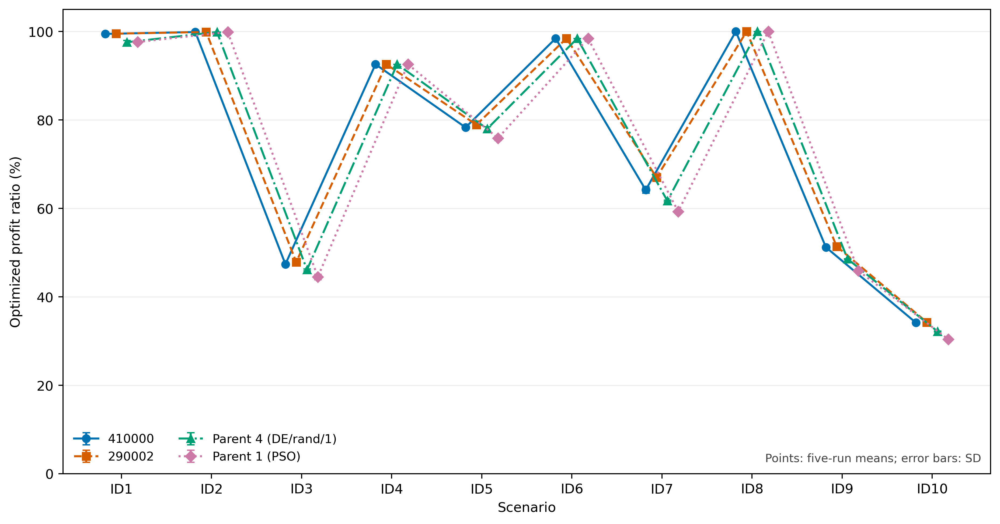
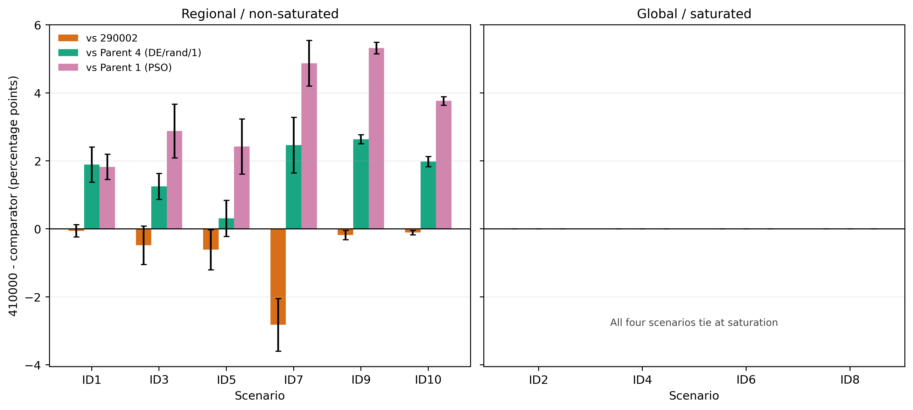

# 原生 perRun 五轮配对消融证据

## 研究问题

本实验回答三个预先定义的问题：`410000={4,1,0,0,0,0}` 是否优于 Parent 4（DE/rand/1）和 Parent 1（PSO），以及它与 `290002={2,9,0,0,0,2}` 的差异。`profitRatio` 越高越好。

## 协议与完整性

- 场景：ID1–ID10；每场景运行原生 `perRun=0..4`，对应有效 index 9–13。
- 配置：`410000`、`290002`、Parent 4、Parent 1。
- 配对：同一 `(scene, perRun)` 的四个配置使用同一最终 seed。
- 运行：`Normal` 优先级，28 个逻辑处理器，`autohyb.deterministic=true`。
- 验收：200/200 条完成，200 个唯一 `runKey`，0 次失败；50 个四配置配对组中 seed、配置和有效 index 错配均为 0。
- 手动复现锚点：ID1 的 `perRun+4` 使用 effective index 13 和 seed `1103879922877097657`，`410000` 得到 `99.64%`。

规范数据见 [data.csv](data.csv)，运行合同与散列见 [manifest.json](manifest.json)。

## 描述性结果

下表按 10 个场景的五次均值做宏平均。Scene SD 描述不同场景之间的离散程度，不是同场景五次运行的误差。

| 配置 | 宏平均（%） | Scene SD | 平均耗时（s） |
|---|---:|---:|---:|
| `410000` | 76.5608 | 25.3926 | 24.7740 |
| `290002` | 76.9880 | 25.1616 | 23.1648 |
| Parent 4（DE/rand/1） | 75.5082 | 26.1660 | 29.8446 |
| Parent 1（PSO） | 74.4530 | 27.1370 | 33.2892 |

## 预先定义对比

差值均为 `410000 - comparator`，单位为百分点（pp）。主检验使用 10 个场景五次均值的双侧 exact Wilcoxon signed-rank test；Holm 校正覆盖以下三个对比。均值区间为按场景重采样 100,000 次的 percentile bootstrap 95% CI。

### `410000` 与 `290002`

- 宏平均差为 `-0.4272 pp`，95% CI `[-1.0046, -0.0650]`；中位差为 `-0.0840 pp`。
- 场景胜/平/负为 `0/4/6`；`W=0`，raw `p=0.03125`，Holm `p=0.09375`，rank-biserial `r=-1.0`。
- 6 个 Regional 非饱和场景全部较低，平均差 `-0.7120 pp`；4 个 Global 饱和场景全部并列。
- 结论：`290002` 的数值结果更好，但三重比较校正后未达到 `α=0.05`。

### `410000` 与 Parent 4（DE/rand/1）

- 宏平均差为 `+1.0526 pp`，95% CI `[+0.4176, +1.7136]`；中位差为 `+0.7790 pp`。
- 场景胜/平/负为 `6/4/0`；`W=0`，raw `p=0.03125`，Holm `p=0.09375`，rank-biserial `r=+1.0`。
- 6 个 Regional 场景全部提高，平均差 `+1.7543 pp`；4 个 Global 场景全部并列。
- 结论：方向一致且效应不小，但不能写成 Holm 校正后显著优于。

### `410000` 与 Parent 1（PSO）

- 宏平均差为 `+2.1078 pp`，95% CI `[+0.9090, +3.3636]`；中位差为 `+2.1230 pp`。
- 场景胜/平/负为 `6/4/0`；`W=0`，raw `p=0.03125`，Holm `p=0.09375`，rank-biserial `r=+1.0`。
- 6 个 Regional 场景全部提高，平均差 `+3.5130 pp`；4 个 Global 场景全部并列。
- 结论：这是三个对比中最大的实际差异，但仍受相同的多重比较边界约束。

## 耗时结果

- `410000` 的平均耗时比 Parent 4 少 `16.99%`，比 Parent 1 少 `25.58%`。
- `410000` 比 `290002` 的总平均耗时多 `6.95%`。它在 10 个场景中的 7 个更快，但 ID7、ID9、ID10 更慢；高耗时的大场景使总体均值反转。
- 因此，Parent 消融同时支持收益和平均耗时优势；与 `290002` 的耗时关系具有明显规模异质性。

## 统计边界

- 四配置的 Friedman omnibus test 为 `χ²(3)=17.00, p=0.000707`，说明至少存在一个条件差异；它不判定具体哪一对不同。
- 三组差值的 Shapiro-Wilk `p` 分别为 `0.0000178`、`0.0262` 和 `0.0967`。前两组不满足正态性，且样本只有 10 个场景并含 4 个饱和并列，因此统一使用预先指定的非参数配对检验。
- 三个 raw Wilcoxon `p` 均为 `0.03125`，Holm 校正后均为 `0.09375`。bootstrap CI 给出差异大小和方向，不替代 family-wise 假设检验。
- 推断单位是场景，不是 50 条重复运行。结论只覆盖当前 10 个场景、当前预算、当前源码和原生 seed 序列。

## 图与解读

### Figure 1：场景收益均值

- 用途：同时展示四配置在全部场景的绝对收益水平和五次运行波动。
- 观察：Global 场景 ID2/4/6/8 四配置重合；Regional 场景中 `290002` 最高，`410000` 高于两个 Parent。
- 含义：方法差异集中在未饱和场景。饱和场景只能证明不退化，不能提供区分算法的统计信息。
- 图注要求：点为五次均值，误差条为五次运行 SD，纵轴从 0% 开始。

### Figure 2：场景级配对差值

- 用途：隔离 `410000` 相对三个对照的效应方向，并区分 Regional 与 Global 场景。
- 观察：Regional 场景中，对 `290002` 的六个差值均为负，对两个 Parent 的六个差值均为正；Global 场景全部为 0。
- 含义：`410000` 的混合结构对单 Parent 有一致优势，但 `290002` 在当前未饱和场景上仍占优。
- 图注要求：柱为五个配对 seed 的平均差，误差条为配对差值 SD，正值表示 `410000` 更高。

SVG 版本：[Figure 1](figures/figure-01-scene-profit-means.svg)；[Figure 2](figures/figure-02-paired-deltas.svg)。

## 论文第五次取值核对

以下只用于后续 Tab. IV 的既定“第五次结果”口径，不替代五次统计。

| 场景 | `410000` 的 `perRun+4`（%） |
|---|---:|
| ID1 | 99.64 |
| ID2 | 99.89 |
| ID3 | 47.57 |
| ID4 | 92.59 |
| ID5 | 78.20 |
| ID6 | 98.44 |
| ID7 | 64.61 |
| ID8 | 100.00 |
| ID9 | 51.30 |
| ID10 | 34.21 |

## 文件索引

- [data.csv](data.csv)：本次分析使用的 200 条 canonical 运行数据。
- [manifest.json](manifest.json)：Git HEAD、源码与 class 散列、seed 合同、运行资源、输入和派生文件 SHA256。
- [运行期统计摘要](../../../../outputs/paired-native-perrun0-4-10scene-20260724-r01/analysis-summary.json)：分析脚本生成的完整机器可读统计。
- 分析脚本：`scripts/analyze_native_paired_ablation.py`。

