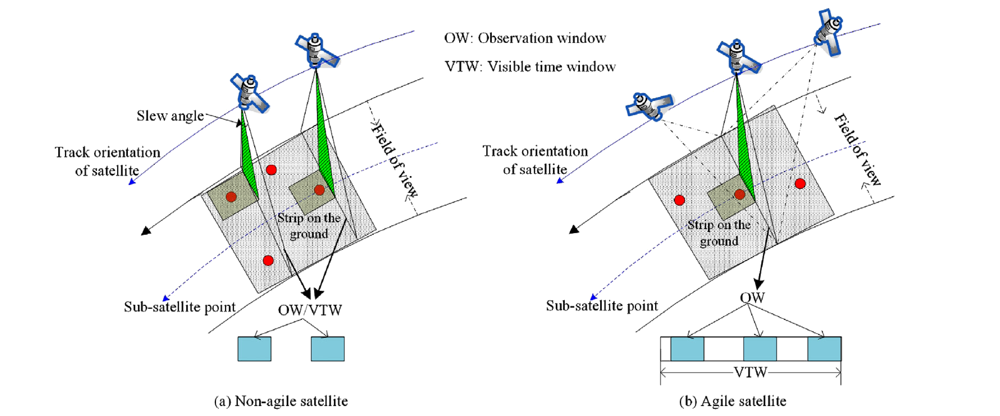
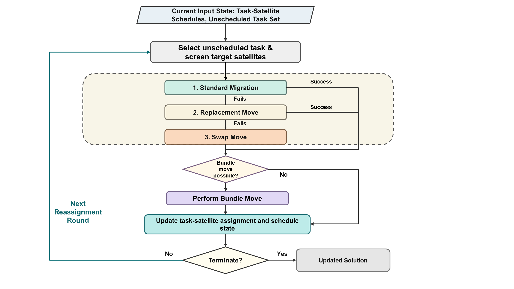

# A Random-Key Hybrid Metaheuristic Algorithm with Dynamic Task Reassignment for Large-Scale Multi-Satellite Scheduling

**Authors**—Haiwei Lei, Xiang Lin, Lei He*, and Yingwu Chen*

**Affiliation**—College of Systems Engineering, National University of Defense Technology, Changsha 410073, China.

**Corresponding authors**—Lei He and Yingwu Chen.

**Abstract**—The large-scale agile earth observation satellite task scheduling problem (LS-AEOSTSP) has received increasing attention because it directly affects the utilization of growing satellite constellations in time-sensitive earth observation missions. The problem is difficult due to its NP-hard nature and large  scale nature. This paper proposes a Random-Key Hybrid Metaheuristic Algorithm (RK-HMA) with dynamic task reassignment for solving LS-AEOSTSP. RK-HMA employs a random-key continuous encoding scheme to transform the discrete scheduling problem into a continuous optimization problem, and adopts a sequential hybrid strategy combining Differential Evolution (DE/rand/1) and Particle Swarm Optimization (PSO) to co-evolve a unified population. For multi-satellite coordination, a dynamic task reassignment layer with four complementary migration strategies—standard migration, replacement move, swap move, and bundle move—iteratively adjusts task-satellite assignments. Experiments on ten benchmark instances ranging from 500 to 10,000 tasks with 5 to 100 satellites demonstrate that RK-HMA achieves the best or tied-best profit rate across all scenarios, improving profit rate by up to 24.10% over the compared baselines.

*Index Terms*—Multi-satellite scheduling, hybrid metaheuristic algorithm, dynamic task reassignment, random-key encoding, differential evolution, particle swarm optimization.

# I. INTRODUCTION

Agile earth observation satellites (AEOS) with high attitude maneuverability have become one of the most important platforms for acquiring space-based information, and are widely used in military, civil, economic, and scientific applications [1][2]. Over the past two decades, the number of earth observation satellites (EOS) in orbit has grown rapidly. Wang et al. [1] reported that AEOS scheduling has been actively studied since the early 2000s, driven by the deployment of increasingly agile platforms such as Pléiades, WorldView, and Jilin-1. Du et al. [3] noted that the growing number of satellites and observation requests has made large-scale multi-satellite scheduling a practical challenge. Wu et al. [4] reported that real-world scheduling instances have grown from hundreds to tens of thousands of tasks across dozens of satellites, far exceeding the capacity of exact methods. Similar scaling pressure is also emerging in other satellite resource scheduling problems, such as coalition-game beam scheduling for LEO satellites in mega hybrid constellations [21] and event-triggered emergency scheduling for space surveillance networks [25]. Efficient scheduling is thus needed to manage large constellations and maximize fulfilled observation requests.

The LS-AEOSTSP is harder than the classic EOSTSP. As illustrated in Fig. 1, unlike conventional EOS that can only observe targets directly below their ground track, AEOS can rotate along the roll, pitch, and yaw axes to steer their imaging payloads toward off-nadir targets. This three-axis maneuverability enlarges the set of visible time windows (VTWs) for each task, but introduces time-dependent attitude transition constraints between consecutive observations. As constellations scale to tens or hundreds of satellites, the joint decision space—task-satellite assignment, VTW selection, and start time determination—grows combinatorially, making exact methods intractable for practical instances [4][5][6].

```{=latex}
\begin{center}
```


**Fig. 1.** Comparison of observation modes between non-agile EOS and AEOS[7].
```{=latex}
\end{center}
```

Metaheuristic algorithms are widely used for the AEOSTSP. Among them, adaptive large neighborhood search (ALNS) and its variants are well studied. Liu et al. [7] proposed an ALNS with problem-specific removal and insertion operators for single-satellite scheduling under time-dependent transition times. He et al. [8] introduced a dynamic task allocation mechanism for multi-satellite scenarios. Peng et al. [6] developed a greedy randomized iterated local search that exploits the time-dependent profit structure of AEOSTSP. Li et al. [9] designed a neighborhood search algorithm with shake and repair operators tailored for interval-varying profits. Wu et al. [29] further developed a two-stage ALNS framework for scheduling multiple super-agile satellites. Wu et al. [22] proposed a frequent pattern-based parallel search approach for time-dependent AEOS scheduling. Population-based evolutionary algorithms have also been applied. Yao et al. [10] proposed a bilevel evolutionary algorithm for large-scale multiobjective task scheduling. Qin et al. [11] combined simulated annealing with a genetic algorithm for multisatellite scheduling of moving targets. Wang et al. [12] designed a strategy fusion-based multi-objective optimization approach. Zhou et al. [31] modeled marginal decreasing imaging duration and solved the multi-satellite scheduling problem with an adaptive ant colony algorithm, while Shang et al. [30] considered joint observation and transmission scheduling with energy constraints. However, most existing methods rely on a single algorithmic paradigm, limiting the balance between exploration and exploitation in the LS-AEOSTSP search space [1].

A second line of work combines machine learning (ML) with metaheuristics. He et al. [13] formulated the AEOSTSP as a Markov decision process and applied deep reinforcement learning (DRL) to learn construction heuristics. Chen et al. [14] proposed a DRL-based model that learns to construct solutions for single-satellite scheduling with time-dependent transition times. Song et al. [15] embedded Q-learning into a genetic algorithm for electromagnetic detection satellite scheduling. Wu et al. [32] designed a data-driven improved genetic algorithm for AEOS scheduling with time-dependent transition time. Song et al. [33] proposed a generalized model and DRL-based evolutionary method for multitype satellite observation scheduling, and later studied an RL-based memetic algorithm for energy-efficient satellite range scheduling [34]. At the broader method level, DRL has been used for adaptive operator selection in evolutionary multi-objective optimization [36] and for hybridizing evolutionary algorithms with DRL in multiobjective orienteering optimization [37]. Reinforcement-driven search has also been used outside AEOS, such as reinforcement search for cooperative UAV task assignment [26] and reinforcement learning level-based PSO for large-scale optimization [27]. Zhu et al. [23] further used a deep Q-network to guide a genetic algorithm with local intensification for AEOS scheduling. Li et al. [24] optimized the time-dependent multi-AEOS scheduling problem using deep Q-learning and ensemble heuristics. More recently, Wu et al. [4] proposed DRL-PASA, a deep reinforcement learning-based parallel adaptive search algorithm that adopts a divide-and-conquer framework: a deep Q-network adaptively selects task allocation strategies in the first phase, while a frequent pattern-based adaptive local search procedure optimizes single-satellite schedules in the second phase. DRL-PASA demonstrated competitive performance on large-scale instances. However, DRL-based methods generally face several practical limitations: (i) they require substantial training data and computational resources for offline training, (ii) they exhibit poor generalization to unseen instance distributions, (iii) the learned policies lack interpretability, and (iv) the training process must be repeated when problem characteristics change significantly.


Hybrid metaheuristic algorithms, which combine the strengths of multiple search strategies within a unified framework, are effective for combinatorial optimization. Blum et al. [16] surveyed hybrid metaheuristic paradigms, categorizing them into sequential, parallel, and embedded hybridization schemes, and demonstrated that hybridization consistently improves solution quality over standalone algorithms. In the domain of scheduling, Fan et al. [17] proposed a hybrid evolutionary algorithm using two solution representations for hybrid flow-shop scheduling, outperforming single-representation approaches. Shu et al. [18] integrated variable neighborhood search with NSGA-II for emergency material scheduling, balancing solution diversity and convergence. For satellite scheduling specifically, Rocha et al. [19] studied the integrated agile earth observation satellite scheduling problem and designed a hybrid algorithm combining a MIP solver with a heuristic procedure, obtaining improved solutions on 29 out of 32 benchmark instances. These results support the use of hybrid algorithms for task scheduling.

We propose the Random-Key Hybrid Metaheuristic Algorithm with Dynamic Task Reassignment (RK-HMA) for the LS-AEOSTSP. Unlike DRL-based approaches that require offline training, RK-HMA can be directly applied to benchmark instances of varying scales without any training phase. RK-HMA adopts a divide-and-conquer framework, decomposing the problem into single-satellite optimization and multi-satellite task reassignment. Related multisatellite observation scheduling studies have also combined metaheuristic and exact search within a divide-and-conquer framework [35]. This decomposition follows the multilevel decision-making view that complex decisions can be separated into interacting levels with different decision scopes [28]. For single-satellite optimization, a hybrid metaheuristic combining DE/rand/1 and PSO is designed to co-evolve a unified population under random-key continuous encoding. For multi-satellite coordination, four complementary migration strategies are designed to iteratively reassign tasks across satellites.

The main contributions of this paper are summarized as follows:

1) We propose the RK-HMA for solving the LS-AEOSTSP, which employs a random-key continuous encoding scheme to transform the discrete scheduling problem into a continuous optimization problem. This encoding enables the direct application of arbitrary continuous-domain metaheuristics without problem-specific operator design. A sequential hybrid strategy combining DE/rand/1 and PSO is adopted as an effective instantiation, where PSO operates on the DE-improved population to ensure monotonic quality improvement within each generation.

2) We design a dynamic task reassignment mechanism with four complementary migration strategies: standard migration, replacement move, swap move, and bundle move. During reassignment, candidate target satellites are filtered by a bounded top-k screening rule: all eligible satellites are scored once by a low-cost heuristic, and only the retained top-k candidates are passed to downstream migration trials. These strategies are attempted progressively from simple to complex, balancing success rate and computational overhead.

3) We conduct extensive experiments on ten benchmark instances with scales ranging from 500 to 10,000 tasks and 5 to 100 satellites. Results demonstrate that RK-HMA significantly outperforms R-ALNS, A-ALNS, and DRL-PASA, especially on large-scale scenarios with regional task distribution. Ablation studies validate the contribution of each component.

The remaining sections are organized as follows. Section II presents a mathematical model for the LS-AEOSTSP. Section III introduces the proposed RK-HMA in detail. Section IV presents experimental results. Finally, Section V concludes this paper.

# II. PROBLEM DESCRIPTION

## A. Problem Description

Consider a scheduling horizon during which a set of $n$ observation tasks $\mathcal{T} = \{\tau_1, \tau_2, \ldots, \tau_n\}$ must be assigned to a constellation of $m$ agile satellites $\mathcal{S} = \{s_1, s_2, \ldots, s_m\}$. Each task $\tau_i$ is characterized by a geographic location (latitude and longitude), an imaging duration $d_i^{\text{img}}$, a profit $r_i$, and a specified minimum imaging quality $c_i$. Each satellite $s_j$ is described by its orbital elements (semi-major axis, eccentricity, inclination, right ascension of ascending node, argument of perigee, and true anomaly). Through orbit propagation and access analysis, the set of visible time windows (VTWs) for each task-satellite pair can be computed. Let $\omega_{ijk}$ denote the $k$-th VTW of task $\tau_i$ on satellite $s_j$, with start time $\alpha_{ijk}$, end time $\beta_{ijk}$, and duration $\lambda_{ijk} = \beta_{ijk} - \alpha_{ijk}$. The satellite attitude is described by three Euler angles: roll $\theta_{jt}^R$, pitch $\theta_{jt}^P$, and yaw $\theta_{jt}^Y$ at time $t$. The notations used throughout this paper are summarized in Tab. I.

Since the number of tasks typically far exceeds the observation capacity of the constellation, it is generally infeasible to execute all tasks. The LS-AEOSTSP aims to select a subset of tasks and determine their observation times within the corresponding VTWs so as to maximize the total collected profit, subject to the following assumptions:

1) Each task is an atomic observation request that can be directly executed by a satellite. Complex tasks such as area coverage or moving target tracking are assumed to have been decomposed into atomic tasks via strip partitioning prior to scheduling.

2) Energy and onboard storage constraints are not explicitly modeled, as satellites recharge through solar panels and periodically downlink data to ground stations or relay satellites during normal operations.

3) Each satellite carries a single imaging sensor, so at most one task can be executed at any given time.

4) Task execution is non-preemptive: once started, an observation cannot be interrupted, and each task is observed at most once across the entire constellation.

```{=latex}
\begin{center}
```
**TABLE I: NOTATION FOR LS-AEOSTSP.**
```{=latex}
\end{center}
```

| Notation | Description |
|----------|-------------|
| $\mathcal{T}$ | Set of observation tasks |
| $n$ | Number of tasks |
| $\mathcal{S}$ | Set of satellites |
| $m$ | Number of satellites |
| $r_i$ | Profit of task $\tau_i$ |
| $d_i^{\text{img}}$ | Imaging duration of task $\tau_i$ |
| $\theta_{jt}^R$ | Roll angle of satellite $s_j$ at time $t$ |
| $\theta_{jt}^P$ | Pitch angle of satellite $s_j$ at time $t$ |
| $\theta_{jt}^Y$ | Yaw angle of satellite $s_j$ at time $t$ |
| $\omega_{ijk}$ | $k$-th VTW for task $\tau_i$ on satellite $s_j$ |
| $\Omega_{ij}$ | Set of VTWs for task $\tau_i$ on satellite $s_j$ |
| $|\Omega_{ij}|$ | Number of VTWs for task $\tau_i$ on satellite $s_j$ |
| $\alpha_{ijk}$ | Opening time of $\omega_{ijk}$ |
| $\beta_{ijk}$ | Closing time of $\omega_{ijk}$ |
| $\lambda_{ijk}$ | Duration of $\omega_{ijk}$ |
| $c_i$ | Specified minimum imaging quality of task $\tau_i$ |
| $q_i$ | Imaging quality of task $\tau_i$ |
| $w_{ijk}^{*}$ | Midpoint of $\omega_{ijk}$ |

Two types of decision variables are defined. The binary variable $x_{ijk} \in \{0, 1\}$ indicates whether task $\tau_i$ is scheduled in VTW $\omega_{ijk}$ ($x_{ijk} = 1$) or not ($x_{ijk} = 0$). The continuous variable $b_{ijk}$ specifies the observation start time of task $\tau_i$ when $x_{ijk} = 1$.

The mathematical formulation of the LS-AEOSTSP is as follows:

**Objective function:**

$$
\max \sum_{i=1}^{n} \sum_{j=1}^{m} \sum_{k=1}^{|\Omega_{ij}|} x_{ijk} \, r_i \tag{1}
$$

The objective is to maximize the total profit collected from all scheduled observations.

**Constraints:**
$$
\sum_{j=1}^{m} \sum_{k=1}^{|\Omega_{ij}|} x_{ijk} \leq 1, \quad \forall \tau_i \in \mathcal{T} \tag{2}
$$

$$
\alpha_{ijk} \leq b_{ijk} \leq \beta_{ijk} - d_i^{\text{img}}, \quad \text{if } x_{ijk} = 1 \tag{3}
$$

$$
\sigma_{ijk,i'jk'} = \begin{cases} 1 & \text{if } \tau_i \text{ directly precedes } \tau_{i'} \text{ on } s_j \\ 0 & \text{otherwise} \end{cases}, \quad \text{if } x_{ijk} = x_{i'jk'} = 1 \tag{4}
$$

$$
b_{ijk} + d_i^{\text{img}} + T^{\text{trans}}(\tau_i, \tau_{i'}) \leq b_{i'jk'}, \quad \text{if } \sigma_{ijk,i'jk'} = 1 \tag{5}
$$

$$
T^{\text{trans}}(\tau_i, \tau_{i'}) = \begin{cases} 11.66 & \Delta\Theta \leq 10^\circ \\ c_1 + \Delta\Theta / v_1 & 10^\circ < \Delta\Theta \leq 30^\circ \\ c_2 + \Delta\Theta / v_2 & 30^\circ < \Delta\Theta \leq 60^\circ \\ c_3 + \Delta\Theta / v_3 & 60^\circ < \Delta\Theta \leq 90^\circ \\ c_4 + \Delta\Theta / v_4 & \Delta\Theta > 90^\circ \end{cases} \tag{6}
$$

$$
\Delta\Theta(\tau_i, \tau_{i'}) = |\theta^R_{b_i} - \theta^R_{b_{i'}}| + |\theta^P_{b_i} - \theta^P_{b_{i'}}| + |\theta^Y_{b_i} - \theta^Y_{b_{i'}}|, \quad \text{if } \sigma_{ijk,i'jk'} = 1 \tag{7}
$$

$$
q_i \geq c_i, \quad \forall \tau_i \in \mathcal{T} \tag{8}
$$

$$
q_i = 10 - 9 \cdot \frac{|2b_{ijk} + d_i^{\text{img}} - 2w_{ijk}^{*}|}{\lambda_{ijk} - d_i^{\text{img}}}, \quad \text{if } x_{ijk} = 1 \tag{9}
$$

$$
w_{ijk}^{*} = \frac{\alpha_{ijk} + \beta_{ijk}}{2}, \quad \text{if } x_{ijk} = 1 \tag{10}
$$

Constraint (2) ensures that each task is observed at most once across all satellites. Constraint (3) guarantees that the observation must start and finish within the selected VTW. Constraint (5) enforces that consecutive tasks on the same satellite must be separated by a sufficient transition time $T^{\text{trans}}$, which accounts for the attitude maneuver required to slew between two observation geometries. The transition time is a piecewise linear function of the total angular displacement $\Delta\Theta$ between the two tasks, as defined in Eq. (6). The angular displacement $\Delta\Theta$ is computed as the sum of absolute differences in roll, pitch, and yaw angles at the respective observation start times, as given in Eq. (7). Following [6], the parameters are set to $v_1 = 1.5^\circ/\text{s}$, $c_1 = 5$, $v_2 = 2^\circ/\text{s}$, $c_2 = 10$, $v_3 = 2.5^\circ/\text{s}$, $c_3 = 16$, $v_4 = 3^\circ/\text{s}$, and $c_4 = 22$. Constraint (8) requires the imaging quality of each executed task to be no lower than the specified threshold $c_i$. The imaging quality $q_i$ depends on the position of the observation start time within the selected VTW: observations scheduled closer to the midpoint of the VTW yield higher quality, as defined by Eqs. (9) and (10).

# III. RK-HMA FOR LS-AEOSTSP

The LS-AEOSTSP is NP-hard since it contains the classic EOSTSP as a special case [5][20]. In the multi-satellite setting, the problem involves two coupled decision dimensions: task-satellite assignment ($m^n$ possible allocations) and task sequencing on each satellite ($n_j!$ permutations per satellite). The total search space is $O(n! \times m^n)$, which grows explosively with the number of tasks and satellites. Three key characteristics make this problem particularly challenging:

1) **Constraint coupling**: Time window constraints, attitude transition constraints, and single-execution constraints are tightly coupled, making feasibility verification computationally expensive.

2) **Dynamic interdependence**: The quality of task allocation depends on the scheduling result of each satellite, but the scheduling result in turn depends on which tasks are allocated. This mutual dependence makes static allocation strategies inherently suboptimal.

3) **Scalability barrier**: As the number of tasks and satellites increases, the solution space grows exponentially, requiring algorithms that can efficiently balance solution quality and computational cost.

We address these challenges with the Random-Key Hybrid Metaheuristic Algorithm (RK-HMA), which combines a continuous-domain hybrid optimizer with dynamic cross-satellite task reassignment in a divide-and-conquer framework.

## A. Framework of RK-HMA

The framework and pseudocode of the proposed RK-HMA are shown in Fig. 2 and Algorithm 1, respectively. RK-HMA follows a three-layer workflow composed of initial task allocation, single-satellite hybrid optimization, and cross-satellite dynamic reassignment.

RK-HMA first constructs an initial task-satellite assignment through the procedure in Section III-B. Then, each satellite optimizes its allocated task subset by the hybrid metaheuristic algorithm in Section III-C to obtain an initial feasible schedule. During each reassignment round, RK-HMA first checks whether unscheduled tasks still exist. If so, and if the reassignment stop conditions are not met, the dynamic reassignment module in Section III-D is invoked to perform standard migration, replacement move, swap move, and bundle move. After the reassignment loop finishes, all satellites are re-optimized in parallel by a full HMA run, and the current global solution is updated. The optimization-reassignment loop continues until the maximum reassignment rounds are reached, and the best global solution is returned.

```{=latex}
\begin{center}
```


**Fig. 2.** Framework of the proposed RK-HMA.
```{=latex}
\end{center}
```

Fig. 2 gives the structural view of RK-HMA, while Algorithm 1 summarizes the corresponding execution order. The figure separates the multi-satellite reassignment layer from the parallel single-satellite HMA layer. The pseudocode then makes the control flow explicit: initialization first constructs task subsets, HMA optimizes each satellite schedule, reassignment repairs unscheduled tasks across satellites, and a final HMA pass refines the returned global schedule.

```{=latex}
\begin{center}
\begin{minipage}{0.97\linewidth}
\small
\textbf{Algorithm 1: RK-HMA}\\
\textbf{Input:} Task set $\mathcal{T}$, satellite set $\mathcal{S}$, maximum reassignment rounds $R_{\max}$\\
\textbf{Output:} Best found solution $X^b$\\[2pt]
\begin{tabbing}
\hspace{1.4em}\=\hspace{1.6em}\=\hspace{1.6em}\=\hspace{1.6em}\=\kill
1:\> Initialize algorithm parameters\\
2:\> $assignment \leftarrow \textsc{InitialAssignment}(\mathcal{T}, \mathcal{S})$\\
3:\> $reassignRound \leftarrow 0$\\
4:\> $zeroGainRounds \leftarrow 0$\\
5:\> \textbf{for each} satellite $s \in \mathcal{S}$ \textbf{do}\\
6:\> \> $s.schedule \leftarrow \textsc{HMA}(s.tasks)$\\
7:\> \textbf{end for}\\
8:\> $X \leftarrow \textsc{GetGlobalSolution}(\mathcal{S})$\\
9:\> $X^b \leftarrow X$\\
10:\> \textbf{for} $r = 1$ \textbf{to} $R_{\max}$ \textbf{do}\\
11:\> \> $\mathcal{U} \leftarrow \textsc{CollectUnscheduled}(\mathcal{S})$\\
12:\> \> \textbf{if} $\mathcal{U} = \varnothing$ \textbf{then}\\
13:\> \> \> \textbf{break}\\
14:\> \> \textbf{end if}\\
15:\> \> \textbf{if} $reassignRound \geq R_{\max}$ \textbf{or} $zeroGainRounds \geq 2$ \textbf{then}\\
16:\> \> \> \textbf{break}\\
17:\> \> \textbf{end if}\\
18:\> \> $X_{\mathrm{before}} \leftarrow X$\\
19:\> \> $\textsc{DynamicReassignment}(\mathcal{U}, \mathcal{S})$\\
20:\> \> $reassignRound \leftarrow reassignRound + 1$\\
21:\> \> $X \leftarrow \textsc{GetGlobalSolution}(\mathcal{S})$\\
22:\> \> \textbf{if} $F(X) > F(X_{\mathrm{before}})$ \textbf{then}\\
23:\> \> \> $zeroGainRounds \leftarrow 0$\\
24:\> \> \textbf{else}\\
25:\> \> \> $zeroGainRounds \leftarrow zeroGainRounds + 1$\\
26:\> \> \textbf{end if}\\
27:\> \textbf{end for}\\
28:\> \textbf{for each} satellite $s \in \mathcal{S}$ \textbf{do}\\
29:\> \> $s.schedule \leftarrow \textsc{HMA}(s.tasks)$\\
30:\> \textbf{end for}\\
31:\> $X \leftarrow \textsc{GetGlobalSolution}(\mathcal{S})$\\
32:\> \textbf{if} $F(X) \geq F(X^b)$ \textbf{then}\\
33:\> \> $X^b \leftarrow X$\\
34:\> \textbf{end if}\\
35:\> \textbf{return} $X^b$\\
\end{tabbing}
\end{minipage}
\end{center}
```

Algorithm 1 shows how RK-HMA combines initialization, single-satellite optimization, and multi-satellite reassignment. The initialization stage provides a high-quality starting allocation, the reassignment loop then targets remaining unscheduled tasks through progressive cross-satellite migration, and a final HMA stage fully re-optimizes all single-satellite schedules through sequential DE/rand/1 and PSO evolution. This ordering makes the coordination logic explicit: reassignment is used to repair task allocation first, and full HMA optimization is applied afterward to refine the final per-satellite schedules.

## B. Initial Solution Construction Procedure

The initial task allocation adopts a two-phase composite strategy to produce high-quality starting solutions.

**Phase 1: Capacity-Aware Composite Allocation.** In the implementation used in our experiments, the default initialization adopts a capacity-aware composite assignment strategy. For each task $\tau_i$ and candidate satellite $s_j$, a normalized composite score is computed:

$$
\text{Score}(\tau_i, s_j) = \tilde{w}_{\lambda} \cdot \hat{\lambda}_{ij} + w_{\Omega} \cdot \hat{\Omega}_{ij} + \tilde{w}_{b} \cdot \hat{b}_{j} - w_{f} \cdot \hat{f}_{ij} \tag{11}
$$

where $\hat{\lambda}_{ij}$ is the normalized usable window length, $\hat{\Omega}_{ij}$ is the normalized number of feasible VTWs, $\hat{b}_{j}$ is the normalized load-balance score of satellite $s_j$, and $\hat{f}_{ij}$ is the normalized time-window conflict score between $\tau_i$ and the tasks already allocated to $s_j$. To favor scarce tasks, the window-length and load-balance terms are adaptively adjusted by the scarcity factor $\rho_i = 1 / |C_i|$, where $|C_i|$ is the number of candidate satellites for task $\tau_i$:

$$
\tilde{w}_{\lambda} = w_{\lambda}(1 + \beta \rho_i), \qquad \tilde{w}_{b} = w_{b}(1 - \beta \rho_i)
$$

The concrete values of $w_{\lambda}$, $w_{\Omega}$, $w_{b}$, $w_{f}$, and $\beta$ are reported with the other experimental parameters in Table III. In the capacity-aware variant, this composite score is further multiplied by a soft capacity penalty to discourage early overload on already crowded satellites.

Tasks are prioritized for allocation as follows: tasks with only one candidate satellite are allocated first (forced allocation to avoid missing), and the remaining tasks are sorted by their profit $r_i$ in descending order. Each task is then assigned to the candidate satellite with the highest heuristic score.

**Phase 2: Fast Local Refinement.** After greedy decoding, tasks that remain unscheduled are sorted by profit in descending order. For each unscheduled task, migration to an alternative candidate satellite is attempted. The source satellite is only re-evaluated after a successful insertion on the target satellite. A migration is accepted if the net fitness gain is positive ($\Delta f > 0$). This phase refines the initial solution through localized adjustments.

## C. Hybrid Metaheuristic Algorithm (HMA)

### C.1 Random-Key Continuous Encoding

For the set of $n_j$ tasks allocated to satellite $s_j$, RK-HMA adopts a random-key representation for permutation-based optimization. Each individual in the population is represented as a real-valued vector $\mathbf{x} = [x_1, x_2, \ldots, x_{n_j}]$, where each $x_i$ serves as a ranking key rather than a direct scheduling time. The decoder uses only the relative order of the keys, so the numerical key interval is written as $[-u,u]$. The population is maintained as a matrix $\mathbf{X} \in \mathbb{R}^{N_{\text{pop}} \times n_j}$, where $N_{\text{pop}}$ is the population size and $n_j$ is the dimensionality.

Under this representation, the discrete task sequencing problem can be handled by continuous metaheuristic algorithms such as DE and PSO. The search operators update real-valued keys, while the decoder converts each key vector back into a task permutation before schedule construction.

**Example.** Given tasks $\{\tau_1, \tau_2, \tau_3, \tau_4\}$ with normalized example key vector $\mathbf{x} = [0.8, 0.3, 0.9, 0.5]$, sorting by key values in descending order yields the task sequence: $\tau_3 \rightarrow \tau_1 \rightarrow \tau_4 \rightarrow \tau_2$.

```{=latex}
\begin{center}
```


**Fig. 3.** Random-key representation and decoding of a single-satellite solution.
```{=latex}
\end{center}
```

### C.2 Greedy Insertion Decoding

Given a random-key vector $\mathbf{x} = [x_1, x_2, \ldots, x_{n_j}]$, the decoding procedure first sorts the tasks in descending order of their key values to obtain a task permutation, and then constructs a feasible schedule through greedy insertion:

1) Sort tasks by their random-key values in descending order to obtain the task sequence: $\tau_{\pi(1)}, \tau_{\pi(2)}, \ldots, \tau_{\pi(n_j)}$, where $x_{\pi(1)} \geq x_{\pi(2)} \geq \cdots \geq x_{\pi(n_j)}$

2) Initialize an empty schedule: $\text{schedule} = []$

3) For each task $\tau_{\pi(i)}$ in order:
   - Attempt insertion into each position of the current schedule
   - Check time window, transition time, and other constraints
   - Select the first feasible position for insertion
   - If no feasible position exists, mark the task as unscheduled

4) Return the schedule and the list of unscheduled tasks

The fitness of an individual is defined as the total profit of all scheduled tasks:

$$
f(\mathbf{x}) = \sum_{\tau_i \in \text{scheduled}} r_i \tag{12}
$$

The time complexity of the greedy insertion decoding is $O(n_j^2)$, where $n_j$ is the number of tasks allocated to satellite $s_j$.


### C.3 Population Initialization

The initial population $P^0 = \{\mathbf{x}_1, \mathbf{x}_2, \ldots, \mathbf{x}_{N_{\text{pop}}}\}$ is generated by sampling each random key $x_{ij}$ uniformly from the interval $[-u,u]$. This uniform random initialization ensures diversity in the initial task orderings. When a satellite is re-optimized during the reassignment loop and a previous best solution exists, the previous best individual is injected into the initial population to preserve accumulated search knowledge, while the remaining individuals are freshly randomized to maintain diversity.

### C.4 Sequential Hybrid Execution Mode

The HMA adopts a serial sequential hybrid strategy, where DE/rand/1 and PSO are executed sequentially within each generation. The key insight is that PSO operates on the DE-improved population rather than the original population, ensuring that the local exploitation of PSO always starts from a globally diversified search region.

```{=latex}
\begin{center}
\begin{minipage}{0.97\linewidth}
\small
\textbf{Algorithm 2: HMA for Single-Satellite Scheduling}\\
\textbf{Input:} Task subset $T_j$, population size $N_{pop}$, maximum HMA generations $G_{hma}$, DE parameters $(F, CR)$, PSO parameters $(w, c_1, c_2)$\\
\textbf{Output:} Best found single-satellite schedule $x^b$\\[2pt]
\begin{tabbing}
\hspace{1.4em}\=\hspace{1.6em}\=\hspace{1.6em}\=\hspace{1.6em}\=\kill
1:\> Initialize random-key population $P^0$ for $T_j$\\
2:\> Decode each individual in $P^0$ by greedy insertion and evaluate fitness\\
3:\> Initialize personal-best set $P^{best}$ and global-best solution $x^b$\\
4:\> \textbf{for} $t = 0$ \textbf{to} $G_{hma}-1$ \textbf{do}\\
5:\> \> \textit{Stage 1: DE/rand/1}\\
6:\> \> \textbf{for each} individual $x_i \in P^t$ \textbf{do}\\
7:\> \> \> Generate mutant vector $v_i$ by Eq. (13)\\
8:\> \> \> Generate trial vector $u_i$ by Eq. (14)\\
9:\> \> \> Decode $u_i$ and evaluate $f(u_i)$\\
10:\> \> \> \textbf{if} $f(u_i) \geq f(x_i^t)$ \textbf{then}\\
11:\> \> \> \> $x_i^{DE} \leftarrow u_i$\\
12:\> \> \> \textbf{else}\\
13:\> \> \> \> $x_i^{DE} \leftarrow x_i^t$\\
14:\> \> \> \textbf{end if}\\
15:\> \> \textbf{end for}\\
16:\> \> \textit{Stage 2: PSO}\\
17:\> \> Form DE-improved population $P_{\mathrm{DE}}^{t}$ from all survivors\\
18:\> \> \textbf{for each} individual $x_i^{DE} \in P_{\mathrm{DE}}^{t}$ \textbf{do}\\
19:\> \> \> Update velocity $v_i$ by Eq. (16)\\
20:\> \> \> Set $\hat{x}_i \leftarrow x_i^{DE} + v_i$\\
21:\> \> \> Decode $\hat{x}_i$ and evaluate $f(\hat{x}_i)$\\
22:\> \> \> \textbf{if} $f(\hat{x}_i) \geq f(x_i^{DE})$ \textbf{then}\\
23:\> \> \> \> $x_i^{t+1} \leftarrow \hat{x}_i$\\
24:\> \> \> \textbf{else}\\
25:\> \> \> \> $x_i^{t+1} \leftarrow x_i^{DE}$\\
26:\> \> \> \textbf{end if}\\
27:\> \> \> Update personal best of individual $i$\\
28:\> \> \textbf{end for}\\
29:\> \> Update global-best solution $x^b$\\
30:\> \textbf{end for}\\
31:\> \textbf{return} $x^b$\\
\end{tabbing}
\end{minipage}
\end{center}
```

At each generation $t$, the execution proceeds as follows:

**Stage 1 (DE/rand/1 — Global Exploration):**

For each individual $\mathbf{x}_i$ in the current population $P^t$:

*Mutation:*
$$
\mathbf{v}_i = \mathbf{x}_{r1} + F \cdot (\mathbf{x}_{r2} - \mathbf{x}_{r3}) \tag{13}
$$

where $r1, r2, r3$ are mutually exclusive random indices, and $F$ is the scaling factor.

*Crossover:*
$$
u_{ij} = \begin{cases} v_{ij} & \text{if } \text{rand}() < CR \text{ or } j = j_{\text{rand}} \\ x_{ij} & \text{otherwise} \end{cases} \tag{14}
$$

where $CR$ is the crossover probability and $j_{\text{rand}}$ is a randomly selected dimension.

*Selection:*
$$
\mathbf{x}_i^{DE} = \begin{cases} \mathbf{u}_i & \text{if } f(\mathbf{u}_i) \geq f(\mathbf{x}_i^t) \\ \mathbf{x}_i^t & \text{otherwise} \end{cases} \tag{15}
$$

The output of Stage 1 is the DE-improved population $P_{\text{DE}}^{t}$, which serves as the input to Stage 2 within the same generation.

**Stage 2 (PSO — Fast Convergence):**

The input to Stage 2 is the DE-improved population $P_{\text{DE}}^{t}$, not the original population $P^t$. For each individual $\mathbf{x}_i^{DE}$ in $P_{\text{DE}}^{t}$:

*Velocity update:*
$$
\mathbf{v}_i^{t+1} = w \cdot \mathbf{v}_i^t + c_1 \cdot r_1 \cdot (\mathbf{p}_i^{\text{best}} - \mathbf{x}_i^{DE}) + c_2 \cdot r_2 \cdot (\mathbf{g}^{\text{best}} - \mathbf{x}_i^{DE}) \tag{16}
$$

*Position update:*
$$
\hat{\mathbf{x}}_i = \mathbf{x}_i^{DE} + \mathbf{v}_i^{t+1} \tag{17}
$$

where $w$ is the inertia weight (linearly decreasing from $w_0$ to $w_{\text{final}}$), $c_1$ and $c_2$ are learning factors, $\mathbf{p}_i^{\text{best}}$ is the personal best position, and $\mathbf{g}^{\text{best}}$ is the global best position.

*Selection:*
$$
\mathbf{x}_i^{t+1} = \begin{cases} \hat{\mathbf{x}}_i & \text{if } f(\hat{\mathbf{x}}_i) \geq f(\mathbf{x}_i^{DE}) \\ \mathbf{x}_i^{DE} & \text{otherwise} \end{cases} \tag{18}
$$

The final output of generation $t$ is the population $P^{t+1}$, which becomes the input to the next generation's DE stage.

**Rationale for the DE + PSO combination.** The random-key encoding admits any continuous-domain optimizer; DE/rand/1 and PSO are chosen based on preliminary experiments because their search behaviors are complementary. DE/rand/1 introduces diversity through difference-based mutation among random individuals, enabling broad exploration. PSO leverages personal and global best information to converge quickly toward promising regions. By executing DE first and PSO second within each generation, the hybrid ensures that local exploitation always starts from a globally diversified population. The two-stage survival selection guarantees monotonic population quality improvement.

## D. Dynamic Task Reassignment Mechanism

### D.1 Triggering Condition

The reassignment is activated whenever unscheduled tasks still exist and the reassignment stop conditions are not met. Specifically, RK-HMA continues reassignment while the current reassignment round is below the maximum allowed number and the profit gain has not been zero for two consecutive rounds. In other words, reassignment is repeatedly executed as long as unscheduled tasks remain, the reassignment budget has not been exhausted, and recent reassignment attempts still produce benefit.

### D.2 Unscheduled Task Ranking

Before attempting migration, all unscheduled tasks are ranked by a composite score:

$$
\begin{aligned}
\text{Score}(\tau_i)
&= \gamma_p \cdot \frac{r_i}{r_{\max}}
+ \gamma_c \cdot \frac{|C_i|}{|C|_{\max}}
+ \gamma_{\Omega} \cdot \frac{|\Omega_i|}{|\Omega|_{\max}}
+ \gamma_{\xi} \cdot \xi_i.
\end{aligned}
\tag{19}
$$

where $r_i / r_{\max}$ is the normalized profit, $|C_i| / |C|_{\max}$ is the normalized number of candidate satellites, $|\Omega_i| / |\Omega|_{\max}$ is the normalized total number of VTWs, and $\xi_i$ is sampled from a uniform distribution between 0 and 1 using a fixed seeded random stream. The coefficients $\gamma_p$, $\gamma_c$, $\gamma_{\Omega}$, and $\gamma_{\xi}$ are the normalized collected weights reported in Table III.

This score is designed as a pre-migration priority rule rather than an absolute objective value. The profit term estimates the direct benefit of successfully repairing a task. The candidate-satellite and VTW terms estimate reassignment flexibility: a task with more compatible satellites or more visible windows has more chances to be inserted by the downstream migration strategies. The random term is kept small and is used to break ties among tasks with similar deterministic features. All deterministic components are normalized before weighting so that raw profit, candidate count, and window count do not dominate the ranking only because of scale differences. This design focuses the limited reassignment budget on tasks that are both valuable and likely to be repaired by cross-satellite migration.

### D.3 Lightweight Fixed-TopK Target-Satellite Screening

To control the cost of evaluating candidate satellites during reassignment, we use a bounded top-k candidate screening rule.

All eligible candidate satellites are scored once by a lightweight heuristic. For task $\tau_i$ and candidate satellite $s_j$, the screening score is

$$
S^{\ell}_{ij}
= \lambda^{\ell}_{p} P^{\ell}_{ij}
+ \lambda^{\ell}_{s} B^{\ell}_{j}
$$

The pair term $P^{\ell}_{ij}$ estimates the compatibility between task $\tau_i$ and candidate satellite $s_j$ before an expensive schedule reconstruction is attempted:

$$
P^{\ell}_{ij}
= \rho_{\mathrm{cnt}} \bar{w}^{\mathrm{cnt}}_{ij}
+ \rho_{\mathrm{len}} \bar{w}^{\mathrm{len}}_{ij}
+ \rho_{e} \bar{e}_{ij}
+ \rho_{\xi} \xi_{ij}
+ \delta^{\mathrm{fb}}_{ij},
$$

The terms $\bar{w}^{\mathrm{cnt}}_{ij}$ and $\bar{w}^{\mathrm{len}}_{ij}$ measure the normalized candidate-window count and total candidate-window length, respectively, indicating how many insertion opportunities the pair provides. The term $\bar{e}_{ij}$ is the earliest-start score and favors targets that can absorb the task earlier in the planning horizon. The random term $\xi_{ij}$ breaks ties among otherwise similar candidates, and the feedback term $\delta^{\mathrm{fb}}_{ij}$ records whether previous reassignment attempts for this task-satellite pair were useful. Acceptance rewards and rejection penalties for the feedback term are given in Table III.

The satellite term $B^{\ell}_{j}$ estimates whether the target satellite has enough remaining capacity:

$$
B^{\ell}_{j}
= \mu_{l} \bar{l}_{j}
+ \mu_{b} \bar{b}_{j}
+ \mu_{s} \bar{s}_{j}
+ \mu_{f} \bar{f}_{j},
$$

Here, $\bar{l}_{j}$, $\bar{b}_{j}$, $\bar{s}_{j}$, and $\bar{f}_{j}$ denote normalized load, backlog, historical-acceptance, and free-window-mass scores, respectively. They favor satellites with lower current pressure, fewer unresolved tasks, better recent reassignment success, and more usable time-window mass. When no target-selection attempt has been recorded for $s_j$, the historical-acceptance score uses the prior value reported in Table III. All four values are clipped to $[0,1]$ in implementation. The weighting coefficients are shared by all tasks and are reported in Table III.

A task is treated as prioritized when it belongs to the top $K_{\mathrm{rank}}^{\mathrm{task}}$ unscheduled tasks under Eq. (19) in the current reassignment round. After all eligible satellites are ranked by the screening score, only the top $K_{\mathrm{ordinary}}^{\mathrm{sat}}$ candidates are retained for ordinary tasks, and only the top $K_{\mathrm{priority}}^{\mathrm{sat}}$ candidates are retained for prioritized tasks. This top-k rule is used because scoring all eligible satellites is cheap, whereas downstream trial moves require schedule reconstruction. The screening stage therefore keeps the full-candidate ranking cost at $O(m)$ while restricting expensive migration trials to a small set of high-scoring target satellites.

After target screening, retained candidates are evaluated by a fast refine procedure. The current task order of the target satellite is used as an anchor: existing scheduled tasks keep their relative order, and only the newly added or temporarily affected tasks are inserted into a limited set of representative candidate positions $\mathcal{P}_{\mathrm{ref}}$. For each candidate order, the satellite schedule is reconstructed by the greedy insertion decoder. A local adjacent-swap pass is then applied around the inserted tasks to repair nearby ordering conflicts. This design keeps the reassignment trial local and cheap while still checking several distinct insertion regions in the sequence. The delta fitness is computed from the reconstructed schedule, and a trial move is accepted only when this local delta is positive.

### D.4 Reassignment Procedure

The overall reassignment proceeds as follows:

```{=latex}
\begin{center}
\begin{minipage}{0.97\linewidth}
\small
\textbf{Algorithm 3: Dynamic Reassignment}\\
\textbf{Input:} Unscheduled tasks $\mathcal{U}$, satellite set $\mathcal{S}$\\
\textbf{Output:} Updated task allocation\\[2pt]
\begin{tabbing}
\hspace{1.4em}\=\hspace{1.6em}\=\hspace{1.6em}\=\hspace{1.6em}\=\kill
1:\> Sort $\mathcal{U}$ by composite score in descending order\\
2:\> \textbf{for each} task $u \in \mathcal{U}$ \textbf{do}\\
3:\> \> $success \leftarrow \textsc{StandardMigration}(u, \mathcal{S})$\\
4:\> \> \textbf{if not} $success$ \textbf{then}\\
5:\> \> \> $success \leftarrow \textsc{ReplacementMove}(u, \mathcal{S})$\\
6:\> \> \textbf{end if}\\
7:\> \> \textbf{if not} $success$ \textbf{then}\\
8:\> \> \> $success \leftarrow \textsc{SwapMove}(u, \mathcal{S})$\\
9:\> \> \textbf{end if}\\
10:\> \> \textbf{if} $success$ \textbf{then}\\
11:\> \> \> Update task allocation and affected schedules\\
12:\> \> \textbf{end if}\\
13:\> \textbf{end for}\\
14:\> $remaining \leftarrow \textsc{CollectStillUnscheduled}(\mathcal{U})$\\
15:\> \textbf{if} $remaining \neq \varnothing$ \textbf{then}\\
16:\> \> $\textsc{BundleMove}(remaining, \mathcal{S})$\\
17:\> \textbf{end if}\\
\end{tabbing}
\end{minipage}
\end{center}
```

Algorithm 3 lists the decision order of the reassignment procedure, while Fig. 4 visualizes the same mechanism as a control-flow diagram. The pseudocode emphasizes the priority among migration trials: each unscheduled task first attempts standard migration, then replacement and swap moves if needed, and the remaining unresolved tasks are finally handled by bundle migration. The flowchart complements this description by showing the loop conditions, success checks, and update points in the reassignment module.

```{=latex}
\begin{center}
```
{width=88%}

**Fig. 4.** Flowchart of the dynamic task reassignment mechanism.
```{=latex}
\end{center}
```

### D.5 Migration Strategies

The reassignment mechanism applies four migration strategies in increasing order of intervention: direct insertion is attempted first, followed by replacement, swap, and bundle moves when simpler trials fail. This order favors low-cost and low-disruption repairs before invoking more complex schedule changes, reducing unnecessary schedule reconstruction while preserving opportunities for larger gains when simple migration is insufficient.

**Strategy 1: Standard Migration.** Standard migration attempts to move an unscheduled task $U$ to a candidate target satellite through the bounded top-k screening and fast refine procedure described in Section III-D.3.

For each trial target, the schedules of the affected satellites are reconstructed. Let $\mathcal{A}$ denote these affected satellites, including the target satellite and, when applicable, the source satellite. The local profit change is computed as

$$
\Delta f =
\sum_{s_j \in \mathcal{A}} \operatorname{profit}(P'_j)
-
\sum_{s_j \in \mathcal{A}} \operatorname{profit}(P_j),
$$

where $P_j$ and $P'_j$ are the schedules before and after the trial move. Unaffected satellites keep the same schedules, so this local difference is equivalent to the total-profit difference $f_{\mathrm{new}}-f_{\mathrm{old}}$. The migration is accepted only when $\Delta f>0$.

**Strategy 2: Replacement Move.** When standard migration fails, replacement move tries to create room on a target satellite by removing one scheduled task, or a small batch of scheduled tasks, and inserting $U$ into the reconstructed target schedule. Removed tasks are selected from low-profit or strongly overlapping candidates. Each replacement trial is evaluated by the same affected-satellite profit difference $\Delta f$, and the best positive trial is accepted.

**Strategy 3: Swap Move.** If replacement also fails, swap move relocates a scheduled task $X$ from the target satellite to a receiver satellite and inserts $U$ into the target satellite. The swap is accepted only when the reconstructed schedules yield $\Delta f>0$.

**Strategy 4: Bundle Move.** After individual migrations are attempted, bundle move groups remaining unscheduled tasks and migrates each group jointly. Unscheduled tasks are clustered by candidate-window start-time proximity, and each bundle is capped by $K_B$. Tasks are treated as time-neighboring when the absolute difference between their earliest candidate-window start times on same satellites is no larger than $\theta_B$. For each candidate satellite, the whole bundle is inserted and evaluated by the same affected-satellite profit difference $\Delta f$; the bundle is accepted only when this value is positive.

```{=latex}
\begin{center}
```
{width=74%}

**Fig. 5.** Illustration of the four migration strategies: standard migration, replacement move, swap move, and bundle move.
```{=latex}
\end{center}
```

# IV. EXPERIMENTAL RESULTS

To evaluate RK-HMA on the LS-AEOSTSP, the simulator introduced in [8] is used to generate multiple experimental scenarios. The proposed algorithm is implemented in Java and runs on a PC with Intel Core i7-14700kf CPU @ 3.40 GHz and 64-GB memory.

## A. Experimental Scenario

Ten experimental scenarios are generated, containing small-scale, medium-scale, large-scale, and superlarge-scale instances. In addition, a superlarge-scale scenario containing 10,000 tasks and 100 agile satellites is included, which is the largest scale of experimental data in the available public literature. The distribution is categorized into regional distribution and global distribution, where the region is set as $3^\circ\text{N} - 53^\circ\text{N}$ and $74^\circ\text{E} - 133^\circ\text{E}$. The specific details of each scenario are shown in Tab. II. The imaging duration of each task is a random integer between 1 and 30, and the priority (profit) of each task is a random integer between 1 and 10.

```{=latex}
\begin{table}[H]
\centering
\small
\renewcommand{\arraystretch}{1.02}
\setlength{\tabcolsep}{5.2pt}
\caption*{\textbf{TABLE II: EXPERIMENTAL SCENARIO.}}
\begin{tabular}{lllllll}
\toprule
ID & Scale & $n$ & $m$ & Start Time & End Time & Distribution \\
\midrule
1 & Small & 500 & 5 & 00:00:00 & 23:59:59 & Regional \\
2 & Small & 500 & 5 & 00:00:00 & 23:59:59 & Global \\
3 & Small & 1000 & 10 & 00:00:00 & 11:59:59 & Regional \\
4 & Small & 1000 & 10 & 12:00:00 & 23:59:59 & Global \\
5 & Medium & 1000 & 20 & 00:00:00 & 11:59:59 & Regional \\
6 & Medium & 2000 & 20 & 12:00:00 & 23:59:59 & Global \\
7 & Medium & 4000 & 40 & 00:00:00 & 05:59:59 & Regional \\
8 & Large & 6000 & 60 & 12:00:00 & 17:59:59 & Global \\
9 & Large & 8000 & 80 & 00:00:00 & 11:59:59 & Regional \\
10 & Superlarge & 10000 & 100 & 06:00:00 & 11:59:59 & Regional \\
\bottomrule
\end{tabular}
\end{table}
```

## B. Performance Metrics and Parameter Settings

Three algorithms are selected for comparison:

**R-ALNS** [7]: Random tasks allocation based ALNS. ALNS is a local search-based algorithm with outstanding performance for SSTSP. On this basis, a random allocation strategy is added for LS-AEOSTSP.

**A-ALNS** [8]: Adaptive tasks allocation based ALNS. The most effective algorithm for multi-satellite scheduling in existing literature, which combines ALNS with an adaptive allocation strategy based on the divide-and-conquer framework.

**DRL-PASA** [4]: Deep reinforcement learning based parallel adaptive search algorithm. A recent method that uses DQN to select task allocation strategies and FPALS for single-satellite scheduling.

The profit rate ($PR$) and computational time are used to evaluate the performance of each algorithm. $PR$ is defined as:

$$
PR = \frac{F(P_S)}{F(P_A)} \times 100\% \tag{20}
$$

where $F(P_S)$ is the total profit of scheduled tasks and $F(P_A)$ is the total profit of all tasks.

Tab. IV reports the instance-wise profit-rate comparison following the protocol of [4]. For Tab. V, the baseline times are cited from [4], while the RK-HMA times are averaged over five independent runs in our Java implementation. Because the compared methods use different implementations and hardware environments, Tab. V is used only as an auxiliary wall-clock reference.

The parameter values for RK-HMA are shown in Tab. III.

```{=latex}
\Needspace{0.22\textheight}
```

```{=latex}
\begin{table}[H]
\centering
\small
\renewcommand{\arraystretch}{1.08}
\setlength{\tabcolsep}{4.2pt}
\caption*{\textbf{TABLE III: PARAMETER SETTINGS FOR RK-HMA.}}
\begin{tabular}{@{}>{\raggedright\arraybackslash}p{0.28\linewidth}>{\raggedright\arraybackslash}p{0.38\linewidth}>{\raggedright\arraybackslash}p{0.20\linewidth}@{}}
\toprule
Parameter & Symbol & Value \\
\midrule
Population size & $N_{pop}$ & $2.5 \times \max(n_j)$ \\
Max evaluations & $maxFes$ & $N_{pop} \times 100$ \\
Maximum reassignment rounds & $R_{\max}$ & 25 \\
Stagnation threshold & $N_{\text{stag}}$ & 1 \\
Random-key search interval & $[-u,u]$ & $u=750$ \\
Initial-allocation composite weights & \makecell[l]{$w_{\lambda},\, w_{\Omega},$\\$w_b,\, w_f,\, \beta$} & \makecell[l]{0.35, 0.20,\\0.20, 0.25, 0.5} \\
Unscheduled-task ranking weights & \makecell[l]{$\gamma_p,\, \gamma_c,$\\$\gamma_{\Omega},\, \gamma_{\xi}$} & 0.61, 0.22, 0.13, 0.04 \\
Pair-score weights & \makecell[l]{$\rho_{\mathrm{cnt}},\, \rho_{\mathrm{len}},$\\$\rho_e,\, \rho_{\xi}$} & 0.43, 0.33, 0.22, 0.02 \\
Satellite-score weights & $\mu_l,\, \mu_b,\, \mu_s,\, \mu_f$ & 0.45, 0.20, 0.10, 0.25 \\
Pair/satellite screening weights & $\lambda^{\ell}_{p},\, \lambda^{\ell}_{s}$ & 0.66, 0.34 \\
Feedback reward and penalty & \makecell[l]{$\Delta^{+}_{\mathrm{fb}},$\\$\Delta^{-}_{\mathrm{fb}}$} & 0.016, 0.002 \\
Historical-acceptance prior & $s_0$ & 0.5 \\
Prioritized-task ranking quota & $K_{\mathrm{rank}}^{\mathrm{task}}$ & 5 \\
Retained target satellites & \makecell[l]{$K_{\mathrm{ordinary}}^{\mathrm{sat}},$\\$K_{\mathrm{priority}}^{\mathrm{sat}}$} & 2, 4 \\
Fast-refine insertion positions & $\mathcal{P}_{\mathrm{ref}}$ & $\{0,n/3,n/2,2n/3,n\}$ \\
Max bundle size & $K_B$ & 3 \\
Bundle time-neighbor threshold & $\theta_B$ & 120 s \\
Max bundle trials per round & $N_B$ & 5 \\
DE scaling factor & $F$ & $0.1 \rightarrow 0.01$ \\
DE crossover probability & $CR$ & 0.3 \\
PSO initial inertia weight & $w_0$ & 0.9 \\
PSO final inertia weight & $w_{\text{final}}$ & 0.4 \\
PSO learning factors & $c_1,\, c_2$ & 2.0, 0.5 \\
\bottomrule
\end{tabular}
\end{table}
```

Here, $n_j$ denotes the number of tasks assigned to a satellite. The DE scaling factor follows a sigmoid adaptive schedule from 0.1 to 0.01. These values are smaller than the typical range $[0.4, 1.0]$ used in standard DE on unbounded continuous problems because the random-key vector is decoded only by sorting. Large perturbations can reorder many tasks at once, while smaller late-stage perturbations favor local changes in the induced task sequence. Boundary handling keeps DE and PSO positions inside the configured key interval.

## C. Experimental Results

In this section, the performance of RK-HMA, R-ALNS, A-ALNS, and DRL-PASA are evaluated on all 10 scenarios. Tab. IV reports the instance-wise profit-rate results. The results of R-ALNS, A-ALNS, and DRL-PASA are directly cited from [4].

```{=latex}
\Needspace{0.22\textheight}
```

```{=latex}
\begin{table}[H]
\centering
\small
\renewcommand{\arraystretch}{1.08}
\setlength{\tabcolsep}{4.4pt}
\caption*{\textbf{TABLE IV: PROFIT RATE OF R-ALNS, A-ALNS, DRL-PASA, AND RK-HMA ON ALL EXPERIMENTAL SCENARIOS.}}
\begin{tabular}{@{}clccccc@{}}
\toprule
ID & Distribution & $n, m$ & R-ALNS & A-ALNS & DRL-PASA & RK-HMA \\
\midrule
1 & Regional & 500, 5 & \makecell[c]{99.05\%\\(+0.55)} & \makecell[c]{98.95\%\\(+0.65)} & \makecell[c]{99.60\%\\(0)} & \makecell[c]{\textbf{99.60\%}\\(0)} \\
2 & Global & 500, 5 & \makecell[c]{99.75\%\\(+0.14)} & \makecell[c]{99.89\%\\(0)} & \makecell[c]{99.89\%\\(0)} & \makecell[c]{\textbf{99.89\%}\\(0)} \\
3 & Regional & 1000, 10 & \makecell[c]{39.60\%\\(+7.20)} & \makecell[c]{40.20\%\\(+6.60)} & \makecell[c]{44.35\%\\(+2.45)} & \makecell[c]{\textbf{46.80\%}\\(0)} \\
4 & Global & 1000, 10 & \makecell[c]{92.57\%\\(+0.02)} & \makecell[c]{92.51\%\\(+0.08)} & \makecell[c]{92.59\%\\(0)} & \makecell[c]{\textbf{92.59\%}\\(0)} \\
5 & Regional & 1000, 20 & \makecell[c]{56.31\%\\(+21.62)} & \makecell[c]{70.21\%\\(+7.72)} & \makecell[c]{76.35\%\\(+1.58)} & \makecell[c]{\textbf{77.93\%}\\(0)} \\
6 & Global & 2000, 20 & \makecell[c]{98.27\%\\(+0.17)} & \makecell[c]{98.37\%\\(+0.07)} & \makecell[c]{98.40\%\\(+0.04)} & \makecell[c]{\textbf{98.44\%}\\(0)} \\
7 & Regional & 4000, 40 & \makecell[c]{57.54\%\\(+6.55)} & \makecell[c]{62.44\%\\(+1.65)} & \makecell[c]{62.58\%\\(+1.51)} & \makecell[c]{\textbf{64.09\%}\\(0)} \\
8 & Global & 6000, 60 & \makecell[c]{99.93\%\\(+0.07)} & \makecell[c]{99.96\%\\(+0.04)} & \makecell[c]{99.98\%\\(+0.02)} & \makecell[c]{\textbf{100.00\%}\\(0)} \\
9 & Regional & 8000, 80 & \makecell[c]{27.12\%\\(+24.10)} & \makecell[c]{34.26\%\\(+16.96)} & \makecell[c]{37.18\%\\(+14.04)} & \makecell[c]{\textbf{51.22\%}\\(0)} \\
10 & Regional & 10000, 100 & \makecell[c]{20.38\%\\(+13.72)} & \makecell[c]{29.25\%\\(+4.85)} & \makecell[c]{33.95\%\\(+0.15)} & \makecell[c]{\textbf{34.10\%}\\(0)} \\
\bottomrule
\end{tabular}
\end{table}
```

*Bold indicates the best result for each scenario. The value in parentheses indicates the gap to the best result.*

As shown in Tab. IV, RK-HMA achieves the best or tied-best profit rate across all 10 scenarios. The advantage is most visible on regional-distribution instances, where tasks are geographically concentrated and scheduling conflicts are stronger. On global-distribution instances, all methods already obtain high profit rates, and RK-HMA mainly preserves a small but consistent advantage.

**Analysis by task distribution.** Fig. 6 compares the profit rates of all algorithms on regional and global distribution scenarios.

```{=latex}
\begin{center}
```
{width=96%}

**Fig. 6.** Profit rate comparison by task distribution. Panel (a) reports regional distribution scenarios, and panel (b) reports global distribution scenarios.
```{=latex}
\end{center}
```

On regional-distribution scenarios, the performance gap between algorithms is most pronounced. RK-HMA shows clear advantages on the larger regional instances, with the largest gap over DRL-PASA reaching 14.04% in scenario 9. The average gap between RK-HMA and R-ALNS on regional scenarios reaches 12.29%, while the average gap over DRL-PASA is 3.29%. These results indicate that the complete RK-HMA workflow is well suited to high-conflict and complex instances, where task allocation and per-satellite sequencing must be improved jointly.

On global-distribution scenarios, where tasks are more evenly spread across the observation area and the conflict degree is relatively low, all algorithms achieve high-quality solutions. The maximum gap between RK-HMA and DRL-PASA on global scenarios is only 0.04% in scenario 6, and the average gap is 0.01%. This pattern suggests that these instances leave little room for further improvement because the compared methods already reach near-saturated schedules. Nevertheless, RK-HMA consistently matches or slightly exceeds the best competitor on every global scenario.

Compared with the three baselines, RK-HMA obtains higher fitness because it addresses their task-allocation and sequence-optimization limitations in a more integrated way. R-ALNS uses random task allocation, so many conflicting tasks may be assigned to unsuitable satellites before ALNS optimizes the single-satellite sequences. A-ALNS improves this step with adaptive allocation, but the allocation is still separated from the following single-satellite search. DRL-PASA further strengthens allocation with a learned policy, but its performance depends on how well the policy generalizes to the current test instance. In contrast, RK-HMA requires no offline training and directly optimizes the given instance: dynamic task reassignment revises task subsets across satellites after observing scheduling outcomes, while the DE/rand/1 and PSO hybrid search provides a better balance between exploration and exploitation when refining the random-key task order. This explains why RK-HMA achieves average gaps of 7.41%, 3.86%, and 1.98% over R-ALNS, A-ALNS, and DRL-PASA, respectively.

**Computational time comparison.** Tab. V reports the computational time of all algorithms as an auxiliary reference. The baseline times are cited from [4], and the RK-HMA times are averaged over five independent runs in our Java environment.

```{=latex}
\Needspace{0.22\textheight}
```

```{=latex}
\begin{table}[H]
\centering
\small
\renewcommand{\arraystretch}{1.08}
\setlength{\tabcolsep}{4.4pt}
\caption*{\textbf{TABLE V: COMPUTATIONAL TIME OF R-ALNS, A-ALNS, DRL-PASA, AND RK-HMA ON ALL EXPERIMENTAL SCENARIOS.}}
\begin{tabular}{@{}clccccc@{}}
\toprule
ID & Distribution & $n, m$ & R-ALNS & A-ALNS & DRL-PASA & RK-HMA \\
\midrule
1 & Regional & 500, 5 & 42.67s & 39.61s & 32.80s & \textbf{27.16s} \\
2 & Global & 500, 5 & 7.32s & 6.64s & 2.80s & \textbf{1.52s} \\
3 & Regional & 1000, 10 & 35.93s & 34.44s & 18.70s & \textbf{14.71s} \\
4 & Global & 1000, 10 & 4.15s & 4.10s & 4.00s & \textbf{1.48s} \\
5 & Regional & 1000, 20 & 37.71s & 37.14s & 27.60s & \textbf{11.62s} \\
6 & Global & 2000, 20 & 59.37s & 47.09s & 42.70s & \textbf{3.50s} \\
7 & Regional & 4000, 40 & 370.48s & 351.17s & 320.40s & \textbf{45.60s} \\
8 & Global & 6000, 60 & 75.42s & 59.69s & 58.20s & \textbf{2.40s} \\
9 & Regional & 8000, 80 & 236.81s & 222.68s & 215.50s & 410.74s \\
10 & Regional & 10000, 100 & 898.14s & 754.58s & 718.10s & \textbf{448.19s} \\
\bottomrule
\end{tabular}
\end{table}
```

*Bold indicates the fastest time for each scenario.*

The wall-clock times in Tab. V are reported only as an auxiliary runtime reference. The baseline methods and RK-HMA use different programming languages and hardware environments, so these values cannot support a strict direct efficiency comparison. They only suggest that RK-HMA runs in a comparable practical time range on most benchmark instances.

On scenario 9 ($n=8000$, $m=80$), RK-HMA takes 410.74s, which is longer than DRL-PASA (215.50s). This longer runtime coincides with extensive dynamic reassignment on a challenging regional-distribution scenario. RK-HMA obtains a profit rate of 51.22%, compared with 37.18% for DRL-PASA, so this case reflects a quality-time trade-off rather than a speed advantage.

## D. Ablation Study

### D.1 Effect of Dynamic Task Reassignment

We analyze the dynamic task reassignment mechanism from two angles: profit improvement and strategy-level accepted moves.

**Profit improvement.** Fig. 7 presents the profit improvement brought by dynamic reassignment on each scenario, comparing the scheduling results with and without the reassignment mechanism.

```{=latex}
\begin{center}
```
{width=72%}

**Fig. 7.** Profit improvement of dynamic reassignment across all scenarios.
```{=latex}
\end{center}
```

The "without reassignment" baseline uses only the initial allocation and HMA optimization, while the "with reassignment" version includes the full dynamic reassignment procedure. The improvement rate is defined as:

$$
\text{Improvement Rate} = \frac{f_{\text{final}} - f_{\text{initial}}}{f_{\text{initial}}} \times 100\% \tag{21}
$$

where $f_{\text{initial}}$ is the fitness after initial allocation and one-round HMA optimization (without reassignment), and $f_{\text{final}}$ is the fitness with dynamic reassignment.

As shown in Fig. 7, dynamic reassignment improves six out of ten instances, with an average improvement of 1.44%. The largest gain appears on scenario 5, where the profit rate increases by 4.22%. The four zero-gain cases (IDs 2, 4, 6, and 8) are global-distribution instances, where the initial allocation already leaves little room for beneficial cross-satellite migration.

The next heatmap further breaks down the accepted moves and average gain of each migration strategy.

```{=latex}
\begin{center}
```
{width=92%}

**Fig. 8.** Five-run cumulative accepted moves and average gain of each migration strategy on reassignment-active scenarios.
```{=latex}
\end{center}
```

The strategy-level results show complementary roles among the migration operators. Standard migration is the core operator, contributing 1350 accepted moves across the reassignment-active scenarios; it provides the main repair path by directly relocating tasks to more suitable satellites. Replacement, swap, and bundle moves are accepted less frequently, but they extend the search beyond simple relocation. Swap moves contribute 35 accepted moves in scenario 1, showing their value for resolving small-scale local conflicts through task exchange. Bundle moves have the highest single-move gain among the complex operators, with an average gain of 3.57, which indicates that jointly moving related unscheduled tasks can produce large improvements when such opportunities appear.

### D.2 Effect of Hybrid Optimization

To isolate the contribution of the hybrid single-satellite optimizer, we compare the full Hybrid configuration with two single-algorithm variants: DE/rand/1-only and PSO-only. All three variants use the same random-key representation, initial task allocation, and dynamic reassignment layer; only the single-satellite optimizer is changed. Each variant is evaluated over five independent runs on the ten benchmark scenarios. Tab. VI reports the maximum, average, and minimum profit rates, and Fig. 9 shows the corresponding run-level distributions on the regional scenarios where the three variants exhibit visible performance differences.

```{=latex}
\Needspace{0.34\textheight}
```

```{=latex}
\begin{table}[H]
\centering
\small
\renewcommand{\arraystretch}{1.08}
\setlength{\tabcolsep}{3.6pt}
\caption*{\textbf{TABLE VI: PROFIT RATE OF HYBRID, DE/RAND/1, AND PSO ON EACH SCENARIO.}}
\begin{tabular}{@{}ccccccccccc@{}}
\toprule
ID & $n, m$ & \multicolumn{3}{c}{Hybrid} & \multicolumn{3}{c}{DE/rand/1} & \multicolumn{3}{c}{PSO} \\
\cmidrule(lr){3-5}\cmidrule(lr){6-8}\cmidrule(lr){9-11}
 &  & Max & Ave & Min & Max & Ave & Min & Max & Ave & Min \\
\midrule
1 & 500, 5 & 99.60\% & \textbf{99.40\%} & 99.09\% & 98.22\% & 97.78\% & 97.42\% & 98.36\% & 97.59\% & 96.69\% \\
2 & 500, 5 & 99.89\% & \textbf{99.89\%} & 99.89\% & 99.89\% & \textbf{99.89\%} & 99.89\% & 99.89\% & \textbf{99.89\%} & 99.89\% \\
3 & 1000, 10 & 47.41\% & \textbf{47.09\%} & 46.60\% & 46.29\% & 45.92\% & 45.38\% & 44.18\% & 43.61\% & 43.26\% \\
4 & 1000, 10 & 92.59\% & \textbf{92.59\%} & 92.59\% & 92.59\% & \textbf{92.59\%} & 92.59\% & 92.59\% & \textbf{92.59\%} & 92.59\% \\
5 & 1000, 20 & 78.27\% & \textbf{78.04\%} & 77.85\% & 78.26\% & 77.65\% & 76.90\% & 75.94\% & 75.11\% & 74.06\% \\
6 & 2000, 20 & 98.44\% & \textbf{98.44\%} & 98.44\% & 98.44\% & \textbf{98.44\%} & 98.44\% & 98.44\% & \textbf{98.44\%} & 98.44\% \\
7 & 4000, 40 & 64.27\% & \textbf{64.05\%} & 63.73\% & 61.73\% & 61.62\% & 61.43\% & 60.04\% & 59.71\% & 59.50\% \\
8 & 6000, 60 & 100.00\% & \textbf{100.00\%} & 100.00\% & 100.00\% & \textbf{100.00\%} & 100.00\% & 100.00\% & \textbf{100.00\%} & 100.00\% \\
9 & 8000, 80 & 51.34\% & \textbf{51.17\%} & 51.04\% & 48.78\% & 48.68\% & 48.62\% & 45.88\% & 45.77\% & 45.62\% \\
10 & 10000, 100 & 34.15\% & \textbf{34.08\%} & 33.96\% & 32.23\% & 32.21\% & 32.18\% & 30.38\% & 30.32\% & 30.19\% \\
\bottomrule
\end{tabular}
\end{table}
```

*Bold indicates the best average profit rate for each scenario.*

```{=latex}
\begin{center}
```
{width=82%}

**Fig. 9.** Profit rate distributions of Hybrid, DE/rand/1, and PSO on the regional scenarios over five independent runs. Boxes summarize each five-run distribution, markers show individual runs, and each panel uses a local y-axis range to show within-scenario variation.
```{=latex}
\end{center}
```

The hybrid optimizer achieves the best average profit rate on the six non-saturated scenarios (IDs 1, 3, 5, 7, 9, and 10), while all three variants tie on the four near-saturated global scenarios (IDs 2, 4, 6, and 8). Across all ten scenarios, Hybrid improves the average profit rate by 1.00 percentage points over DE/rand/1 and 2.17 percentage points over PSO. When only the six non-saturated scenarios are considered, the gaps increase to 1.66 and 3.62 percentage points, respectively. The largest gain appears on scenario 9 ($n=8000$, $m=80$), where Hybrid reaches 51.17% average profit rate, compared with 48.68% for DE/rand/1 and 45.77% for PSO.

These results support the design choice of combining DE/rand/1 and PSO instead of relying on either component alone. DE/rand/1 consistently outperforms PSO on the non-saturated scenarios, indicating that difference-based mutation is more effective than pure particle-swarm updates for maintaining search diversity under the random-key representation. However, the full Hybrid variant remains stronger than DE/rand/1 alone, suggesting that the subsequent PSO phase can still refine the DE-improved population when the scenario contains enough scheduling conflict. On near-saturated global scenarios, all methods reach the same profit rate, so the hybridization benefit is naturally limited by the instance capacity and conflict structure rather than by optimizer weakness.

# V. CONCLUSION

This paper studied the LS-AEOSTSP, where a large set of observation tasks must be assigned to multiple agile satellites and then ordered within feasible visible time windows under attitude-transition constraints. The problem couples task-satellite allocation with per-satellite sequencing, so a poor early allocation can leave valuable tasks unscheduled even when individual satellite schedules are locally optimized. The study therefore focused on improving both levels of the scheduling decision: how tasks are distributed across satellites and how each satellite orders its assigned tasks.

This paper proposed RK-HMA, a random-key hybrid metaheuristic with dynamic task reassignment for the LS-AEOSTSP. The random-key representation transforms per-satellite task sequencing into a continuous-domain search problem, which allows different metaheuristic operators to work on a unified solution representation. In the reported implementation, DE/rand/1 and PSO are combined sequentially: DE/rand/1 provides stronger exploratory perturbations, while PSO further refines the population around promising regions. This hybrid design improves the balance between exploration and exploitation compared with using a single search mechanism.

RK-HMA also includes a dynamic task reassignment layer for multi-satellite coordination. Standard migration, replacement move, swap move, and bundle move progressively adjust task subsets across satellites, while bounded top-k screening and fast refine reduce unnecessary reassignment evaluations. On ten benchmark instances with 500 to 10,000 tasks and 5 to 100 satellites, RK-HMA achieves the best or tied-best profit rate on all scenarios. The average profit-rate gaps over R-ALNS, A-ALNS, and DRL-PASA are 7.41%, 3.86%, and 1.98%, respectively. These results show that the combination of hybrid single-satellite optimization and dynamic cross-satellite reassignment is effective for large-scale multi-satellite scheduling.

Future work will focus on extending RK-HMA from a fixed hybrid algorithm into a more modular algorithm-design framework. First, more metaheuristic components, such as additional DE variants, swarm-based optimizers, local search operators, and problem-specific repair operators, can be implemented as reusable modules. Second, different combination patterns can be explored, including sequential hybridization, parallel cooperation, adaptive operator selection, and stage-wise switching between global and local search. Third, these modules and combination rules can support automatic algorithm design, where the system searches for suitable algorithm structures and parameter settings for different satellite scheduling scenarios. This direction may provide a practical path from manually designed hybrid metaheuristics toward reusable and automatically configurable scheduling optimizers.

# CRediT authorship contribution statement

Haiwei Lei: Conceptualization, Methodology, Software, Formal analysis, Investigation, Writing - original draft. Lei He: Supervision, Validation, Funding acquisition, Writing - review & editing.

# Declaration of Competing Interest

The authors declare that they have no known competing financial interests or personal relationships that could have appeared to influence the work reported in this paper.

# Data availability

The data and code that support the findings of this study are available from the corresponding author upon reasonable request.

# Acknowledgements

This work was supported by the National Natural Science Foundation of China under Grant No. 72571283.

# REFERENCES

[1] X. Wang, G. Wu, L. Xing, and W. Pedrycz, "Agile earth observation satellite scheduling over 20 years: Formulations, methods, and future directions," *IEEE Systems Journal*, vol. 15, no. 3, pp. 3881-3892, 2020.

[2] X. Chen, G. Reinelt, G. Dai, and A. Spitz, "A mixed integer linear programming model for multi-satellite scheduling," *European Journal of Operational Research*, vol. 275, no. 2, pp. 694-707, 2019.

[3] Y. Du, T. Wang, B. Xin, L. Wang, Y. Chen, and L. Xing, "A data-driven parallel scheduling approach for multiple agile earth observation satellites," *IEEE Transactions on Evolutionary Computation*, vol. 24, no. 4, pp. 679-693, 2020.

[4] J. Wu, Y. Du, F. Yao, M. Gong, J. Sun, Y. Zhao, and L. Xing, "A deep reinforcement learning-based parallel adaptive search algorithm for solving large-scale agile earth observation satellites tasks scheduling problem," *IEEE Transactions on Geoscience and Remote Sensing*, 2024.

[5] G. Peng, G. Song, L. Xing, A. Gunawan, and P. Vansteenwegen, "An exact algorithm for agile earth observation satellite scheduling with time-dependent profits," *Computers & Operations Research*, vol. 120, p. 104946, 2020.

[6] G. Peng, G. Song, Y. He, J. Yu, S. Xiang, L. Xing, and P. Vansteenwegen, "Solving the agile earth observation satellite scheduling problem with time-dependent transition times," *IEEE Transactions on Systems, Man, and Cybernetics: Systems*, vol. 52, no. 3, pp. 1614-1625, 2020.

[7] X. Liu, G. Laporte, Y. Chen, and R. He, "An adaptive large neighborhood search metaheuristic for agile satellite scheduling with time-dependent transition time," *Computers & Operations Research*, vol. 86, pp. 41-53, 2017.

[8] L. He, X. Liu, G. Laporte, Y. Chen, and Y. Chen, "An improved adaptive large neighborhood search algorithm for multiple agile satellites scheduling," *Computers & Operations Research*, vol. 100, pp. 12-25, 2018.

[9] J. Li, J. Zhu, D. Xu, J. Wang, Z. Li, and K. Zhang, "Earth observation satellite scheduling with interval-varying profits," *IEEE Transactions on Aerospace and Electronic Systems*, vol. 60, no. 6, pp. 8273-8288, 2024.

[10] F. Yao, Y. Chen, L. Wang, Z. Chang, P.-Q. Huang, and Y. Wang, "A bilevel evolutionary algorithm for large-scale multiobjective task scheduling in multiagile earth observation satellite systems," *IEEE Transactions on Systems, Man, and Cybernetics: Systems*, vol. 54, no. 6, pp. 3512-3524, 2024.

[11] J. Qin, X. Bai, G. Du, J. Liu, N. Peng, and M. Xu, "Multisatellite scheduling for moving targets using the enhanced hybrid genetic simulated annealing algorithm and observation strip selection," *IEEE Transactions on Aerospace and Electronic Systems*, vol. 60, no. 5, pp. 5773-5800, 2024.

[12] H. Wang, W. Huang, S. Magnusson, T. Lindgren, R. Wang, and Y. Song, "A strategy fusion-based multi-objective optimization approach for agile earth observation satellite scheduling problem," *IEEE Transactions on Geoscience and Remote Sensing*, 2024.

[13] Y. He, L. Xing, Y. Chen, W. Pedrycz, L. Wang, and G. Wu, "A generic markov decision process model and reinforcement learning method for scheduling agile earth observation satellites," *IEEE Transactions on Systems, Man, and Cybernetics: Systems*, vol. 52, no. 3, pp. 1463-1474, 2020.

[14] M. Chen, Y. Du, K. Tang, L. Xing, Y. Chen, and Y. Chen, "Learning to construct a solution for the agile satellite scheduling problem with time-dependent transition times," *IEEE Transactions on Systems, Man, and Cybernetics: Systems*, 2024.

[15] Y. Song, L. Wei, Q. Yang, J. Wu, L. Xing, and Y. Chen, "RL-GA: A reinforcement learning-based genetic algorithm for electromagnetic detection satellite scheduling problem," *Swarm and Evolutionary Computation*, vol. 77, p. 101236, 2023.

[16] C. Blum, J. Puchinger, G. R. Raidl, and A. Roli, "Hybrid metaheuristics in combinatorial optimization: A survey," *Applied Soft Computing*, vol. 11, no. 6, pp. 4135-4151, 2011.

[17] J. Fan, Y. Li, J. Xie, C. Zhang, W. Shen, and L. Gao, "A hybrid evolutionary algorithm using two solution representations for hybrid flow-shop scheduling problem," *IEEE Transactions on Cybernetics*, vol. 53, no. 3, pp. 1752-1764, 2023.

[18] Z. Shu, A. Song, G. Wu, and W. Pedrycz, "Variable reduction strategy integrated variable neighborhood search and NSGA-II hybrid algorithm for emergency material scheduling," *Complex System Modeling and Simulation*, vol. 3, no. 2, pp. 83-101, 2023.

[19] Y. Rocha, G. O. Chagas, L. C. Coelho, and A. Subramanian, "The integrated agile earth observation satellite scheduling problem," *Computers & Operations Research*, vol. 184, p. 107212, 2025.

[20] X. Wang, G. Song, R. Leus, and C. Han, "Robust earth observation satellite scheduling with uncertainty of cloud coverage," *IEEE Transactions on Aerospace and Electronic Systems*, vol. 56, no. 3, pp. 2450-2461, 2019.

[21] W. Li, J. Wu, Y. Chen, L. Jia, L. Sun, Q. Chen, J. Yan, and N. Qi, "A coalition formation game-based beam scheduling method for LEO satellites in mega hybrid constellations," *IEEE Transactions on Wireless Communications*, vol. 25, pp. 10716-10729, 2026.

[22] J. Wu, F. Yao, Y. Song, L. He, F. Lu, Y. Du, J. Yan, Y. Chen, L. Xing, and J. Ou, "Frequent pattern-based parallel search approach for time-dependent agile earth observation satellite scheduling," *Information Sciences*, vol. 636, p. 118924, 2023.

[23] J. Zhu, Q. Hu, J. Wu, Y. Du, X. Liu, Y. Song, W. Pedrycz, and L. Xing, "A DQN-guided genetic algorithm with local intensification for agile earth observation satellite scheduling," *IEEE Transactions on Aerospace and Electronic Systems*, vol. 62, pp. 8917-8933, 2026.

[24] B. Li, M. Chen, L. Xing, Y. Chen, and Y. Chen, "Optimizing time-dependent multi-agile Earth observation satellite scheduling problem using deep Q-learning and ensemble heuristics," *Information Sciences*, vol. 712, p. 122140, 2025.

[25] X. Long, L. Yang, and C. Qiao, "Emergency scheduling based on event triggering and multi-hierarchical planning for space surveillance network," *Information Sciences*, vol. 667, p. 120486, 2024.

[26] Y. Xiao, Y. Li, H. Liu, Y. Chen, Y. Wang, and G. Wu, "Adaptive large neighborhood search algorithm with reinforcement search strategy for solving extended cooperative multi task assignment problem of UAVs," *Information Sciences*, vol. 679, p. 121068, 2024.

[27] F. Wang, X. Wang, and S. Sun, "A reinforcement learning level-based particle swarm optimization algorithm for large-scale optimization," *Information Sciences*, vol. 602, pp. 298-312, 2022.

[28] J. Lu, J. Han, Y. Hu, and G. Zhang, "Multilevel decision-making: A survey," *Information Sciences*, vol. 346-347, pp. 463-487, 2016.

[29] G. Wu, Z. Xiang, Y. Wang, Y. Gu, and W. Pedrycz, "Improved adaptive large neighborhood search algorithm based on the two-stage framework for scheduling multiple super-agile satellites," *IEEE Transactions on Aerospace and Electronic Systems*, vol. 60, no. 5, pp. 7185-7200, 2024.

[30] M. Shang, R. Yuan, B. Song, X. Huang, B. Yang, and S. Li, "Joint observation and transmission scheduling of multiple agile satellites with energy constraint using improved ACO algorithm," *Acta Astronautica*, vol. 230, pp. 92-103, 2025.

[31] Z. Zhou, E. Chen, F. Wu, Z. Chang, and L. Xing, "Multi-satellite scheduling problem with marginal decreasing imaging duration: An improved adaptive ant colony algorithm," *Computers & Industrial Engineering*, vol. 176, p. 108890, 2023.

[32] J. Wu, B. Song, G. Zhang, J. Ou, Y. Chen, F. Yao, L. He, and L. Xing, "A data-driven improved genetic algorithm for agile earth observation satellite scheduling with time-dependent transition time," *Computers & Industrial Engineering*, vol. 174, p. 108823, 2022.

[33] Y. Song, J. Ou, W. Pedrycz, P. N. Suganthan, X. Wang, L. Xing, and Y. Zhang, "Generalized model and deep reinforcement learning-based evolutionary method for multitype satellite observation scheduling," *IEEE Transactions on Systems, Man, and Cybernetics: Systems*, vol. 54, no. 4, pp. 2576-2589, 2024.

[34] Y. Song, P. N. Suganthan, W. Pedrycz, R. Yan, D. Fan, and Y. Zhang, "Energy-efficient satellite range scheduling using a reinforcement learning-based memetic algorithm," *IEEE Transactions on Aerospace and Electronic Systems*, vol. 60, no. 4, pp. 4073-4087, 2024.

[35] G. Wu, Q. Luo, X. Du, Y. Chen, P. N. Suganthan, and X. Wang, "Ensemble of metaheuristic and exact algorithm based on the divide-and-conquer framework for multisatellite observation scheduling," *IEEE Transactions on Aerospace and Electronic Systems*, vol. 58, no. 5, pp. 4396-4408, 2022.

[36] Y. Tian, X. Li, H. Ma, X. Zhang, K. C. Tan, and Y. Jin, "Deep reinforcement learning based adaptive operator selection for evolutionary multi-objective optimization," *IEEE Transactions on Emerging Topics in Computational Intelligence*, vol. 7, no. 4, pp. 1051-1064, 2023.

[37] W. Liu, R. Wang, T. Zhang, K. Li, W. Li, H. Ishibuchi, and X. Liao, "Hybridization of evolutionary algorithm and deep reinforcement learning for multiobjective orienteering optimization," *IEEE Transactions on Evolutionary Computation*, vol. 27, no. 5, pp. 1260-1274, 2023.
