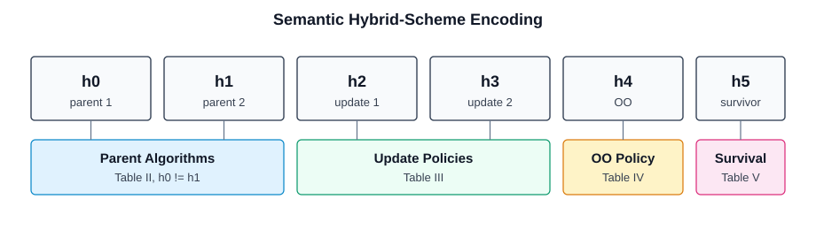
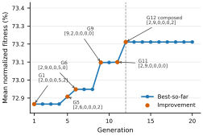

# Automatic Design of Collaboration-Based Hybrid Metaheuristics for Large-Scale Agile Earth Observation Satellite Scheduling

**Abstract**--Large-scale agile earth observation satellite scheduling requires a scheduler to select profitable tasks, assign them to satellites, and insert them into feasible visible time windows under single-sensor execution, imaging-quality, and attitude-transition constraints. This paper studies the automatic design of collaboration-based hybrid metaheuristics for this setting. Following the top-down line of automated algorithm design, the single-satellite optimizer is treated as a design object whose parent search procedures and hybrid-control realization forms are selected by search, while the random-key scheduling bridge and dynamic reassignment layer are kept fixed from the RK-HMA pipeline. A candidate optimizer is encoded by two parent metaheuristics, two update policies, one operation-order policy, and one survivor-selection policy. The design stage uses a reduced-budget evolutionary search on representative small and medium regional instances, and the automatically selected optimizer is then replayed with the full budget on ten benchmark instances ranging from 500 tasks and 5 satellites to 10,000 tasks and 100 satellites. Against RK-HMA, the selected optimizer matches the saturated global instances, improves every non-saturated regional instance, and raises the average profit rate by 0.58 percentage points over all scenarios and by 0.97 percentage points on the non-saturated subset. Compared with the reported R-ALNS, A-ALNS, and DRL-PASA baselines, it is best or tied-best by five-run average on all ten scenarios.

**Index Terms**--agile earth observation satellite scheduling, automated algorithm design, collaboration-based hybrid metaheuristic, random-key encoding, task reassignment

# I. Introduction

Agile earth observation satellites can observe ground targets by adjusting attitude within visibility time windows. This agility enlarges the set of observable targets, but it also makes the transition time between consecutive observations depend on the satellite attitude sequence. This paper studies the large-scale agile earth observation satellite task scheduling problem (LS-AEOSTSP). In large-scale missions, the number of candidate tasks usually exceeds the available observation capacity. A scheduler must decide which tasks to observe, which satellite should execute each selected task, which visible window should be used, and where each task should be inserted in the satellite sequence. These decisions are coupled. A locally good task order can become infeasible after assignment changes, and a profitable assignment can still fail if the sequence creates excessive attitude-transition cost.

Prior work on agile satellite scheduling spans several methodological lines. Survey and exact-optimization studies clarify the main modeling variants and constraint structures [1], [2], [5], [6]. Adaptive large neighborhood search and related constructive or repair-based methods have been used for time-dependent transitions, multiple satellites, interval-varying profits, moving targets, and integrated scheduling variants [7]-[11], [19]. Reinforcement learning and other data-driven methods have also been introduced to learn construction or search policies for large-scale instances [3], [4], [12]-[15].

Hybrid metaheuristics are attractive because different operators can contribute complementary search behavior [16]. For LS-AEOSTSP, RK-HMA is a strong reference point because it connects continuous optimizers with discrete task sequences through random-key encoding, applies DE/rand/1 and PSO to a shared population, and uses dynamic task reassignment to coordinate satellites. This baseline shows that hybridization is useful, but it leaves the optimizer structure as an input assumption rather than a search result.

The central question is therefore an automatic-design question: can the hybrid structure itself be selected for the scheduling pipeline? Algorithm configuration methods such as ParamILS, SMAC, and irace tune parameterized algorithms over training instances [20]-[22]. Hyper-heuristics search over heuristics or heuristic components instead of directly searching the solution space [23]. Automated algorithm design goes further by searching algorithm structures. Recent work on automated design of collaboration-based hybrid metaheuristics treats hybrid-optimizer design as a meta-optimization problem and uses a top-down template to generate collaboration-based hybrid algorithms [24].

Following this research line, this paper specializes top-down automated design to LS-AEOSTSP. The design problem is not to choose one parent optimizer by manual preference, and it is not limited to tuning parameters of a fixed optimizer. Instead, the design of a collaboration-based hybrid optimizer is treated as a meta-optimization problem. The search variables specify the parent metaheuristics and the realization forms that control how these parents collaborate inside the single-satellite optimizer. The scheduling-specific components inherited from the RK-HMA pipeline, including initialization, random-key encoding, greedy decoding, and dynamic task reassignment, provide the fixed evaluation environment for every generated optimizer.

The design choice is moved from a fixed optimizer input to a searchable structural layer. The random-key scheduling bridge and reassignment layer remain fixed; the inner hybrid optimizer is the part being designed. The automatic design used here makes parent choice, update scope, execution order, and survivor selection searchable through the semantic structural configuration:

```text
{parent1, parent2, update1, update2, operationOrder, survivor}
```

Here, `parent1` and `parent2` choose the two parent metaheuristics. `update1` and `update2` define the population subset updated by each parent. `operationOrder` specifies how the two parents are executed inside the single-satellite optimizer. `survivor` specifies how parent and offspring candidates compete for the next population. This keeps the design object compact and interpretable.

The main contributions are as follows.

1. We turn the collaboration-based hybrid optimizer structure into a searchable design object. Parent choice, update scope, operation order, and survivor selection are exposed as evolvable realization forms, while the random-key scheduling bridge and reassignment layer are fixed during evaluation.

2. We formulate a semantic chromosome that assembles the component libraries into executable single-satellite optimizers. The chromosome keeps parent selection, update scope, operation order, and survivor selection interpretable, while low-level runtime settings remain outside the design space.

3. We separate design-stage selection from final evidence collection. A reduced-budget evolutionary search selects the optimizer on four training scenarios, and a full-budget replay evaluates the selected optimizer on all ten benchmark scenarios.

4. We show that the automatically selected configuration improves RK-HMA on every non-saturated scenario and matches all saturated scenarios in profit rate. Against reported R-ALNS, A-ALNS, DRL-PASA, and RK-HMA values, it is best or tied-best by average on all ten scenarios.

The remaining sections are organized as follows. Section II defines the scheduling problem. Section III describes the automatic hybrid-design framework. Section IV reports the experiments. Section V discusses the findings, and Section VI concludes the paper.

# II. Problem Description

Consider a scheduling horizon during which a set of $n$ observation tasks $\mathcal{T}=\{\tau_1,\tau_2,\ldots,\tau_n\}$ must be assigned to a constellation of $m$ agile satellites $\mathcal{S}=\{s_1,s_2,\ldots,s_m\}$. Each task $\tau_i$ is characterized by a geographic location, an imaging duration $d_i^{\text{img}}$, a profit $r_i$, and a specified minimum imaging quality $c_i$. Each satellite $s_j$ is described by its orbital elements and attitude state over the scheduling horizon. Through orbit propagation and access analysis, the visible time windows (VTWs) for each task-satellite pair can be computed. Let $\omega_{ijk}$ denote the $k$-th VTW of task $\tau_i$ on satellite $s_j$, with opening time $\alpha_{ijk}$, closing time $\beta_{ijk}$, and duration $\lambda_{ijk}=\beta_{ijk}-\alpha_{ijk}$. The satellite attitude is described by roll $\theta_{jt}^R$, pitch $\theta_{jt}^P$, and yaw $\theta_{jt}^Y$ at time $t$.

Since the number of tasks typically far exceeds the observation capacity of the constellation, it is generally infeasible to execute all tasks. The LS-AEOSTSP aims to select a subset of tasks and determine their satellite, VTW, and observation start time so as to maximize the total collected profit, subject to the following assumptions.

1. Each task is an atomic observation request that can be directly executed by a satellite. Complex requests such as area coverage or moving target tracking are assumed to have been decomposed into atomic tasks before scheduling.
2. Energy and onboard storage constraints are not explicitly modeled, because satellites recharge through solar panels and periodically downlink data during normal operations.
3. Each satellite carries a single imaging sensor, so at most one task can be executed at any given time.
4. Task execution is non-preemptive. Once an observation starts, it cannot be interrupted, and each task can be observed at most once across the constellation.

**TABLE I: NOTATION FOR LS-AEOSTSP.**

| Notation | Description |
|---|---|
| $\mathcal{T}$ | Set of observation tasks |
| $n$ | Number of tasks |
| $\mathcal{S}$ | Set of satellites |
| $m$ | Number of satellites |
| $\tau_i$ | Task $i$ |
| $s_j$ | Satellite $j$ |
| $r_i$ | Profit of task $\tau_i$ |
| $d_i^{\text{img}}$ | Imaging duration of task $\tau_i$ |
| $\theta_{jt}^R$ | Roll angle of satellite $s_j$ at time $t$ |
| $\theta_{jt}^P$ | Pitch angle of satellite $s_j$ at time $t$ |
| $\theta_{jt}^Y$ | Yaw angle of satellite $s_j$ at time $t$ |
| $\Omega_{ij}$ | Set of VTWs for task $\tau_i$ on satellite $s_j$ |
| $\omega_{ijk}$ | The $k$-th VTW of task $i$ on satellite $j$ |
| $|\Omega_{ij}|$ | Number of VTWs for task $\tau_i$ on satellite $s_j$ |
| $\alpha_{ijk}$ | Opening time of $\omega_{ijk}$ |
| $\beta_{ijk}$ | Closing time of $\omega_{ijk}$ |
| $\lambda_{ijk}$ | Duration of $\omega_{ijk}$ |
| $x_{ijk}$ | Binary variable indicating whether task $i$ is scheduled in $\omega_{ijk}$ |
| $b_{ijk}$ | Observation start time |
| $\sigma_{ijk,i'jk'}$ | Precedence indicator for consecutive observations on one satellite |
| $T^{\text{trans}}$ | Attitude-transition time between two consecutive observations |
| $c_i$ | Required minimum imaging quality of task $\tau_i$ |
| $q_i$ | Imaging quality of scheduled task $\tau_i$ |
| $w_{ijk}^{*}$ | Midpoint of $\omega_{ijk}$ |
| $F(P_S)$ | Total profit of the scheduled task set |

Two types of decision variables are defined. The binary variable $x_{ijk}\in\{0,1\}$ indicates whether task $\tau_i$ is scheduled in VTW $\omega_{ijk}$. The continuous variable $b_{ijk}$ specifies the observation start time of task $\tau_i$ when $x_{ijk}=1$.

The objective is to maximize the collected profit:

$$
\max F(P_S)=\sum_{i=1}^{n}\sum_{j=1}^{m}\sum_{k=1}^{|\Omega_{ij}|} x_{ijk}r_i. \tag{1}
$$

Each task can be scheduled at most once:

$$
\sum_{j=1}^{m}\sum_{k=1}^{|\Omega_{ij}|} x_{ijk} \le 1,\quad \forall \tau_i\in\mathcal{T}. \tag{2}
$$

If a task is selected, the observation must start and finish inside the chosen VTW:

$$
\alpha_{ijk} \le b_{ijk} \le \beta_{ijk}-d_i^{\text{img}},\quad \text{if }x_{ijk}=1. \tag{3}
$$

For consecutive observations on the same satellite, define

$$
\sigma_{ijk,i'jk'} =
\begin{cases}
1, & \text{if }\tau_i\text{ directly precedes }\tau_{i'}\text{ on }s_j,\\
0, & \text{otherwise.}
\end{cases} \tag{4}
$$

The transition-time constraint is then

$$
b_{ijk}+d_i^{\text{img}}+T^{\text{trans}}(\tau_i,\tau_{i'})\le b_{i'jk'},\quad \text{if }\sigma_{ijk,i'jk'}=1. \tag{5}
$$

The attitude-transition time is a piecewise linear function of the total angular displacement:

$$
T^{\text{trans}}(\tau_i,\tau_{i'})
=
\begin{cases}
11.66, & \Delta\Theta \leq 10^\circ,\\
c_1+\Delta\Theta/v_1, & 10^\circ<\Delta\Theta\leq 30^\circ,\\
c_2+\Delta\Theta/v_2, & 30^\circ<\Delta\Theta\leq 60^\circ,\\
c_3+\Delta\Theta/v_3, & 60^\circ<\Delta\Theta\leq 90^\circ,\\
c_4+\Delta\Theta/v_4, & \Delta\Theta>90^\circ.
\end{cases} \tag{6}
$$

The angular displacement is computed from the attitude differences between the two observations:

$$
\Delta\Theta(\tau_i,\tau_{i'})
=|\theta^R_{b_i}-\theta^R_{b_{i'}}|
+|\theta^P_{b_i}-\theta^P_{b_{i'}}|
+|\theta^Y_{b_i}-\theta^Y_{b_{i'}}|,\quad \text{if }\sigma_{ijk,i'jk'}=1. \tag{7}
$$

The executed task must also satisfy its imaging-quality requirement:

$$
q_i\ge c_i,\quad \forall \tau_i\in\mathcal{T}. \tag{8}
$$

When a scheduled task is executed in $\omega_{ijk}$, its imaging quality is computed by the distance between the observation start time and the midpoint of the selected VTW:

$$
q_i=10-9\cdot
\frac{|2b_{ijk}+d_i^{\text{img}}-2w_{ijk}^{*}|}{\lambda_{ijk}-d_i^{\text{img}}},
\quad \text{if }x_{ijk}=1, \tag{9}
$$

where

$$
w_{ijk}^{*}=\frac{\alpha_{ijk}+\beta_{ijk}}{2},\quad \text{if }x_{ijk}=1. \tag{10}
$$

Constraint (2) ensures that each task is observed at most once across all satellites. Constraint (3) guarantees that the observation must start and finish within the selected VTW. Constraint (5) enforces that consecutive tasks on the same satellite must be separated by a sufficient transition time. The transition time is defined by Eq. (6), and the angular displacement is computed by Eq. (7). Following [6], the parameters are set to $v_1=1.5^\circ/\text{s}$, $c_1=5$, $v_2=2^\circ/\text{s}$, $c_2=10$, $v_3=2.5^\circ/\text{s}$, $c_3=16$, $v_4=3^\circ/\text{s}$, and $c_4=22$. Constraint (8) requires the imaging quality of each executed task to be no lower than the specified threshold, and Eqs. (9)-(10) compute imaging quality from the position of the start time inside the selected VTW. The solution has two coupled parts: each scheduled task must be assigned to a satellite and VTW, and each satellite must choose a feasible task sequence.

# III. Automatic Hybrid-Design Framework

## A. Design Principle

The proposed framework follows the top-down design idea of AutoHyb [24], where designing a collaboration-based hybrid optimizer is formulated as a meta-optimization problem. A general collaboration-based hybrid optimizer can be viewed as a template composed of parent optimization algorithms and hybridization factors. The parent algorithms provide search behaviors, while the hybridization factors specify how the parents share a population, which part of the population they update, in which order they are invoked, and how generated candidates survive.

This paper instantiates that template for LS-AEOSTSP. The design object is the single-satellite optimizer used inside the multi-satellite scheduling pipeline. A candidate in the design population is therefore an optimizer configuration, not a task sequence. The fixed scheduling pipeline follows the RK-HMA setting: initial task allocation, random-key continuous representation, greedy insertion decoding, and dynamic cross-satellite task reassignment are kept unchanged. The automatic-design layer only changes the collaboration structure of the single-satellite optimizer.

The resulting workflow has four levels:

1. A semantic structural chromosome encodes a candidate hybrid optimizer.
2. The chromosome is decoded into an executable single-satellite optimizer configuration.
3. The configured single-satellite optimizer is embedded in the fixed multi-satellite scheduling pipeline.
4. An evolutionary search selects optimizer structures by their measured scheduling profit.

RK-HMA corresponds to one feasible chromosome in this configuration space. Its DE/rand/1 + PSO optimizer is a manually fixed collaboration structure, whereas the proposed design stage can either recover that structure or select a different one under the same scheduling pipeline. This makes the comparison controlled: the scheduling bridge and reassignment layer are shared, and the searched component is the single-satellite optimizer structure.


**Fig. 1. Automatic hybrid-design workflow.** Component libraries define the searchable optimizer space. Each semantic chromosome is decoded into a single-satellite optimizer and evaluated by the complete scheduling pipeline with dynamic reassignment. The search stage uses normalized scheduling profit as feedback, and the selected optimizer is then evaluated by an independent full-budget replay on all benchmark scenarios.

Design and evidence collection are kept separate. The search stage evaluates candidate optimizers on four representative training scenarios, ID1, ID3, ID5, and ID7. This reduced scenario set lowers the cost of evolutionary design while retaining small, medium, and conflict-heavy regional cases. The search-stage fitness is the normalized scheduling profit over these training scenarios and is formally defined with the evolutionary procedure in Section III-E. The selected optimizer is then evaluated on all ten benchmark scenarios by the full-budget replay protocol; the reported ten-scenario results come from this independent replay path.

## B. Component Libraries for Automatic Design

Automatic design needs a finite set of reusable algorithmic choices. Following the hybrid-template view in AutoHyb [24], the inner hybrid optimizer is assembled from parent algorithms and three groups of hybridization-factor realization forms: update policy, operation order, and survivor selection. These libraries define the structural choices available to the design stage.

Only decisions that change the optimizer structure or control flow are encoded as genes. Parent choice determines which search mechanisms are available. Update policy determines which individuals each parent modifies. Operation order determines when the parents act. Survivor selection determines how generated candidates replace current individuals. Low-level settings such as insertion mode, DE scaling schedule, reassignment top-k values, and parent-internal numerical parameters are fixed during the design comparison. This keeps the search focused on collaboration structure rather than mixing structural design with parameter tuning.

**TABLE II: PARENT-ALGORITHM LIBRARY.**

| ID | Parent algorithm | Brief description |
|---:|---|---|
| 0 | GA | Evolutionary algorithm that generates offspring through selection, crossover, and mutation. |
| 1 | PSO | Swarm-intelligence algorithm that updates particles using personal and global best experience. |
| 2 | EDA | Probabilistic model-based algorithm that estimates promising distributions from selected solutions. |
| 3 | ACO | Pheromone-inspired constructive search that samples candidates according to learned desirability. |
| 4 | DE/rand/1 | Differential evolution variant that mutates a random base vector with one differential vector. |
| 5 | DE/best/1 | Differential evolution variant that mutates the current best vector with one differential vector. |
| 6 | DE/current-to-rand/1 | Differential evolution variant that moves the current vector toward a random differential direction. |
| 7 | ABC | Bee-colony algorithm that alternates employed-bee, onlooker-bee, and scout-bee search phases. |
| 8 | SA | Trajectory-based local search that uses temperature-controlled acceptance of worsening moves. |
| 9 | L-SHADE | Success-history adaptive differential evolution with external archive and linear population-size reduction. |
| 10 | ALNS | Neighborhood-search framework that alternates destroy and repair operators under adaptive selection. |

**TABLE III: UPDATE-POLICY LIBRARY.**

| ID | Update policy | Operating level | Corresponding realization form |
|---:|---|---|---|
| 0 | FULL | Population | The parent algorithm works on all individuals in the current population. |
| 1 | TOP_SUBSET | Subpopulation | The parent algorithm works on a fixed high-fitness subset. |
| 2 | MIXED_SUBSET | Subpopulation | The parent algorithm works on a mixture of high-fitness and random individuals. |
| 3 | RANDOM_DECAY | Subpopulation | The parent algorithm works on a random subset whose size decreases over iterations. |
| 4 | ABOVE_MEAN | Subpopulation | The parent algorithm works on individuals whose fitness is above the population mean. |
| 5 | LOCAL_SEARCH | Individual | The parent algorithm focuses on the historical best individual. |
| 6 | WORST_REPAIR | Individual | The parent algorithm focuses on the current worst individual. |

**TABLE IV: OPERATION-ORDER (OO) LIBRARY.**

| ID | Operation-Order policy | OO type | Corresponding realization form |
|---:|---|---|---|
| 0 | SEQUENTIAL | Sequential | Parent 1 is invoked before parent 2 in each enabled iteration. |
| 1 | PERIODIC_SWITCH | Sequential | The active parent switches by a fixed iteration period. |
| 2 | STAGE_SWITCH | Sequential | Different parents are enabled in different search stages. |
| 3 | BEST_NO_IMPROVEMENT_SWITCH | Sequential | The active parent switches when the global best does not improve. |
| 4 | PROCESS_NO_IMPROVEMENT_SWITCH | Sequential | The active parent switches when the enabled parent stagnates. |
| 5 | DIVERSITY_SWITCH | Sequential | Parent routing depends on the current population diversity state. |
| 6 | PARALLEL | Parallel | The two parents generate candidates separately and the candidates are merged. |
| 7 | ADAPTIVE_CREDIT | Sequential | Recent improvement per evaluation cost determines parent routing. |

**TABLE V: SURVIVOR-SELECTION LIBRARY.**

| ID | Survivor policy | Corresponding realization form |
|---:|---|---|
| 0 | ELITIST_BEST_N | Truncation selection: parent and offspring candidates are merged and the best $N$ survive. |
| 1 | TOURNAMENT | Tournament selection: survivors are selected through stochastic local competitions. |
| 2 | PAIRWISE_GREEDY | One-to-one comparison: each offspring competes with its paired parent. |
| 3 | RANK_WEIGHTED | Rank-based sampling: merged candidates are sampled with probabilities determined by fitness rank. |

Together, Tables II-V define the active optimizer-design space searched in this study: 11 parent algorithms, 7 update policies, 8 operation-order realization forms, and 4 survivor-selection realization forms. The parent library covers population-based, model-based, swarm-based, trajectory-based, and neighborhood-based search behaviors. The three hybrid-control libraries cover which individuals are updated, how parent searches are coordinated, and how parent and offspring candidates compete. The tables describe the collaboration structure that the design stage can change; scheduling execution details that remain fixed are described later with the evaluation protocol.

## C. Semantic Structural Optimizer Encoding

Each candidate optimizer is represented by a six-gene chromosome:

$$
\mathbf{h}=(h_0,h_1,h_2,h_3,h_4,h_5).
$$

Fig. 2 summarizes the layout of the semantic hybrid-scheme encoding.



**Fig. 2. Encoding of the semantic hybrid scheme.** The first two genes select distinct parent algorithms from Table II. The next two genes select update policies from Table III. The fifth gene selects the OO realization form from Table IV, and the last gene selects the survivor-selection realization form from Table V. The layout keeps each gene tied to one algorithmic role, which makes the generated optimizer readable after search.

After enforcing $h_0\ne h_1$, the valid search space is:
$$
11\times 10\times 7\times 7\times 8\times 4 = 172{,}480
$$

This gives 172,480 optimizer structures. This number is reported to show the scale of the structural design space. Exhaustively evaluating all candidate structures is not practical because each candidate must be decoded into an optimizer and evaluated through the scheduling pipeline. This motivates the evolutionary configuration-search procedure in Section III-E.

The genes assemble reusable components into an executable single-satellite optimizer. Runtime settings and low-level component parameters are kept outside the chromosome. This separation keeps the search space compact, avoids mixing runtime calibration with structural search, and preserves a direct interpretation for the optimizer returned by the design stage.

## D. Chromosome-to-Optimizer Decoding

The decoding function maps one optimizer chromosome to a runnable single-satellite optimizer. Let $\Phi(\mathbf{h})$ denote the optimizer generated by chromosome $\mathbf{h}$. The generated optimizer is a shared-population hybrid. It keeps one random-key population and one decoded scheduling objective. During evaluation, every generated optimizer is embedded in the same multi-satellite reassignment layer; the chromosome only changes how the inner search operators are assembled.

At iteration $t$, the first two genes activate parent strategies:

$$
(h_0,h_1)\mapsto (\mathcal{A}_{h_0},\mathcal{A}_{h_1}),
$$

where $\mathcal{A}_{h_i}$ is one algorithm from the active parent library. These parents do not run as isolated optimizers. They update selected individuals from the same population $X^t$ and are evaluated by the same fitness vector $F^t$.

The update-policy genes then define two individual masks:

$$
M_1=\mathcal{M}(h_2,X^t,F^t),\quad M_2=\mathcal{M}(h_3,X^t,F^t),
$$

where $X^t$ is the current random-key population and $F^t$ is the corresponding fitness vector. The masks define which individuals each parent is allowed to modify, while the policy semantics are listed in Table III.

The operation-order gene schedules the two parent calls and produces a candidate population:

$$
\mathcal{O}_{h_4}:\left(\mathcal{A}_{h_0},\mathcal{A}_{h_1},M_1,M_2\right)\rightarrow X'.
$$

The operation-order semantics are listed in Table IV. Each candidate key in $X'$ is decoded into a task sequence and scored by the scheduling-profit objective, giving the candidate fitness vector $F'$.

The survivor gene then builds the next population:

$$
X^{t+1}=\mathcal{S}_{h_5}(X^t,X',F^t,F').
$$

The survivor rule is selected from Table V. The result is a complete single-satellite optimizer iteration:
$$
X^{t+1}
=
\mathcal{S}_{h_5}
\left(
X^t,
\mathcal{O}_{h_4}
\left(
\mathcal{A}_{h_0},\mathcal{A}_{h_1},
\mathcal{M}(h_2,X^t,F^t),
\mathcal{M}(h_3,X^t,F^t)
\right),
F^t,F'
\right).
$$

The decoding step turns optimizer construction into part of the experiment. The inner search algorithm is generated from an evolvable semantic chromosome and evaluated inside the same scheduling pipeline.

## E. Evolutionary Configuration-Search Procedure

The design procedure evolves a population of optimizer chromosomes. Fitness is not assigned to a directly encoded task sequence. It is assigned to the scheduling profit obtained by the optimizer generated from each chromosome.

For a training scenario $s$, let $P(\mathbf{h},s)$ be the mean profit obtained by evaluating optimizer $\Phi(\mathbf{h})$ for $R$ independent runs under the reduced design-stage budget. Let $T_s$ be the total profit of all tasks. The multi-scene design fitness is:

$$
\mathcal{F}(\mathbf{h})=
\sum_{s\in\mathcal{D}_{train}}
\frac{P(\mathbf{h},s)}{T_s}.
$$

The denominator normalizes each scenario by total task profit, so large-profit scenarios do not dominate the design objective only because of scale.

Algorithm 1 summarizes the procedure.

```text
Algorithm 1: Evolutionary optimizer-design procedure
Input: training scenarios D_train, component libraries A, U, O, S,
       population size N_d, generations G_d, repeat count R,
       crossover rate p_c, search budget ratio rho
Output: selected optimizer chromosome h_star

1:  Initialize population P_0 of valid optimizer chromosomes
2:  Evaluate every h in P_0 by F(h)
3:  h_star <- best chromosome in P_0
4:  for t = 1 to G_d do
5:      Shuffle parent indices in P_{t-1}
6:      for each shuffled parent pair do
7:          with probability p_c, generate offspring by one-point crossover
8:          otherwise, sample 1..6 gene positions and mutate those genes
9:          repair duplicate parent genes so that the two parents are distinct
10:         add the offspring to Q_t
11:     end for
12:     Evaluate every offspring h in Q_t by F(h)
13:     Merge P_{t-1} and Q_t
14:     Select the top N_d chromosomes by design fitness
15:     Update h_star if a better chromosome is found
16: end for
17: return h_star
```

When crossover is skipped, mutation samples one to six gene positions and resamples the corresponding genes within their valid library ranges. If a parent-selection gene is mutated, repair enforces the distinct-parent constraint $h_0\ne h_1$. This operator definition is reported to make the search path reproducible.

The evaluation steps are expensive because each chromosome must be decoded into a complete optimizer and run through the satellite scheduling pipeline. The search stage uses a reduced inner budget, while final evidence is collected by the full-budget replay protocol.

## F. Full-Budget Replay Protocol

Search-stage fitness is used only to choose a promising optimizer. It is not treated as the final experimental result. After the design stage returns $\mathbf{h}^*$, the selected chromosome is instantiated as a single-satellite optimizer and embedded in the same multi-satellite scheduling pipeline used during search. The replay protocol uses the full inner budget and five independent runs for each reported scenario. It separates automatic design from final confirmation because the design stage uses fewer evaluations and can be noisy.

## G. Scheduling Execution Under a Designed Optimizer

Once $\Phi(\mathbf{h})$ is instantiated, each satellite is optimized through the standard random-key scheduling bridge. For a satellite with $D$ assigned tasks, the single-satellite optimizer maintains a population:

$$
X=\{\mathbf{x}^{(1)},\mathbf{x}^{(2)},\ldots,\mathbf{x}^{(N)}\},\quad
\mathbf{x}^{(q)}\in[-u,u]^D.
$$

Each vector is decoded by sorting its keys. The sorted order gives a candidate task sequence. The decoder attempts to insert tasks into feasible visible time windows and computes the collected profit:

$$
f(\mathbf{x})=\sum_{\tau_i\in P_j} r_i,
$$

where $P_j$ is the feasible schedule constructed for satellite $s_j$.

After per-satellite schedules are generated, the fixed multi-satellite layer follows the RK-HMA dynamic reassignment procedure [REF1] to reconsider unscheduled tasks through migration, replacement, swap, and bundle moves. This layer is shared by all candidate chromosomes and is not part of the optimizer-design space. Its iteration budget, target-satellite limits, and bundle-move settings are reported in Table VII. Keeping this layer fixed makes the comparison focus on the automatically designed single-satellite optimizer structure rather than on changes to the reassignment mechanism.

# IV. Experimental Results

To evaluate RK-HMA on the LS-AEOSTSP, the simulator introduced in [8] is used to generate multiple
experimental scenarios. The proposed algorithm is implemented in Java and runs on a PC with Intel Core i7-14700kf CPU @ 3.40 GHz and 64-GB memory.

## A. Experimental Scenarios

Ten experimental scenarios are used, covering small-scale, medium-scale, large-scale, and superlarge-scale instances. The task count ranges from 500 to 10,000, and the satellite count ranges from 5 to 100. The distribution is categorized into regional and global distributions. In the regional setting, tasks are concentrated in the area $3^\circ\text{N}$-$53^\circ\text{N}$ and $74^\circ\text{E}$-$133^\circ\text{E}$, which creates stronger competition for feasible time windows. The imaging duration of each task is a random integer between 1 and 30, and the task profit is a random integer between 1 and 10.

**TABLE VI: EXPERIMENTAL SCENARIOS.**

| ID | Scale | $n$ | $m$ | Start time | End time | Distribution |
|---:|---|---:|---:|---|---|---|
| 1 | Small | 500 | 5 | 00:00:00 | 23:59:59 | Regional |
| 2 | Small | 500 | 5 | 00:00:00 | 23:59:59 | Global |
| 3 | Small | 1000 | 10 | 00:00:00 | 11:59:59 | Regional |
| 4 | Small | 1000 | 10 | 12:00:00 | 23:59:59 | Global |
| 5 | Medium | 1000 | 20 | 00:00:00 | 11:59:59 | Regional |
| 6 | Medium | 2000 | 20 | 12:00:00 | 23:59:59 | Global |
| 7 | Medium | 4000 | 40 | 00:00:00 | 05:59:59 | Regional |
| 8 | Large | 6000 | 60 | 12:00:00 | 17:59:59 | Global |
| 9 | Large | 8000 | 80 | 00:00:00 | 11:59:59 | Regional |
| 10 | Superlarge | 10000 | 100 | 06:00:00 | 11:59:59 | Regional |

## B. Performance Metrics and Parameter Settings

We compare Auto-Hybrid with three reported baselines and one manually fixed reference.

**R-ALNS** [7]: An ALNS variant that uses random task allocation before single-satellite ALNS scheduling.

**A-ALNS** [8]: An adaptive-allocation ALNS variant that improves the initial task allocation before single-satellite scheduling.

**DRL-PASA** [4]: A deep reinforcement learning based parallel adaptive search algorithm. It uses a DQN-based allocation policy and frequent pattern based adaptive local search.

**RK-HMA**: A manually fixed hybrid reference under the same random-key bridge and dynamic reassignment layer. Its single-satellite optimizer uses DE/rand/1 and PSO with FULL/FULL update policies, SEQUENTIAL operation order, and ELITIST_BEST_N survivor selection (6D index [4,1,0,0,0,0]). DE/rand/1 first updates the shared random-key population, and PSO then refines the DE-improved population.

The primary metric is profit rate:

$$
PR=\frac{F(P_S)}{F(P_A)}\times 100\%,
$$

where $F(P_S)$ is the profit of scheduled tasks and $F(P_A)$ is the total profit of all tasks.

For profit rate, the R-ALNS, A-ALNS, and DRL-PASA entries are taken from [4] rather than rerun here. Auto-Hybrid denotes the optimizer selected by the design stage described in Section III. RK-HMA and Auto-Hybrid results are five-run averages from the full-budget replay protocol. The reduced-budget search is used only for optimizer selection; it does not supply any scheduling result in the tables.

Table VII reports the main hyperparameters used by the automatic-design stage and the full-budget scheduling layer. The first two rows describe the reduced-budget design search; the remaining rows describe the full-budget evaluation shared by RK-HMA and Auto-Hybrid. The table does not list component-library sizes, training scenario IDs, replay seed IDs, or the selected chromosome, because those items describe the protocol or the search outcome rather than tunable hyperparameters.

**TABLE VII: HYPERPARAMETER SETTINGS.**

| Hyperparameter | Symbol | Value |
|---|---|---|
| Design population | $N_d$ | 35 |
| Design generations | $G_d$ | 20 |
| Population size | $N_{pop}$ | $2.5 \times \max(n_j)$ |
| Max evaluations | $F_{\max}$ | $100N_{pop}$ |
| Random-key search interval | $[-u,u]$ | $u=750$ |
| Max reassignment iterations | $I_{\max}^{reassign}$ | 25 |
| Retained target satellites | $K_{sat}^{ord}, K_{sat}^{pri}$ | 2, 4 |
| Max bundle size | $K_B$ | 3 |
| Bundle time-neighbor threshold | $\theta_B$ | 120 s |
| Max bundle trials per round | $N_B$ | 5 |

## C. Configuration-Search Evidence

The design search uses four training scenarios, ID1, ID3, ID5, and ID7. These regional-distribution cases range from 500 tasks and 5 satellites to 4000 tasks and 40 satellites, reducing search cost while retaining increasing task-satellite contention. Fig. 3 plots the best-so-far trajectory over 20 generations. The y-axis reports mean normalized fitness across the four training scenarios. Each candidate is evaluated by $R=3$ independent scheduling runs per scenario, and each scenario result is normalized by the corresponding total task profit. Orange markers indicate generations where the incumbent optimizer improves.

The trajectory shows a staged structural search. The initial incumbent combines EDA with GA. The search then changes the second parent and the collaboration policy several times: generation 6 moves to EDA + L-SHADE, generation 9 reverses the parent order to L-SHADE + EDA, and generation 11 returns to EDA followed by L-SHADE under SEQUENTIAL execution. At generation 12, the incumbent becomes EDA and L-SHADE with FULL/FULL update policies, SEQUENTIAL operation order, and PAIRWISE_GREEDY survivor selection (6D index [2,9,0,0,0,2]). This decoded structure remains best from generation 12 to generation 20. The design-stage fitness is used only for optimizer selection.

The selected structure separates the two search roles. EDA estimates promising random-key distributions from elite solutions, and L-SHADE refines those keys with adaptive differential perturbations. FULL/FULL lets both parents update the shared population. With SEQUENTIAL execution, L-SHADE starts from the population already shaped by EDA, and PAIRWISE_GREEDY preserves individual-level improvements. In regional scenarios, concentrated tasks compete for feasible windows, so small changes in random-key order can decide which tasks survive greedy insertion and reassignment. This explains why the selected structure is plausible for high-conflict regional cases.



**Fig. 3. Multi-scene evolutionary search trace.** The curve reports best-so-far mean normalized fitness across the four design-stage training scenarios. Orange markers denote improvement generations. Text callouts show representative incumbent chromosomes, and the dashed line marks the first appearance of Auto-Hybrid at generation 12. Auto-Hybrid remains best through generation 20.

## D. Performance Comparison

Table VIII reports the main profit-rate comparison. The value in parentheses is the gap to the best result in that scenario, in percentage points. Bold values mark the highest or tied-highest profit rate in each row. The R-ALNS, A-ALNS, and DRL-PASA columns are reported values from [4]. The RK-HMA and Auto-Hybrid columns are five-run averages from the full-budget replay protocol, not from the reduced-budget design search.

**TABLE VIII: PROFIT RATE COMPARISON WITH REPORTED BASELINES AND RK-HMA.**

| ID | Distribution | $n,m$ | R-ALNS | A-ALNS | DRL-PASA | RK-HMA | Auto-Hybrid |
|---:|---|---:|---:|---:|---:|---:|---:|
| 1 | Regional | 500,5 | 99.05% (+0.57) | 98.95% (+0.67) | 99.60% (+0.02) | 99.40% (+0.22) | **99.62% (0)** |
| 2 | Global | 500,5 | 99.75% (+0.14) | **99.89% (0)** | **99.89% (0)** | **99.89% (0)** | **99.89% (0)** |
| 3 | Regional | 1000,10 | 39.60% (+8.69) | 40.20% (+8.09) | 44.35% (+3.94) | 47.09% (+1.20) | **48.29% (0)** |
| 4 | Global | 1000,10 | 92.57% (+0.02) | 92.51% (+0.08) | **92.59% (0)** | **92.59% (0)** | **92.59% (0)** |
| 5 | Regional | 1000,20 | 56.31% (+22.72) | 70.21% (+8.82) | 76.35% (+2.68) | 78.04% (+0.99) | **79.03% (0)** |
| 6 | Global | 2000,20 | 98.27% (+0.17) | 98.37% (+0.07) | 98.40% (+0.04) | **98.44% (0)** | **98.44% (0)** |
| 7 | Regional | 4000,40 | 57.54% (+9.45) | 62.44% (+4.55) | 62.58% (+4.41) | 64.05% (+2.94) | **66.99% (0)** |
| 8 | Global | 6000,60 | 99.93% (+0.07) | 99.96% (+0.04) | 99.98% (+0.02) | **100.00% (0)** | **100.00% (0)** |
| 9 | Regional | 8000,80 | 27.12% (+24.34) | 34.26% (+17.20) | 37.18% (+14.28) | 51.17% (+0.29) | **51.46% (0)** |
| 10 | Regional | 10000,100 | 20.38% (+13.86) | 29.25% (+4.99) | 33.95% (+0.29) | 34.08% (+0.16) | **34.24% (0)** |

Table VIII gives the five-run averages used for the main comparison. To show run-to-run variation, Table IX reports the maximum, average, and minimum profit rates of RK-HMA and Auto-Hybrid under the same full-budget protocol.

**TABLE IX: FIVE-RUN PROFIT RATE OF RK-HMA AND AUTO-HYBRID ON EACH SCENARIO.**

| ID | $n,m$ | RK-HMA Max | RK-HMA Ave | RK-HMA Min | Auto-Hybrid Max | Auto-Hybrid Ave | Auto-Hybrid Min |
|---:|---|---:|---:|---:|---:|---:|---:|
| 1 | 500,5 | 99.60% | 99.40% | 99.09% | 99.67% | 99.62% | 99.53% |
| 2 | 500,5 | 99.89% | 99.89% | 99.89% | 99.89% | 99.89% | 99.89% |
| 3 | 1000,10 | 47.41% | 47.09% | 46.60% | 48.52% | 48.29% | 48.09% |
| 4 | 1000,10 | 92.59% | 92.59% | 92.59% | 92.59% | 92.59% | 92.59% |
| 5 | 1000,20 | 78.27% | 78.04% | 77.85% | 79.31% | 79.03% | 78.72% |
| 6 | 2000,20 | 98.44% | 98.44% | 98.44% | 98.44% | 98.44% | 98.44% |
| 7 | 4000,40 | 64.27% | 64.05% | 63.73% | 67.10% | 66.99% | 66.79% |
| 8 | 6000,60 | 100.00% | 100.00% | 100.00% | 100.00% | 100.00% | 100.00% |
| 9 | 8000,80 | 51.34% | 51.17% | 51.04% | 51.58% | 51.46% | 51.41% |
| 10 | 10000,100 | 34.15% | 34.08% | 33.96% | 34.32% | 34.24% | 34.19% |

Under the reported-value comparison protocol, Auto-Hybrid obtains the highest or tied-highest average profit rate on all ten scenarios. Compared with RK-HMA, Auto-Hybrid improves every non-saturated regional instance and ties the four saturated or near-saturated global instances. The five-run ranges in Table IX show the same pattern as the averages in Table VIII: the gain is concentrated on regional scenarios with stronger scheduling conflicts, while the global scenarios have little remaining profit-rate headroom. The average gain over RK-HMA is 0.58 percentage points across all ten scenarios and 0.97 percentage points across the six non-saturated instances. The largest gain occurs on ID7, where the average profit rate rises from 64.05% to 66.99%.

Across all ten scenarios, Auto-Hybrid's average profit rate is 8.00 percentage points higher than R-ALNS, 4.45 percentage points higher than A-ALNS, 2.57 percentage points higher than DRL-PASA, and 0.58 percentage points higher than RK-HMA. These values are table-level contextual comparisons against reported baselines, not paired statistical tests under a unified rerun protocol.

Fig. 4 separates the comparison by task distribution. On regional-distribution scenarios, the performance gap between algorithms is more pronounced. Auto-Hybrid improves the regional average profit rate by 13.27 percentage points over R-ALNS, 7.39 percentage points over A-ALNS, 4.27 percentage points over DRL-PASA, and 0.97 percentage points over RK-HMA. This pattern is consistent with the stronger scheduling conflicts created by geographically concentrated tasks.

On global-distribution scenarios, all methods already obtain high profit rates. Auto-Hybrid matches RK-HMA and only slightly exceeds the external baseline averages. The right panel of Fig. 4 therefore starts its y-axis at 92% to make the remaining small gaps visible.


**Fig. 4. Profit-rate comparison by task distribution.** The left panel reports regional-distribution scenarios on a 0-100% scale. The right panel reports global-distribution scenarios with a y-axis starting at 92% because all methods are near saturation.

**Computational time comparison.** Table X reports wall-clock times as an auxiliary reference. The R-ALNS, A-ALNS, and DRL-PASA times are cited from [4] for their original implementation environment, while RK-HMA and Auto-Hybrid times are five-run averages from our Java implementation on the hardware described above. Because the methods differ in implementation, programming language, and hardware environment, Table X cannot support a strict efficiency comparison; it provides practical runtime context for the benchmark scenarios.

**TABLE X: COMPUTATIONAL TIME COMPARISON.**

| ID | Distribution | $n,m$ | R-ALNS | A-ALNS | DRL-PASA | RK-HMA | Auto-Hybrid |
|---:|---|---:|---:|---:|---:|---:|---:|
| 1 | Regional | 500,5 | 42.67 s | 39.61 s | 32.80 s | 27.16 s | **7.80 s** |
| 2 | Global | 500,5 | 7.32 s | 6.64 s | 2.80 s | **1.52 s** | 1.61 s |
| 3 | Regional | 1000,10 | 35.93 s | 34.44 s | 18.70 s | 14.71 s | **5.20 s** |
| 4 | Global | 1000,10 | 4.15 s | 4.10 s | 4.00 s | 1.48 s | **1.39 s** |
| 5 | Regional | 1000,20 | 37.71 s | 37.14 s | 27.60 s | 11.62 s | **4.33 s** |
| 6 | Global | 2000,20 | 59.37 s | 47.09 s | 42.70 s | 3.50 s | **2.50 s** |
| 7 | Regional | 4000,40 | 370.48 s | 351.17 s | 320.40 s | 45.60 s | **8.52 s** |
| 8 | Global | 6000,60 | 75.42 s | 59.69 s | 58.20 s | 2.40 s | **1.33 s** |
| 9 | Regional | 8000,80 | 236.81 s | 222.68 s | 215.50 s | 410.74 s | **58.76 s** |
| 10 | Regional | 10000,100 | 898.14 s | 754.58 s | 718.10 s | 448.19 s | **122.72 s** |

*Bold indicates the fastest time for each scenario.*

Table X contains two kinds of runtime evidence. Across all methods, it is only an auxiliary wall-clock reference because the external baseline times come from [4]. Within our Java replay, Auto-Hybrid is faster than RK-HMA on nine of ten scenarios. On ID9, RK-HMA is slower than DRL-PASA but obtains a much higher profit rate, matching the quality-time trade-off reported for the RK-HMA procedure [REF1]. Auto-Hybrid reduces the ID9 average time to 58.76 s while raising the average profit rate to 51.46%, so the replay results show a practical quality-time improvement over RK-HMA on this difficult regional case.

# V. Discussion

The key result is not merely that one optimizer outperforms another. More important, the hybrid structure itself becomes a search result. The automatically selected chromosome is still expert-readable after decoding: it combines EDA and L-SHADE under full-population updates, sequential execution, and pairwise-greedy survival. Under the current random-key decoding and survivor-selection rules, distribution-based sampling and adaptive differential search appear to be a useful combination.

The gain is concentrated on non-saturated regional instances. This pattern is consistent with the role of dynamic reassignment and hybrid sequencing. Global-distribution instances already have high feasible coverage, so all strong methods approach saturation. Regional instances contain stronger contention among tasks and satellites, leaving more room for reassignment and sequence refinement to improve collected profit.

The structural representation is also easier to interpret than a broad low-level hyperparameter grid. Each gene corresponds to a design decision: which parent algorithms are used, which individuals are updated, when parent algorithms run, and how survivor selection is performed. This makes the selected optimizer easier to analyze and more suitable for future transfer studies.

Two limits remain. First, the selected optimizer was replayed on ten scenarios, but the design-stage search itself was not repeated from many independent random seeds. Second, the profit-rate comparison still uses reported external baseline values, and the runtime table combines values from non-unified implementations and code versions. These limits do not change the table-level profit-rate comparison, but they should be resolved before making strong runtime or search-stability claims.

# VI. Conclusion

We presented an automatic design framework for collaboration-based hybrid metaheuristics in large-scale agile earth observation satellite scheduling. The framework searches a semantic chromosome that controls parent algorithms, update policies, operation order, and survivor selection while keeping the random-key scheduling bridge and dynamic reassignment layer fixed. The selected chromosome is `[2,9,0,0,0,2]`, which decodes to EDA and L-SHADE with full-population updates, sequential execution, and pairwise-greedy survival.

Compared with RK-HMA, the automatically selected optimizer improves all six non-saturated instances and matches all four saturated global instances in profit rate. It improves average profit rate by 0.58 percentage points across all ten scenarios and by 0.97 percentage points on the non-saturated subset. The result suggests that automatic design is a credible way to choose collaboration structure for this scheduling pipeline.

Future work should repeat the design-stage search with independent seeds, not only replay the selected optimizer. It should also add a unified runtime protocol and analyze which structural genes are most responsible for the observed gains. Another direction is to add a racing or surrogate-assisted stage so that larger component libraries can be explored without increasing evaluation cost.

# References

[1] X. Wang, G. Wu, L. Xing, and W. Pedrycz, "Agile earth observation satellite scheduling over 20 years: Formulations, methods, and future directions," *IEEE Systems Journal*, vol. 15, no. 3, pp. 3881-3892, 2021, doi: 10.1109/JSYST.2020.2997050.

[2] X. Chen, G. Reinelt, G. Dai, and A. Spitz, "A mixed integer linear programming model for multi-satellite scheduling," *European Journal of Operational Research*, vol. 275, no. 2, pp. 694-707, 2019, doi: 10.1016/j.ejor.2018.11.058.

[3] Y. Du, T. Wang, B. Xin, L. Wang, Y. Chen, and L. Xing, "A data-driven parallel scheduling approach for multiple agile earth observation satellites," *IEEE Transactions on Evolutionary Computation*, vol. 24, no. 4, pp. 679-693, 2020, doi: 10.1109/TEVC.2019.2934148.

[4] J. Wu, Y. Du, F. Yao, M. Gong, J. Sun, Y. Zhao, and L. Xing, "A deep reinforcement learning-based parallel adaptive search algorithm for solving large-scale agile earth observation satellites tasks scheduling problem," *IEEE Transactions on Geoscience and Remote Sensing*, 2024.

[5] G. Peng, G. Song, L. Xing, A. Gunawan, and P. Vansteenwegen, "An exact algorithm for agile earth observation satellite scheduling with time-dependent profits," *Computers & Operations Research*, vol. 120, p. 104946, 2020, doi: 10.1016/j.cor.2020.104946.

[6] G. Peng, G. Song, Y. He, J. Yu, S. Xiang, L. Xing, and P. Vansteenwegen, "Solving the agile earth observation satellite scheduling problem with time-dependent transition times," *IEEE Transactions on Systems, Man, and Cybernetics: Systems*, vol. 52, no. 3, pp. 1614-1625, 2022, doi: 10.1109/TSMC.2020.3031738.

[7] X. Liu, G. Laporte, Y. Chen, and R. He, "An adaptive large neighborhood search metaheuristic for agile satellite scheduling with time-dependent transition time," *Computers & Operations Research*, vol. 86, pp. 41-53, 2017, doi: 10.1016/j.cor.2017.04.006.

[8] L. He, X. Liu, G. Laporte, Y. Chen, and Y. Chen, "An improved adaptive large neighborhood search algorithm for multiple agile satellites scheduling," *Computers & Operations Research*, vol. 100, pp. 12-25, 2018, doi: 10.1016/j.cor.2018.06.020.

[9] J. Li, J. Zhu, D. Xu, J. Wang, Z. Li, and K. Zhang, "Earth observation satellite scheduling with interval-varying profits," *IEEE Transactions on Aerospace and Electronic Systems*, vol. 60, no. 6, pp. 8273-8288, 2024, doi: 10.1109/TAES.2024.3427090.

[10] F. Yao, Y. Chen, L. Wang, Z. Chang, P.-Q. Huang, and Y. Wang, "A bilevel evolutionary algorithm for large-scale multiobjective task scheduling in multiagile earth observation satellite systems," *IEEE Transactions on Systems, Man, and Cybernetics: Systems*, vol. 54, no. 6, pp. 3512-3524, 2024, doi: 10.1109/TSMC.2024.3359265.

[11] J. Qin, X. Bai, G. Du, J. Liu, N. Peng, and M. Xu, "Multisatellite scheduling for moving targets using the enhanced hybrid genetic simulated annealing algorithm and observation strip selection," *IEEE Transactions on Aerospace and Electronic Systems*, vol. 60, no. 5, pp. 5773-5800, 2024, doi: 10.1109/TAES.2024.3397958.

[12] H. Wang, W. Huang, S. Magnusson, T. Lindgren, R. Wang, and Y. Song, "A strategy fusion-based multiobjective optimization approach for agile earth observation satellite scheduling problem," *IEEE Transactions on Geoscience and Remote Sensing*, vol. 62, pp. 1-14, 2024, doi: 10.1109/TGRS.2024.3472749.

[13] Y. He, L. Xing, Y. Chen, W. Pedrycz, L. Wang, and G. Wu, "A generic Markov decision process model and reinforcement learning method for scheduling agile earth observation satellites," *IEEE Transactions on Systems, Man, and Cybernetics: Systems*, vol. 52, no. 3, pp. 1463-1474, 2022, doi: 10.1109/TSMC.2020.3020732.

[14] M. Chen, Y. Du, K. Tang, L. Xing, Y. Chen, and Y. Chen, "Learning to construct a solution for the agile satellite scheduling problem with time-dependent transition times," *IEEE Transactions on Systems, Man, and Cybernetics: Systems*, vol. 54, no. 10, pp. 5949-5963, 2024, doi: 10.1109/TSMC.2024.3411640.

[15] Y. Song, L. Wei, Q. Yang, J. Wu, L. Xing, and Y. Chen, "RL-GA: A reinforcement learning-based genetic algorithm for electromagnetic detection satellite scheduling problem," *Swarm and Evolutionary Computation*, vol. 77, p. 101236, 2023, doi: 10.1016/j.swevo.2023.101236.

[16] C. Blum, J. Puchinger, G. R. Raidl, and A. Roli, "Hybrid metaheuristics in combinatorial optimization: A survey," *Applied Soft Computing*, vol. 11, no. 6, pp. 4135-4151, 2011, doi: 10.1016/j.asoc.2011.02.032.

[17] J. Fan, Y. Li, J. Xie, C. Zhang, W. Shen, and L. Gao, "A hybrid evolutionary algorithm using two solution representations for hybrid flow-shop scheduling problem," *IEEE Transactions on Cybernetics*, vol. 53, no. 3, pp. 1752-1764, 2023, doi: 10.1109/TCYB.2021.3120875.

[18] Z. Shu, A. Song, G. Wu, and W. Pedrycz, "Variable reduction strategy integrated variable neighborhood search and NSGA-II hybrid algorithm for emergency material scheduling," *Complex System Modeling and Simulation*, vol. 3, no. 2, pp. 83-101, 2023, doi: 10.23919/CSMS.2023.0006.

[19] Y. Rocha, G. O. Chagas, L. C. Coelho, and A. Subramanian, "The integrated agile earth observation satellite scheduling problem," *Computers & Operations Research*, vol. 184, p. 107212, 2025, doi: 10.1016/j.cor.2025.107212.

[20] F. Hutter, H. H. Hoos, K. Leyton-Brown, and T. Stutzle, "ParamILS: An automatic algorithm configuration framework," *Journal of Artificial Intelligence Research*, vol. 36, pp. 267-306, 2009, doi: 10.1613/jair.2861.

[21] F. Hutter, H. H. Hoos, and K. Leyton-Brown, "Sequential model-based optimization for general algorithm configuration," in *Learning and Intelligent Optimization*, Lecture Notes in Computer Science, vol. 6683, pp. 507-523, Springer, 2011, doi: 10.1007/978-3-642-25566-3_40.

[22] M. Lopez-Ibanez, J. Dubois-Lacoste, L. Perez Caceres, M. Birattari, and T. Stutzle, "The irace package: Iterated racing for automatic algorithm configuration," *Operations Research Perspectives*, vol. 3, pp. 43-58, 2016, doi: 10.1016/j.orp.2016.09.002.

[23] E. K. Burke, M. Gendreau, M. Hyde, G. Kendall, G. Ochoa, E. Ozcan, and R. Qu, "Hyper-heuristics: A survey of the state of the art," *Journal of the Operational Research Society*, vol. 64, no. 12, pp. 1695-1724, 2013, doi: 10.1057/jors.2013.71.

[24] Y. Wang, B. Xin, B. Liu, and Q. Wang, "Automated design of collaboration-based hybrid metaheuristics," *IEEE Transactions on Cybernetics*, vol. 54, no. 12, pp. 7877-7890, 2024, doi: 10.1109/TCYB.2024.3412997.
