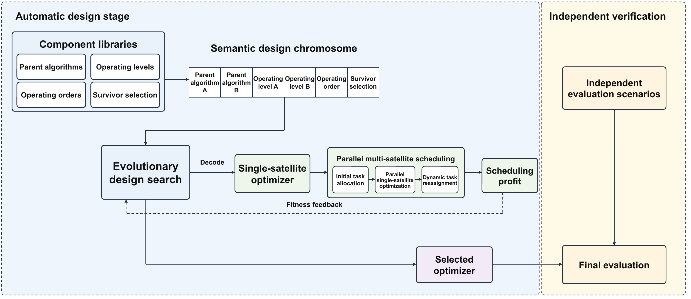

# Automatic Design of Collaboration-Based Hybrid Metaheuristics for Large-Scale Agile Earth Observation Satellite Scheduling

**Abstract**--The large-scale agile earth observation satellite task scheduling problem (LS-AEOSTSP) critically impacts time-sensitive observation missions for growing satellite constellations. Coupling task selection, satellite assignment, visible-window placement, and attitude-constrained sequencing, it presents an NP-hard combinatorial challenge at operational constellation scales. While collaboration-based hybrid metaheuristics have demonstrated remarkable performance in combinatorial scheduling, existing approaches rely on fixed collaboration structures that suffer from vast combinatorial configuration spaces and high manual design costs. To address these limitations, this paper recasts the design of collaboration-based hybrid optimizers as an automated structural search problem within a unified scheduling pipeline. We formulate a six-gene semantic chromosome and modular component libraries governing parent algorithm selection, population operating levels, operating orders, and survivor selection rules. An evolutionary configuration-search procedure on multi-scenario training instances automatically composes an effective hybrid optimizer (Auto-Hybrid), discovering an adaptive collaboration scheme combining estimation of distribution algorithms and genetic algorithms. Extensive comparative experiments across sixteen scenarios (500–10,000 tasks and 5–100 satellites) demonstrate that Auto-Hybrid consistently outperforms or matches state-of-the-art handcrafted hybrid metaheuristics and classic algorithms, exhibiting superior solution quality on dense regional scenarios while maintaining near-optimal performance on global scenarios.

**Index Terms**--Agile earth observation satellites, multi-satellite scheduling, automated algorithm design, collaboration-based hybrid metaheuristics, evolutionary search

# I. Introduction

Agile earth observation satellites (AEOS) equipped with three-axis attitude maneuverability have become an essential platform for acquiring space-based information, supporting time-sensitive applications such as disaster response, resource mapping, and environmental monitoring [1], [3]. However, as illustrated in Fig. 1, this attitude agility introduces unprecedented challenges for large-scale multi-satellite scheduling across three key dimensions. First, each observation task typically corresponds to multiple potential visible time windows (VTWs) across different satellites, leading to a combinatorial decision space that expands exponentially with constellation and task scales. Second, unlike conventional earth observation satellites (EOS) that can only observe targets directly below their ground track, AEOS can maneuver along roll, pitch, and yaw axes to capture off-nadir targets. This three-axis maneuverability introduces complex, attitude-dependent transition times between consecutive observations, tightly coupling the scheduling of successive tasks. Third, multi-satellite cooperative scheduling must simultaneously satisfy stringent attitude maneuver limits, narrow time windows, and intense resource competition across satellites while balancing constellation workloads. Due to the combined effect of these factors, the large-scale agile earth observation satellite task scheduling problem (LS-AEOSTSP) is widely recognized as a highly complex NP-hard combinatorial optimization problem [1], [2], [4], [5].


**Fig. 1.** Comparison of observation modes between non-agile EOS and AEOS [6].

Prior work on agile satellite scheduling spans several methodological lines. Survey and exact-optimization studies clarify the main modeling variants and constraint structures: Wang et al. [1] reviewed two decades of AEOS scheduling formulations and methods, Chen et al. [2] built a mixed-integer linear programming model for multi-satellite scheduling, and Peng et al. [4], [5] developed exact formulations that exploit the time-dependent profit and transition-time structure of the problem. However, as constellation and task scales expand, the binary decision variables and temporal sequencing constraints proliferate combinatorially, causing exact branch-and-bound solvers to suffer from exponential time complexity and memory exhaustion [1], [2], [5]. Because exact methods become computationally intractable for operational large-scale instances, metaheuristics have emerged as the dominant practical approach.

Adaptive large neighborhood search (ALNS) and its variants are well studied. Liu et al. [6] designed problem-specific removal and insertion operators for time-dependent transition times, and He et al. [7] extended ALNS to multiple agile satellites with a dynamic task-allocation mechanism. Population-based evolutionary algorithms have also been applied: Yao et al. [9] proposed a bilevel evolutionary algorithm for large-scale multiobjective task scheduling, Qin et al. [10] combined simulated annealing with a genetic algorithm for multisatellite scheduling of moving targets, and Wang et al. [11] designed a strategy fusion-based multi-objective optimization approach. Related methods address further variants, including interval-varying profits [8] and the integrated agile scheduling problem [15]. However, most existing methods rely on a single algorithmic paradigm, limiting the balance between exploration and exploitation in the LS-AEOSTSP search space [1].

Hybrid metaheuristics, which combine the strengths of multiple search strategies within a unified framework, are effective for combinatorial optimization. Blum et al. [12] surveyed hybrid metaheuristic paradigms and reported numerous successful applications where hybridization improved solution quality. In the domain of scheduling, Fan et al. [13] proposed a hybrid evolutionary algorithm using two solution representations for hybrid flow-shop scheduling, and Shu et al. [14] integrated variable neighborhood search with NSGA-II for emergency material scheduling. For LS-AEOSTSP, recent work proposed a random-key hybrid metaheuristic algorithm (RK-HMA) [21], which connects continuous optimizers with discrete task sequences through random-key encoding, applies DE/rand/1 and PSO sequentially to the full shared population with elitist-truncation survivor selection, and uses dynamic task reassignment to coordinate satellites. RK-HMA demonstrates that hybridization is effective for large-scale satellite scheduling. However, this manual design paradigm faces two notable limitations: (i) the structural design space of collaboration-based hybrids is combinatorially vast—combinations of parent algorithms, operating levels, operating orders, and survivor-selection rules form a massive configuration space, within which manual trial and error can sample only a tiny fraction of intuitive, human-biased configurations, easily overlooking non-obvious yet effective synergistic structures; and (ii) the design process relies on ad-hoc empirical engineering and expert heuristics, where exploring alternative architectures requires substantial implementation overhead and lacks a systematic, data-driven feedback mechanism to guide structural search.

The central question is therefore an automatic-design question: can the hybrid structure itself be automatically composed for the complex scheduling pipeline? Algorithm configuration methods such as ParamILS, SMAC, and irace tune parameterized algorithms over training instances [16]–[18]. Hyper-heuristics search over heuristic components rather than directly searching the solution space [19]. Automated algorithm design (AAD) goes further by searching structural compositions rather than only tuning parameters or choosing among fixed algorithms. Recently, AutoHyb formulated the automated design of collaboration-based hybrid metaheuristics as a meta-optimization problem using a top-down structural template [20]. However, existing automated hybrid-design studies have primarily focused on standard continuous numerical benchmarks or simple combinatorial problems with inexpensive objective evaluations. In operational LS-AEOSTSP, each candidate solution evaluation involves intricate multi-satellite visible-window access, time-dependent attitude maneuvers, and coupled task allocation. The high computational cost and tightly coupled temporal constraints make naive end-to-end structural search intractable, demanding a specialized, modular automated design framework tailored to the scheduling hierarchy.

This paper addresses these challenges for LS-AEOSTSP by making the inner single-satellite optimizer a searchable structural layer. We adopt the established two-level scheduling architecture from RK-HMA [21]—which decomposes large-scale scheduling into single-satellite optimization and multi-satellite task reassignment—while keeping the outer scheduling bridge and reassignment layer fixed as a common evaluation environment. A six-gene chromosome encodes the collaboration structure of the inner optimizer, governing parent algorithms, operating levels, operating orders, and survivor selection. Each candidate chromosome is decoded into an executable optimizer and evaluated through the coupled scheduling pipeline, a setting not addressed by prior automated-design work. The detailed encoding is introduced in Section III-C.

The main contributions of this paper are summarized as follows:

1. We propose an automated design framework for collaboration-based hybrid metaheuristics tailored to LS-AEOSTSP, transforming the design of inner single-satellite optimizers from empirical manual crafting into systematic algorithmic search.

2. We formulate a six-gene semantic chromosome and modular component libraries that govern parent algorithm selection, population operating levels, operating orders, and survivor selection rules into an interpretable structural representation, seamlessly integrated with the random-key scheduling bridge and dynamic task reassignment.

3. We conduct extensive comparative evaluations across sixteen experimental scenarios (500–10,000 tasks and 5–100 satellites). The automatically synthesized optimizer (Auto-Hybrid) consistently outperforms or matches state-of-the-art handcrafted hybrids and classic metaheuristics, exhibiting superior optimization capability on complex regional scenarios while maintaining near-optimal performance on global scenarios.

The remaining sections are organized as follows. Section II defines the scheduling problem. Section III describes the automatic hybrid-design framework. Section IV reports the experiments. Section V concludes the paper.

# II. Problem Description

## A. Problem Description

Given a set $T=\{t_1,\ldots,t_n\}$ of $n$ tasks and a set $AEOS=\{aeos_1,\ldots,aeos_m\}$ of $m$ agile earth observation satellites. Each task $t_i$ is associated with a geographic location (latitude and longitude), an imaging duration $l_i$, and a profit $p_i$, which are provided by the user. Each satellite $aeos_j$ is represented by its orbital parameters, including the semi-major axis, eccentricity, inclination, right ascension of the ascending node, argument of perigee, and true anomaly. Given the target location and satellite orbital parameters, the visible time windows (VTWs) of each target associated with its visible satellites are obtained through access calculation. Each VTW $w_{ijk}$ has a start time $st_{ijk}$, an end time $et_{ijk}$, and a length $d_{ijk}$. The roll, pitch, and yaw angles of the imaging payload at the corresponding observation times are also available. The notations used throughout this paper are summarized in Table I.

\clearpage
**Table I**

Notation for LS-AEOSTSP.

\begin{longtable}{@{}>{\centering\arraybackslash}p{(\linewidth - 2\tabcolsep) * \real{0.4000}} >{\centering\arraybackslash}p{(\linewidth - 2\tabcolsep) * \real{0.6000}}@{}}
\toprule
\textbf{Notation} & \textbf{Description} \\
\midrule
\endhead
\bottomrule
\endlastfoot
\(T\) & Tasks set \\
\(n\) & Number of tasks \\
\(\mathrm{AEOS}\) & Satellites set \\
\(m\) & Number of satellites \\
\(p_i\) & Profit of task \(t_i\) \\
\(l_i\) & Imaging duration of task \(t_i\) \\
\(\chi^{jt}\) & Rolling angle of \(\mathrm{aeos}_j\) at time \(t\) \\
\(\pi^{jt}\) & Pitching angle of \(\mathrm{aeos}_j\) at time \(t\) \\
\(\phi^{jt}\) & Yawing angle of \(\mathrm{aeos}_j\) at time \(t\) \\
\(w_{ijk}\) & \(k\)-th VTW for task \(t_i\) on satellite \(\mathrm{aeos}_j\) \\
\(W_{ij}\) & VTWs set for task \(t_i\) on satellite \(\mathrm{aeos}_j\) \\
\(\lvert W_{ij}\rvert\) & Number of VTWs for task \(t_i\) on satellite \(\mathrm{aeos}_j\) \\
\(st_{ijk}\) & Start time of \(w_{ijk}\) \\
\(et_{ijk}\) & End time of \(w_{ijk}\) \\
\(d_{ijk}\) & Length of \(w_{ijk}\) \\
\(c_i\) & Specified minimum imaging quality of task \(t_i\) \\
\end{longtable}

Due to the limited number of satellites compared with the number of tasks, it is difficult to execute all tasks. Therefore, the LS-AEOSTSP aims to determine the imaging times of a subset of tasks within their VTWs while maximizing the total observation profit, subject to the following assumptions.

1. Each task is a meta-task that can be directly executed by a satellite. Complex tasks such as area target coverage or moving target tracking are not considered, because they can be decomposed into meta-tasks through strip partitioning.
2. Power-capacity and storage-capacity constraints are not modeled. In normal operation, satellites charge through solar power and transmit data to ground stations or relay satellites to release onboard storage.
3. Each satellite is equipped with a single imaging payload and can execute at most one task at a time.
4. Once executed, a task cannot be aborted, and each task is executed at most once.

The decision variables are $x_{ijk}$ and $u_{ijk}$. The binary variable $x_{ijk}$ equals one if task $t_i$ is executed in VTW $w_{ijk}$ and zero otherwise. The continuous variable $u_{ijk}$ denotes the start time of task $t_i$ when $x_{ijk}=1$. The sequencing variable $\rho_{ijk,i^*jk^*}$ equals one if task $t_i$ is the predecessor of task $t_{i^*}$ on satellite $aeos_j$ and zero otherwise.

The mathematical formulation of the LS-AEOSTSP is given as follows.

Objective function:

$$
\max \sum_{i=1}^{n}\sum_{j=1}^{m}\sum_{k=1}^{|W_{ij}|} x_{ijk}p_i. \tag{1}
$$

The objective function maximizes the total observation profit of all scheduled tasks.

Constraints:

$$
\sum_{j=1}^{m}\sum_{k=1}^{|W_{ij}|} x_{ijk} \le 1,\quad \forall t_i\in T. \tag{2}
$$

$$
st_{ijk} \le u_{ijk} < u_{ijk}+l_i \le et_{ijk},\quad \text{if }x_{ijk}=1. \tag{3}
$$

$$
\rho_{ijk,i^*jk^*}=
\begin{cases}
1, & \text{if }t_i\text{ is the predecessor of }t_{i^*},\\
0, & \text{otherwise,}
\end{cases}
\quad \text{if }x_{ijk}=x_{i^*jk^*}=1. \tag{4}
$$

$$
u_{ijk}+l_i+\Delta t(t_i,t_{i^*})\le u_{i^*jk^*},\quad \text{if }\rho_{ijk,i^*jk^*}=1. \tag{5}
$$

The transition time is a piecewise linear function of the total angular displacement:

$$
\Delta t(t_i,t_{i^*})
=
\begin{cases}
11.66, & \Delta g(t_i,t_{i^*})\leq 10^\circ,\\
a_1+\dfrac{\Delta g(t_i,t_{i^*})}{v_1}, & 10^\circ<\Delta g(t_i,t_{i^*})\leq 30^\circ,\\
a_2+\dfrac{\Delta g(t_i,t_{i^*})}{v_2}, & 30^\circ<\Delta g(t_i,t_{i^*})\leq 60^\circ,\\
a_3+\dfrac{\Delta g(t_i,t_{i^*})}{v_3}, & 60^\circ<\Delta g(t_i,t_{i^*})\leq 90^\circ,\\
a_4+\dfrac{\Delta g(t_i,t_{i^*})}{v_4}, & \Delta g(t_i,t_{i^*})>90^\circ.
\end{cases} \tag{6}
$$

The total change in satellite look angles is computed from the attitude differences between the two observations:

$$
\Delta g(t_i,t_{i^*})
=|\chi^{j,u_{ijk}}-\chi^{j,u_{i^*jk^*}}|
+|\pi^{j,u_{ijk}}-\pi^{j,u_{i^*jk^*}}|
+|\phi^{j,u_{ijk}}-\phi^{j,u_{i^*jk^*}}|,\quad \text{if }\rho_{ijk,i^*jk^*}=1. \tag{7}
$$

$$
q_i\ge c_i,\quad \forall t_i\in T. \tag{8}
$$

When a scheduled task is executed in $w_{ijk}$, its imaging quality is computed by the distance between the observation start time and the midpoint of the selected VTW:

$$
q_i=10-9\cdot
\frac{|2u_{ijk}+l_i-2w_{ijk}^{*}|}{d_{ijk}-l_i},
\quad \text{if }x_{ijk}=1, \tag{9}
$$

$$
w_{ijk}^{*}=\frac{st_{ijk}+et_{ijk}}{2},\quad \text{if }x_{ijk}=1. \tag{10}
$$

Constraint (2) ensures that each task is executed at most once. Constraint (3) ensures that the execution interval of a scheduled task is contained in its selected VTW. Constraint (5) requires the time interval between two successive tasks on the same satellite to be no shorter than the transition time $\Delta t(t_i,t_{i^*})$. Following [5], the transition time is calculated using the segmented function in Eq. (6). The quantity $\Delta g(t_i,t_{i^*})$ represents the total change in the satellite look angles between the two tasks, as defined in Eq. (7). The angular velocities and constant terms are set to $v_1=1.5^\circ/\text{s}$, $a_1=5$, $v_2=2^\circ/\text{s}$, $a_2=10$, $v_3=2.5^\circ/\text{s}$, $a_3=16$, $v_4=3^\circ/\text{s}$, and $a_4=22$. Constraint (8) requires the imaging quality $q_i$ to be no lower than the specified minimum quality $c_i$. Equation (9) calculates $q_i$ from the task start time, and Eq. (10) defines the midpoint of the selected VTW.

# III. Automatic Hybrid-Design Framework

## A. Design Principle

The proposed framework follows the top-down design idea of AutoHyb [20], where designing a collaboration-based hybrid optimizer is formulated as a meta-optimization problem. AutoHyb treats the optimizer structure as a searchable design object: each candidate design scheme specifies which parent algorithms to combine (e.g., DE, PSO, EDA) and how to hybridize them through a set of hybridization factors: the operating level (OL), which determines which subpopulation of the shared population each parent algorithm modifies; the operating order (OO), which determines the information dependency between the two parent algorithms; and survivor selection, which determines how newly generated and existing individuals compete for the next generation. AutoHyb was developed and validated on general numerical and combinatorial benchmarks, where each candidate optimizer can be evaluated with modest computational cost. We adapt this idea to the coupled, discrete LS-AEOSTSP, where every candidate solution must be evaluated through a full scheduling process that assigns tasks to satellites, selects visible time windows, determines observation timing, and computes attitude-dependent transition times—making each fitness evaluation far more expensive and the design problem considerably harder than on numerical benchmarks.

This paper instantiates that template for LS-AEOSTSP. The target scheduling pipeline is inherited from RK-HMA [21], which has two layers: an outer multi-satellite layer that handles task-to-satellite allocation and cross-satellite reassignment of unscheduled tasks, and an inner single-satellite optimizer that evolves the task sequence for each satellite independently using a random-key encoding—continuous keys define task priorities, and a greedy insertion decoder maps each random-key vector to a feasible schedule by sorting tasks and inserting them into visible time windows while respecting attitude-transition constraints.

We fix the outer layer and the decoder unchanged from RK-HMA; the automatic-design layer searches only the collaboration structure of the inner single-satellite optimizer—parent algorithms, their OL choices, the OO choice, and survivor selection. We further restrict this design object to pairwise collaboration between exactly two parent algorithms. This restriction serves three purposes: (1) it keeps the design space tractable, and adding a third parent algorithm would expand this by another order of magnitude; (2) it ensures a well-defined collaboration structure—two parent algorithms form a single information-flow edge with explicit OO semantics and information dependency; hybridizing three or more parent algorithms could potentially offer greater search diversity, but would introduce multiple edges with cyclic dependencies or complex scheduling among components, requiring additional design dimensions that are beyond the scope of this work; (3) it supports a matched comparison with the manually designed RK-HMA baseline, which is itself a hybrid with two parent algorithms. This scoping keeps each candidate optimizer cheap enough to evaluate through the expensive scheduling pipeline.

In our design, each offspring is generated by either crossover or mutation. The two operators are mutually exclusive alternatives with complementary probabilities $p_c$ and $p_m=1-p_c$. This exclusive choice ensures that each offspring can be unambiguously attributed to a single operator, preserving a clean interpretation of their individual effects. To evaluate the generalization capability and prevent overfitting, the design search is conducted on a dedicated set of independent training scenarios distinct from the final evaluation benchmarks. Chromosomes are ranked by a multi-scenario fitness that normalizes scheduling profit across scenarios, as defined in Section III-E.

As shown in Fig. 2, the resulting workflow has five levels:

1. Component libraries define the admissible parent algorithms and hybridization factors.
2. A semantic chromosome selects one component for each algorithmic role.
3. A decoder maps the chromosome to an executable single-satellite optimizer.
4. The generated optimizer is embedded in the fixed multi-satellite scheduling pipeline.
5. An outer evolutionary search ranks chromosomes by their measured scheduling profit.



**Fig. 2.** Framework of the proposed Auto-Hybrid.

## B. Component Libraries for Automatic Design

Based on the design principle above, the searchable collaboration structure is defined by four component libraries. Tables II–V list the admissible realization forms for parent algorithms, operating levels (OL), operating orders (OO), and survivor selection rules. To avoid ambiguity across the two optimization tiers, an inner individual denotes one real-valued random-key solution—where continuous keys determine task observation priorities decoded into a single-satellite schedule—whereas a design candidate denotes one six-gene chromosome that specifies the complete collaboration structure of an inner single-satellite hybrid optimizer. Only these structural choices are encoded; the numerical parameters of the library algorithms are held fixed during the design comparison. This separation keeps the search focused strictly on collaboration structure.

The parent-algorithm library collects established metaheuristics that can operate on the shared random-key representation, chosen to span complementary search behaviors. It includes population-based evolutionary search through a genetic algorithm (GA) [22]; swarm intelligence through particle swarm optimization (PSO) [22]; probabilistic model building through an estimation-of-distribution algorithm (EDA) [22] and a continuous ant colony optimization (ACO) [23]; differential evolution in three mutation forms, DE/rand/1, DE/best/1, and DE/current-to-rand/1 [24]; a bee-colony algorithm (ABC) [22]; trajectory-based simulated annealing (SA) [22]; the success-history adaptive DE with linear population reduction (L-SHADE) [25]; and an adaptive large neighborhood search (ALNS) [6], [7] drawn from the scheduling literature. This mix lets the design stage combine exploratory, exploitative, model-based, and neighborhood-based dynamics. Table II summarizes the eleven parent algorithms.

**TABLE II: PARENT-ALGORITHM LIBRARY.**

| ID | Parent algorithm | Brief description |
|--:|-----|------------|
| 0 | GA | Evolutionary algorithm that generates offspring through selection, crossover, and mutation. |
| 1 | PSO | Swarm-intelligence algorithm that updates particles using personal and global best experience. |
| 2 | EDA | Probabilistic model-based algorithm that estimates promising distributions from selected solutions. |
| 3 | ACO | Pheromone-inspired constructive search that samples candidates according to learned desirability. |
| 4 | DE/rand/1 | Differential evolution variant that mutates a random base vector with one differential vector. |
| 5 | DE/best/1 | Differential evolution variant that mutates the current best vector with one differential vector. |
| 6 | DE/current-to-rand/1 | Differential evolution variant that moves the current vector toward a random differential direction. |
| 7 | ABC | Bee-colony algorithm that alternates employed-bee, onlooker-bee, and scout-bee search phases. |
| 8 | SA | Trajectory-based local search that uses temperature-controlled acceptance of worsening moves. |
| 9 | L-SHADE | Success-history adaptive differential evolution with external archive and linear population-size reduction. |
| 10 | ALNS | Neighborhood-search framework that alternates destroy and repair operators under adaptive selection. |

The operating-level library determines which inner random-key solutions of the shared population each parent algorithm is allowed to modify. As summarized in Table III, the seven realization forms span population-, subpopulation-, and individual-level updates. Parameter symbols are included directly in the corresponding realization forms, and their values are reported in Table IX.

**TABLE III: OPERATING-LEVEL LIBRARY.**

| ID | Operating level | Realization form |
|--:|-----|------------|
| 0 | Full population | The parent algorithm works on all inner random-key solutions in the current population. |
| 1 | Top-subset selection | The parent algorithm works on a fixed high-fitness subpopulation of inner solutions with ratio $r_{\text{sub}}$. |
| 2 | Mixed-subset selection | The parent algorithm works on a subpopulation mixing the top fraction $r_{\text{mix}}$ with random inner solutions. |
| 3 | Random-decay selection | The parent algorithm works on a random subpopulation of inner solutions whose ratio decays from $r_{\text{dec}}$ over iterations. |
| 4 | Above-mean selection | The parent algorithm works on inner solutions whose fitness is above the population mean. |
| 5 | Local-search focus | The parent algorithm focuses on the historical best inner solution. |
| 6 | Worst-repair focus | The parent algorithm focuses on the current worst inner solution. |

The operating-order library specifies when the two parent algorithms are invoked and thereby determines their information dependency. As listed in Table IV, its realization forms comprise seven sequential options and one parallel option. Parameter symbols are included directly in the corresponding realization forms, and their values are reported in Table IX.

**TABLE IV: OPERATING-ORDER (OO) LIBRARY.**

| ID | Operating order (OO) | OO type | Corresponding realization form |
|--:|------|----|------------|
| 0 | Sequential | Sequential | Parent algorithm 1 runs before parent algorithm 2 in each iteration. |
| 1 | Periodic switching | Sequential | The active parent algorithm switches every $T_{\text{sw}}$ iterations. |
| 2 | Stage-based switching | Sequential | Parent algorithm 1 runs through stage boundary $\tau_{\text{stage}}$; parent algorithm 2 runs afterward. |
| 3 | Best-no-improvement switching | Sequential | Switches after $T_{\text{best}}$ consecutive iterations without global-best improvement. |
| 4 | Process-no-improvement switching | Sequential | Switches after $T_{\text{proc}}$ consecutive iterations without improvement in the global best or mean fitness. |
| 5 | Diversity-based switching | Sequential | Routing depends on population diversity, checked every $T_{\text{div}}$ iterations against threshold $\theta_{\text{div}}$. |
| 7 | Adaptive-credit routing | Sequential | Parent algorithm 1 is selected with probability $p_1$ derived from recent improvement per evaluation cost; parent algorithm 2 with $p_2=1-p_1$. |
| 6 | Parallel | Parallel | Both parent algorithms generate candidates separately; candidates are merged. |

The survivor-selection library determines how current and newly generated inner solutions compete to form the next population. As summarized in Table V, its four realization forms span deterministic truncation, pairwise-greedy replacement, stochastic tournament selection, and rank-weighted sampling, allowing the design search to vary the selection pressure applied to candidate solutions.

**TABLE V: SURVIVOR-SELECTION LIBRARY.**

| ID | Survivor policy | Corresponding realization form |
|--:|-----|------------|
| 0 | Elitist truncation | Current and offspring inner solutions are merged and the best $N$ survive. |
| 1 | Tournament selection | For each survivor slot, $k_{\mathrm{tour}}$ candidates are sampled from the merged set, and the fittest candidate is retained. |
| 2 | Pairwise greedy | Each offspring inner solution competes with its paired current solution. |
| 3 | Rank-weighted sampling | Candidates are sampled from the merged set with probabilities that decrease linearly with fitness rank. |

Together, Tables II-V define the component libraries that span the searchable optimizer-design space. Scheduling execution details are described with the evaluation protocol.

## C. Semantic Structural Optimizer Encoding

The component libraries are assembled into a searchable representation through a chromosome:
$$
\mathbf{h}=(h_0,h_1,h_2,h_3,h_4,h_5),
$$
as illustrated in Fig. 3.

\begin{center}
\includegraphics[width=0.65\linewidth,keepaspectratio]{figures/semantic_hybrid_scheme_encoding.png}
\end{center}
\refstepcounter{figure}
\textbf{Fig. 3.} Six-gene semantic chromosome encoding.

Together, the six positions encode one structural collaboration scheme rather than a numerical parameter vector. This semantic layout makes the composed optimizer interpretable after search: each gene names a distinct algorithmic role.

After enforcing $h_0\ne h_1$, the valid search space is:
$$
11\times 10\times 7\times 7\times 8\times 4 = 172{,}480
$$

This yields 172,480 candidate optimizer structures, which indicates the scale of the structural design space. Exhaustively evaluating all of them is impractical, because each candidate must be decoded into an optimizer and run through the scheduling pipeline. This motivates the evolutionary configuration-search procedure in Section III-E.

## D. Chromosome-to-Optimizer Decoding

The decoding function maps one optimizer chromosome to a runnable single-satellite optimizer. Let $\Phi(\mathbf{h})$ denote the optimizer generated by chromosome $\mathbf{h}$. The generated optimizer is a shared-population hybrid: it maintains one random-key population and one decoded scheduling objective. Both parent algorithms update selected individuals from this population and are evaluated using the same fitness vector $F^t$. This shared-population design distinguishes the method from running two independent optimizers and combining their outputs: the OL choices, the OO choice, and survivor selection specify how the two parent algorithms collaborate through one evolving population. The chromosome changes how these inner search operators are assembled, while the outer scheduling bridge and reassignment layer remain fixed.

At iteration $t$, the first two genes activate the two parent algorithms:

$$
(h_0,h_1)\mapsto (\mathcal{A}_{h_0},\mathcal{A}_{h_1}),
$$
where $\mathcal{A}_{h_i}$ is one algorithm from the active parent-algorithm library. The two parent calls therefore share the population state and objective evaluation described above.

The OL genes then define two individual masks:

$$
M_1=\mathcal{M}(h_2,X^t,F^t),\quad M_2=\mathcal{M}(h_3,X^t,F^t),
$$
where $X^t$ is the current random-key population and $F^t$ is the corresponding fitness vector. The masks define which inner random-key solutions each parent algorithm is allowed to modify, while the OL semantics are listed in Table III.

The OO gene schedules the two parent-algorithm calls and produces a candidate population:

$$
\mathcal{O}_{h_4}:\left(\mathcal{A}_{h_0},\mathcal{A}_{h_1},M_1,M_2\right)\rightarrow X'.
$$

The OO semantics are listed in Table IV. Each candidate key in $X'$ is decoded into a task sequence and scored by the scheduling-profit objective, giving the candidate fitness vector $F'$.

The survivor gene then builds the next population:

$$
X^{t+1}=\mathcal{S}_{h_5}(X^t,X',F^t,F').
$$

Applied in order, parent-algorithm activation, OL masking, parent execution under the OO policy, and survivor selection form one complete single-satellite optimizer iteration.

The decoding step turns optimizer construction into part of the experiment. The inner single-satellite optimizer is generated from an evolvable semantic chromosome and evaluated inside the same scheduling pipeline.

## E. Evolutionary Configuration-Search Procedure

The design procedure evolves optimizer chromosomes based on their performance across the training scenarios. Each decoded optimizer is evaluated over multiple independent runs per scenario. To eliminate instance-scale bias, the design fitness (designScore in Algorithm 1) aggregates the scheduling profit normalized by each scenario’s total task profit.

Algorithm 1 summarizes the design-search procedure.

\begin{algorithm}
\caption{Evolutionary optimizer-design procedure}
\begin{algorithmic}[1]
\Statex \textbf{Input:} Training-scenario set $\mathcal{D}_{\mathrm{train}}$; component libraries $\mathcal{A}$, $\mathcal{U}$, $\mathcal{O}$, and $\mathcal{S}$; population size $N_d$; generation cap $G_{\max}$; evaluation repeats $R_d$; crossover probability $p_c$; mutation probability $p_m=1-p_c$; search-budget ratio $\rho$; and full inner budget $B_{\mathrm{full}}(s)$ for each $s\in\mathcal{D}_{\mathrm{train}}$.
\Statex \textbf{Output:} Selected optimizer chromosome $\mathbf{h}^{\star}$.
\State For each $s\in\mathcal{D}_{\mathrm{train}}$, set $B_{\mathrm{design}}(s)\gets\max\{1,\operatorname{round}(\rho B_{\mathrm{full}}(s))\}$.
\State Initialize population $P_0$ with $N_d$ valid optimizer chromosomes.
\State Evaluate every $\mathbf{h}\in P_0$ using $\operatorname{designScore}(\mathbf{h};\{B_{\mathrm{design}}(s):s\in\mathcal{D}_{\mathrm{train}}\})$.
\State Set $\mathbf{h}^{\star}$ to the best chromosome in $P_0$.
\For{$t=1,\ldots,G_{\max}$}
    \State Shuffle the chromosome indices in $P_{t-1}$.
    \For{each selected chromosome pair}
        \If{a random draw is at most $p_c$}
            \State Generate an offspring by one-point crossover.
        \Else
            \State Mutate a randomly selected nonempty subset of the six genes.
        \EndIf
        \State Repair duplicate parent-algorithm choices so that $h_0\ne h_1$.
        \State Add the offspring to $Q_t$.
    \EndFor
    \State Evaluate every offspring $\mathbf{h}\in Q_t$ using $\operatorname{designScore}(\mathbf{h};\{B_{\mathrm{design}}(s):s\in\mathcal{D}_{\mathrm{train}}\})$.
    \State Merge $P_{t-1}$ and $Q_t$.
    \State Select the top $N_d$ chromosomes by design fitness to form $P_t$.
    \State Update $\mathbf{h}^{\star}$ if a better chromosome is found.
\EndFor
\State \textbf{return} $\mathbf{h}^{\star}$.
\end{algorithmic}
\end{algorithm}


**Fig. 4.** Crossover and mutation of optimizer chromosomes.

The overall experimental protocol follows a three-stage procedure that balances search efficiency with evaluation reliability. First, Algorithm 1 is executed across five independent runs on the training scenarios with a reduced budget $B_{\mathrm{design}}(s)$ ($R_d$ runs per candidate) to rapidly explore the structural design space. Second, to mitigate stochastic noise, the top five unique configurations pooled from the final populations are re-evaluated under the same reduced budget with an increased sample size $R_s$, and the configuration achieving the highest macro-mean normalized profit across training scenarios is selected. Third, the selected configuration is re-assessed under the full budget $B_{\mathrm{full}}(s)$ with $R_f$ runs on all evaluation scenarios to establish its final scheduling performance.

## F. Scheduling Execution Under a Designed Optimizer

The overall multi-satellite scheduling pipeline follows a two-level decomposition inherited from RK-HMA [21]. Initially, all observation tasks are partitioned across candidate satellites using the capacity-aware composite allocation heuristic and fast local refinement from [21], which balances usable window length, visible window count, satellite workload, and time-window conflict density.

Once tasks are assigned to satellites and $\Phi(\mathbf{h})$ is instantiated, each satellite is optimized through the random-key scheduling bridge. For a satellite with $D$ assigned tasks, the single-satellite optimizer maintains a population of $N$ random-key vectors, each of dimension $D$:

$$
X=\{\mathbf{x}^{(1)},\mathbf{x}^{(2)},\ldots,\mathbf{x}^{(N)}\}.
$$

Each vector is decoded by sorting its keys, and the sorted order gives a candidate task sequence. A greedy insertion decoder then places tasks one by one into their earliest feasible observation time following this priority order and computes the collected profit:

$$
f(\mathbf{x})=\sum_{t_i\in P_j} p_i,
$$
where $P_j$ is the feasible schedule constructed for satellite $aeos_j$.

After per-satellite schedules are generated, the fixed multi-satellite layer applies the RK-HMA dynamic reassignment procedure [21] to reconsider unscheduled tasks. It attempts four migration strategies in increasing order of intervention: standard migration inserts unscheduled tasks directly; replacement move removes a low-profit scheduled task to make room; swap move exchanges a scheduled task between two satellites; and bundle move clusters remaining unscheduled tasks by time proximity and migrates each group jointly. This layer is shared by all candidate chromosomes and is not part of the optimizer-design space.

# IV. Experimental Results

To evaluate the proposed automatic design framework and the resulting hybrid optimizer, comprehensive experiments are conducted on sixteen multi-satellite experimental scenarios. All algorithms and the experimental pipeline are implemented in Java, and experiments are performed on a workstation equipped with an Intel Core i7-14700KF CPU at 3.40 GHz and 64 GB of RAM.

```{=latex}
\renewcommand{\thetable}{\Roman{table}}
\setcounter{table}{5}
```

## A. Evaluation and Training Scenarios

Sixteen experimental scenarios are generated using the widely used satellite simulation tool introduced in [7], spanning small-scale, medium-scale, large-scale, and superlarge-scale problem instances. As summarized in Tables VI and VII, the evaluation scenarios contain 500–10,000 tasks and 5–100 agile satellites. In particular, a superlarge-scale scenario with 10,000 tasks and 100 satellites (R10) is included to evaluate the scalability of the algorithms under extreme problem dimensions. The planning horizons range from 6 to 24 hours. The spatial distributions are categorized into regional and global settings. Regional observation targets lie within $3^\circ\text{N}$–$53^\circ\text{N}$ and $74^\circ\text{E}$–$133^\circ\text{E}$, while global targets are randomly distributed across the globe. Imaging durations are integers between 1 and 30 seconds, and task profits range from 1 to 10. Among the regional instances, R3 (2000 tasks and 10 satellites) and R5 (3000 tasks and 20 satellites with a tight 8-hour window) exhibit especially high task-to-satellite ratios, serving as stress tests for resolving severe temporal contention and resource competition.

To prevent data snooping and ensure unbiased evaluation, structural search and candidate screening are conducted exclusively on four separately generated regional training instances (Table VIII). These training instances possess distinct scenario identities and generation seeds, keeping the search phase completely isolated from the evaluation scenarios.

The selection of these four training instances balances computational tractability with structural representativeness. Because the outer evolutionary design search repeatedly evaluates candidate hybrid chromosomes across multiple generations, restricting the training instances to moderate scales ($\le 4000$ tasks) keeps the structural search computationally feasible. Concurrently, instances T1–T4 span diverse problem dimensions (500 to 4000 tasks) and planning horizons (from tight 6-hour windows to full 24-hour horizons), capturing sufficient temporal and spatial conflict patterns for learning effective collaboration schemes. This setup also leaves the larger scenarios (up to 10,000 tasks and 100 satellites) to rigorously test the cross-scale generalization capability of the machine-composed optimizer.

```{=latex}
\begin{table}[H]
\centering
\small
\renewcommand{\arraystretch}{1.04}
\setlength{\tabcolsep}{4pt}
\caption{Regional experimental scenarios.}
\begin{tabular*}{\linewidth}{@{\extracolsep{\fill}}lrrl@{}}
\toprule
Scenario & Tasks & Satellites & Planning interval \\
\midrule
R1 & 500 & 5 & 00:00:00--23:59:59 \\
R2 & 1000 & 10 & 00:00:00--11:59:59 \\
R3 & 2000 & 10 & 00:00:00--11:59:59 \\
R4 & 2000 & 20 & 00:00:00--11:59:59 \\
R5 & 3000 & 20 & 00:00:00--07:59:59 \\
R6 & 4000 & 40 & 00:00:00--05:59:59 \\
R7 & 5000 & 50 & 00:00:00--11:59:59 \\
R8 & 6000 & 60 & 00:00:00--05:59:59 \\
R9 & 8000 & 80 & 00:00:00--11:59:59 \\
R10 & 10000 & 100 & 06:00:00--11:59:59 \\
\bottomrule
\end{tabular*}
\end{table}
```

```{=latex}
\begin{table}[H]
\centering
\small
\renewcommand{\arraystretch}{1.04}
\setlength{\tabcolsep}{4pt}
\caption{Global experimental scenarios.}
\begin{tabular*}{\linewidth}{@{\extracolsep{\fill}}lrrl@{}}
\toprule
Scenario & Tasks & Satellites & Planning interval \\
\midrule
G1 & 500 & 5 & 00:00:00--23:59:59 \\
G2 & 1000 & 10 & 12:00:00--23:59:59 \\
G3 & 2000 & 20 & 12:00:00--23:59:59 \\
G4 & 3000 & 30 & 12:00:00--19:59:59 \\
G5 & 4000 & 40 & 12:00:00--17:59:59 \\
G6 & 6000 & 60 & 12:00:00--17:59:59 \\
\bottomrule
\end{tabular*}
\end{table}
```

```{=latex}
\begin{table}[H]
\centering
\small
\renewcommand{\arraystretch}{1.04}
\setlength{\tabcolsep}{4pt}
\caption{Regional training scenarios.}
\begin{tabular*}{\linewidth}{@{\extracolsep{\fill}}lrrl@{}}
\toprule
Training instance & Tasks & Satellites & Planning interval \\
\midrule
T1 & 500 & 5 & 00:00:00--23:59:59 \\
T2 & 1000 & 10 & 00:00:00--11:59:59 \\
T3 & 1000 & 20 & 00:00:00--11:59:59 \\
T4 & 4000 & 40 & 00:00:00--05:59:59 \\
\bottomrule
\end{tabular*}
\end{table}
```

## B. Baselines, Metrics, and Parameter Settings

To comprehensively assess the performance of the automatically designed hybrid optimizer, six representative state-of-the-art algorithms in agile satellite scheduling are selected as comparative baselines, covering both adaptive neighborhood search frameworks (R-ALNS, A-ALNS) and prominent handcrafted hybrid metaheuristics (HCGA, HPSO, HeDEA, RK-HMA):
- **R-ALNS** [6]: Adaptive large neighborhood search for single-satellite scheduling combined with random multi-satellite task allocation.
- **A-ALNS** [7]: An enhanced ALNS framework that integrates adaptive cross-satellite task allocation.
- **HCGA** [26]: A hybrid coding genetic algorithm combining binary task selection and integer observation window encodings with problem-tailored genetic operators.
- **HPSO** [27]: A hybrid particle swarm optimization algorithm incorporating genetic crossover and local hill-climbing search.
- **HeDEA** [28]: A recently proposed hybrid dual-phase evolutionary algorithm that couples hierarchical genetic search with simulated annealing local exploitation.
- **RK-HMA** [21]: The state-of-the-art handcrafted hybrid metaheuristic combining DE/rand/1 and PSO sequentially under random-key continuous representation and dynamic task reassignment.

Auto-Hybrid denotes the optimal collaboration scheme discovered by the evolutionary configuration-search procedure on the training set: chromosome $[2,0,0,0,4,2]$, which couples EDA and GA with full-population updates, process-no-improvement switching, and pairwise-greedy survivor selection. Table IX summarizes the parameter settings for both structural search and inner scheduling execution. For fair and robust comparison, all algorithms are evaluated across five independent runs on each scenario.

The primary solution quality metric is the profit rate ($PR$), defined as:

$$
PR = \frac{F(P_S)}{F(P_A)} \times 100\% \tag{20}
$$
where $F(P_S)$ is the total profit of successfully scheduled tasks, and $F(P_A)$ is the total profit of all candidate observation tasks. In addition, elapsed computational time is recorded to evaluate execution efficiency. Macro means across scenarios assign equal weight to each instance.

```{=latex}
\begin{table}[H]
\centering
\small
\renewcommand{\arraystretch}{1.05}
\setlength{\tabcolsep}{4pt}
\caption{Parameter settings for Auto-Hybrid.}
\begin{tabular*}{\linewidth}{@{\extracolsep{\fill}}>{\raggedright\arraybackslash}p{0.42\linewidth}>{\raggedright\arraybackslash}p{0.13\linewidth}>{\raggedright\arraybackslash}p{0.37\linewidth}@{}}
\toprule
Setting & Symbol & Value \\
\midrule
Design population & $N_d$ & 35 \\
Outer generation cap & $G_{\max}$ & 25 \\
Early-stop minimum generations & $G_{\min}$ & 20 \\
Early-stop patience & $P$ & 5 \\
Early-stop minimum improvement & $\Delta$ & 0.001 \\
Outer evaluation repeats & $R_d$ & 2 \\
Candidate-screen repeats per training scenario & $R_s$ & 5 \\
Final replay runs per scenario & $R_f$ & 5 \\
Search budget ratio & $\rho$ & 0.6 \\
Design crossover probability & $p_c$ & 0.3 \\
Design mutation probability & $p_m=1-p_c$ & 0.7 \\
Population size & $N_{\mathrm{pop}}$ & $2.5 \times \max(n_j)$ \\
Full inner budget & $B_{\mathrm{full}}$ & $100N_{\mathrm{pop}}$ \\
Top-subset ratio & $r_{\mathrm{sub}}$ & 0.5 \\
Mixed-subset top ratio & $r_{\mathrm{mix}}$ & 0.8 \\
Random-decay start ratio & $r_{\mathrm{dec}}$ & $0.5 \rightarrow 0.2$ \\
Stage-switch boundary ratio & $\tau_{\mathrm{stage}}$ & 0.5 \\
Periodic-switch period & $T_{\mathrm{sw}}$ & $\max\{1,\lceil0.05B_{\mathrm{full}}\rceil\}$ \\
Best-no-improvement patience & $T_{\mathrm{best}}$ & $\max\{1,\lceil0.05(B_{\mathrm{full}}-N_{\mathrm{pop}}+1)\rceil\}$ \\
Process-no-improvement patience & $T_{\mathrm{proc}}$ & $\max\{1,\lceil0.05B_{\mathrm{full}}\rceil\}$ \\
Diversity-switch check interval & $T_{\mathrm{div}}$ & $\max\{1,\lceil0.01B_{\mathrm{full}}\rceil\}$ \\
Diversity-switch threshold & $\theta_{\mathrm{div}}$ & 0.02 \\
Adaptive-credit window & $W_c$ & 8 \\
Adaptive-credit default routing ratio & $\rho_c$ & 0.5 \\
Tournament size & $k_{\mathrm{tour}}$ & 2 \\
\bottomrule
\end{tabular*}
\end{table}
```

## C. Comparison Results

Tables X and XI report the five-run mean profit rates and elapsed computational times across all seven algorithms for regional and global scenarios, respectively. Bold values mark the highest mean profit rate in each scenario. Figs. 5 and 6 illustrate the overall profit-rate comparisons across the regional and global scenarios.

**Regional scenarios:** As demonstrated in Table X and Fig. 5, Auto-Hybrid achieves superior solution quality on the ten regional instances, attaining the highest mean profit rate on nine instances and tying RK-HMA on R1 (99.60%). Across all ten regional scenarios, Auto-Hybrid achieves a macro mean profit rate of 57.12%, outperforming RK-HMA (56.19%), A-ALNS (50.12%), R-ALNS (46.15%), HPSO (44.52%), HeDEA (43.00%), and HCGA (42.03%).

The performance advantages of Auto-Hybrid across different problem scales can be analyzed as follows:
- *Small- and Medium-Scale Scenarios (R1–R4):* In small-scale R1 (500 tasks, 5 satellites), both Auto-Hybrid and RK-HMA achieve 99.60%, outperforming HeDEA (98.66%), HPSO (96.58%), and ALNS variants (94.47%–95.39%). On R2 (1000 tasks, 10 satellites), Auto-Hybrid achieves 48.17%, compared with 47.50% for RK-HMA, while significantly outperforming other baselines (36.91%–44.14%). On R4 (2000 tasks, 20 satellites), Auto-Hybrid reaches 59.86%, surpassing RK-HMA (58.62%) by 1.24 percentage points.
- *High-Conflict Stress Scenarios (R3 and R5):* In instances R3 (2000 tasks, 10 satellites) and R5 (3000 tasks, 20 satellites with a constrained 8-hour horizon), the high task-to-satellite ratios induce intense competition for observation windows. Auto-Hybrid consistently maintains top performance, achieving 34.92% on R3 and 28.12% on R5, verifying its effectiveness in resolving severe combinatorial conflicts.
- *Large- and Superlarge-Scale Scenarios (R6–R10):* The advantages of automated structural search become particularly evident on large-scale instances. On R6 (4000 tasks, 40 satellites), Auto-Hybrid achieves 66.94% versus 63.95% for RK-HMA—a notable improvement of 2.99 percentage points. On R7 (5000 tasks, 50 satellites), Auto-Hybrid reaches 81.19%, outperforming HeDEA (58.71%), HPSO (56.67%), and A-ALNS (70.22%) by 10.97 to 24.52 percentage points. On the superlarge-scale R10 (10,000 tasks, 100 satellites), Auto-Hybrid achieves 34.21%, outperforming RK-HMA (34.08%), A-ALNS (30.41%), and HeDEA (21.36%). This highlights that the machine-discovered hybrid structure provides robust scalability in ultra-high-dimensional scheduling problems.

**Global scenarios:** As shown in Table XI and Fig. 6, the profit-rate differences among algorithms are markedly smaller on global scenarios. The macro mean of Auto-Hybrid (97.00%) is virtually identical to that of RK-HMA (97.01%), with both methods achieving tied near-optimal performance on G1 (99.89%), G2 (92.59%), G3 (98.44%), and G6 (100.00%). On G4 and G5, Auto-Hybrid achieves 94.99% and 96.07%, remaining within 0.05 percentage points of RK-HMA. This phenomenon aligns with domain characteristics: global targets are dispersed uniformly around the Earth, which substantially reduces visible window overlaps and resource contention. When scheduling conflicts are sparse, most search algorithms can readily achieve near-ceiling observation profits.

```{=latex}
\begingroup
\small
\renewcommand{\arraystretch}{1.03}
\setlength{\tabcolsep}{4pt}
\setlength{\LTleft}{0pt}
\setlength{\LTright}{0pt}
\makeatletter
\renewcommand{\LT@makecaption}[3]{\LT@mcol\LT@cols c{\hbox to\z@{\hss\parbox[t]{\linewidth}{\sffamily\small #1{\textbf{#2}\par}#3\par\vspace{6pt}}\hss}}}
\makeatother
\begin{longtable}{@{}p{0.12\linewidth}p{0.28\linewidth}>{\raggedleft\arraybackslash}p{0.25\linewidth}>{\raggedleft\arraybackslash}p{0.25\linewidth}@{}}
\caption{Mean profit rates and elapsed times on regional scenarios.}\\
\toprule
Scenario & Algorithm & Profit rate (\%) & Elapsed (s) \\
\midrule
\endfirsthead
\multicolumn{4}{@{}l}{\small\sffamily\textbf{Table \thetable} (continued)}\\
\toprule
Scenario & Algorithm & Profit rate (\%) & Elapsed (s) \\
\midrule
\endhead
\midrule
\multicolumn{4}{r@{}}{\small Continued on next page}\\
\endfoot
\bottomrule
\endlastfoot
R1 & R-ALNS & 94.47 & 7.33 \\*
 & A-ALNS & 95.39 & 7.01 \\*
 & HCGA & 94.58 & 13.92 \\*
 & HPSO & 96.58 & 8.37 \\*
 & HeDEA & 98.66 & 8.86 \\*
 & RK-HMA & \textbf{99.60} & 6.12 \\*
 & Auto-Hybrid & \textbf{99.60} & 5.57 \\
\midrule
R2 & R-ALNS & 36.91 & 11.00 \\*
 & A-ALNS & 41.95 & 11.90 \\*
 & HCGA & 44.14 & 15.40 \\*
 & HPSO & 41.73 & 7.98 \\*
 & HeDEA & 44.04 & 36.54 \\*
 & RK-HMA & 47.50 & 4.95 \\*
 & Auto-Hybrid & \textbf{48.17} & 4.40 \\
\midrule
R3 & R-ALNS & 25.76 & 32.20 \\*
 & A-ALNS & 30.90 & 32.89 \\*
 & HCGA & 29.40 & 32.35 \\*
 & HPSO & 29.10 & 25.23 \\*
 & HeDEA & 29.24 & 110.68 \\*
 & RK-HMA & 34.09 & 19.46 \\*
 & Auto-Hybrid & \textbf{34.92} & 16.15 \\
\midrule
R4 & R-ALNS & 45.42 & 42.09 \\*
 & A-ALNS & 49.23 & 50.66 \\*
 & HCGA & 48.76 & 56.77 \\*
 & HPSO & 48.67 & 49.01 \\*
 & HeDEA & 40.69 & 180.72 \\*
 & RK-HMA & 58.62 & 19.84 \\*
 & Auto-Hybrid & \textbf{59.86} & 14.90 \\
\midrule
R5 & R-ALNS & 20.81 & 54.30 \\*
 & A-ALNS & 23.82 & 62.78 \\*
 & HCGA & 20.59 & 39.07 \\*
 & HPSO & 23.43 & 52.61 \\*
 & HeDEA & 17.54 & 212.89 \\*
 & RK-HMA & 27.66 & 38.93 \\*
 & Auto-Hybrid & \textbf{28.12} & 32.95 \\
\midrule
R6 & R-ALNS & 53.67 & 169.02 \\*
 & A-ALNS & 59.70 & 213.19 \\*
 & HCGA & 48.30 & 157.48 \\*
 & HPSO & 48.09 & 214.00 \\*
 & HeDEA & 44.12 & 796.86 \\*
 & RK-HMA & 63.95 & 9.45 \\*
 & Auto-Hybrid & \textbf{66.94} & 7.77 \\
\midrule
R7 & R-ALNS & 65.39 & 130.54 \\*
 & A-ALNS & 70.22 & 196.35 \\*
 & HCGA & 49.39 & 558.40 \\*
 & HPSO & 56.67 & 189.55 \\*
 & HeDEA & 58.71 & 673.62 \\*
 & RK-HMA & 79.59 & 11.03 \\*
 & Auto-Hybrid & \textbf{81.19} & 9.57 \\
\midrule
R8 & R-ALNS & 51.27 & 165.66 \\*
 & A-ALNS & 56.00 & 243.12 \\*
 & HCGA & 36.79 & 632.50 \\*
 & HPSO & 43.14 & 224.14 \\*
 & HeDEA & 42.21 & 1008.71 \\*
 & RK-HMA & 65.62 & 14.66 \\*
 & Auto-Hybrid & \textbf{66.84} & 10.69 \\
\midrule
R9 & R-ALNS & 40.66 & 325.99 \\*
 & A-ALNS & 43.61 & 545.98 \\*
 & HCGA & 29.34 & 865.49 \\*
 & HPSO & 34.25 & 490.69 \\*
 & HeDEA & 33.43 & 2257.98 \\*
 & RK-HMA & 51.22 & 81.23 \\*
 & Auto-Hybrid & \textbf{51.40} & 46.40 \\
\midrule
R10 & R-ALNS & 27.13 & 435.24 \\*
 & A-ALNS & 30.41 & 363.74 \\*
 & HCGA & 19.01 & 1070.38 \\*
 & HPSO & 23.55 & 561.84 \\*
 & HeDEA & 21.36 & 3177.28 \\*
 & RK-HMA & 34.08 & 108.52 \\*
 & Auto-Hybrid & \textbf{34.21} & 87.13 \\
\end{longtable}
\endgroup
```

```{=latex}
\begingroup
\small
\renewcommand{\arraystretch}{1.03}
\setlength{\tabcolsep}{4pt}
\setlength{\LTleft}{0pt}
\setlength{\LTright}{0pt}
\makeatletter
\renewcommand{\LT@makecaption}[3]{\LT@mcol\LT@cols c{\hbox to\z@{\hss\parbox[t]{\linewidth}{\sffamily\small #1{\textbf{#2}\par}#3\par\vspace{6pt}}\hss}}}
\makeatother
\begin{longtable}{@{}p{0.12\linewidth}p{0.28\linewidth}>{\raggedleft\arraybackslash}p{0.25\linewidth}>{\raggedleft\arraybackslash}p{0.25\linewidth}@{}}
\caption{Mean profit rates and elapsed times on global scenarios.}\\
\toprule
Scenario & Algorithm & Profit rate (\%) & Elapsed (s) \\
\midrule
\endfirsthead
\multicolumn{4}{@{}l}{\small\sffamily\textbf{Table \thetable} (continued)}\\
\toprule
Scenario & Algorithm & Profit rate (\%) & Elapsed (s) \\
\midrule
\endhead
\midrule
\multicolumn{4}{r@{}}{\small Continued on next page}\\
\endfoot
\bottomrule
\endlastfoot
G1 & R-ALNS & 99.88 & 0.30 \\*
 & A-ALNS & \textbf{99.89} & 0.89 \\*
 & HCGA & \textbf{99.89} & 10.96 \\*
 & HPSO & \textbf{99.89} & 3.10 \\*
 & HeDEA & \textbf{99.89} & 1.08 \\*
 & RK-HMA & \textbf{99.89} & 1.27 \\*
 & Auto-Hybrid & \textbf{99.89} & 0.97 \\
\midrule
G2 & R-ALNS & 92.22 & 2.99 \\*
 & A-ALNS & 92.52 & 3.86 \\*
 & HCGA & 92.41 & 24.49 \\*
 & HPSO & 92.50 & 7.97 \\*
 & HeDEA & 92.57 & 18.07 \\*
 & RK-HMA & \textbf{92.59} & 1.25 \\*
 & Auto-Hybrid & \textbf{92.59} & 1.00 \\
\midrule
G3 & R-ALNS & 97.86 & 11.37 \\*
 & A-ALNS & 98.33 & 14.95 \\*
 & HCGA & 97.37 & 72.47 \\*
 & HPSO & 97.02 & 28.13 \\*
 & HeDEA & 98.43 & 25.88 \\*
 & RK-HMA & \textbf{98.44} & 2.48 \\*
 & Auto-Hybrid & \textbf{98.44} & 2.03 \\
\midrule
G4 & R-ALNS & 93.39 & 20.54 \\*
 & A-ALNS & 94.07 & 27.84 \\*
 & HCGA & 92.18 & 121.17 \\*
 & HPSO & 91.27 & 53.26 \\*
 & HeDEA & 94.78 & 51.98 \\*
 & RK-HMA & \textbf{95.01} & 4.86 \\*
 & Auto-Hybrid & 94.99 & 4.05 \\
\midrule
G5 & R-ALNS & 93.98 & 32.80 \\*
 & A-ALNS & 94.84 & 39.99 \\*
 & HCGA & 92.01 & 201.55 \\*
 & HPSO & 90.68 & 86.53 \\*
 & HeDEA & 96.07 & 76.50 \\*
 & RK-HMA & \textbf{96.12} & 1.84 \\*
 & Auto-Hybrid & 96.07 & 1.16 \\
\midrule
G6 & R-ALNS & 98.50 & 73.23 \\*
 & A-ALNS & 99.58 & 145.81 \\*
 & HCGA & 96.92 & 341.42 \\*
 & HPSO & 94.58 & 213.37 \\*
 & HeDEA & \textbf{100.00} & 93.37 \\*
 & RK-HMA & \textbf{100.00} & 2.63 \\*
 & Auto-Hybrid & \textbf{100.00} & 0.96 \\
\end{longtable}
\endgroup
```

**Computational efficiency:** In addition to solution quality, Tables X and XI demonstrate the computational efficiency of Auto-Hybrid across all problem scales. Notably, Auto-Hybrid attains a lower mean elapsed runtime than RK-HMA across all sixteen scenarios. For small- to medium-scale regional scenarios (R1–R4), Auto-Hybrid completes within 4.40 to 16.15 seconds (compared with 4.95 to 19.84 seconds for RK-HMA). As the problem dimension scales to 10,000 tasks and 100 satellites (R10), Auto-Hybrid finishes in 87.13 seconds, demonstrating clear speed superiority over RK-HMA (108.52 seconds) and other comparative baselines such as A-ALNS (363.74 seconds), HPSO (561.84 seconds), and HeDEA (3177.28 seconds). Across global scenarios, Auto-Hybrid requires only 0.96 to 4.05 seconds. These results confirm that the automatically designed hybrid structure maintains superior computational tractability while consistently delivering state-of-the-art solution quality.

Regarding the design overhead, the evolutionary structural search in Algorithm 1 represents a one-off offline computational investment. Because the five independent runs of Algorithm 1 are embarrassingly parallel, they were executed concurrently on the workstation, completing within approximately 5.6 hours of total wall-clock time (corresponding to roughly 28 cumulative CPU hours, while the subsequent top-five candidate screening stage required under 20 minutes). Crucially, this structural synthesis is conducted entirely offline: once composed, the resulting Auto-Hybrid optimizer requires no retraining or online adaptation, directly generating high-quality schedules for practical satellite mission planning in seconds to tens of seconds.

```{=latex}
\begin{center}
\begin{minipage}{\linewidth}
\centering
\includegraphics[width=0.96\linewidth,keepaspectratio]{figures/auto_hybrid_current16_regional.png}
\par\vspace{4pt}
\begin{minipage}{0.96\linewidth}\sffamily\small\textbf{Fig. 5.} Mean profit rates of seven algorithms on regional scenarios.\end{minipage}
\end{minipage}
\end{center}
```

```{=latex}
\begin{center}
\begin{minipage}{\linewidth}
\centering
\includegraphics[width=0.96\linewidth,keepaspectratio]{figures/auto_hybrid_current16_global.png}
\par\vspace{4pt}
\begin{minipage}{0.96\linewidth}\sffamily\small\textbf{Fig. 6.} Mean profit rates of seven algorithms on global scenarios.\end{minipage}
\end{minipage}
\end{center}
```

## D. Designed-Optimizer Comparison

To understand why automated structural design can surpass expert handcrafted algorithms, we examine the structural distinctions between RK-HMA and Auto-Hybrid. Both methods operate within the same random-key scheduling pipeline and dynamic task reassignment framework, isolating the effect of the inner single-satellite optimizer structure. Specifically, RK-HMA employs a sequential DE/rand/1–PSO structure with elitist truncation; in contrast, Auto-Hybrid discovers an alternative collaboration scheme: EDA and GA with process-no-improvement switching and pairwise-greedy survivor selection.

This discovered scheme reveals important algorithmic insights:
1. *Synergistic Exploration and Exploitation:* In continuous random-key space, DE and PSO both rely on directional vector manipulation. In contrast, EDA estimates the global probability distribution of high-profit solution regions across the population, effectively capturing the macroscopic clustering of promising task schedules. Meanwhile, GA preserves and recombines discrete task-priority schemata through crossover and mutation. The pairing of probabilistic modeling (EDA) and schema recombination (GA) provides a more complementary balance between global exploration and local structural refinement.
2. *Adaptive Resource Allocation:* Rather than forcing both parent algorithms to execute sequentially in every iteration, process-no-improvement switching dynamically reallocates computational effort. If the active paradigm fails to improve either the global best or population mean fitness within $T_{\mathrm{proc}}$ iterations, control switches to the complementary paradigm, avoiding wasted fitness evaluations during stagnation.
3. *Balanced Selection Pressure:* RK-HMA’s elitist truncation merges current and offspring individuals and retains only the top $N$, which can rapidly deplete population diversity in constrained spaces. In Auto-Hybrid, pairwise-greedy survivor selection pits each offspring strictly against its corresponding parent solution. This localized replacement pressure protects diverse task-sequencing topologies from premature extinction while steadily advancing solution quality.

Fig. 7 visualizes the profit-rate distributions across all five runs for RK-HMA and Auto-Hybrid on each regional instance (R1–R10). Auto-Hybrid exhibits consistently higher median profit rates across R2–R10 with tight interquartile ranges (sample standard deviations between 0.026 and 0.289 percentage points), demonstrating high optimization stability. The widest improvement margin occurs on R6 (66.94% vs. 63.95%). These empirical distributions confirm that the automatically discovered collaboration mechanisms systematically enhance search efficacy across diverse scheduling conditions.

```{=latex}
\begin{center}
\begin{minipage}{\linewidth}
\centering
\includegraphics[width=0.96\linewidth,height=0.84\textheight,keepaspectratio]{figures/rk_hma_auto_hybrid_current10_boxplots.png}
\par\vspace{4pt}
\begin{minipage}{0.96\linewidth}\sffamily\small\textbf{Fig. 7.} Profit rate distributions of RK-HMA and Auto-Hybrid on regional scenarios.\end{minipage}
\end{minipage}
\end{center}
```

\clearpage
# V. Conclusion

This paper presented an automatic design framework for collaboration-based hybrid metaheuristics tailored to the LS-AEOSTSP. A six-gene semantic chromosome encodes parent algorithm selection, population operating levels, operating orders, and survivor selection rules within a unified scheduling pipeline. Guided by multi-scenario evolutionary search on independent training instances, the framework automatically synthesizes an effective hybrid optimizer (Auto-Hybrid) that couples EDA and GA with process-no-improvement switching and pairwise-greedy survivor selection.

Extensive comparative evaluations across sixteen scenarios (500–10,000 tasks and 5–100 satellites) demonstrate the effectiveness and scalability of the proposed framework. On dense regional scenarios characterized by intense resource contention, Auto-Hybrid consistently outperforms state-of-the-art handcrafted hybrid metaheuristics and classic baselines, while maintaining near-ceiling solution quality on global instances. Furthermore, Auto-Hybrid achieves superior computational efficiency across all problem scales, validating that automated structural composition successfully discovers synergistic collaboration patterns without online adaptation overhead.

Future work will investigate extending the automated design paradigm to end-to-end multi-satellite task allocation and exploring online adaptive control of hybridization factors. Additionally, integrating large language models (LLMs) to guide automated algorithm composition—such as intelligent component recommendation, code-level heuristic generation, and search-space pruning—presents a promising direction for intelligent satellite mission planning.

# References

[1] X. Wang, G. Wu, L. Xing, and W. Pedrycz, "Agile earth observation satellite scheduling over 20 years: Formulations, methods, and future directions," *IEEE Systems Journal*, vol. 15, no. 3, pp. 3881-3892, 2021.

[2] X. Chen, G. Reinelt, G. Dai, and A. Spitz, "A mixed integer linear programming model for multi-satellite scheduling," *European Journal of Operational Research*, vol. 275, no. 2, pp. 694-707, 2019.

[3] Y. Du, T. Wang, B. Xin, L. Wang, Y. Chen, and L. Xing, "A data-driven parallel scheduling approach for multiple agile earth observation satellites," *IEEE Transactions on Evolutionary Computation*, vol. 24, no. 4, pp. 679-693, 2020.

[4] G. Peng, G. Song, L. Xing, A. Gunawan, and P. Vansteenwegen, "An exact algorithm for agile earth observation satellite scheduling with time-dependent profits," *Computers & Operations Research*, vol. 120, p. 104946, 2020.

[5] G. Peng, G. Song, Y. He, J. Yu, S. Xiang, L. Xing, and P. Vansteenwegen, "Solving the agile earth observation satellite scheduling problem with time-dependent transition times," *IEEE Transactions on Systems, Man, and Cybernetics: Systems*, vol. 52, no. 3, pp. 1614-1625, 2022.

[6] X. Liu, G. Laporte, Y. Chen, and R. He, "An adaptive large neighborhood search metaheuristic for agile satellite scheduling with time-dependent transition time," *Computers & Operations Research*, vol. 86, pp. 41-53, 2017.

[7] L. He, X. Liu, G. Laporte, Y. Chen, and Y. Chen, "An improved adaptive large neighborhood search algorithm for multiple agile satellites scheduling," *Computers & Operations Research*, vol. 100, pp. 12-25, 2018.

[8] J. Li, J. Zhu, D. Xu, J. Wang, Z. Li, and K. Zhang, "Earth observation satellite scheduling with interval-varying profits," *IEEE Transactions on Aerospace and Electronic Systems*, vol. 60, no. 6, pp. 8273-8288, 2024.

[9] F. Yao, Y. Chen, L. Wang, Z. Chang, P.-Q. Huang, and Y. Wang, "A bilevel evolutionary algorithm for large-scale multiobjective task scheduling in multiagile earth observation satellite systems," *IEEE Transactions on Systems, Man, and Cybernetics: Systems*, vol. 54, no. 6, pp. 3512-3524, 2024.

[10] J. Qin, X. Bai, G. Du, J. Liu, N. Peng, and M. Xu, "Multisatellite scheduling for moving targets using the enhanced hybrid genetic simulated annealing algorithm and observation strip selection," *IEEE Transactions on Aerospace and Electronic Systems*, vol. 60, no. 5, pp. 5773-5800, 2024.

[11] H. Wang, W. Huang, S. Magnusson, T. Lindgren, R. Wang, and Y. Song, "A strategy fusion-based multiobjective optimization approach for agile earth observation satellite scheduling problem," *IEEE Transactions on Geoscience and Remote Sensing*, vol. 62, pp. 1-14, 2024.

[12] C. Blum, J. Puchinger, G. R. Raidl, and A. Roli, "Hybrid metaheuristics in combinatorial optimization: A survey," *Applied Soft Computing*, vol. 11, no. 6, pp. 4135-4151, 2011.

[13] J. Fan, Y. Li, J. Xie, C. Zhang, W. Shen, and L. Gao, "A hybrid evolutionary algorithm using two solution representations for hybrid flow-shop scheduling problem," *IEEE Transactions on Cybernetics*, vol. 53, no. 3, pp. 1752-1764, 2023.

[14] Z. Shu, A. Song, G. Wu, and W. Pedrycz, "Variable reduction strategy integrated variable neighborhood search and NSGA-II hybrid algorithm for emergency material scheduling," *Complex System Modeling and Simulation*, vol. 3, no. 2, pp. 83-101, 2023.

[15] Y. Rocha, G. O. Chagas, L. C. Coelho, and A. Subramanian, "The integrated agile earth observation satellite scheduling problem," *Computers & Operations Research*, vol. 184, p. 107212, 2025.

[16] F. Hutter, H. H. Hoos, K. Leyton-Brown, and T. Stutzle, "ParamILS: An automatic algorithm configuration framework," *Journal of Artificial Intelligence Research*, vol. 36, pp. 267-306, 2009.

[17] F. Hutter, H. H. Hoos, and K. Leyton-Brown, "Sequential model-based optimization for general algorithm configuration," in *Learning and Intelligent Optimization*, Lecture Notes in Computer Science, vol. 6683, pp. 507-523, Springer, 2011.

[18] M. Lopez-Ibanez, J. Dubois-Lacoste, L. Perez Caceres, M. Birattari, and T. Stutzle, "The irace package: Iterated racing for automatic algorithm configuration," *Operations Research Perspectives*, vol. 3, pp. 43-58, 2016.

[19] E. K. Burke, M. Gendreau, M. Hyde, G. Kendall, G. Ochoa, E. Ozcan, and R. Qu, "Hyper-heuristics: A survey of the state of the art," *Journal of the Operational Research Society*, vol. 64, no. 12, pp. 1695-1724, 2013.

[20] Y. Wang, B. Xin, B. Liu, and Q. Wang, "Automated design of collaboration-based hybrid metaheuristics," *IEEE Transactions on Cybernetics*, vol. 54, no. 12, pp. 7877-7890, 2024.

[21] H. Lei, X. Lin, L. He, and Y. Chen, "A random-key hybrid metaheuristic algorithm with dynamic task reassignment for large-scale multi-satellite scheduling," 2025, submitted for publication.

[22] E.-G. Talbi, *Metaheuristics: From Design to Implementation*. Hoboken, NJ, USA: Wiley, 2009.

[23] K. Socha and M. Dorigo, "Ant colony optimization for continuous domains," *European Journal of Operational Research*, vol. 185, no. 3, pp. 1155-1173, 2008.

[24] S. Das and P. N. Suganthan, "Differential evolution: A survey of the state-of-the-art," *IEEE Transactions on Evolutionary Computation*, vol. 15, no. 1, pp. 4-31, 2011.

[25] R. Tanabe and A. S. Fukunaga, "Improving the search performance of SHADE using linear population size reduction," in *Proc. IEEE Congress on Evolutionary Computation (CEC)*, 2014, pp. 1658-1665.

[26] X. Geng, J. Li, W. Yang, and H. Gong, "Agile satellite scheduling based on hybrid coding genetic algorithm," in *Proc. 12th World Congress on Intelligent Control and Automation (WCICA)*, 2016, pp. 2727-2731.

[27] G. Long, Y. Chen, and D. Chen, "Cooperative game theory-based collaborative task planning method for multiple heterogeneous agile satellites," in *Proc. Int. Conf. Modeling, Natural Language Processing and Machine Learning*, 2024, pp. 54-61.

[28] M. Wang, J. Zheng, Y. Liu, and J. Ou, "Hierarchical encoding-based dual-phase evolutionary algorithm for large-scale multiple agile satellites scheduling," *Expert Systems with Applications*, vol. 333, Art. no. 133991, 2027.
