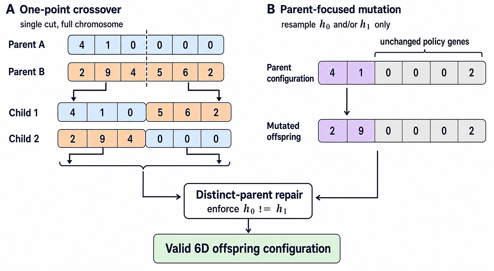
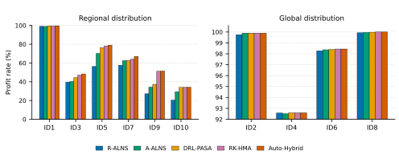

# Automatic Design of Collaboration-Based Hybrid Metaheuristics for Large-Scale Agile Earth Observation Satellite Scheduling

**Abstract**--Large-scale agile earth observation satellite scheduling has drawn growing attention as satellite constellations expand and observation demand rises. The problem couples task selection, satellite assignment, visible-window placement, and attitude-constrained sequencing, and is NP-hard at the scale of practical missions. In conventional collaboration-based hybrid metaheuristic design, the inner collaboration structure is typically fixed in advance. RK-HMA is one such artificially designed hybrid algorithm: its internal single-satellite optimizer combines DE/rand/1 and PSO, achieving good results. This paper recasts the design of this collaboration-based two-parent hybrid as an automatic structural-design problem within the same scheduling pipeline. A six-gene chromosome encodes two parent metaheuristics, two update policies, operating order, and survivor selection. Over these component libraries, a evolutionary search on four regional design scenarios composes a hybrid optimizer. This composed optimizer is then evaluated  on ten benchmark scenarios containing 500–10,000 tasks and 5–100 satellites. It obtains the best or tied-best profit rate on all ten benchmark scenarios against RK-HMA and three state-of-the-art methods for agile satellite scheduling. These results indicate that automatic structure search can obtain better algorithms than manual design in this scheduling pipeline.

**Index Terms**--agile earth observation satellite scheduling, automated algorithm design, collaboration-based hybrid metaheuristic

# I. Introduction

Agile earth observation satellites (AEOS) have become a key platform for acquiring space-based information, supporting applications such as disaster monitoring, mapping, and reconnaissance [1]. As constellations grow to hundreds of satellites and observation requests scale to tens of thousands of tasks, deciding what each satellite should observe has become a practical bottleneck [3], [4]. This scaling pressure motivates the large-scale agile earth observation satellite task scheduling problem (LS-AEOSTSP) studied in this paper. AEOS observe ground targets by adjusting their attitude within visible time windows. This agility enlarges the set of observable targets, but it also makes the transition time between consecutive observations depend on the satellite attitude sequence. In large-scale missions, the number of candidate tasks usually exceeds the available observation capacity. A scheduler must decide which tasks to observe, which satellite should execute each selected task, which visible window should be used, and where each task should be inserted in the satellite sequence. These decisions are coupled. A locally good task order can become infeasible after assignment changes, and a profitable assignment can still fail if the sequence creates excessive attitude-transition cost.

Fig. 1 contrasts the observation geometry of the two satellite types. A non-agile satellite observes targets close to its ground track. An agile earth observation satellite can slew toward off-nadir targets and use broader visible time windows [7]. These additional access opportunities make observation timing and attitude-dependent transitions part of the scheduling decision.


**Fig. 1. Comparison of observation modes between non-agile EOS and AEOS [7].**

Prior work on agile satellite scheduling spans several methodological lines. Survey and exact-optimization studies clarify the main modeling variants and constraint structures: Wang et al. [1] reviewed two decades of AEOS scheduling formulations and methods, Chen et al. [2] built a mixed-integer linear programming model for multi-satellite scheduling, and Peng et al. developed exact formulations that exploit the time-dependent profit and transition-time structure of the problem [5], [6]. Because exact methods do not scale to large instances, metaheuristics have become the dominant practical approach. Adaptive large neighborhood search (ALNS) is the most studied line: Liu et al. [7] designed problem-specific removal and insertion operators for time-dependent transition times, and He et al. [8] extended ALNS to multiple agile satellites with a dynamic task-allocation mechanism. Related constructive and population-based methods address further variants, including interval-varying profits [9], large-scale multiobjective scheduling [10], moving-target observation [11], and the integrated agile scheduling problem [19].

A second line couples machine learning with search. He et al. [13] modeled AEOS scheduling as a Markov decision process and learned construction policies by reinforcement learning, Chen et al. [14] learned to construct single-satellite schedules under time-dependent transition times, and Song et al. [15] embedded Q-learning in a genetic algorithm. Data-driven parallel scheduling and strategy-fusion multiobjective methods have also been proposed for large-scale instances [3], [12], and Wu et al. [4] recently introduced DRL-PASA, which uses a deep Q-network for task allocation and a frequent-pattern-based adaptive local search for single-satellite scheduling. These lines advance the field, but each fixes its search structure in advance—a single algorithmic paradigm or a learned policy tied to the training distribution—which limits the exploration-exploitation balance available on coupled large-scale instances [1].

Hybrid metaheuristics are attractive because different operators can contribute complementary search behavior [16]. For LS-AEOSTSP, our previous work proposed RK-HMA [25], which connects continuous optimizers with discrete task sequences through random-key encoding, applies DE/rand/1 and PSO to a shared population, and uses dynamic task reassignment to coordinate satellites. RK-HMA shows that hybridization is effective, but its inner collaboration structure is manually fixed: changing any structural decision requires expert re-design and re-validation, and there is no guarantee that the chosen structure remains effective when the scheduling scenario changes in scale or task distribution.

The central question is therefore an automatic-design question: can the hybrid structure itself be composed for the scheduling pipeline? Algorithm configuration methods such as ParamILS, SMAC, and irace tune parameterized algorithms over training instances [20]-[22]. Hyper-heuristics search over heuristics or heuristic components instead of directly searching the solution space [23]. Automated algorithm design goes further by searching algorithm structures rather than only tuning parameters or choosing among fixed algorithms. Recent work on automated design of collaboration-based hybrid metaheuristics treats hybrid-optimizer design as a meta-optimization problem and uses a top-down template to generate collaboration-based hybrid algorithms [24].

This paper studies that question for LS-AEOSTSP by making the inner single-satellite optimizer a searchable structural layer. The inner hybrid optimizer is encoded as a semantic chromosome whose genes specify parent choice, update scope, operating order, and survivor selection, while the random-key scheduling bridge and cross-satellite reassignment layer remain fixed and provide a common evaluation environment for every generated optimizer. We evaluate the generated hybrid structures under random-key decoding and cross-satellite reassignment, a coupled setting not addressed by prior automated-design work. The detailed encoding is introduced in Section III-C.

The main contributions are as follows.

1. To our knowledge, this is the first work to specialize automated collaboration-based hybrid metaheuristic design to the coupled LS-AEOSTSP pipeline. The inner single-satellite optimizer is obtained by search rather than fixed by manual design.

2. We formulate a semantic chromosome and its component libraries tailored to this scheduling pipeline. The chromosome exposes the collaboration structure—parent choice, update scope, operating order, and survivor selection—as interpretable structural decisions that the search can recombine.

3. We show that automated structure design improves on the best manually fixed hybrid for this pipeline. The composed optimizer is also best or tied-best on all ten scenarios against the external R-ALNS, A-ALNS, and DRL-PASA methods, confirming that the resulting system stays competitive with published state-of-the-art scheduling algorithms.

The remaining sections are organized as follows. Section II defines the scheduling problem. Section III describes the automatic hybrid-design framework. Section IV reports the experiments. Section V concludes the paper.

# II. Problem Description

Consider a scheduling horizon during which a set of $n$ observation tasks $\mathcal{T}=\{\tau_1,\tau_2,\ldots,\tau_n\}$ must be assigned to a constellation of $m$ agile satellites $\mathcal{S}=\{s_1,s_2,\ldots,s_m\}$. Each task $\tau_i$ is characterized by a geographic location, an imaging duration $d_i^{\text{img}}$, a profit $r_i$, and a specified minimum imaging quality $c_i$. Each satellite $s_j$ is described by its orbital elements and attitude state over the scheduling horizon. Through orbit propagation and access analysis, the visible time windows (VTWs) for each task-satellite pair can be computed. Let $\omega_{ijk}$ denote the $k$-th VTW of task $\tau_i$ on satellite $s_j$, with opening time $\alpha_{ijk}$, closing time $\beta_{ijk}$, and duration $\lambda_{ijk}=\beta_{ijk}-\alpha_{ijk}$. The satellite attitude is described by roll $\theta_{jt}^R$, pitch $\theta_{jt}^P$, and yaw $\theta_{jt}^Y$ at time $t$. The notation used throughout this paper is summarized in Table I.

Since the number of tasks typically far exceeds the observation capacity of the constellation, it is generally infeasible to execute all tasks. The LS-AEOSTSP aims to select a subset of tasks and determine their satellite, VTW, and observation start time so as to maximize the total collected profit, subject to the following assumptions.

1. Each task is an atomic observation request that can be directly executed by a satellite. Complex requests such as area coverage or moving target tracking are assumed to have been decomposed into atomic tasks before scheduling.
2. Energy and onboard storage constraints are not explicitly modeled, because satellites recharge through solar panels and periodically downlink data during normal operations.
3. Each satellite carries a single imaging sensor, so at most one task can be executed at any given time.
4. Task execution is non-preemptive. Once an observation starts, it cannot be interrupted, and each task can be observed at most once across the constellation.

**TABLE I: NOTATION FOR LS-AEOSTSP.**

| Notation | Description |
|---|---|
| $\mathcal{T}$ | Set of observation tasks |
| $n$ | Number of tasks |
| $\mathcal{S}$ | Set of satellites |
| $m$ | Number of satellites |
| $\tau_i$ | Task $i$ |
| $s_j$ | Satellite $j$ |
| $r_i$ | Profit of task $\tau_i$ |
| $d_i^{\text{img}}$ | Imaging duration of task $\tau_i$ |
| $\theta_{jt}^R$ | Roll angle of satellite $s_j$ at time $t$ |
| $\theta_{jt}^P$ | Pitch angle of satellite $s_j$ at time $t$ |
| $\theta_{jt}^Y$ | Yaw angle of satellite $s_j$ at time $t$ |
| $\Omega_{ij}$ | Set of VTWs for task $\tau_i$ on satellite $s_j$ |
| $\omega_{ijk}$ | The $k$-th VTW of task $i$ on satellite $j$ |
| $|\Omega_{ij}|$ | Number of VTWs for task $\tau_i$ on satellite $s_j$ |
| $\alpha_{ijk}$ | Opening time of $\omega_{ijk}$ |
| $\beta_{ijk}$ | Closing time of $\omega_{ijk}$ |
| $\lambda_{ijk}$ | Duration of $\omega_{ijk}$ |
| $x_{ijk}$ | Binary variable indicating whether task $i$ is scheduled in $\omega_{ijk}$ |
| $b_{ijk}$ | Observation start time |
| $\sigma_{ijk,i'jk'}$ | Precedence indicator for consecutive observations on one satellite |
| $T^{\text{trans}}$ | Attitude-transition time between two consecutive observations |
| $c_i$ | Required minimum imaging quality of task $\tau_i$ |
| $q_i$ | Imaging quality of scheduled task $\tau_i$ |
| $w_{ijk}^{*}$ | Midpoint of $\omega_{ijk}$ |
| $F(P_S)$ | Total profit of the scheduled task set |

Two types of decision variables are defined. The binary variable $x_{ijk}\in\{0,1\}$ indicates whether task $\tau_i$ is scheduled in VTW $\omega_{ijk}$. The continuous variable $b_{ijk}$ specifies the observation start time of task $\tau_i$ when $x_{ijk}=1$.

The objective is to maximize the collected profit:

$$
\max F(P_S)=\sum_{i=1}^{n}\sum_{j=1}^{m}\sum_{k=1}^{|\Omega_{ij}|} x_{ijk}r_i. \tag{1}
$$

Each task can be scheduled at most once:

$$
\sum_{j=1}^{m}\sum_{k=1}^{|\Omega_{ij}|} x_{ijk} \le 1,\quad \forall \tau_i\in\mathcal{T}. \tag{2}
$$

If a task is selected, the observation must start and finish inside the chosen VTW:

$$
\alpha_{ijk} \le b_{ijk} \le \beta_{ijk}-d_i^{\text{img}},\quad \text{if }x_{ijk}=1. \tag{3}
$$

For consecutive observations on the same satellite, define

$$
\sigma_{ijk,i'jk'} =
\begin{cases}
1, & \text{if }\tau_i\text{ directly precedes }\tau_{i'}\text{ on }s_j,\\
0, & \text{otherwise.}
\end{cases} \tag{4}
$$

The transition-time constraint is then

$$
b_{ijk}+d_i^{\text{img}}+T^{\text{trans}}(\tau_i,\tau_{i'})\le b_{i'jk'},\quad \text{if }\sigma_{ijk,i'jk'}=1. \tag{5}
$$

The attitude-transition time is a piecewise linear function of the total angular displacement:

$$
T^{\text{trans}}(\tau_i,\tau_{i'})
=
\begin{cases}
11.66, & \Delta\Theta \leq 10^\circ,\\
c_1+\Delta\Theta/v_1, & 10^\circ<\Delta\Theta\leq 30^\circ,\\
c_2+\Delta\Theta/v_2, & 30^\circ<\Delta\Theta\leq 60^\circ,\\
c_3+\Delta\Theta/v_3, & 60^\circ<\Delta\Theta\leq 90^\circ,\\
c_4+\Delta\Theta/v_4, & \Delta\Theta>90^\circ.
\end{cases} \tag{6}
$$

The angular displacement is computed from the attitude differences between the two observations:

$$
\Delta\Theta(\tau_i,\tau_{i'})
=|\theta^R_{j,b_{ijk}}-\theta^R_{j,b_{i'jk'}}|
+|\theta^P_{j,b_{ijk}}-\theta^P_{j,b_{i'jk'}}|
+|\theta^Y_{j,b_{ijk}}-\theta^Y_{j,b_{i'jk'}}|,\quad \text{if }\sigma_{ijk,i'jk'}=1. \tag{7}
$$

The executed task must also satisfy its imaging-quality requirement:

$$
q_i\ge c_i,\quad \forall \tau_i\in\mathcal{T}. \tag{8}
$$

When a scheduled task is executed in $\omega_{ijk}$, its imaging quality is computed by the distance between the observation start time and the midpoint of the selected VTW:

$$
q_i=10-9\cdot
\frac{|2b_{ijk}+d_i^{\text{img}}-2w_{ijk}^{*}|}{\lambda_{ijk}-d_i^{\text{img}}},
\quad \text{if }x_{ijk}=1, \tag{9}
$$

where

$$
w_{ijk}^{*}=\frac{\alpha_{ijk}+\beta_{ijk}}{2},\quad \text{if }x_{ijk}=1. \tag{10}
$$

Constraint (2) ensures that each task is observed at most once across all satellites. Constraint (3) guarantees that the observation must start and finish within the selected VTW. Constraint (5) enforces that consecutive tasks on the same satellite must be separated by a sufficient transition time. The transition time is defined by Eq. (6), and the angular displacement is computed by Eq. (7). Following [6], the parameters are set to $v_1=1.5^\circ/\text{s}$, $c_1=5$, $v_2=2^\circ/\text{s}$, $c_2=10$, $v_3=2.5^\circ/\text{s}$, $c_3=16$, $v_4=3^\circ/\text{s}$, and $c_4=22$. Constraint (8) requires the imaging quality of each executed task to be no lower than the specified threshold, and Eqs. (9)-(10) compute imaging quality from the position of the start time inside the selected VTW.

The solution has two coupled parts: each scheduled task must be assigned to a satellite and VTW, and each satellite must choose a feasible task sequence. These two decisions are interdependent, because the value of an assignment depends on the sequence each satellite can realize, while a feasible sequence depends on which tasks are assigned. The LS-AEOSTSP is NP-hard, as it contains the single-satellite EOSTSP as a special case [5], [6], and the joint assignment-and-sequencing space grows on the order of $O(n!\,m^{n})$ with the number of tasks $n$ and satellites $m$. Exact methods are therefore intractable at the scales considered here, which motivates the metaheuristic scheduling pipeline described in Section III.

# III. Automatic Hybrid-Design Framework

## A. Design Principle

The proposed framework follows the top-down design idea of AutoHyb [24], where designing a collaboration-based hybrid optimizer is formulated as a meta-optimization problem. AutoHyb was developed and validated on general numerical and combinatorial benchmarks, where each candidate optimizer is cheap to evaluate. We adapt this idea to a domain setting it was not designed for: the coupled, discrete LS-AEOSTSP pipeline, where every candidate must be scored by random-key decoding and cross-satellite reassignment. A general collaboration-based hybrid optimizer can be viewed as a template composed of parent optimization algorithms and hybridization factors. The parent algorithms provide search behaviors. The hybridization factors define how these parents are combined, including which individuals they update, in which order they are invoked, and how generated candidates survive.

This paper instantiates that template for LS-AEOSTSP. The design object is the single-satellite optimizer used inside the multi-satellite scheduling pipeline. A candidate in the design population is therefore an optimizer configuration, not a task sequence. The fixed scheduling pipeline follows the RK-HMA setting: initial task allocation, random-key continuous representation, greedy insertion decoding, and dynamic cross-satellite task reassignment are kept unchanged. The automatic-design layer changes only the collaboration structure of the single-satellite optimizer.

Specializing the top-down design paradigm to this scheduling pipeline requires two problem-driven design decisions rather than a direct reuse of a general-purpose design method. First, the design object is restricted to a pairwise collaboration between exactly two parents. This is not a loss of generality but a match to the scheduling setting: the manually fixed RK-HMA optimizer is itself a two-parent hybrid, so a pairwise structure already contains the manual baseline as one feasible point while keeping the encoding compact and expert-readable after search. A two-parent structure also gives a well-defined channel for information exchange: both parents share one random-key population and one fitness vector, so the collaboration factors act on a single, clearly defined interaction rather than on many entangled parents. It also keeps each generated optimizer cheap enough to be evaluated through the full scheduling pipeline, which matters because every fitness value here requires running task allocation, per-satellite decoding, and cross-satellite reassignment. Second, because each candidate must be evaluated by this expensive scheduling pipeline, the design stage needs an evaluation protocol that is affordable at search time yet trustworthy at reporting time. We therefore adopt a reduced-budget/full-budget protocol: a low-cost reduced-budget evaluation over a shared regional designing set guides the structural search, and an independent full-budget replay confirms the composed optimizer. This realizes the multiscale principle of cheap search and expensive confirmation directly in the scheduling-evaluation budget, which is the dimension that dominates cost in this problem.

As shown in Fig. 2, the resulting workflow has four levels:

1. A semantic structural chromosome encodes a candidate hybrid optimizer.
2. The chromosome is decoded into an executable single-satellite optimizer configuration.
3. The configured single-satellite optimizer is embedded in the fixed multi-satellite scheduling pipeline.
4. An evolutionary search selects optimizer structures by their measured scheduling profit.

RK-HMA corresponds to one feasible chromosome in this configuration space. Its DE/rand/1 + PSO optimizer is a manually fixed collaboration structure, whereas the proposed design stage compares that manually chosen point with other structures under the same scheduling pipeline. This makes the comparison controlled: the scheduling bridge and reassignment layer are shared, and the searched component is the single-satellite optimizer structure.


**Fig. 2. Automatic hybrid-design workflow.** Component libraries define the searchable optimizer space. Each semantic chromosome is decoded into a single-satellite optimizer and evaluated by the complete scheduling pipeline with dynamic reassignment. The search stage uses normalized scheduling profit as feedback, and the composed optimizer is then evaluated by a full-budget replay on all benchmark scenarios.

Design and evidence collection are kept separate. The search stage evaluates candidate optimizers on a representative subset of the benchmark scenarios (detailed in Section IV-C), using normalized scheduling profit as the search-stage fitness (formally defined with the evolutionary procedure in Section III-E). The composed optimizer is then evaluated on all ten benchmark scenarios by the full-budget replay protocol; the reported ten-scenario results come from this independent replay path.

## B. Component Libraries for Automatic Design

Automatic design needs a finite set of reusable algorithmic choices. The inner hybrid optimizer is assembled from parent algorithms and three hybrid-control choices considered in this LS-AEOSTSP instantiation: update policy, operating order, and survivor selection. The update policy decides which individuals of the shared population a parent may modify, the operating order fixes the information dependency between the two parents, and survivor selection decides how current and generated candidates compete for the next population. The concrete alternatives listed in Tables III-V are the realization forms of these choices available to the design stage.

Only decisions that change the optimizer structure or control flow are encoded as genes. Parent choice determines which search mechanisms are available. Update policy determines which individuals each parent modifies. Operating order determines when the parents act. Survivor selection determines how generated candidates replace current individuals. The low-level parameters of the library algorithms are held fixed during the design comparison. This keeps the search focused on collaboration structure rather than mixing structural design with parameter tuning.

The parent-algorithm library collects established metaheuristics that can operate on the shared random-key representation, chosen to span complementary search behaviors rather than to enumerate every available method. It includes population-based evolutionary search through a genetic algorithm (GA) [26]; swarm intelligence through particle swarm optimization (PSO) [26]; probabilistic model building through an estimation-of-distribution algorithm (EDA) [26] and a continuous ant colony optimization (ACO) [27]; differential evolution in three mutation forms, DE/rand/1, DE/best/1, and DE/current-to-rand/1 [28]; a bee-colony algorithm (ABC) [26]; trajectory-based simulated annealing (SA) [26]; the success-history adaptive DE with linear population reduction (L-SHADE) [29]; and an adaptive large neighborhood search (ALNS) [7], [8] drawn from the scheduling literature. This mix lets the design stage combine exploratory, exploitative, model-based, and neighborhood-based dynamics. Table II summarizes the eleven parents.

**TABLE II: PARENT-ALGORITHM LIBRARY.**

| ID | Parent algorithm | Brief description |
|---:|---|---|
| 0 | GA | Evolutionary algorithm that generates offspring through selection, crossover, and mutation. |
| 1 | PSO | Swarm-intelligence algorithm that updates particles using personal and global best experience. |
| 2 | EDA | Probabilistic model-based algorithm that estimates promising distributions from selected solutions. |
| 3 | ACO | Pheromone-inspired constructive search that samples candidates according to learned desirability. |
| 4 | DE/rand/1 | Differential evolution variant that mutates a random base vector with one differential vector. |
| 5 | DE/best/1 | Differential evolution variant that mutates the current best vector with one differential vector. |
| 6 | DE/current-to-rand/1 | Differential evolution variant that moves the current vector toward a random differential direction. |
| 7 | ABC | Bee-colony algorithm that alternates employed-bee, onlooker-bee, and scout-bee search phases. |
| 8 | SA | Trajectory-based local search that uses temperature-controlled acceptance of worsening moves. |
| 9 | L-SHADE | Success-history adaptive differential evolution with external archive and linear population-size reduction. |
| 10 | ALNS | Neighborhood-search framework that alternates destroy and repair operators under adaptive selection. |

**TABLE III: UPDATE-POLICY LIBRARY.**

The update policy decides which individuals of the shared population each parent is allowed to modify. The seven realization forms below span population-, subpopulation-, and individual-level updates. Parameter symbols are included directly in the corresponding realization forms, and their values are reported in Table VII.

| ID | Update policy | Operating level | Corresponding realization form |
|---:|---|---|---|
| 0 | FULL | Population | The parent algorithm works on all individuals in the current population. |
| 1 | TOP_SUBSET | Subpopulation | The parent algorithm works on a fixed high-fitness subset of ratio $r_{\text{sub}}$. |
| 2 | MIXED_SUBSET | Subpopulation | The parent algorithm works on a subset mixing the top fraction $r_{\text{mix}}$ with random individuals. |
| 3 | RANDOM_DECAY | Subpopulation | The parent algorithm works on a random subset whose ratio decays from $r_{\text{dec}}$ over iterations. |
| 4 | ABOVE_MEAN | Subpopulation | The parent algorithm works on individuals whose fitness is above the population mean. |
| 5 | LOCAL_SEARCH | Individual | The parent algorithm focuses on the historical best individual. |
| 6 | WORST_REPAIR | Individual | The parent algorithm focuses on the current worst individual. |

**TABLE IV: OPERATING-ORDER (OO) LIBRARY.**

The operating order fixes the information dependency between the two parents. The realization forms below cover both sequential and parallel orders. Parameter symbols are included directly in the corresponding realization forms, and their values are reported in Table VII.

| ID | Operating-Order policy | OO type | Corresponding realization form |
|---:|---|---|---|
| 0 | SEQUENTIAL | Sequential | Parent 1 is invoked before parent 2 in each enabled iteration. |
| 1 | PERIODIC_SWITCH | Sequential | The active parent switches every $T_{\text{sw}}$ iterations. |
| 2 | STAGE_SWITCH | Sequential | Different parents are enabled in different search stages. |
| 3 | BEST_NO_IMPROVEMENT_SWITCH | Sequential | The active parent switches when the global best does not improve. |
| 4 | PROCESS_NO_IMPROVEMENT_SWITCH | Sequential | The active parent switches when the enabled parent stagnates. |
| 5 | DIVERSITY_SWITCH | Sequential | Parent routing depends on the population diversity state, checked every $T_{\text{div}}$ iterations against threshold $\theta_{\text{div}}$. |
| 6 | PARALLEL | Parallel | The two parents generate candidates separately and the candidates are merged. |
| 7 | ADAPTIVE_CREDIT | Sequential | Recent improvement per evaluation cost over a window $W_c$ (default routing ratio $\rho_c$) determines parent routing. |

**TABLE V: SURVIVOR-SELECTION LIBRARY.**

| ID | Survivor policy | Corresponding realization form |
|---:|---|---|
| 0 | ELITIST_BEST_N | Truncation selection: parent and offspring candidates are merged and the best $N$ survive. |
| 1 | TOURNAMENT | Tournament selection: survivors are selected through stochastic local competitions. |
| 2 | PAIRWISE_GREEDY | One-to-one comparison: each offspring competes with its paired parent. |
| 3 | RANK_WEIGHTED | Rank-based sampling: merged candidates are sampled with probabilities determined by fitness rank. |

Together, Tables II-V define the active optimizer-design space searched in this study: 11 parent algorithms, 7 update-policy realization forms, 8 operating-order realization forms, and 4 survivor-selection realization forms. The parent library covers population-based, model-based, swarm-based, trajectory-based, and neighborhood-based search behaviors. The three hybrid-control libraries cover which individuals are updated, how parent searches are coordinated, and how parent and offspring candidates compete. The tables describe the collaboration structure that the design stage can change; scheduling execution details that remain fixed are described later with the evaluation protocol.

## C. Semantic Structural Optimizer Encoding

Having defined the component libraries, we now describe how one choice from each library is assembled into a single searchable representation. Each candidate optimizer is represented by a six-gene chromosome:
$$
\mathbf{h}=(h_0,h_1,h_2,h_3,h_4,h_5).
$$

Fig. 3 summarizes the layout of the semantic hybrid-scheme encoding.

<p align="center">
  
</p>
**Fig. 3. Encoding of the six-gene semantic hybrid scheme, adapted from [24].** The first two genes select distinct parent algorithms from Table II. The next two genes select update policies from Table III. The fifth gene selects the OO realization form from Table IV, and the last gene selects the survivor-selection realization form from Table V. The layout keeps each gene tied to one algorithmic role, which makes the generated optimizer readable after search.

Equivalently, the six positions correspond to `{parent1, parent2, update1, update2, operationOrder, survivor}`. The two parent genes choose the metaheuristics that share the random-key population. The two update genes define the population subset updated by each parent. The operating-order gene specifies how the two parent calls are arranged inside the single-satellite optimizer. The survivor gene specifies how current and generated candidates compete for the next population. A chromosome therefore records one collaboration mode between two parent algorithms instead of a generic numerical setting vector.

After enforcing $h_0\ne h_1$, the valid search space is:
$$
11\times 10\times 7\times 7\times 8\times 4 = 172{,}480
$$

This yields 172,480 candidate optimizer structures, which indicates the scale of the structural design space. Exhaustively evaluating all of them is impractical, because each candidate must be decoded into an optimizer and run through the scheduling pipeline. This motivates the evolutionary configuration-search procedure in Section III-E.

The genes assemble reusable components into an executable single-satellite optimizer. Runtime settings and low-level component parameters are kept outside the chromosome. This separation keeps the search space compact, avoids mixing runtime calibration with structural search, and preserves a direct interpretation for the optimizer returned by the design stage.

## D. Chromosome-to-Optimizer Decoding

The decoding function maps one optimizer chromosome to a runnable single-satellite optimizer. Let $\Phi(\mathbf{h})$ denote the optimizer generated by chromosome $\mathbf{h}$. The generated optimizer is a shared-population hybrid. It keeps one random-key population and one decoded scheduling objective. During evaluation, every generated optimizer is embedded in the same multi-satellite reassignment layer; the chromosome only changes how the inner search operators are assembled.

At iteration $t$, the first two genes activate parent strategies:

$$
(h_0,h_1)\mapsto (\mathcal{A}_{h_0},\mathcal{A}_{h_1}),
$$

where $\mathcal{A}_{h_i}$ is one algorithm from the active parent library. These parents do not run as isolated optimizers. They update selected individuals from the same population $X^t$ and are evaluated by the same fitness vector $F^t$.

The update-policy genes then define two individual masks:

$$
M_1=\mathcal{M}(h_2,X^t,F^t),\quad M_2=\mathcal{M}(h_3,X^t,F^t),
$$

where $X^t$ is the current random-key population and $F^t$ is the corresponding fitness vector. The masks define which individuals each parent is allowed to modify, while the policy semantics are listed in Table III.

The operating-order gene schedules the two parent calls and produces a candidate population:

$$
\mathcal{O}_{h_4}:\left(\mathcal{A}_{h_0},\mathcal{A}_{h_1},M_1,M_2\right)\rightarrow X'.
$$

The operating-order semantics are listed in Table IV. Each candidate key in $X'$ is decoded into a task sequence and scored by the scheduling-profit objective, giving the candidate fitness vector $F'$.

The survivor gene then builds the next population:

$$
X^{t+1}=\mathcal{S}_{h_5}(X^t,X',F^t,F').
$$

The survivor rule is selected from Table V. Applied in order, parent activation, the two update masks, the operating-order schedule, and survivor selection form one complete single-satellite optimizer iteration.

The decoding step turns optimizer construction into part of the experiment. The inner search algorithm is generated from an evolvable semantic chromosome and evaluated inside the same scheduling pipeline.

## E. Evolutionary Configuration-Search Procedure

The design procedure evolves a population of optimizer chromosomes. Fitness is not assigned to a directly encoded task sequence. It is assigned to the scheduling profit obtained by the optimizer generated from each chromosome.

For a design scenario $s$, let $P(\mathbf{h},s)$ be the mean profit obtained by evaluating optimizer $\Phi(\mathbf{h})$ for $R$ independent runs under the reduced design-stage budget. Let $T_s$ be the total profit of all tasks. The multi-scene design fitness is:

$$
\mathcal{F}(\mathbf{h})=
\sum_{s\in\mathcal{D}_{train}}
\frac{P(\mathbf{h},s)}{T_s}.
$$

The denominator normalizes each scenario by total task profit, so large-profit scenarios do not dominate the design objective only because of scale.

Algorithm 1 summarizes the procedure.

```text
Algorithm 1: Evolutionary optimizer-design procedure
Input: training scenarios D_train, component libraries A, U, O, S,
       population size N_d, generations G_d, repeat count R,
       crossover rate p_c, search budget ratio rho
Output: composed optimizer chromosome h_star

1:  Initialize population P_0 of valid optimizer chromosomes
2:  Evaluate every h in P_0 by F(h)
3:  h_star <- best chromosome in P_0
4:  for t = 1 to G_d do
5:      Shuffle parent indices in P_{t-1}
6:      for each shuffled parent pair do
7:          with probability p_c, generate offspring by one-point crossover
8:          otherwise, apply parent-focused mutation to genes h_0 and h_1
9:          repair duplicate parent genes so that the two parents are distinct
10:         add the offspring to Q_t
11:     end for
12:     Evaluate every offspring h in Q_t by F(h)
13:     Merge P_{t-1} and Q_t
14:     Select the top N_d chromosomes by design fitness
15:     Update h_star if a better chromosome is found
16: end for
17: return h_star
```

The parent-algorithm genes dominate the search behavior of each generated optimizer: they select from eleven distinct metaheuristics, each with qualitatively different exploration and exploitation dynamics. Under the fixed design budget, mutating these two genes yields the largest behavioral change per variation event. The four policy genes, by contrast, each have only three to five admissible values and produce smaller behavioral shifts; single-point crossover already recombines them effectively across the six-gene chromosome. Mutation is therefore prioritized for the two parent-algorithm genes, while policy-gene diversity is maintained through crossover and the initial random sampling of admissible values. Repair enforces the distinct-parent constraint $h_0\ne h_1$ after variation.

Fig. 4 illustrates the two variation paths and their shared distinct-parent repair.



**Fig. 4. Crossover and mutation of the 6D semantic optimizer chromosome.** One-point crossover recombines the complete chromosome at a single cut. Parent-focused mutation resamples only $h_0$ and/or $h_1$ while preserving $h_2$-$h_5$. Both paths repair duplicate parent indices to enforce $h_0\ne h_1$.

The evaluation steps are expensive because each chromosome must be decoded into a complete optimizer and run through the satellite scheduling pipeline. As motivated in Section III-A, the search stage therefore uses a reduced inner budget, and the two scales are realized through the scheduling-evaluation budget.

The search-stage fitness is used only to identify a promising optimizer, not as the final experimental result. After the design stage returns $\mathbf{h}^*$, the composed chromosome is instantiated as a single-satellite optimizer and embedded in the same multi-satellite scheduling pipeline used during search, now under the full inner budget per reported scenario. This full-budget replay separates automatic design from final confirmation, because the design stage uses fewer evaluations and can be noisy.

## F. Scheduling Execution Under a Designed Optimizer

Once $\Phi(\mathbf{h})$ is instantiated, each satellite is optimized through the standard random-key scheduling bridge inherited from RK-HMA. For a satellite with $D$ assigned tasks, the single-satellite optimizer maintains a population of $N$ random-key vectors, each of dimension $D$:

$$
X=\{\mathbf{x}^{(1)},\mathbf{x}^{(2)},\ldots,\mathbf{x}^{(N)}\}.
$$

Each vector is decoded by sorting its keys, and the sorted order gives a candidate task sequence. The decoder then inserts tasks into feasible visible time windows and computes the collected profit:

$$
f(\mathbf{x})=\sum_{\tau_i\in P_j} r_i,
$$

where $P_j$ is the feasible schedule constructed for satellite $s_j$.

After per-satellite schedules are generated, the fixed multi-satellite layer applies the RK-HMA dynamic reassignment procedure [25] to reconsider unscheduled tasks. This layer is shared by all candidate chromosomes and is not part of the optimizer-design space.

# IV. Experimental Results

To evaluate the proposed automatic hybrid-design framework on the LS-AEOSTSP, the simulator introduced in [8] is used to generate multiple experimental scenarios. The framework and the generated optimizer are implemented in Java and run on a PC with Intel Core i7-14700kf CPU @ 3.40 GHz and 64-GB memory.

## A. Experimental Scenarios

Ten experimental scenarios are used, covering small-scale, medium-scale, large-scale, and superlarge-scale instances. The task count ranges from 500 to 10,000, and the satellite count ranges from 5 to 100. The distribution is categorized into regional and global distributions. In the regional setting, tasks are concentrated in the area $3^\circ\text{N}$-$53^\circ\text{N}$ and $74^\circ\text{E}$-$133^\circ\text{E}$, which creates stronger competition for feasible time windows. The imaging duration of each task is a random integer between 1 and 30, and the task profit is a random integer between 1 and 10.

**TABLE VI: EXPERIMENTAL SCENARIOS.**

| ID | Scale | $n$ | $m$ | Start time | End time | Distribution |
|---:|---|---:|---:|---|---|---|
| 1 | Small | 500 | 5 | 00:00:00 | 23:59:59 | Regional |
| 2 | Small | 500 | 5 | 00:00:00 | 23:59:59 | Global |
| 3 | Small | 1000 | 10 | 00:00:00 | 11:59:59 | Regional |
| 4 | Small | 1000 | 10 | 12:00:00 | 23:59:59 | Global |
| 5 | Medium | 1000 | 20 | 00:00:00 | 11:59:59 | Regional |
| 6 | Medium | 2000 | 20 | 12:00:00 | 23:59:59 | Global |
| 7 | Medium | 4000 | 40 | 00:00:00 | 05:59:59 | Regional |
| 8 | Large | 6000 | 60 | 12:00:00 | 17:59:59 | Global |
| 9 | Large | 8000 | 80 | 00:00:00 | 11:59:59 | Regional |
| 10 | Superlarge | 10000 | 100 | 06:00:00 | 11:59:59 | Regional |

## B. Performance Metrics and Parameter Settings

We compare Auto-Hybrid optimizer with three reported baselines and one manually fixed reference.

**R-ALNS** [7]: An ALNS variant that uses random task allocation before single-satellite ALNS scheduling.

**A-ALNS** [8]: An adaptive-allocation ALNS variant that improves the initial task allocation before single-satellite scheduling.

**DRL-PASA** [4]: A deep reinforcement learning based parallel adaptive search algorithm. It uses a DQN-based allocation policy and frequent pattern based adaptive local search.

**RK-HMA**: A manually fixed hybrid reference under the same random-key bridge and dynamic reassignment layer. Its single-satellite optimizer uses DE/rand/1 and PSO with FULL/FULL update policies, SEQUENTIAL operating order, and ELITIST_BEST_N survivor selection. DE/rand/1 first updates the shared random-key population, and PSO then refines the DE-improved population.

The primary metric is profit rate:

$$
PR=\frac{F(P_S)}{F(P_A)}\times 100\%,
$$

where $F(P_S)$ is the profit of scheduled tasks and $F(P_A)$ is the total profit of all tasks.

The R-ALNS, A-ALNS, and DRL-PASA profit-rate entries are cited from [4]. Auto-Hybrid denotes the optimizer composed by the design stage described in Section III. In the main comparison table, the RK-HMA column follows the reported RK-HMA values in our previous work [25], and the Auto-Hybrid column reports its best full-budget replay run. All reported scheduling results come from the full-budget replay path.

Table VII reports the main hyperparameters used by the automatic-design stage and the full-budget scheduling layer. The first block describes the reduced-budget design search; the next rows describe the full-budget evaluation shared by RK-HMA and Auto-Hybrid; the last block lists the realization-form parameters referenced in Tables III-IV, which take effect only when the corresponding update or operating-order form is composed. The multi-satellite dynamic reassignment layer is inherited unchanged from RK-HMA [25]; because it is identical to the RK-HMA setting and is not part of the optimizer-design space, its parameters are not re-listed here. The table also omits component-library sizes, training scenario IDs, the number of replay runs, and the composed chromosome, because those items describe the protocol or the search outcome rather than tunable hyperparameters.

**TABLE VII: HYPERPARAMETER SETTINGS.**

| Hyperparameter | Symbol | Value |
|---|---|---|
| Design population | $N_d$ | 35 |
| Design generations | $G_d$ | 20 |
| Design crossover rate | $p_c$ | 0.3 |
| Design repeats per evaluation | $R$ | 3 |
| Search budget ratio | $\rho$ | 0.6 |
| Population size | $N_{pop}$ | $2.5 \times \max(n_j)$ |
| Max evaluations | $F_{\max}$ | $100N_{pop}$ |
| TOP_SUBSET ratio | $r_{\text{sub}}$ | 0.5 |
| MIXED_SUBSET top ratio | $r_{\text{mix}}$ | 0.8 |
| RANDOM_DECAY start ratio | $r_{\text{dec}}$ | $0.5 \rightarrow 0.2$ |
| PERIODIC_SWITCH period | $T_{\text{sw}}$ | $0.05 G_{hma}$ |
| DIVERSITY_SWITCH check interval | $T_{\text{div}}$ | $0.01 G_{hma}$ |
| DIVERSITY_SWITCH threshold | $\theta_{\text{div}}$ | 0.02 |
| ADAPTIVE_CREDIT window | $W_c$ | 8 |
| ADAPTIVE_CREDIT default routing ratio | $\rho_c$ | 0.5 |

## C. Configuration-Search Evidence

The design search uses four designing scenarios, ID1, ID3, ID5, and ID7 (see Table VI). These regional-distribution cases range from 500 tasks and 5 satellites to 4000 tasks and 40 satellites, reducing search cost while retaining increasing task-satellite contention. The 20-generation search with population size 35, evaluating each chromosome by $R=3$ scheduling runs on each of the four scenarios, completed in approximately 6 hours on the same PC described above (i7-14700KF, 28 threads). Fig. 5 plots the best-so-far trajectory over 20 generations. The y-axis reports mean normalized fitness across the four training scenarios. Each candidate is evaluated by $R=3$ independent scheduling runs per scenario, and each scenario result is normalized by the corresponding total task profit. Orange markers indicate generations where the incumbent optimizer improves.

The trajectory shows successive incumbent changes. The initial incumbent combines EDA with GA. Generation 5 first improves the incumbent by pairing EDA with DE/current-to-rand/1 under FULL/FULL updates, SEQUENTIAL execution, and PAIRWISE_GREEDY survivor selection (6D index [2,6,0,0,0,2]). The following improvements then move through EDA + L-SHADE variants: generation 6 uses DIVERSITY_SWITCH and ELITIST_BEST_N, generation 9 reverses the parent order to L-SHADE + EDA, and generation 11 returns to EDA followed by L-SHADE under SEQUENTIAL execution. At generation 12, the incumbent becomes EDA and L-SHADE with FULL/FULL update policies, SEQUENTIAL operating order, and PAIRWISE_GREEDY survivor selection (6D index [2,9,0,0,0,2]). This decoded structure remains best from generation 12 to generation 20.

The composed structure separates the two search roles. EDA estimates promising random-key distributions from elite solutions, and L-SHADE refines those keys with adaptive differential perturbations. FULL/FULL lets both parents update the shared population. With SEQUENTIAL execution, L-SHADE starts from the population already shaped by EDA, and PAIRWISE_GREEDY preserves individual-level improvements.


**Fig. 5. Multi-scene evolutionary search trace.** The curve reports best-so-far mean normalized fitness across the four design-stage training scenarios. Orange markers denote improvement generations. Text callouts show representative incumbent chromosomes, and the dashed line marks the first appearance of Auto-Hybrid at generation 12. Auto-Hybrid remains best through generation 20.

## D. Performance Comparison

Table VIII reports the main profit-rate comparison. The value in parentheses is the gap to the best result in that scenario, in percentage points. Bold values mark the highest or tied-highest profit rate in each row. The R-ALNS, A-ALNS, and DRL-PASA columns are reported values from [4]. The RK-HMA column follows the main comparison values in our previous work [25]. The Auto-Hybrid column reports its best full-budget replay run.

**TABLE VIII: PROFIT RATE COMPARISON WITH REPORTED BASELINES AND RK-HMA.**

| ID | Distribution | $n,m$ | R-ALNS | A-ALNS | DRL-PASA | RK-HMA | Auto-Hybrid |
|---:|---|---:|---:|---:|---:|---:|---:|
| 1 | Regional | 500,5 | 99.05% (+0.62) | 98.95% (+0.72) | 99.60% (+0.07) | 99.60% (+0.07) | **99.67% (0)** |
| 2 | Global | 500,5 | 99.75% (+0.14) | **99.89% (0)** | **99.89% (0)** | **99.89% (0)** | **99.89% (0)** |
| 3 | Regional | 1000,10 | 39.60% (+8.83) | 40.20% (+8.23) | 44.35% (+4.08) | 46.80% (+1.63) | **48.43% (0)** |
| 4 | Global | 1000,10 | 92.57% (+0.02) | 92.51% (+0.08) | **92.59% (0)** | **92.59% (0)** | **92.59% (0)** |
| 5 | Regional | 1000,20 | 56.31% (+22.64) | 70.21% (+8.74) | 76.35% (+2.60) | 77.93% (+1.02) | **78.95% (0)** |
| 6 | Global | 2000,20 | 98.27% (+0.17) | 98.37% (+0.07) | 98.40% (+0.04) | **98.44% (0)** | **98.44% (0)** |
| 7 | Regional | 4000,40 | 57.54% (+9.54) | 62.44% (+4.64) | 62.58% (+4.50) | 64.09% (+2.99) | **67.08% (0)** |
| 8 | Global | 6000,60 | 99.93% (+0.07) | 99.96% (+0.04) | 99.98% (+0.02) | **100.00% (0)** | **100.00% (0)** |
| 9 | Regional | 8000,80 | 27.12% (+24.46) | 34.26% (+17.32) | 37.18% (+14.40) | 51.22% (+0.36) | **51.58% (0)** |
| 10 | Regional | 10000,100 | 20.38% (+13.94) | 29.25% (+5.07) | 33.95% (+0.37) | 34.10% (+0.22) | **34.32% (0)** |

As shown in Table VIII, Auto-Hybrid obtains the highest or tied-highest profit rate on all ten scenarios. It improves RK-HMA on all six regional scenarios and matches it on the four saturated global scenarios. Across all ten scenarios, Auto-Hybrid is higher than R-ALNS, A-ALNS, DRL-PASA, and RK-HMA by 8.04, 4.49, 2.61, and 0.63 percentage points on average, respectively. On the six regional scenarios, the corresponding gaps are 13.34, 7.45, 4.34, and 1.05 percentage points. Because RK-HMA and Auto-Hybrid share the same random-key bridge and dynamic reassignment layer, the gap over RK-HMA measures the effect of automated structure design alone. RK-HMA already exceeds the external R-ALNS, A-ALNS, and DRL-PASA baselines, so the larger gaps over those methods are jointly produced by the shared scheduling pipeline and the searched optimizer, and should not be read as the contribution of structure search by itself. The largest single-scenario gain over RK-HMA appears on ID7, where the profit rate rises from 64.09% to 67.08%, a 2.99-percentage-point improvement on a conflict-heavy regional instance.

A component-level ablation of the inner optimizer was already reported in the RK-HMA study [25]; the present comparison against the same manually fixed optimizer under a shared pipeline directly isolates the effect of automated structure design.

Fig. 6 separates the reported-value comparison by task distribution. On regional-distribution scenarios, the performance gap between algorithms is more pronounced. In this view, Auto-Hybrid improves the regional average by 13.34 percentage points over R-ALNS, 7.45 percentage points over A-ALNS, 4.34 percentage points over DRL-PASA, and 1.05 percentage points over RK-HMA. This pattern is consistent with the stronger scheduling conflicts created by geographically concentrated tasks.

On global-distribution scenarios, all methods already obtain high profit rates. Auto-Hybrid matches RK-HMA and only slightly exceeds the reported external baseline values. Global instances have enough feasible windows for every strong method to approach the profit ceiling, so profit rate loses discriminative power there and the meaningful comparison concentrates on the contention-heavy regional instances. Read in this light, the controlled gain of Auto-Hybrid over RK-HMA should be judged on the regional subset, where headroom remains: RK-HMA is already a strong hybrid that surpasses the external baselines, so the further 0.97-percentage-point average regional gain is obtained against a high floor rather than a weak one. On the hardest regional instance, ID7, the average gain over RK-HMA reaches 2.94 percentage points, comparable in magnitude to the regional margin that separates DRL-PASA from A-ALNS.



**Fig. 6. Profit-rate comparison by task distribution.** The left panel reports regional-distribution scenarios on a 0-100% scale. The right panel reports global-distribution scenarios with a y-axis starting at 92% because all methods are near saturation.

**Computational time comparison.** Profit rate is the primary comparison axis above; for completeness we now turn to wall-clock cost, which we report only as an auxiliary reference. Table IX lists these times. The R-ALNS, A-ALNS, and DRL-PASA times are cited from [4]; the RK-HMA  is cited from[25]

**TABLE IX: COMPUTATIONAL TIME COMPARISON.**

| ID | Distribution | $n,m$ | R-ALNS | A-ALNS | DRL-PASA | RK-HMA | Auto-Hybrid |
|---:|---|---:|---:|---:|---:|---:|---:|
| 1 | Regional | 500,5 | 42.67 s | 39.61 s | 32.80 s | 27.16 s | **7.80 s** |
| 2 | Global | 500,5 | 7.32 s | 6.64 s | 2.80 s | **1.52 s** | 1.61 s |
| 3 | Regional | 1000,10 | 35.93 s | 34.44 s | 18.70 s | 14.71 s | **5.20 s** |
| 4 | Global | 1000,10 | 4.15 s | 4.10 s | 4.00 s | 1.48 s | **1.39 s** |
| 5 | Regional | 1000,20 | 37.71 s | 37.14 s | 27.60 s | 11.62 s | **4.33 s** |
| 6 | Global | 2000,20 | 59.37 s | 47.09 s | 42.70 s | 3.50 s | **2.50 s** |
| 7 | Regional | 4000,40 | 370.48 s | 351.17 s | 320.40 s | 45.60 s | **8.52 s** |
| 8 | Global | 6000,60 | 75.42 s | 59.69 s | 58.20 s | 2.40 s | **1.33 s** |
| 9 | Regional | 8000,80 | 236.81 s | 222.68 s | 215.50 s | 410.74 s | **58.76 s** |
| 10 | Regional | 10000,100 | 898.14 s | 754.58 s | 718.10 s | 448.19 s | **122.72 s** |

*Bold indicates the fastest time for each scenario.*

The external and local times differ in implementation language and hardware, so no cross-method efficiency claim is supported. The RK-HMA and Auto-Hybrid times were also produced from different Java code states: the Auto-Hybrid codebase includes later optimizations in the random-key encoding and decoding path that reduce wall-clock time independent of the optimizer structure. The time difference therefore reflects code-level engineering, not the automatic design. The table confirms only that the composed optimizer remains practical across the tested scales, from about 1 s on small global scenarios to about 2 min on the largest regional scenario.

Table X reports five independent full-budget replay runs for both RK-HMA and Auto-Hybrid on all ten scenarios, listing the maximum, average, and minimum profit rates. This multi-run protocol quantifies run-to-run variation under the stochastic scheduling pipeline.

**TABLE X: FIVE-RUN PROFIT RATE OF RK-HMA AND AUTO-HYBRID ON EACH SCENARIO.**

| ID | $n,m$ | RK-HMA Max | RK-HMA Ave | RK-HMA Min | Auto-Hybrid Max | Auto-Hybrid Ave | Auto-Hybrid Min |
|---:|---|---:|---:|---:|---:|---:|---:|
| 1 | 500,5 | 99.60% | 99.40% | 99.09% | 99.67% | **99.62%** | 99.53% |
| 2 | 500,5 | 99.89% | **99.89%** | 99.89% | 99.89% | **99.89%** | 99.89% |
| 3 | 1000,10 | 47.41% | 47.09% | 46.60% | 48.52% | **48.29%** | 48.09% |
| 4 | 1000,10 | 92.59% | **92.59%** | 92.59% | 92.59% | **92.59%** | 92.59% |
| 5 | 1000,20 | 78.27% | 78.04% | 77.85% | 79.31% | **79.03%** | 78.72% |
| 6 | 2000,20 | 98.44% | **98.44%** | 98.44% | 98.44% | **98.44%** | 98.44% |
| 7 | 4000,40 | 64.27% | 64.05% | 63.73% | 67.10% | **66.99%** | 66.79% |
| 8 | 6000,60 | 100.00% | **100.00%** | 100.00% | 100.00% | **100.00%** | 100.00% |
| 9 | 8000,80 | 51.34% | 51.17% | 51.04% | 51.58% | **51.46%** | 51.41% |
| 10 | 10000,100 | 34.15% | 34.08% | 33.96% | 34.32% | **34.24%** | 34.19% |

*Bold indicates the higher (or tied) average profit rate in each row.*

On the four global scenarios (ID2, ID4, ID6, ID8), both methods produce identical profit rates in every run, confirming that the global task distribution saturates observation capacity and leaves no room for structural improvement. On the six regional scenarios, Auto-Hybrid's five-run average exceeds RK-HMA on every instance. The overall ten-scenario mean gap is 0.58 percentage points; on the regional subset it is 0.97 percentage points. On three scenarios (ID3, ID5, ID7), the five-run ranges do not overlap: Auto-Hybrid's minimum exceeds RK-HMA's maximum, indicating that the gain persists across all runs. On ID9 and ID10, the ranges overlap slightly, but Auto-Hybrid's worst run still exceeds RK-HMA's average. Both methods show small within-scenario spread (under 1 percentage point), confirming that the stochastic pipeline produces stable results and the observed gaps are not artifacts of individual outlier runs.

Fig. 7 visualizes the six regional scenarios where run-to-run variation is informative.


**Fig. 7. Five-run profit-rate distributions of RK-HMA and Auto-Hybrid on the six regional scenarios.** Each panel reports one scenario and labels its task and satellite counts as $(n,m)$. Boxes summarize the five runs, colored markers show individual runs, and diamonds denote means. Panel-specific y-axis ranges expose within-scenario variation.

Across all six panels, the Auto-Hybrid box lies entirely above or overlaps only the upper edge of the RK-HMA box. On ID7 (4000 tasks, 40 satellites), the two distributions are fully separated with no overlapping runs, and the gap between means (2.94 percentage points) exceeds the combined spread of both methods. On the large-scale scenarios ID9 and ID10, where task-satellite contention is highest, the gap narrows but remains consistent: Auto-Hybrid's worst run still exceeds RK-HMA's mean, and the interquartile ranges do not overlap. The largest relative improvement appears on ID3, where the mean rises from 47.09% to 48.29%, a 2.5% relative gain on a scenario that is far from saturation.

Because the two methods share the same random-key bridge, greedy decoding, and dynamic reassignment layer, the only difference is the inner collaboration structure: manually fixed (DE/rand/1 + PSO) versus automatically composed (EDA + L-SHADE). The consistent five-run advantage across all six non-saturated scenarios confirms the superiority of the automatically composed structure over the manually fixed one. The gain is not confined to a single scenario or a single lucky run, which indicates that automatic structural search finds a collaboration configuration that a human designer did not reach by manual tuning.

# V. Conclusion

The LS-AEOSTSP couples task selection, satellite assignment, and attitude-constrained per-satellite sequencing, and existing hybrid solvers fix the inner single-satellite optimizer by hand. This paper presented an automatic design framework for collaboration-based hybrid metaheuristics that instead treats this inner optimizer as a design object. It keeps the scheduling-specific RK-HMA pipeline unchanged, including initial task allocation, random-key continuous representation, greedy decoding, and dynamic cross-satellite reassignment. The searched part is the collaboration structure of the inner optimizer.

The method uses component libraries and a six-gene semantic chromosome to describe parent algorithms, update policies, operating order, and survivor selection. Each chromosome is decoded into an executable single-satellite optimizer and evaluated through the same multi-satellite scheduling pipeline. A reduced-budget evolutionary search selects a candidate structure on four representative regional scenarios, and a full-budget replay then evaluates the composed optimizer on all ten benchmark scenarios. The composed chromosome is `[2,9,0,0,0,2]`, which decodes to EDA and L-SHADE with full-population updates, sequential execution, and pairwise-greedy survivor selection.

In a controlled comparison sharing the same scheduling pipeline, Auto-Hybrid improves all six non-saturated regional instances over the manually fixed RK-HMA optimizer and matches the four near-saturated global instances; in the five-run averages, it raises profit rate by 0.58 percentage points across all ten scenarios and by 0.97 percentage points across the six regional scenarios. Since RK-HMA already surpasses the external baselines, this controlled comparison isolates the gain from automated structure design. Under the reported-value comparison protocol, the selected full-budget replay run is also best or tied-best on all ten scenarios against the external R-ALNS, A-ALNS, and DRL-PASA methods, exceeding DRL-PASA, the strongest external baseline, by 2.61 percentage points on average and by 4.34 percentage points on the six high-contention regional scenarios. Together these results show that the searched structure improves on the best manual hybrid for this pipeline while keeping the overall system competitive with published state-of-the-art scheduling methods. Beyond solution quality, the automatic design stage compresses the metaheuristic design cycle—traditionally requiring weeks to months of expert experimentation—to approximately six hours of unattended computation on a desktop computer.

In future work, the component libraries can be enriched with more parent algorithms and hybridization forms, and large language models offer a promising route to propose or generate such components automatically; a racing or surrogate-assisted design stage would then keep the enlarged search affordable. The same searchable-structure formulation can also be applied to a wider range of scheduling and combinatorial-optimization problems beyond LS-AEOSTSP. More broadly, the results suggest that treating the inner optimizer as a searchable structural layer is a reusable way to strengthen an existing scheduling pipeline without redesigning its problem-specific components.

# References

[1] X. Wang, G. Wu, L. Xing, and W. Pedrycz, "Agile earth observation satellite scheduling over 20 years: Formulations, methods, and future directions," *IEEE Systems Journal*, vol. 15, no. 3, pp. 3881-3892, 2021, doi: 10.1109/JSYST.2020.2997050.

[2] X. Chen, G. Reinelt, G. Dai, and A. Spitz, "A mixed integer linear programming model for multi-satellite scheduling," *European Journal of Operational Research*, vol. 275, no. 2, pp. 694-707, 2019, doi: 10.1016/j.ejor.2018.11.058.

[3] Y. Du, T. Wang, B. Xin, L. Wang, Y. Chen, and L. Xing, "A data-driven parallel scheduling approach for multiple agile earth observation satellites," *IEEE Transactions on Evolutionary Computation*, vol. 24, no. 4, pp. 679-693, 2020, doi: 10.1109/TEVC.2019.2934148.

[4] J. Wu, Y. Du, F. Yao, M. Gong, J. Sun, Y. Zhao, and L. Xing, "A deep reinforcement learning-based parallel adaptive search algorithm for solving large-scale agile earth observation satellites tasks scheduling problem," *IEEE Transactions on Geoscience and Remote Sensing*, 2024.

[5] G. Peng, G. Song, L. Xing, A. Gunawan, and P. Vansteenwegen, "An exact algorithm for agile earth observation satellite scheduling with time-dependent profits," *Computers & Operations Research*, vol. 120, p. 104946, 2020, doi: 10.1016/j.cor.2020.104946.

[6] G. Peng, G. Song, Y. He, J. Yu, S. Xiang, L. Xing, and P. Vansteenwegen, "Solving the agile earth observation satellite scheduling problem with time-dependent transition times," *IEEE Transactions on Systems, Man, and Cybernetics: Systems*, vol. 52, no. 3, pp. 1614-1625, 2022, doi: 10.1109/TSMC.2020.3031738.

[7] X. Liu, G. Laporte, Y. Chen, and R. He, "An adaptive large neighborhood search metaheuristic for agile satellite scheduling with time-dependent transition time," *Computers & Operations Research*, vol. 86, pp. 41-53, 2017, doi: 10.1016/j.cor.2017.04.006.

[8] L. He, X. Liu, G. Laporte, Y. Chen, and Y. Chen, "An improved adaptive large neighborhood search algorithm for multiple agile satellites scheduling," *Computers & Operations Research*, vol. 100, pp. 12-25, 2018, doi: 10.1016/j.cor.2018.06.020.

[9] J. Li, J. Zhu, D. Xu, J. Wang, Z. Li, and K. Zhang, "Earth observation satellite scheduling with interval-varying profits," *IEEE Transactions on Aerospace and Electronic Systems*, vol. 60, no. 6, pp. 8273-8288, 2024, doi: 10.1109/TAES.2024.3427090.

[10] F. Yao, Y. Chen, L. Wang, Z. Chang, P.-Q. Huang, and Y. Wang, "A bilevel evolutionary algorithm for large-scale multiobjective task scheduling in multiagile earth observation satellite systems," *IEEE Transactions on Systems, Man, and Cybernetics: Systems*, vol. 54, no. 6, pp. 3512-3524, 2024, doi: 10.1109/TSMC.2024.3359265.

[11] J. Qin, X. Bai, G. Du, J. Liu, N. Peng, and M. Xu, "Multisatellite scheduling for moving targets using the enhanced hybrid genetic simulated annealing algorithm and observation strip selection," *IEEE Transactions on Aerospace and Electronic Systems*, vol. 60, no. 5, pp. 5773-5800, 2024, doi: 10.1109/TAES.2024.3397958.

[12] H. Wang, W. Huang, S. Magnusson, T. Lindgren, R. Wang, and Y. Song, "A strategy fusion-based multiobjective optimization approach for agile earth observation satellite scheduling problem," *IEEE Transactions on Geoscience and Remote Sensing*, vol. 62, pp. 1-14, 2024, doi: 10.1109/TGRS.2024.3472749.

[13] Y. He, L. Xing, Y. Chen, W. Pedrycz, L. Wang, and G. Wu, "A generic Markov decision process model and reinforcement learning method for scheduling agile earth observation satellites," *IEEE Transactions on Systems, Man, and Cybernetics: Systems*, vol. 52, no. 3, pp. 1463-1474, 2022, doi: 10.1109/TSMC.2020.3020732.

[14] M. Chen, Y. Du, K. Tang, L. Xing, Y. Chen, and Y. Chen, "Learning to construct a solution for the agile satellite scheduling problem with time-dependent transition times," *IEEE Transactions on Systems, Man, and Cybernetics: Systems*, vol. 54, no. 10, pp. 5949-5963, 2024, doi: 10.1109/TSMC.2024.3411640.

[15] Y. Song, L. Wei, Q. Yang, J. Wu, L. Xing, and Y. Chen, "RL-GA: A reinforcement learning-based genetic algorithm for electromagnetic detection satellite scheduling problem," *Swarm and Evolutionary Computation*, vol. 77, p. 101236, 2023, doi: 10.1016/j.swevo.2023.101236.

[16] C. Blum, J. Puchinger, G. R. Raidl, and A. Roli, "Hybrid metaheuristics in combinatorial optimization: A survey," *Applied Soft Computing*, vol. 11, no. 6, pp. 4135-4151, 2011, doi: 10.1016/j.asoc.2011.02.032.

[17] J. Fan, Y. Li, J. Xie, C. Zhang, W. Shen, and L. Gao, "A hybrid evolutionary algorithm using two solution representations for hybrid flow-shop scheduling problem," *IEEE Transactions on Cybernetics*, vol. 53, no. 3, pp. 1752-1764, 2023, doi: 10.1109/TCYB.2021.3120875.

[18] Z. Shu, A. Song, G. Wu, and W. Pedrycz, "Variable reduction strategy integrated variable neighborhood search and NSGA-II hybrid algorithm for emergency material scheduling," *Complex System Modeling and Simulation*, vol. 3, no. 2, pp. 83-101, 2023, doi: 10.23919/CSMS.2023.0006.

[19] Y. Rocha, G. O. Chagas, L. C. Coelho, and A. Subramanian, "The integrated agile earth observation satellite scheduling problem," *Computers & Operations Research*, vol. 184, p. 107212, 2025, doi: 10.1016/j.cor.2025.107212.

[20] F. Hutter, H. H. Hoos, K. Leyton-Brown, and T. Stutzle, "ParamILS: An automatic algorithm configuration framework," *Journal of Artificial Intelligence Research*, vol. 36, pp. 267-306, 2009, doi: 10.1613/jair.2861.

[21] F. Hutter, H. H. Hoos, and K. Leyton-Brown, "Sequential model-based optimization for general algorithm configuration," in *Learning and Intelligent Optimization*, Lecture Notes in Computer Science, vol. 6683, pp. 507-523, Springer, 2011, doi: 10.1007/978-3-642-25566-3_40.

[22] M. Lopez-Ibanez, J. Dubois-Lacoste, L. Perez Caceres, M. Birattari, and T. Stutzle, "The irace package: Iterated racing for automatic algorithm configuration," *Operations Research Perspectives*, vol. 3, pp. 43-58, 2016, doi: 10.1016/j.orp.2016.09.002.

[23] E. K. Burke, M. Gendreau, M. Hyde, G. Kendall, G. Ochoa, E. Ozcan, and R. Qu, "Hyper-heuristics: A survey of the state of the art," *Journal of the Operational Research Society*, vol. 64, no. 12, pp. 1695-1724, 2013, doi: 10.1057/jors.2013.71.

[24] Y. Wang, B. Xin, B. Liu, and Q. Wang, "Automated design of collaboration-based hybrid metaheuristics," *IEEE Transactions on Cybernetics*, vol. 54, no. 12, pp. 7877-7890, 2024, doi: 10.1109/TCYB.2024.3412997.

[25] H. Lei and L. He, "A random-key hybrid metaheuristic algorithm with dynamic task reassignment for large-scale multi-satellite scheduling," 2025, submitted for publication.

[26] E.-G. Talbi, *Metaheuristics: From Design to Implementation*. Hoboken, NJ, USA: Wiley, 2009.

[27] K. Socha and M. Dorigo, "Ant colony optimization for continuous domains," *European Journal of Operational Research*, vol. 185, no. 3, pp. 1155-1173, 2008, doi: 10.1016/j.ejor.2006.06.046.

[28] S. Das and P. N. Suganthan, "Differential evolution: A survey of the state-of-the-art," *IEEE Transactions on Evolutionary Computation*, vol. 15, no. 1, pp. 4-31, 2011, doi: 10.1109/TEVC.2010.2059031.

[29] R. Tanabe and A. S. Fukunaga, "Improving the search performance of SHADE using linear population size reduction," in *Proc. IEEE Congress on Evolutionary Computation (CEC)*, 2014, pp. 1658-1665, doi: 10.1109/CEC.2014.6900380.
