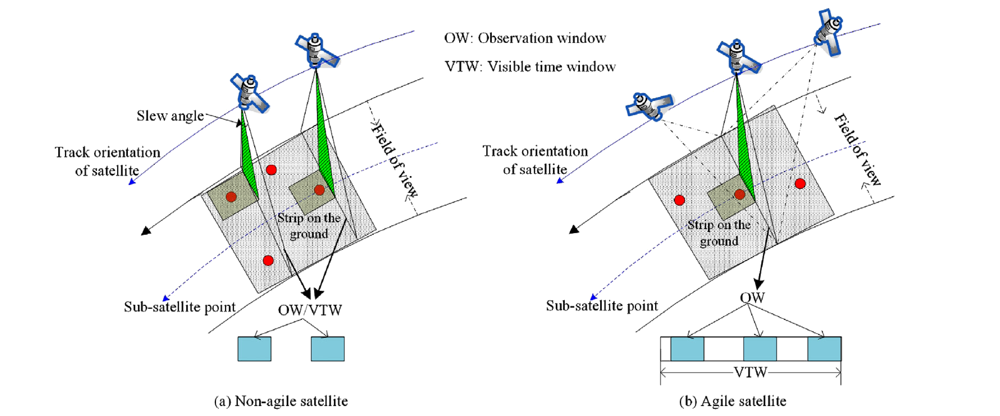

# Automatic Design of Collaboration-Based Hybrid Metaheuristics for Large-Scale Agile Earth Observation Satellite Scheduling

**Abstract**--Large-scale agile earth observation satellite scheduling has drawn growing attention as satellite constellations expand and observation demand rises. The problem couples task selection, satellite assignment, visible-window placement, and attitude-constrained sequencing, and is NP-hard at the scale of practical missions. In conventional collaboration-based hybrid metaheuristic design, the inner collaboration structure is typically fixed in advance. RK-HMA is one such artificially designed hybrid algorithm: its internal single-satellite optimizer combines DE/rand/1 and PSO, achieving good results. This paper recasts the design of this collaboration-based hybrid with two parent algorithms as an automatic structural-design problem within the same scheduling pipeline. A six-gene chromosome selects two parent algorithms, two operating levels, operating order, and survivor selection. Over these component libraries, an evolutionary search on four regional design scenarios composes a hybrid optimizer. The retained configuration is evaluated on ten benchmark scenarios containing 500–10,000 tasks and 5–100 satellites using a five-run full-budget replay. It completes all 50 planned runs and achieves a ten-scenario macro-mean profit rate of 77.04%. Compared with the RK-HMA means reported in [25], the latest replay is higher by approximately 0.46 percentage points in the ten-scenario macro mean; because the execution protocols and code states differ, this comparison is descriptive rather than a paired causal estimate.

**Index Terms**--agile earth observation satellite scheduling, automated algorithm design, collaboration-based hybrid metaheuristic

# I. Introduction

Agile earth observation satellites (AEOS) have become a key platform for acquiring space-based information, supporting applications such as disaster monitoring, mapping, and reconnaissance [1]. As constellations grow to hundreds of satellites and observation requests scale to tens of thousands of tasks, deciding what each satellite should observe has become a practical bottleneck [3], [4]. This scaling pressure motivates the large-scale agile earth observation satellite task scheduling problem (LS-AEOSTSP) studied in this paper. AEOS observe ground targets by adjusting their attitude within visible time windows. This agility enlarges the set of observable targets, but it also makes the transition time between consecutive observations depend on the satellite attitude sequence. In large-scale missions, the number of candidate tasks usually exceeds the available observation capacity. A scheduler must decide which tasks to observe, which satellite should execute each selected task, which visible window should be used, and where each task should be inserted in the satellite sequence. These decisions are coupled. A locally good task order can become infeasible after assignment changes, and a profitable assignment can still fail if the sequence creates excessive attitude-transition cost.

Fig. 1 contrasts the observation geometry of the two satellite types. A non-agile satellite observes targets close to its ground track. An agile earth observation satellite can slew toward off-nadir targets and use broader visible time windows [7]. These additional access opportunities make observation timing and attitude-dependent transitions part of the scheduling decision.



**Fig. 1.** Comparison of observation modes between non-agile EOS and AEOS [7].

Prior work on agile satellite scheduling spans several methodological lines. Survey and exact-optimization studies clarify the main modeling variants and constraint structures: Wang et al. [1] reviewed two decades of AEOS scheduling formulations and methods, Chen et al. [2] built a mixed-integer linear programming model for multi-satellite scheduling, and Peng et al. developed exact formulations that exploit the time-dependent profit and transition-time structure of the problem [5], [6]. Because exact methods do not scale to large instances, metaheuristics have become the dominant practical approach. Adaptive large neighborhood search (ALNS) is the most studied line: Liu et al. [7] designed problem-specific removal and insertion operators for time-dependent transition times, and He et al. [8] extended ALNS to multiple agile satellites with a dynamic task-allocation mechanism. Related constructive and population-based methods address further variants, including interval-varying profits [9], large-scale multiobjective scheduling [10], moving-target observation [11], and the integrated agile scheduling problem [19].

A second line couples machine learning with search. He et al. [13] modeled AEOS scheduling as a Markov decision process and learned construction policies by reinforcement learning, Chen et al. [14] learned to construct single-satellite schedules under time-dependent transition times, and Song et al. [15] embedded Q-learning in a genetic algorithm. Data-driven parallel scheduling and strategy-fusion multiobjective methods have also been proposed for large-scale instances [3], [12], and Wu et al. [4] recently introduced DRL-PASA, which uses a deep Q-network for task allocation and a frequent-pattern-based adaptive local search for single-satellite scheduling. These lines advance the field, but each fixes its search structure in advance—a single algorithmic paradigm or a learned policy tied to the training distribution—which limits the exploration-exploitation balance available on coupled large-scale instances [1].

Hybrid metaheuristics are attractive because different operators can contribute complementary search behavior [16]. For LS-AEOSTSP, our previous work proposed RK-HMA [25], which connects continuous optimizers with discrete task sequences through random-key encoding, applies DE/rand/1 and PSO to a shared population, and uses dynamic task reassignment to coordinate satellites. RK-HMA shows that hybridization is effective, but its inner collaboration structure is manually fixed: changing any structural decision requires expert re-design and re-validation, and there is no guarantee that the chosen structure remains effective when the scheduling scenario changes in scale or task distribution.

The central question is therefore an automatic-design question: can the hybrid structure itself be composed for the scheduling pipeline? Algorithm configuration methods such as ParamILS, SMAC, and irace tune parameterized algorithms over training instances [20]-[22]. Hyper-heuristics search over heuristics or heuristic components instead of directly searching the solution space [23]. Automated algorithm design goes further by searching algorithm structures rather than only tuning parameters or choosing among fixed algorithms. Recent work on automated design of collaboration-based hybrid metaheuristics treats hybrid-optimizer design as a meta-optimization problem and uses a top-down template to generate collaboration-based hybrid algorithms [24].

This paper studies that question for LS-AEOSTSP by making the inner single-satellite optimizer a searchable structural layer. The inner hybrid optimizer is encoded as a semantic chromosome whose genes specify the parent algorithms, update scope, operating order, and survivor selection, while the random-key scheduling bridge and cross-satellite reassignment layer remain fixed and provide a common evaluation environment for every generated optimizer. We evaluate the generated hybrid structures under random-key decoding and cross-satellite reassignment, a coupled setting not addressed by prior automated-design work. The detailed encoding is introduced in Section III-C.

The main contributions are as follows.

1. To our knowledge, this is the first work to specialize automated collaboration-based hybrid metaheuristic design to the coupled LS-AEOSTSP pipeline. The inner single-satellite optimizer is obtained by search rather than fixed by manual design.

2. We formulate a semantic chromosome and its component libraries tailored to this scheduling pipeline. The chromosome exposes the collaboration structure—the choice of parent algorithms, update scope, operating order, and survivor selection—as interpretable structural decisions that the search can recombine.

3. We provide a full-budget five-run replay of the retained configuration on all ten scenarios and compare it with the reported R-ALNS, A-ALNS, DRL-PASA, and RK-HMA results. The replay completes 50/50 runs and reports a ten-scenario macro-mean profit rate of 77.04%; the reported-value comparison indicates an approximately 0.46-percentage-point macro-mean difference from RK-HMA, subject to different execution and implementation protocols.

The remaining sections are organized as follows. Section II defines the scheduling problem. Section III describes the automatic hybrid-design framework. Section IV reports the experiments. Section V concludes the paper.

# II. Problem Description

Consider a scheduling horizon during which a set of $n$ observation tasks $\mathcal{T}=\{\tau_1,\tau_2,\ldots,\tau_n\}$ must be assigned to a constellation of $m$ agile satellites $\mathcal{S}=\{s_1,s_2,\ldots,s_m\}$. Each task $\tau_i$ is characterized by a geographic location, an imaging duration $d_i^{\text{img}}$, a profit $r_i$, and a specified minimum imaging quality $c_i$. Each satellite $s_j$ is described by its orbital elements and attitude state over the scheduling horizon. Through orbit propagation and access analysis, the visible time windows (VTWs) for each task-satellite pair can be computed. Let $\omega_{ijk}$ denote the $k$-th VTW of task $\tau_i$ on satellite $s_j$, with opening time $\alpha_{ijk}$, closing time $\beta_{ijk}$, and duration $\lambda_{ijk}=\beta_{ijk}-\alpha_{ijk}$. The satellite attitude is described by roll $\theta_{jt}^R$, pitch $\theta_{jt}^P$, and yaw $\theta_{jt}^Y$ at time $t$. The notation used throughout this paper is summarized in Table I.

Since the number of tasks typically far exceeds the observation capacity of the constellation, it is generally infeasible to execute all tasks. The LS-AEOSTSP aims to select a subset of tasks and determine their satellite, VTW, and observation start time so as to maximize the total collected profit, subject to the following assumptions.

1. Each task is an atomic observation request that can be directly executed by a satellite. Complex requests such as area coverage or moving target tracking are assumed to have been decomposed into atomic tasks before scheduling.
2. Energy and onboard storage constraints are not explicitly modeled, because satellites recharge through solar panels and periodically downlink data during normal operations.
3. Each satellite carries a single imaging sensor, so at most one task can be executed at any given time.
4. Task execution is non-preemptive. Once an observation starts, it cannot be interrupted, and each task can be observed at most once across the constellation.

**TABLE I: NOTATION FOR LS-AEOSTSP.**

| Notation | Description |
|---|---|
| $\mathcal{T}$ | Set of observation tasks |
| $n$ | Number of tasks |
| $\mathcal{S}$ | Set of satellites |
| $m$ | Number of satellites |
| $\tau_i$ | Task $i$ |
| $s_j$ | Satellite $j$ |
| $r_i$ | Profit of task $\tau_i$ |
| $d_i^{\text{img}}$ | Imaging duration of task $\tau_i$ |
| $\theta_{jt}^R$ | Roll angle of satellite $s_j$ at time $t$ |
| $\theta_{jt}^P$ | Pitch angle of satellite $s_j$ at time $t$ |
| $\theta_{jt}^Y$ | Yaw angle of satellite $s_j$ at time $t$ |
| $\Omega_{ij}$ | Set of VTWs for task $\tau_i$ on satellite $s_j$ |
| $\omega_{ijk}$ | The $k$-th VTW of task $i$ on satellite $j$ |
| $|\Omega_{ij}|$ | Number of VTWs for task $\tau_i$ on satellite $s_j$ |
| $\alpha_{ijk}$ | Opening time of $\omega_{ijk}$ |
| $\beta_{ijk}$ | Closing time of $\omega_{ijk}$ |
| $\lambda_{ijk}$ | Duration of $\omega_{ijk}$ |
| $x_{ijk}$ | Binary variable indicating whether task $i$ is scheduled in $\omega_{ijk}$ |
| $b_{ijk}$ | Observation start time |
| $\sigma_{ijk,i'jk'}$ | Precedence indicator for consecutive observations on one satellite |
| $T^{\text{trans}}$ | Attitude-transition time between two consecutive observations |
| $c_i$ | Required minimum imaging quality of task $\tau_i$ |
| $q_i$ | Imaging quality of scheduled task $\tau_i$ |
| $w_{ijk}^{*}$ | Midpoint of $\omega_{ijk}$ |
| $F(P_S)$ | Total profit of the scheduled task set |

Two types of decision variables are defined. The binary variable $x_{ijk}\in\{0,1\}$ indicates whether task $\tau_i$ is scheduled in VTW $\omega_{ijk}$. The continuous variable $b_{ijk}$ specifies the observation start time of task $\tau_i$ when $x_{ijk}=1$.

The objective is to maximize the collected profit:

$$
\max F(P_S)=\sum_{i=1}^{n}\sum_{j=1}^{m}\sum_{k=1}^{|\Omega_{ij}|} x_{ijk}r_i. \tag{1}
$$

Each task can be scheduled at most once:

$$
\sum_{j=1}^{m}\sum_{k=1}^{|\Omega_{ij}|} x_{ijk} \le 1,\quad \forall \tau_i\in\mathcal{T}. \tag{2}
$$

If a task is selected, the observation must start and finish inside the chosen VTW:

$$
\alpha_{ijk} \le b_{ijk} \le \beta_{ijk}-d_i^{\text{img}},\quad \text{if }x_{ijk}=1. \tag{3}
$$

For consecutive observations on the same satellite, define

$$
\sigma_{ijk,i'jk'} =
\begin{cases}
1, & \text{if }\tau_i\text{ directly precedes }\tau_{i'}\text{ on }s_j,\\
0, & \text{otherwise.}
\end{cases} \tag{4}
$$

The transition-time constraint is then

$$
b_{ijk}+d_i^{\text{img}}+T^{\text{trans}}(\tau_i,\tau_{i'})\le b_{i'jk'},\quad \text{if }\sigma_{ijk,i'jk'}=1. \tag{5}
$$

The attitude-transition time is a piecewise linear function of the total angular displacement:

$$
T^{\text{trans}}(\tau_i,\tau_{i'})
=
\begin{cases}
11.66, & \Delta\Theta \leq 10^\circ,\\
c_1+\Delta\Theta/v_1, & 10^\circ<\Delta\Theta\leq 30^\circ,\\
c_2+\Delta\Theta/v_2, & 30^\circ<\Delta\Theta\leq 60^\circ,\\
c_3+\Delta\Theta/v_3, & 60^\circ<\Delta\Theta\leq 90^\circ,\\
c_4+\Delta\Theta/v_4, & \Delta\Theta>90^\circ.
\end{cases} \tag{6}
$$

The angular displacement is computed from the attitude differences between the two observations:

$$
\Delta\Theta(\tau_i,\tau_{i'})
=|\theta^R_{j,b_{ijk}}-\theta^R_{j,b_{i'jk'}}|
+|\theta^P_{j,b_{ijk}}-\theta^P_{j,b_{i'jk'}}|
+|\theta^Y_{j,b_{ijk}}-\theta^Y_{j,b_{i'jk'}}|,\quad \text{if }\sigma_{ijk,i'jk'}=1. \tag{7}
$$

The executed task must also satisfy its imaging-quality requirement:

$$
q_i\ge c_i,\quad \forall \tau_i\in\mathcal{T}. \tag{8}
$$

When a scheduled task is executed in $\omega_{ijk}$, its imaging quality is computed by the distance between the observation start time and the midpoint of the selected VTW:

$$
q_i=10-9\cdot
\frac{|2b_{ijk}+d_i^{\text{img}}-2w_{ijk}^{*}|}{\lambda_{ijk}-d_i^{\text{img}}},
\quad \text{if }x_{ijk}=1, \tag{9}
$$

where

$$
w_{ijk}^{*}=\frac{\alpha_{ijk}+\beta_{ijk}}{2},\quad \text{if }x_{ijk}=1. \tag{10}
$$

Constraint (2) ensures that each task is observed at most once across all satellites. Constraint (3) guarantees that the observation must start and finish within the selected VTW. Constraint (5) enforces that consecutive tasks on the same satellite must be separated by a sufficient transition time. The transition time is defined by Eq. (6), and the angular displacement is computed by Eq. (7). Following [6], the parameters are set to $v_1=1.5^\circ/\text{s}$, $c_1=5$, $v_2=2^\circ/\text{s}$, $c_2=10$, $v_3=2.5^\circ/\text{s}$, $c_3=16$, $v_4=3^\circ/\text{s}$, and $c_4=22$. Constraint (8) requires the imaging quality of each executed task to be no lower than the specified threshold, and Eqs. (9)-(10) compute imaging quality from the position of the start time inside the selected VTW.

The solution has two coupled parts: each scheduled task must be assigned to a satellite and VTW, and each satellite must choose a feasible task sequence. These two decisions are interdependent, because the value of an assignment depends on the sequence each satellite can realize, while a feasible sequence depends on which tasks are assigned. The LS-AEOSTSP is NP-hard, as it contains the single-satellite EOSTSP as a special case [5], [6], and the joint assignment-and-sequencing space grows on the order of $O(n!\,m^{n})$ with the number of tasks $n$ and satellites $m$. Exact methods are therefore intractable at the scales considered here, which motivates the metaheuristic scheduling pipeline described in Section III.

# III. Automatic Hybrid-Design Framework

## A. Design Principle

The proposed framework follows the top-down design idea of AutoHyb [24], where designing a collaboration-based hybrid optimizer is formulated as a meta-optimization problem. AutoHyb treats the optimizer structure as a searchable design object: each candidate design scheme specifies which parent algorithms to combine (e.g., DE, PSO, EDA) and how to hybridize them through a set of hybridization factors—the operating level (which subset of the shared population each parent algorithm modifies), the operating order (the information dependency between the two parent algorithms), and the survivor selection (how newly generated and existing individuals compete for the next generation). AutoHyb was developed and validated on general numerical and combinatorial benchmarks, where each candidate optimizer can be evaluated with modest computational cost. We adapt this idea to the coupled, discrete LS-AEOSTSP, where every candidate solution must be evaluated through a full scheduling process that assigns tasks to satellites, selects visible time windows, determines observation timing, and computes attitude-dependent transition times—making each fitness evaluation far more expensive than on numerical benchmarks.

This paper instantiates that template for LS-AEOSTSP. The target scheduling pipeline is inherited from RK-HMA [25], which has two layers: an outer multi-satellite layer that handles task-to-satellite allocation and cross-satellite reassignment of unscheduled tasks, and an inner single-satellite optimizer that evolves the task sequence for each satellite independently using a random-key encoding—continuous keys define task priorities, and a greedy insertion decoder maps each random-key vector to a feasible schedule by sorting tasks and inserting them into visible time windows while respecting attitude-transition constraints.

We fix the outer layer and the decoder unchanged from RK-HMA; the automatic-design layer searches only the collaboration structure of the inner single-satellite optimizer—the two parent algorithms, their operating levels, operating order, and survivor selection. We further restrict this design object to pairwise collaboration between exactly two parent algorithms. This restriction serves three purposes: (1) it keeps the design space tractable, and adding a third parent algorithm would expand this by another order of magnitude; (2) it ensures a well-defined collaboration structure—two parent algorithms form a single information-flow edge with explicit operating order and information dependency, whereas three or more parent algorithms would introduce multiple edges with potential cyclic dependencies or complex scheduling; (3) it supports a future matched comparison with the manually designed RK-HMA baseline, which is itself a hybrid with two parent algorithms (DE/rand/1 followed by PSO, both with FULL operating level, sequential operating order, and truncation survivor selection)—restricting the search to the same pairwise structure separates the effect of automatic design from the effect of adding more parent algorithms. This scoping keeps each candidate optimizer cheap enough to evaluate through the expensive scheduling pipeline and preserves a common scheduling bridge for a later controlled comparison.

At the outer design level, each offspring is generated by either crossover or mutation, not both. The two operators are mutually exclusive alternatives with complementary probabilities $p_c$ and $p_m=1-p_c$. This exclusive-path design makes each offspring traceable to one variation event and preserves a clean interpretation of the operator probabilities. Chaining mutation after crossover would create a composite operation that conflates recombination with gene resampling, obscuring their separate effects. Both operators modify only the six-gene design chromosome and do not alter the internal variation rules of the parent algorithms specified by $h_0$ and $h_1$. This scheme resembles operator-selection mechanisms in adaptive evolutionary algorithms [30], [31], but uses fixed probabilities rather than online adaptation. Section IV-B specifies the concrete values.

The design stage therefore searches over a training subset with a reduced inner budget, rather than applying the full evaluation protocol to every candidate. Chromosomes are ranked by a multi-scenario fitness that normalizes scheduling profit across scenarios, as defined in Section III-E.

As shown in Fig. 2, the resulting workflow has five levels:

1. Component libraries define the admissible parent algorithms and hybrid-control policies.
2. A six-gene semantic chromosome selects one component for each algorithmic role.
3. A decoder maps the chromosome to an executable single-satellite optimizer.
4. The generated optimizer is embedded in the fixed multi-satellite scheduling pipeline.
5. An outer evolutionary search ranks chromosomes by their measured scheduling profit.


**Fig. 2.** Automatic hybrid-design workflow.

## B. Component Libraries for Automatic Design

We instantiate the searchable design space with four component libraries. The parent-algorithm library supplies the candidate algorithms for the two parent-algorithm positions, while the operating-level, operating-order, and survivor-selection libraries specify the subset each parent algorithm updates, the order of the parent-algorithm calls, and the rule for forming the next population from current and generated candidates. A six-gene chromosome stores two parent-algorithm indices, two operating-level indices, one operating-order index, and one survivor-selection index. Decoding these indices produces a runnable single-satellite optimizer. Tables II-V list the admissible realization forms. In this section, an inner individual denotes one random-key solution, whereas a design candidate denotes one six-gene chromosome. Only these structural choices are encoded in the chromosome; the numerical parameters of the library algorithms are held fixed during the design comparison. This separation keeps the search focused on collaboration structure.

The parent-algorithm library collects established metaheuristics that can operate on the shared random-key representation, chosen to span complementary search behaviors rather than to enumerate every available method. It includes population-based evolutionary search through a genetic algorithm (GA) [26]; swarm intelligence through particle swarm optimization (PSO) [26]; probabilistic model building through an estimation-of-distribution algorithm (EDA) [26] and a continuous ant colony optimization (ACO) [27]; differential evolution in three mutation forms, DE/rand/1, DE/best/1, and DE/current-to-rand/1 [28]; a bee-colony algorithm (ABC) [26]; trajectory-based simulated annealing (SA) [26]; the success-history adaptive DE with linear population reduction (L-SHADE) [29]; and an adaptive large neighborhood search (ALNS) [7], [8] drawn from the scheduling literature. This mix lets the design stage combine exploratory, exploitative, model-based, and neighborhood-based dynamics. Table II summarizes the eleven parent algorithms.

**TABLE II: PARENT-ALGORITHM LIBRARY.**

| ID | Parent algorithm | Brief description |
|---:|---|---|
| 0 | GA | Evolutionary algorithm that generates offspring through selection, crossover, and mutation. |
| 1 | PSO | Swarm-intelligence algorithm that updates particles using personal and global best experience. |
| 2 | EDA | Probabilistic model-based algorithm that estimates promising distributions from selected solutions. |
| 3 | ACO | Pheromone-inspired constructive search that samples candidates according to learned desirability. |
| 4 | DE/rand/1 | Differential evolution variant that mutates a random base vector with one differential vector. |
| 5 | DE/best/1 | Differential evolution variant that mutates the current best vector with one differential vector. |
| 6 | DE/current-to-rand/1 | Differential evolution variant that moves the current vector toward a random differential direction. |
| 7 | ABC | Bee-colony algorithm that alternates employed-bee, onlooker-bee, and scout-bee search phases. |
| 8 | SA | Trajectory-based local search that uses temperature-controlled acceptance of worsening moves. |
| 9 | L-SHADE | Success-history adaptive differential evolution with external archive and linear population-size reduction. |
| 10 | ALNS | Neighborhood-search framework that alternates destroy and repair operators under adaptive selection. |

**TABLE III: OPERATING-LEVEL LIBRARY.**

The operating level decides which inner random-key solutions of the shared population each parent algorithm is allowed to modify. The seven realization forms below span population-, subpopulation-, and individual-level updates. Parameter symbols are included directly in the corresponding realization forms, and their values are reported in Table VII.

| ID | Operating level | Realization form |
|---:|---|---|
| 0 | FULL | The parent algorithm works on all inner random-key solutions in the current population. |
| 1 | TOP_SUBSET | The parent algorithm works on a fixed high-fitness subset of inner solutions with ratio $r_{\text{sub}}$. |
| 2 | MIXED_SUBSET | The parent algorithm works on a subset mixing the top fraction $r_{\text{mix}}$ with random inner solutions. |
| 3 | RANDOM_DECAY | The parent algorithm works on a random subset of inner solutions whose ratio decays from $r_{\text{dec}}$ over iterations. |
| 4 | ABOVE_MEAN | The parent algorithm works on inner solutions whose fitness is above the population mean. |
| 5 | LOCAL_SEARCH | The parent algorithm focuses on the historical best inner solution. |
| 6 | WORST_REPAIR | The parent algorithm focuses on the current worst inner solution. |

**TABLE IV: OPERATING-ORDER (OO) LIBRARY.**

The operating-order library specifies when the two parent algorithms are invoked and thereby determines their information dependency. Its realization forms comprise seven sequential policies and one parallel policy. The IDs retain their fixed encoding assignments. Parameter symbols are included directly in the corresponding realization forms, and their values are reported in Table VII.

| ID | Operating-Order policy | OO type | Corresponding realization form |
|---:|---|---|---|
| 0 | SEQUENTIAL | Sequential | Inner parent algorithm 1 is invoked before inner parent algorithm 2 in each enabled iteration. |
| 1 | PERIODIC_SWITCH | Sequential | The active inner parent algorithm switches every $T_{\text{sw}}$ iterations. |
| 2 | STAGE_SWITCH | Sequential | Parent algorithm 1 is enabled through the stage boundary $\tau_{\text{stage}}$, and parent algorithm 2 is enabled afterward. |
| 3 | BEST_NO_IMPROVEMENT_SWITCH | Sequential | The active parent algorithm switches after $T_{\text{best}}$ consecutive inner iterations without improvement in the historical global best. |
| 4 | PROCESS_NO_IMPROVEMENT_SWITCH | Sequential | The active parent algorithm switches after $T_{\text{proc}}$ consecutive inner iterations without improvement in either the global best or the mean population fitness. |
| 5 | DIVERSITY_SWITCH | Sequential | Inner parent-algorithm routing depends on the population diversity state, checked every $T_{\text{div}}$ iterations against threshold $\theta_{\text{div}}$. |
| 7 | ADAPTIVE_CREDIT | Sequential | At each inner iteration, parent algorithm 1 is selected with probability $p_1$ derived from recent improvement per evaluation cost. The routing statistics use a sliding window of $W_c$ records, and $\rho_c$ is the fallback value of $p_1$ when both credits are unavailable. |
| 6 | PARALLEL | Parallel | The two inner parent algorithms generate candidates separately and the candidates are merged. |

**TABLE V: SURVIVOR-SELECTION LIBRARY.**

The survivor-selection library determines how current and newly generated inner solutions compete to form the next population. Its four realization forms span deterministic truncation, pairwise-greedy replacement, stochastic tournament selection, and rank-weighted sampling, allowing the design search to vary the selection pressure applied to candidate solutions.

| ID | Survivor policy | Corresponding realization form |
|---:|---|---|
| 0 | ELITIST_BEST_N | Truncation selection: current and offspring inner solutions are merged and the best $N$ survive. |
| 1 | TOURNAMENT | Tournament selection: for each survivor slot, $k_{\mathrm{tour}}$ candidates are sampled from the merged set, and the fittest candidate is retained. |
| 2 | PAIRWISE_GREEDY | One-to-one comparison: each offspring inner solution competes with its paired current solution. |
| 3 | RANK_WEIGHTED | Rank-based sampling: candidates are sampled from the merged set with probabilities that decrease linearly with fitness rank. |

Together, Tables II-V define the active optimizer-design space searched in this study: 11 parent algorithms, 7 update-policy realization forms, 8 operating-order realization forms, and 4 survivor-selection realization forms. Scheduling execution details that remain fixed are described with the evaluation protocol.

## C. Semantic Structural Optimizer Encoding

Having defined the component libraries, we now describe how one choice from each library is assembled into a single searchable representation. Each decoded optimizer maintains one shared random-key population $X^t$ and one shared fitness vector $F^t$; all operating levels, operating orders (including the PARALLEL option), and survivor-selection rules operate on this single population. The three hybridization-control genes define how the two parent algorithms coordinate their access to this shared population. Each candidate optimizer is represented by a six-gene chromosome:
$$
\mathbf{h}=(h_0,h_1,h_2,h_3,h_4,h_5).
$$

Fig. 3 summarizes the layout of the semantic hybrid-scheme encoding.

<p align="center">
  
</p>
**Fig. 3.** Six-gene semantic hybrid-scheme encoding.

Equivalently, the six positions are denoted by $\{\text{parent}_1,\text{parent}_2,\text{operating level}_1,\text{operating level}_2,\text{operating order},\text{survivor}\}$. Together, these positions encode one structural collaboration scheme rather than a numerical parameter vector. This semantic layout makes the composed optimizer interpretable after search: each gene names a distinct algorithmic role.

After enforcing $h_0\ne h_1$, the valid search space is:
$$
11\times 10\times 7\times 7\times 8\times 4 = 172{,}480
$$

This yields 172,480 candidate optimizer structures, which indicates the scale of the structural design space. Exhaustively evaluating all of them is impractical, because each candidate must be decoded into an optimizer and run through the scheduling pipeline. This motivates the evolutionary configuration-search procedure in Section III-E.

The genes assemble reusable components into an executable single-satellite optimizer. Runtime settings and low-level component parameters are kept outside the chromosome. This separation keeps the search space compact, avoids mixing runtime calibration with structural search, and preserves a direct interpretation for the optimizer returned by the design stage.

## D. Chromosome-to-Optimizer Decoding

The decoding function maps one optimizer chromosome to a runnable single-satellite optimizer. Let $\Phi(\mathbf{h})$ denote the optimizer generated by chromosome $\mathbf{h}$. The generated optimizer is a shared-population hybrid: it maintains one random-key population and one decoded scheduling objective. Both parent algorithms update selected individuals from this population and are evaluated using the same fitness vector $F^t$. This shared-population design distinguishes the method from running two independent optimizers and combining their outputs: the operating levels, operating order, and survivor selection specify how the two parent algorithms collaborate through one evolving population. The chromosome changes how these inner search operators are assembled, while the outer scheduling bridge and reassignment layer remain fixed.

At iteration $t$, the first two genes activate the two parent algorithms:

$$
(h_0,h_1)\mapsto (\mathcal{A}_{h_0},\mathcal{A}_{h_1}),
$$

where $\mathcal{A}_{h_i}$ is one algorithm from the active parent-algorithm library. The two parent calls therefore share the population state and objective evaluation described above.

The update-policy genes then define two individual masks:

$$
M_1=\mathcal{M}(h_2,X^t,F^t),\quad M_2=\mathcal{M}(h_3,X^t,F^t),
$$

where $X^t$ is the current random-key population and $F^t$ is the corresponding fitness vector. The masks define which inner random-key solutions each parent algorithm is allowed to modify, while the policy semantics are listed in Table III.

The operating-order gene schedules the two parent-algorithm calls and produces a candidate population:

$$
\mathcal{O}_{h_4}:\left(\mathcal{A}_{h_0},\mathcal{A}_{h_1},M_1,M_2\right)\rightarrow X'.
$$

The operating-order semantics are listed in Table IV. Each candidate key in $X'$ is decoded into a task sequence and scored by the scheduling-profit objective, giving the candidate fitness vector $F'$.

The survivor gene then builds the next population:

$$
X^{t+1}=\mathcal{S}_{h_5}(X^t,X',F^t,F').
$$

The survivor rule is selected from Table V. Applied in order, parent-algorithm activation, the two update masks, the operating-order schedule, and survivor selection form one complete single-satellite optimizer iteration.

The decoding step turns optimizer construction into part of the experiment. The inner search algorithm is generated from an evolvable semantic chromosome and evaluated inside the same scheduling pipeline.

## E. Evolutionary Configuration-Search Procedure

The design procedure evolves a population of optimizer chromosomes. Fitness is not assigned to a directly encoded task sequence. It is assigned to the scheduling profit obtained by the inner optimizer generated from each chromosome.

For a design scenario $s$, let $P(\mathbf{h},s)$ be the mean profit obtained by evaluating optimizer $\Phi(\mathbf{h})$ for $R$ independent runs under the reduced design-stage budget. Let $T_s$ be the total profit of all tasks. The multi-scene design fitness is:

$$
\mathcal{F}(\mathbf{h})=
\sum_{s\in\mathcal{D}_{train}}
\frac{P(\mathbf{h},s)}{T_s}.
$$

This is an outer design score used to rank chromosomes; it does not replace the scheduling objective. The denominator normalizes each scenario by total task profit, so large-profit scenarios do not dominate chromosome selection only because of scale. Algorithm 1 denotes this score as `designScore` to distinguish it from the scheduling objective.

Algorithm 1 summarizes the procedure.

```text
Algorithm 1: Evolutionary optimizer-design procedure
Input: training scenarios D_train, component libraries A, U, O, S,
       population size N_d, generations G_d, repeat count R,
       crossover probability p_c, mutation probability p_m=1-p_c,
       search budget ratio rho,
       full inner budget B_full(s) for each s in D_train
Output: composed optimizer chromosome h_star

1:  For each s, set B_design(s) <- max{1, round(rho B_full(s))}
2:  Initialize population P_0 of valid optimizer chromosomes
3:  Evaluate every h in P_0 by designScore(h; {B_design(s)})
4:  h_star <- best chromosome in P_0
5:  for t = 1 to G_d do
6:      Shuffle chromosome indices in P_{t-1}
7:      for each selected chromosome pair do
8:          with probability p_c, generate an offspring chromosome by one-point crossover
9:          with probability p_m, mutate a random nonempty subset of the six genes
10:         repair duplicate parent-algorithm choices so that h_0 != h_1
11:         add the offspring chromosome to Q_t
12:     end for
13:     Evaluate every offspring chromosome h in Q_t by designScore(h; {B_design(s)})
14:     Merge P_{t-1} and Q_t
15:     Select the top N_d chromosomes by design fitness
16:     Update h_star if a better chromosome is found
17: end for
18: return h_star
```

At the outer design level, crossover and mutation act on the six-gene design chromosome, while genes $h_0$ and $h_1$ determine which two parent algorithms are used by the decoded optimizer. Fig. 4 summarizes the two alternative paths and their distinct-parent repair.


**Fig. 4.** Crossover and mutation of the 6D semantic optimizer chromosome.

## F. Scheduling Execution Under a Designed Optimizer

Once $\Phi(\mathbf{h})$ is instantiated, each satellite is optimized through the standard random-key scheduling bridge inherited from RK-HMA. For a satellite with $D$ assigned tasks, the single-satellite optimizer maintains a population of $N$ random-key vectors, each of dimension $D$:

$$
X=\{\mathbf{x}^{(1)},\mathbf{x}^{(2)},\ldots,\mathbf{x}^{(N)}\}.
$$

Each vector is decoded by sorting its keys, and the sorted order gives a candidate task sequence. The decoder then inserts tasks into feasible visible time windows and computes the collected profit:

$$
f(\mathbf{x})=\sum_{\tau_i\in P_j} r_i,
$$

where $P_j$ is the feasible schedule constructed for satellite $s_j$.

After per-satellite schedules are generated, the fixed multi-satellite layer applies the RK-HMA dynamic reassignment procedure [25] to reconsider unscheduled tasks. This layer is shared by all candidate chromosomes and is not part of the optimizer-design space.

# IV. Experimental Results

To evaluate the proposed automatic hybrid-design framework on the LS-AEOSTSP, the simulator introduced in [8] is used to generate multiple experimental scenarios. The framework and the generated optimizer are implemented in Java and run on a PC with Intel Core i7-14700kf CPU @ 3.40 GHz and 64-GB memory.

## A. Experimental Scenarios

Ten experimental scenarios are used, following the benchmark scale and distribution settings reported in DRL-PASA [4]. They cover small-scale, medium-scale, large-scale, and superlarge-scale instances. The task count ranges from 500 to 10,000, and the satellite count ranges from 5 to 100. The distribution is categorized into regional and global distributions. In the regional setting, tasks are concentrated in the area $3^\circ\text{N}$-$53^\circ\text{N}$ and $74^\circ\text{E}$-$133^\circ\text{E}$, which creates stronger competition for feasible time windows. The imaging duration of each task is a random integer between 1 and 30, and the task profit is a random integer between 1 and 10.

**TABLE VI: EXPERIMENTAL SCENARIOS.**

| Scenario | Scale | $n$ | $m$ | Start time | End time | Distribution |
|---:|---|---:|---:|---|---|---|
| 1 | Small | 500 | 5 | 00:00:00 | 23:59:59 | Regional |
| 2 | Small | 500 | 5 | 00:00:00 | 23:59:59 | Global |
| 3 | Small | 1000 | 10 | 00:00:00 | 11:59:59 | Regional |
| 4 | Small | 1000 | 10 | 12:00:00 | 23:59:59 | Global |
| 5 | Medium | 1000 | 20 | 00:00:00 | 11:59:59 | Regional |
| 6 | Medium | 2000 | 20 | 12:00:00 | 23:59:59 | Global |
| 7 | Medium | 4000 | 40 | 00:00:00 | 05:59:59 | Regional |
| 8 | Large | 6000 | 60 | 12:00:00 | 17:59:59 | Global |
| 9 | Large | 8000 | 80 | 00:00:00 | 11:59:59 | Regional |
| 10 | Superlarge | 10000 | 100 | 06:00:00 | 11:59:59 | Regional |

## B. Evaluation Protocol and Metrics

The latest evaluation separates candidate selection from final reporting. The outer MFEA search was run five times on the four regional training scenarios 1, 3, 5, and 7. After deduplication, the five highest-ranked distinct configurations were screened under a common five-run protocol, with five runs per training scenario. The configuration [2,0,0,0,4,2] was selected by the highest macro mean of the four scene-level means (73.32%); its margin over the runner-up was approximately 0.04 percentage points, so this stage identifies the retained candidate rather than establishing a globally optimal configuration. The selected configuration was then evaluated under the full budget on all ten scenarios. This separation prevents a reduced-budget design score from being presented as the final scheduling result.

The primary metric is profit rate:

$$
PR=\frac{F(P_S)}{F(P_A)}\times 100\%,
$$

where $F(P_S)$ is the profit of scheduled tasks and $F(P_A)$ is the total profit of all tasks. The reported scene value is the arithmetic mean of the five replay values for that scene. The ten-scenario summary is the unweighted mean of the ten scene means, rather than a task-weighted aggregate.

The full inner evaluation budget for training scenario $s$ is defined as $B_{\mathrm{full}}(s)=100N_{\mathrm{pop}}(s)$. The design-stage budget is

$$
B_{\mathrm{design}}(s)=\max\left\{1,\operatorname{round}\left(\rho B_{\mathrm{full}}(s)\right)\right\},
$$

where $\rho=0.6$. The design search uses $B_{\mathrm{design}}(s)$, whereas the final replay uses $B_{\mathrm{full}}(s)$. The final replay values use main.RunSingleHybridConfig in deterministic mode. The replay covers one selected configuration on scenarios 1--10, with all 50 runs completed successfully.

The R-ALNS, A-ALNS, and DRL-PASA values follow the published comparison in [4]. The RK-HMA values are the five-run means reported in Table 4 of [25]. The latest Auto-Hybrid values come from the full-budget replay. These sources are combined as a descriptive reported-value comparison; the Auto-Hybrid--RK-HMA difference is not a paired statistical estimate because the execution protocols and code states are different.

**TABLE VII: DESIGN-SEARCH AND REPLAY SETTINGS.**

Table VII lists the selection protocol and fixed realization-form parameters; dynamic reassignment is inherited from RK-HMA [25] and lies outside the six-gene search space.

| Setting | Symbol | Value |
|---|---|---|
| Design population | $N_d$ | 35 |
| Outer generation cap | $G_{\max}$ | 25 |
| Early-stop minimum generations | $G_{\min}$ | 20 |
| Early-stop patience | $P$ | 5 |
| Early-stop minimum improvement | $\Delta$ | 0.001 |
| Outer evaluation repeats | $R_d$ | 2 |
| Candidate-screen repeats per training scenario | $R_s$ | 5 |
| Final replay runs per scenario | $R_f$ | 5 |
| Search budget ratio | $\rho$ | 0.6 |
| Design crossover probability | $p_c$ | 0.3 |
| Design mutation probability | $p_m=1-p_c$ | 0.7 |
| Population size | $N_{\mathrm{pop}}$ | $2.5 \times \max(n_j)$ |
| Full inner budget | $B_{\mathrm{full}}$ | $100N_{\mathrm{pop}}$ |
| TOP_SUBSET ratio | $r_{\mathrm{sub}}$ | 0.5 |
| MIXED_SUBSET top ratio | $r_{\mathrm{mix}}$ | 0.8 |
| RANDOM_DECAY start ratio | $r_{\mathrm{dec}}$ | $0.5 \rightarrow 0.2$ |
| STAGE_SWITCH boundary ratio | $\tau_{\mathrm{stage}}$ | 0.5 |
| PERIODIC_SWITCH period | $T_{\mathrm{sw}}$ | $\max\{1,\lceil0.05B_{\mathrm{full}}\rceil\}$ |
| BEST_NO_IMPROVEMENT_SWITCH patience | $T_{\mathrm{best}}$ | $\max\{1,\lceil0.05(B_{\mathrm{full}}-N_{\mathrm{pop}}+1)\rceil\}$ |
| PROCESS_NO_IMPROVEMENT_SWITCH patience | $T_{\mathrm{proc}}$ | $\max\{1,\lceil0.05B_{\mathrm{full}}\rceil\}$ |
| DIVERSITY_SWITCH check interval | $T_{\mathrm{div}}$ | $\max\{1,\lceil0.01B_{\mathrm{full}}\rceil\}$ |
| DIVERSITY_SWITCH threshold | $\theta_{\mathrm{div}}$ | 0.02 |
| ADAPTIVE_CREDIT window | $W_c$ | 8 |
| ADAPTIVE_CREDIT default routing ratio | $\rho_c$ | 0.5 |
| TOURNAMENT size | $k_{\mathrm{tour}}$ | 2 |

The realization-form settings in Table VII are fixed parameters rather than additional search genes. For adaptive-credit routing, let $c_1$ and $c_2$ denote the two parent algorithms' improvement-per-evaluation-cost credits accumulated over the last $W_c$ records. Parent algorithm 1 is selected with probability $p_1=c_1/(c_1+c_2+\epsilon)$, and parent algorithm 2 is selected otherwise. When both credits are unavailable, $p_1$ is set to the fallback value $\rho_c$.

## C. Full-Budget Replay Results

The first four methods use reported values from [4] and [25], whereas Auto-Hybrid reports the current five-run full-budget replay means. Different execution protocols and code states make the comparison descriptive.

Parentheses show the gap to the row maximum in percentage points; bold percentages mark the highest or tied-highest rate.

**TABLE VIII: PROFIT-RATE COMPARISON ON ALL EXPERIMENTAL SCENARIOS.**

| Scenario | Distribution | $n,m$ | R-ALNS | A-ALNS | DRL-PASA | RK-HMA | Auto-Hybrid |
|---:|---|---:|---:|---:|---:|---:|---:|
| 1 | Regional | 500, 5 | 99.05%<br>(+0.55) | 98.95%<br>(+0.65) | **99.60%**<br>(0) | **99.60%**<br>(0) | **99.60%**<br>(0) |
| 2 | Global | 500, 5 | 99.75%<br>(+0.14) | **99.89%**<br>(0) | **99.89%**<br>(0) | **99.89%**<br>(0) | **99.89%**<br>(0) |
| 3 | Regional | 1000, 10 | 39.60%<br>(+8.57) | 40.20%<br>(+7.97) | 44.35%<br>(+3.82) | 47.50%<br>(+0.67) | **48.17%**<br>(0) |
| 4 | Global | 1000, 10 | 92.57%<br>(+0.02) | 92.51%<br>(+0.08) | **92.59%**<br>(0) | **92.59%**<br>(0) | **92.59%**<br>(0) |
| 5 | Regional | 1000, 20 | 56.31%<br>(+22.82) | 70.21%<br>(+8.92) | 76.35%<br>(+2.78) | 78.51%<br>(+0.62) | **79.13%**<br>(0) |
| 6 | Global | 2000, 20 | 98.27%<br>(+0.17) | 98.37%<br>(+0.07) | 98.40%<br>(+0.04) | **98.44%**<br>(0) | **98.44%**<br>(0) |
| 7 | Regional | 4000, 40 | 57.54%<br>(+9.40) | 62.44%<br>(+4.50) | 62.58%<br>(+4.36) | 63.95%<br>(+2.99) | **66.94%**<br>(0) |
| 8 | Global | 6000, 60 | 99.93%<br>(+0.07) | 99.96%<br>(+0.04) | 99.98%<br>(+0.02) | **100.00%**<br>(0) | **100.00%**<br>(0) |
| 9 | Regional | 8000, 80 | 27.12%<br>(+24.28) | 34.26%<br>(+17.14) | 37.18%<br>(+14.22) | 51.22%<br>(+0.18) | **51.40%**<br>(0) |
| 10 | Regional | 10000, 100 | 20.38%<br>(+13.83) | 29.25%<br>(+4.96) | 33.95%<br>(+0.26) | 34.08%<br>(+0.13) | **34.21%**<br>(0) |

The latest Auto-Hybrid replay has a ten-scenario macro mean of 77.04%, compared with 76.58% for the RK-HMA values reported in [25], a difference of 0.46 percentage points at two-decimal precision. On the six regional scenarios, the corresponding means are 63.24% and 62.48%, a difference of 0.76 percentage points. At the two-decimal precision of the reported comparison, Auto-Hybrid ties RK-HMA on scenario 1 and all four global scenarios, and exceeds it on the remaining five regional scenarios. These differences should not be interpreted as a causal estimate of automatic structure design because the execution protocols and code states are different.

The regional results retain more headroom than the global results. The Auto-Hybrid means range from 34.21% on scenario 10 to 99.60% on scenario 1, while the four global scenarios are between 92.59% and 100.00%. This pattern is consistent with the stronger task-satellite contention in the regional distribution, but it does not by itself distinguish whether the difference comes from the searched inner structure, stochastic variation, or implementation and execution-protocol differences.


**Fig. 5.** Reported profit-rate comparison by task distribution.

**Computational time.** Reported times are from [4] and [25], whereas Auto-Hybrid times are current five-run means. Different implementations, hardware, and protocols make this an auxiliary comparison.

**TABLE IX: COMPUTATIONAL-TIME COMPARISON WITH REPORTED METHODS.**

| Scenario | Distribution | $n,m$ | R-ALNS | A-ALNS | DRL-PASA | RK-HMA | Auto-Hybrid (current replay) |
|---:|---|---:|---:|---:|---:|---:|---:|
| 1 | Regional | 500,5 | 42.67 s | 39.61 s | 32.80 s | 7.83 s | 6.929 s |
| 2 | Global | 500,5 | 7.32 s | 6.64 s | 2.80 s | 1.23 s | 0.969 s |
| 3 | Regional | 1000,10 | 35.93 s | 34.44 s | 18.70 s | 5.64 s | 4.402 s |
| 4 | Global | 1000,10 | 4.15 s | 4.10 s | 4.00 s | 1.39 s | 1.004 s |
| 5 | Regional | 1000,20 | 37.71 s | 37.14 s | 27.60 s | 4.86 s | 3.423 s |
| 6 | Global | 2000,20 | 59.37 s | 47.09 s | 42.70 s | 2.59 s | 2.025 s |
| 7 | Regional | 4000,40 | 370.48 s | 351.17 s | 320.40 s | 9.70 s | 7.768 s |
| 8 | Global | 6000,60 | 75.42 s | 59.69 s | 58.20 s | 1.89 s | 0.964 s |
| 9 | Regional | 8000,80 | 236.81 s | 222.68 s | 215.50 s | 76.79 s | 46.395 s |
| 10 | Regional | 10000,100 | 898.14 s | 754.58 s | 718.10 s | 126.83 s | 113.658 s |

The current Auto-Hybrid replay took 937.686 s across 50 runs, or 18.754 s per run on average. Scenarios 9 and 10 account for most of this cost, with five-run totals of 231.975 s and 568.292 s, respectively. Within the current implementation, the replay remains executable at the tested scales, but the cost grows sharply for the largest regional scenarios.

The source RK-HMA paper shows five run-level points for RK-HMA on the six regional scenarios in Fig. 9. We use those plotted RK-HMA points to construct a descriptive boxplot comparison with the five current Auto-Hybrid replay values. The two methods come from different execution protocols and code states, so the figure is not a paired inferential comparison.


**Fig. 6.** Five-run profit-rate distributions of RK-HMA and Auto-Hybrid on the regional scenarios.

The regional Auto-Hybrid replay is stable at the current five-run resolution, with standard deviations between 0.03 and 0.53 percentage points. Its median is above the RK-HMA median in all six plotted regional panels, although the distributions overlap on several scenarios. The numerical ten-scenario comparison above continues to use the reported RK-HMA means in Table IV of [25]; Fig. 6 uses the run-level points shown in Fig. 9 to make within-scenario variation visible. Neither source supports a paired causal estimate of automatic structure design.

# V. Conclusion

The LS-AEOSTSP couples task selection, satellite assignment, and attitude-constrained per-satellite sequencing, and existing hybrid solvers fix the inner single-satellite optimizer by hand. This paper presented an automatic design framework for collaboration-based hybrid metaheuristics that instead treats this inner optimizer as a design object. It keeps the scheduling-specific RK-HMA pipeline unchanged, including initial task allocation, random-key continuous representation, greedy decoding, and dynamic cross-satellite reassignment. The searched part is the collaboration structure of the inner optimizer.

The method uses component libraries and a six-gene semantic chromosome to describe parent algorithms, operating levels, operating order, and survivor selection. Each chromosome is decoded into an executable single-satellite optimizer and evaluated through the same multi-satellite scheduling pipeline. A reduced-budget evolutionary search selects a candidate structure on four representative regional scenarios, and a full-budget replay then evaluates the composed optimizer on all ten benchmark scenarios. The training screen selects chromosome [2,0,0,0,4,2], which decodes to EDA and GA with FULL operating levels, PROCESS_NO_IMPROVEMENT_SWITCH, and PAIRWISE_GREEDY survivor selection. Its training macro mean is 73.32%, approximately 0.04 percentage points above the runner-up.

The selected configuration completes 50/50 full-budget replay runs and reaches a ten-scenario macro-mean profit rate of 77.04% under the current full-budget replay protocol. The global scenarios are close to the profit ceiling, while the regional scenarios show lower means and larger replay variation. Compared with the RK-HMA means reported in [25], the current Auto-Hybrid replay is higher on all six regional scenarios at the unrounded mean level, tied with scenario 1 at the two-decimal reporting precision, and tied on the four global scenarios at that precision; the descriptive macro-mean differences are approximately 0.46 percentage points across all ten scenarios and 0.76 percentage points on the regional subset. Because the two sources use different execution protocols and code states, these values quantify a reported-protocol comparison rather than an isolated causal effect of automatic structure design. Beyond solution quality, the automatic design stage provides an unattended route for selecting a concrete collaboration structure from the six-gene search space.

In future work, the component libraries can be enriched with more parent algorithms and hybridization forms, and large language models offer a promising route to propose or generate such components automatically; a racing or surrogate-assisted design stage would then keep the enlarged search affordable. The same searchable-structure formulation can also be applied to a wider range of scheduling and combinatorial-optimization problems beyond LS-AEOSTSP. More broadly, the results suggest that treating the inner optimizer as a searchable structural layer is a reusable way to strengthen an existing scheduling pipeline without redesigning its problem-specific components.

# References

[1] X. Wang, G. Wu, L. Xing, and W. Pedrycz, "Agile earth observation satellite scheduling over 20 years: Formulations, methods, and future directions," *IEEE Systems Journal*, vol. 15, no. 3, pp. 3881-3892, 2021, doi: 10.1109/JSYST.2020.2997050.

[2] X. Chen, G. Reinelt, G. Dai, and A. Spitz, "A mixed integer linear programming model for multi-satellite scheduling," *European Journal of Operational Research*, vol. 275, no. 2, pp. 694-707, 2019, doi: 10.1016/j.ejor.2018.11.058.

[3] Y. Du, T. Wang, B. Xin, L. Wang, Y. Chen, and L. Xing, "A data-driven parallel scheduling approach for multiple agile earth observation satellites," *IEEE Transactions on Evolutionary Computation*, vol. 24, no. 4, pp. 679-693, 2020, doi: 10.1109/TEVC.2019.2934148.

[4] J. Wu, Y. Du, F. Yao, M. Gong, J. Sun, Y. Zhao, and L. Xing, "A deep reinforcement learning-based parallel adaptive search algorithm for solving large-scale agile earth observation satellites tasks scheduling problem," *IEEE Transactions on Geoscience and Remote Sensing*, 2024.

[5] G. Peng, G. Song, L. Xing, A. Gunawan, and P. Vansteenwegen, "An exact algorithm for agile earth observation satellite scheduling with time-dependent profits," *Computers & Operations Research*, vol. 120, p. 104946, 2020, doi: 10.1016/j.cor.2020.104946.

[6] G. Peng, G. Song, Y. He, J. Yu, S. Xiang, L. Xing, and P. Vansteenwegen, "Solving the agile earth observation satellite scheduling problem with time-dependent transition times," *IEEE Transactions on Systems, Man, and Cybernetics: Systems*, vol. 52, no. 3, pp. 1614-1625, 2022, doi: 10.1109/TSMC.2020.3031738.

[7] X. Liu, G. Laporte, Y. Chen, and R. He, "An adaptive large neighborhood search metaheuristic for agile satellite scheduling with time-dependent transition time," *Computers & Operations Research*, vol. 86, pp. 41-53, 2017, doi: 10.1016/j.cor.2017.04.006.

[8] L. He, X. Liu, G. Laporte, Y. Chen, and Y. Chen, "An improved adaptive large neighborhood search algorithm for multiple agile satellites scheduling," *Computers & Operations Research*, vol. 100, pp. 12-25, 2018, doi: 10.1016/j.cor.2018.06.020.

[9] J. Li, J. Zhu, D. Xu, J. Wang, Z. Li, and K. Zhang, "Earth observation satellite scheduling with interval-varying profits," *IEEE Transactions on Aerospace and Electronic Systems*, vol. 60, no. 6, pp. 8273-8288, 2024, doi: 10.1109/TAES.2024.3427090.

[10] F. Yao, Y. Chen, L. Wang, Z. Chang, P.-Q. Huang, and Y. Wang, "A bilevel evolutionary algorithm for large-scale multiobjective task scheduling in multiagile earth observation satellite systems," *IEEE Transactions on Systems, Man, and Cybernetics: Systems*, vol. 54, no. 6, pp. 3512-3524, 2024, doi: 10.1109/TSMC.2024.3359265.

[11] J. Qin, X. Bai, G. Du, J. Liu, N. Peng, and M. Xu, "Multisatellite scheduling for moving targets using the enhanced hybrid genetic simulated annealing algorithm and observation strip selection," *IEEE Transactions on Aerospace and Electronic Systems*, vol. 60, no. 5, pp. 5773-5800, 2024, doi: 10.1109/TAES.2024.3397958.

[12] H. Wang, W. Huang, S. Magnusson, T. Lindgren, R. Wang, and Y. Song, "A strategy fusion-based multiobjective optimization approach for agile earth observation satellite scheduling problem," *IEEE Transactions on Geoscience and Remote Sensing*, vol. 62, pp. 1-14, 2024, doi: 10.1109/TGRS.2024.3472749.

[13] Y. He, L. Xing, Y. Chen, W. Pedrycz, L. Wang, and G. Wu, "A generic Markov decision process model and reinforcement learning method for scheduling agile earth observation satellites," *IEEE Transactions on Systems, Man, and Cybernetics: Systems*, vol. 52, no. 3, pp. 1463-1474, 2022, doi: 10.1109/TSMC.2020.3020732.

[14] M. Chen, Y. Du, K. Tang, L. Xing, Y. Chen, and Y. Chen, "Learning to construct a solution for the agile satellite scheduling problem with time-dependent transition times," *IEEE Transactions on Systems, Man, and Cybernetics: Systems*, vol. 54, no. 10, pp. 5949-5963, 2024, doi: 10.1109/TSMC.2024.3411640.

[15] Y. Song, L. Wei, Q. Yang, J. Wu, L. Xing, and Y. Chen, "RL-GA: A reinforcement learning-based genetic algorithm for electromagnetic detection satellite scheduling problem," *Swarm and Evolutionary Computation*, vol. 77, p. 101236, 2023, doi: 10.1016/j.swevo.2023.101236.

[16] C. Blum, J. Puchinger, G. R. Raidl, and A. Roli, "Hybrid metaheuristics in combinatorial optimization: A survey," *Applied Soft Computing*, vol. 11, no. 6, pp. 4135-4151, 2011, doi: 10.1016/j.asoc.2011.02.032.

[17] J. Fan, Y. Li, J. Xie, C. Zhang, W. Shen, and L. Gao, "A hybrid evolutionary algorithm using two solution representations for hybrid flow-shop scheduling problem," *IEEE Transactions on Cybernetics*, vol. 53, no. 3, pp. 1752-1764, 2023, doi: 10.1109/TCYB.2021.3120875.

[18] Z. Shu, A. Song, G. Wu, and W. Pedrycz, "Variable reduction strategy integrated variable neighborhood search and NSGA-II hybrid algorithm for emergency material scheduling," *Complex System Modeling and Simulation*, vol. 3, no. 2, pp. 83-101, 2023, doi: 10.23919/CSMS.2023.0006.

[19] Y. Rocha, G. O. Chagas, L. C. Coelho, and A. Subramanian, "The integrated agile earth observation satellite scheduling problem," *Computers & Operations Research*, vol. 184, p. 107212, 2025, doi: 10.1016/j.cor.2025.107212.

[20] F. Hutter, H. H. Hoos, K. Leyton-Brown, and T. Stutzle, "ParamILS: An automatic algorithm configuration framework," *Journal of Artificial Intelligence Research*, vol. 36, pp. 267-306, 2009, doi: 10.1613/jair.2861.

[21] F. Hutter, H. H. Hoos, and K. Leyton-Brown, "Sequential model-based optimization for general algorithm configuration," in *Learning and Intelligent Optimization*, Lecture Notes in Computer Science, vol. 6683, pp. 507-523, Springer, 2011, doi: 10.1007/978-3-642-25566-3_40.

[22] M. Lopez-Ibanez, J. Dubois-Lacoste, L. Perez Caceres, M. Birattari, and T. Stutzle, "The irace package: Iterated racing for automatic algorithm configuration," *Operations Research Perspectives*, vol. 3, pp. 43-58, 2016, doi: 10.1016/j.orp.2016.09.002.

[23] E. K. Burke, M. Gendreau, M. Hyde, G. Kendall, G. Ochoa, E. Ozcan, and R. Qu, "Hyper-heuristics: A survey of the state of the art," *Journal of the Operational Research Society*, vol. 64, no. 12, pp. 1695-1724, 2013, doi: 10.1057/jors.2013.71.

[24] Y. Wang, B. Xin, B. Liu, and Q. Wang, "Automated design of collaboration-based hybrid metaheuristics," *IEEE Transactions on Cybernetics*, vol. 54, no. 12, pp. 7877-7890, 2024, doi: 10.1109/TCYB.2024.3412997.

[25] H. Lei, X. Lin, L. He, and Y. Chen, "A random-key hybrid metaheuristic algorithm with dynamic task reassignment for large-scale multi-satellite scheduling," 2025, submitted for publication.

[26] E.-G. Talbi, *Metaheuristics: From Design to Implementation*. Hoboken, NJ, USA: Wiley, 2009.

[27] K. Socha and M. Dorigo, "Ant colony optimization for continuous domains," *European Journal of Operational Research*, vol. 185, no. 3, pp. 1155-1173, 2008, doi: 10.1016/j.ejor.2006.06.046.

[28] S. Das and P. N. Suganthan, "Differential evolution: A survey of the state-of-the-art," *IEEE Transactions on Evolutionary Computation*, vol. 15, no. 1, pp. 4-31, 2011, doi: 10.1109/TEVC.2010.2059031.

[29] R. Tanabe and A. S. Fukunaga, "Improving the search performance of SHADE using linear population size reduction," in *Proc. IEEE Congress on Evolutionary Computation (CEC)*, 2014, pp. 1658-1665, doi: 10.1109/CEC.2014.6900380.

[30] A. Santiago, B. Dorronsoro, A. J. Nebro, J. J. Durillo, O. Castillo, and H. J. Fraire, "A novel multi-objective evolutionary algorithm with fuzzy logic based adaptive selection of operators: FAME," *Information Sciences*, vol. 471, pp. 233-251, 2019, doi: 10.1016/j.ins.2018.09.005.

[31] F. Zhao, W. Lei, W. Ma, Y. Liu, and C. Zhang, "An improved SPEA2 algorithm with adaptive selection of evolutionary operators scheme for multiobjective optimization problems," *Mathematical Problems in Engineering*, vol. 2016, Art. no. 8010346, pp. 1-20, 2016, doi: 10.1155/2016/8010346.
