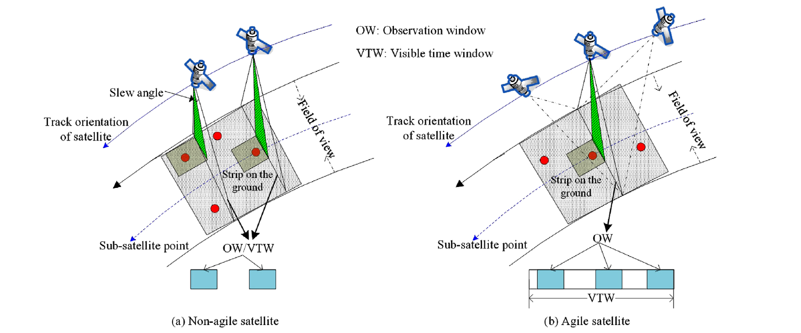
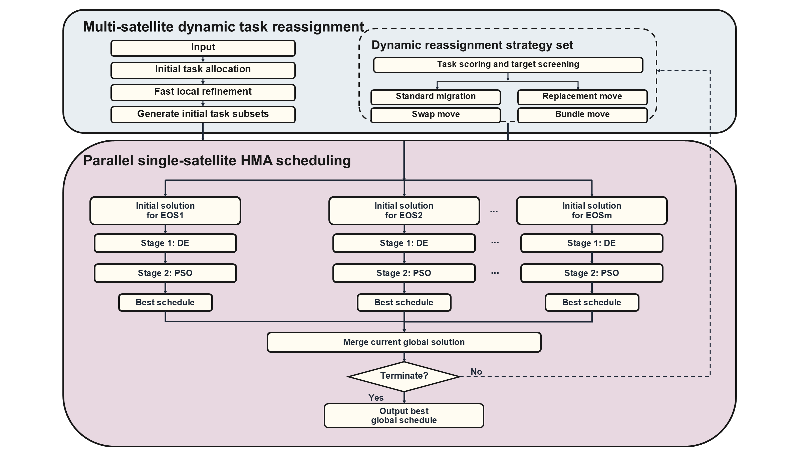
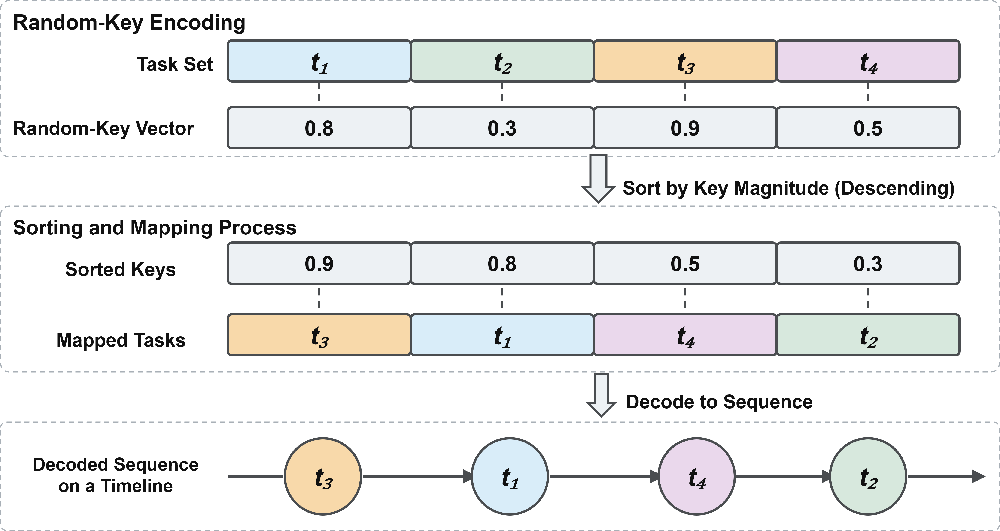
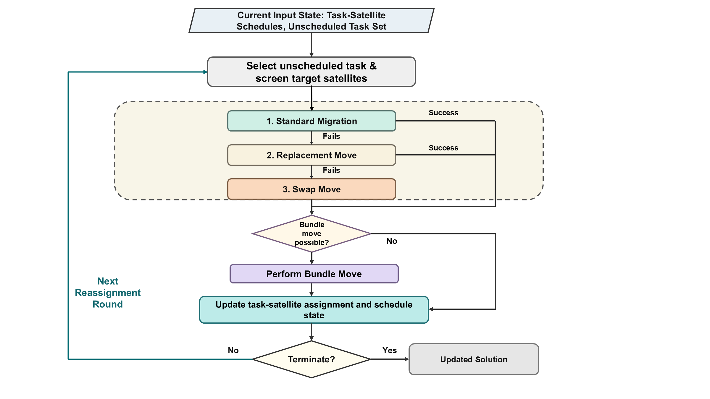
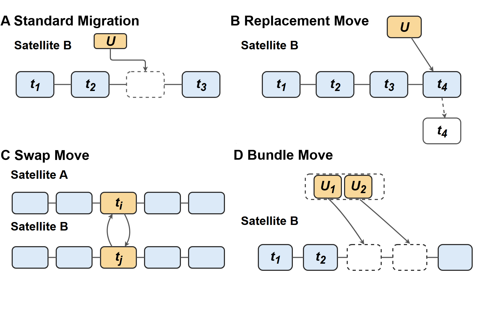
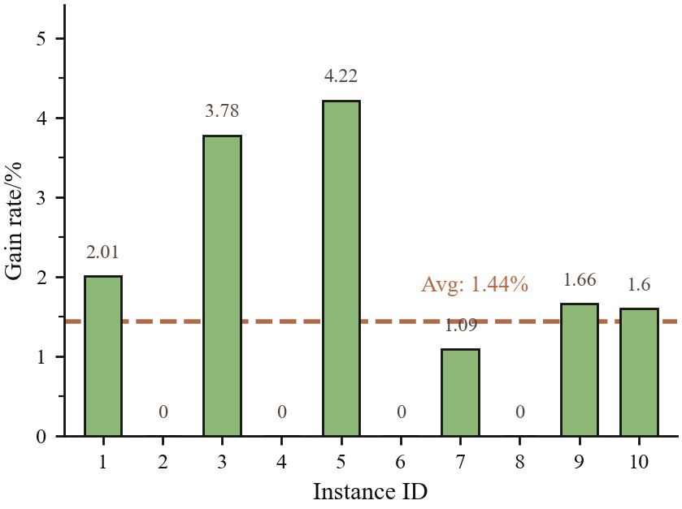
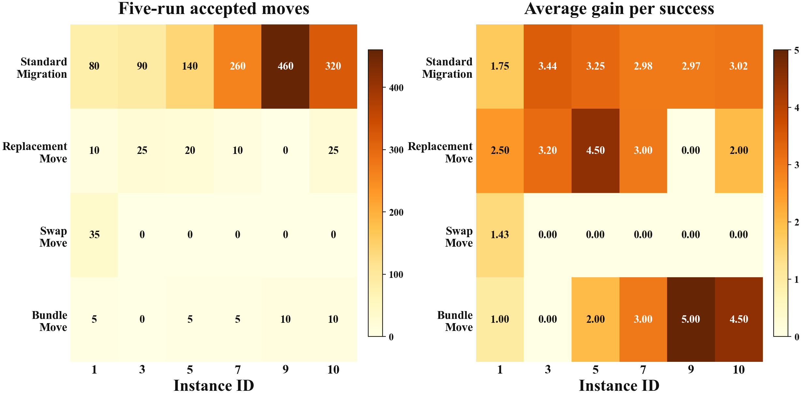
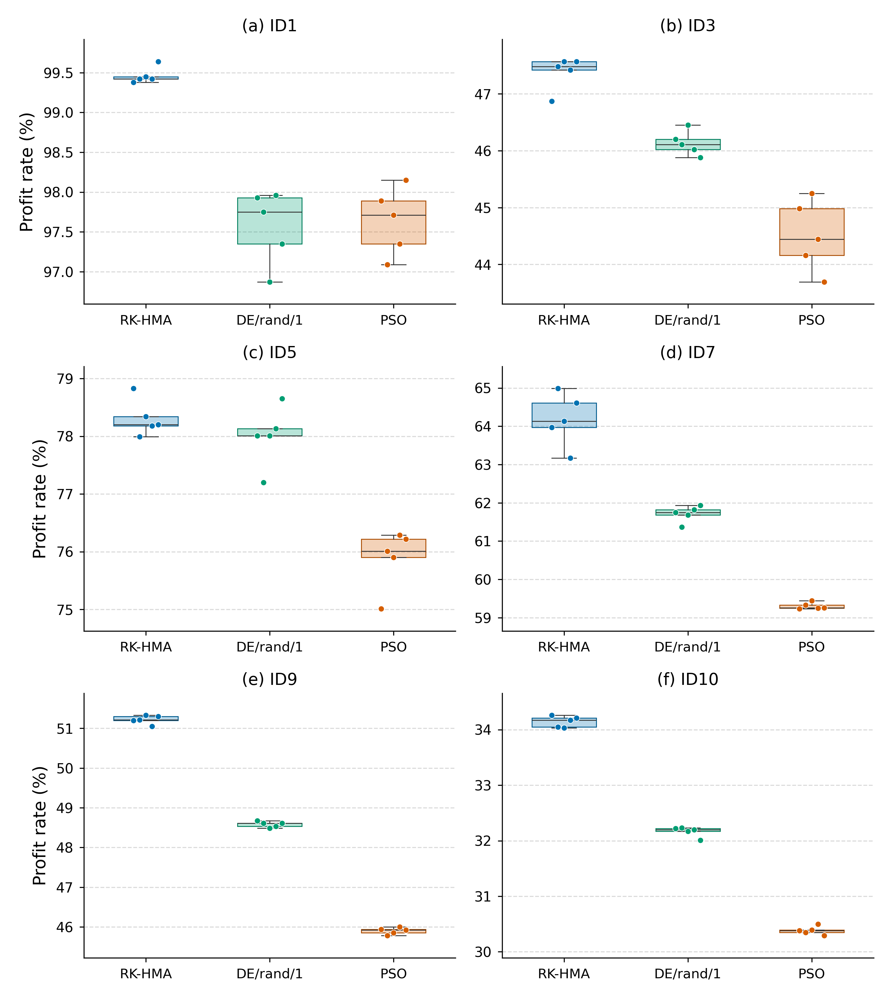

# A Random-Key Hybrid Metaheuristic Algorithm with Dynamic Task Reassignment for Large-Scale Multi-Satellite Scheduling

**Authors**—Haiwei Lei, Xiang Lin, Xiutian Li, Lei He, and Yingwu Chen

**Affiliation**—College of Systems Engineering, National University of Defense Technology, Changsha 410073, China.

**Abstract**—The large-scale agile earth observation satellite task scheduling problem (LS-AEOSTSP) critically impacts time-sensitive missions for growing satellite constellations. Its joint task-allocation and sequencing decisions form an NP-hard combinatorial problem, where large-scale scenarios pose significant challenges: exponentially expanding decision space, limited exploration efficiency of single-paradigm metaheuristics, and revenue loss from suboptimal task-satellite assignments. To address these issues, we propose a Random-Key Hybrid Metaheuristic Algorithm (RK-HMA) with dynamic task reassignment. RK-HMA adopts a two-level optimization framework. At the single-satellite level, a sequential hybrid strategy combining Differential Evolution (DE/rand/1) and Particle Swarm Optimization (PSO) operates on a shared population, where DE performs global exploration and PSO refines solutions through local exploitation. At the multi-satellite coordination level, a dynamic task reassignment mechanism employs four complementary migration strategies—standard migration, replacement, swap, and bundle moves—attempted progressively to revise task-satellite assignments. To comprehensively evaluate performance, systematic comparative experiments are conducted on sixteen scenarios with 500–10,000 tasks and 5–100 satellites, including a superlarge-scale instance of 10,000 tasks and 100 satellites. RK-HMA obtains competitive performance across all tested scenarios, demonstrating particularly strong scalability on large-scale problem instances.

*Index Terms*—Multi-satellite scheduling, hybrid metaheuristic algorithm, dynamic task reassignment, differential evolution, particle swarm optimization.

# 1. INTRODUCTION

Agile earth observation satellites (AEOS) significantly enhance imaging capabilities through three-axis attitude maneuverability. However, as illustrated in Fig. 1, this maneuverability introduces unprecedented challenges for large-scale multi-satellite scheduling that manifest in three key aspects. First, each observation task typically corresponds to multiple potential visible time windows (VTWs) across different satellites, leading to a dramatic increase in decision space that grows exponentially with the number of satellites and tasks. Second, unlike conventional earth observation satellites (EOS) that can only observe targets directly below their ground track, AEOS can rotate along roll, pitch, and yaw axes to steer their imaging payloads toward off-nadir targets. This three-axis agility profoundly influences the required satellite attitude transition time between consecutive observations, thereby affecting the scheduling of subsequent tasks. Third, multi-satellite cooperative scheduling must simultaneously satisfy complex constraints such as attitude maneuver limits, multiple time windows, and task competition for satellite resources, while balancing resource utilization and load distribution across satellites. Due to the combined effect of these factors, large-scale multi-AEOS scheduling is widely recognized as an NP-Hard combinatorial optimization problem with high complexity [1, 2].

```{=latex}
\begin{center}
```


**Fig. 1.** Comparison of observation modes between non-agile EOS and AEOS [3].
```{=latex}
\end{center}
```

In addressing the large-scale multi-AEOS scheduling problem, existing research has proposed various solution approaches [4]. Exact algorithms such as mixed integer linear programming can obtain optimal or near-optimal solutions for small-scale instances, but become prohibitive as the problem size increases [1, 2, 5]. Heuristic-based sequential construction methods often struggle to accurately model complex temporal interactions among multi-satellite and multi-time window constraints, frequently resulting in low solution quality and inefficient convergence [2, 3, 6, 7, 8, 9]. Mainstream metaheuristic optimization algorithms, including genetic algorithms and ant colony optimization, face inherent limitations in their encoding strategies. Common encoding strategies such as single integer encoding or binary encoding often produce excessively long gene sequences when dealing with AEOS-specific continuous solution spaces and multi-window selection problems, severely hampering search efficiency and adaptability to multi-satellite scenarios [10, 11, 12, 13, 14]. Machine learning-based methods, particularly deep reinforcement learning (DRL) approaches, have been explored to learn adaptive heuristics or operator selection policies [15, 16, 17, 18, 19, 20, 21, 22]. These methods introduce a learned policy or heuristic into the scheduling process. The present study examines a complementary approach that combines population-based search with explicit task reassignment, without training a scheduling policy.

To effectively address key challenges in large-scale AEOS scheduling—high-dimensional decision space, low optimization efficiency, and revenue loss caused by task conflicts—we propose a Random-Key Hybrid Metaheuristic Algorithm with Dynamic Task Reassignment (RK-HMA). Building upon the encoding-decoding framework, this paper develops an efficient two-level optimization method. At the single-satellite level, a random-key continuous encoding scheme transforms discrete task sequencing into continuous optimization, enabling direct application of gradient-free optimizers while ensuring strict feasibility constraints through greedy insertion decoding rules. A sequential hybrid strategy combining Differential Evolution (DE/rand/1) and Particle Swarm Optimization (PSO) operates on a shared population. The sequential execution mode ensures PSO operates on the DE-improved population, allowing local exploitation to start from a globally diversified search region and rapidly generating high-quality scheduling solutions in large-scale task scenarios. At the multi-satellite coordination level, a dynamic task reassignment mechanism employs four complementary migration strategies—standard migration, replacement, swap, and bundle moves—that are attempted progressively from simple to complex to revise task-satellite assignments, escape local optima, and optimize overall scheduling revenue. This two-level framework follows the multilevel decision-making view that complex decisions can be separated into interacting levels with different decision scopes [23], and related multi-satellite observation scheduling studies have also combined metaheuristic and exact search within divide-and-conquer frameworks [24]. The main contributions of this paper are summarized as follows:

1) We propose a two-level optimization framework that decomposes the LS-AEOSTSP into single-satellite optimization and multi-satellite task reassignment. The single-satellite level employs random-key encoding to transform discrete scheduling into continuous optimization, enabling direct application of continuous-domain metaheuristics. The multi-satellite level iteratively revises task-satellite assignments to improve overall scheduling quality.

2) We develop a sequential hybrid metaheuristic combining DE/rand/1 and PSO at the single-satellite level. The sequential execution ensures that PSO refines solutions from DE's globally diversified population, achieving effective balance between exploration and exploitation.

3) We design a dynamic task reassignment mechanism with four complementary migration strategies: standard migration, replacement, swap, and bundle moves. These strategies are attempted progressively to systematically explore alternative task-satellite allocations and escape local optima.

4) We conduct systematic comparative experiments on sixteen scenarios with 500–10,000 tasks and 5–100 satellites, including a superlarge-scale instance of 10,000 tasks and 100 satellites. RK-HMA achieves competitive performance across all tested scenarios, demonstrating strong scalability on large-scale problem instances.

The remaining sections are organized as follows. Section 2 reviews related work on AEOS scheduling. Section 3 presents a mathematical model for the LS-AEOSTSP. Section 4 introduces the proposed RK-HMA in detail. Section 5 presents experimental results. Finally, Section 6 concludes this paper.

# 2. RELATED WORK

## 2.1. Research on Single Agile Satellite Scheduling

Single-satellite scheduling methods must select observation opportunities and account for the transition times between consecutive observations. Xu et al. [25] developed priority-based constructive algorithms for maximizing the total priority of scheduled tasks. Liu et al. [3] used adaptive large neighborhood search to handle time-dependent transition times. Wu et al. [18] developed a data-driven improved genetic algorithm for the same scheduling setting. Differential evolution has also been studied for agile satellite scheduling, with Chen et al. [26] proposing DEEM, a differential evolution ensemble method. Learning-based approaches include the Markov decision process and reinforcement learning formulation of He et al. [15] and the solution-construction method of Chen et al. [16]. Song et al. [19] combined deep reinforcement learning with evolutionary search for multitype satellite observation scheduling, and later studied an RL-based memetic algorithm for energy-efficient satellite range scheduling [20]. Cloud coverage uncertainty has also been considered explicitly in robust Earth observation satellite scheduling [27].

## 2.2. Research on Large-Scale Multi-Satellite Agile Scheduling

With the expansion of constellation scales, the research focus has shifted toward large-scale multi-satellite observation. The multi-satellite scheduling problem is not a simple extension of single-satellite problems. Rather, it represents a complex system optimization problem that poses significant challenges in task decomposition, resource allocation, and real-time scheduling [28, 29]. The joint optimization nature of this problem is generally non-convex, involving both discrete task assignment and continuous resource allocation variables. Its complexity grows exponentially with the number of satellites and tasks, making it widely recognized as NP-hard [1, 2].

Liu et al. [3] proposed an ALNS with problem-specific removal and insertion operators for single-satellite scheduling under time-dependent transition times. He et al. [6] introduced a dynamic task allocation mechanism for multi-satellite scenarios. Peng et al. [2] developed a greedy randomized iterated local search that accounts for time-dependent transition times. Li et al. [7] designed a neighborhood search algorithm with shake and repair operators tailored for interval-varying profits. Wu et al. [8] further developed a two-stage ALNS framework for scheduling multiple super-agile satellites. Wu et al. [9] proposed a frequent pattern-based parallel search approach for time-dependent AEOS scheduling.

Population-based evolutionary algorithms have also been applied. Yao et al. [10] proposed a bilevel evolutionary algorithm for large-scale multiobjective task scheduling. Qin et al. [11] combined simulated annealing with a genetic algorithm for multisatellite scheduling of moving targets. Wang et al. [12] designed a strategy fusion-based multi-objective optimization approach that integrates multiple evolutionary strategies. Geng et al. [30] proposed a hybrid coding genetic algorithm that combines binary task-selection decisions with integer observation-window decisions. Long et al. [31] incorporated a hybrid particle swarm algorithm into cooperative planning for heterogeneous agile satellites, using genetic crossover and hill climbing. Zhou et al. [13] modeled marginal decreasing imaging duration and solved the multi-satellite scheduling problem with an adaptive ant colony algorithm, while Shang et al. [14] considered joint observation and transmission scheduling with energy constraints.

He et al. [15] formulated the AEOSTSP as a Markov decision process and applied deep reinforcement learning to learn construction heuristics. Chen et al. [16] proposed a DRL-based model that learns to construct solutions for single-satellite scheduling with time-dependent transition times. Song et al. [17] embedded Q-learning into a genetic algorithm for electromagnetic detection satellite scheduling. Zhu et al. [21] used a deep Q-network to guide a genetic algorithm with local intensification for AEOS scheduling. Li et al. [22] optimized the time-dependent multi-AEOS scheduling problem using deep Q-learning and ensemble heuristics.

Recent studies also address the coordination of large-scale schedules [32]. Qi et al. [33] combined deep reinforcement learning with large neighborhood search for online emergency-task scheduling, using a rolling-horizon framework. Xing et al. [34] reformulated large-scale scheduling with heterogeneous tasks as a strip-selection problem and combined feasible schedule construction with variable neighborhood search over imaging-opportunity sequences. These studies illustrate ways to connect construction and improvement procedures.

More recently, hybrid metaheuristic approaches have attracted increasing attention [35]. Blum et al. [36] surveyed hybrid metaheuristic paradigms, categorizing them into sequential, parallel, and embedded hybridization schemes. In the domain of scheduling, Fan et al. [37] proposed a hybrid evolutionary algorithm using two solution representations for hybrid flow-shop scheduling. Shu et al. [38] integrated variable neighborhood search with NSGA-II for emergency material scheduling. For satellite scheduling specifically, Rocha et al. [39] designed a hybrid algorithm combining a MIP solver with a heuristic procedure for the integrated agile earth observation satellite scheduling problem. Wang et al. [40] proposed a hierarchical encoding-based dual-phase evolutionary algorithm (HeDEA) that employs a hierarchical encoding and decoding scheme to compress the search space, followed by a two-phase evolutionary strategy combining isolation crossover and simulated annealing.

# 3. PROBLEM DESCRIPTION

## 3.1. Problem Description

Given a set $T = \{t_1, \ldots, t_n\}$ of $n$ tasks and a set $\mathrm{AEOS} = \{\mathrm{aeos}_1, \ldots, \mathrm{aeos}_m\}$ of $m$ agile earth observation satellites. Each task $t_i$ is associated with a geographic location (latitude and longitude), an imaging duration $l_i$, and a profit $p_i$, which are provided by the user. Each satellite $\mathrm{aeos}_j$ is represented by its orbital parameters, including the semi-major axis, eccentricity, inclination, right ascension of the ascending node, argument of perigee, and true anomaly. Given the target location and satellite orbital parameters, the visible time windows (VTWs) of each target associated with its visible satellites are obtained through access calculation. Each VTW $W_{ijk}$ has a start time $st_{ijk}$, an end time $et_{ijk}$, and a length $d_{ijk}$. The roll, pitch, and yaw angles of the imaging payload at the corresponding observation times are also available. The notations used throughout this paper are summarized in Table 1.

Due to the limited number of satellites compared with the number of tasks, it is difficult to execute all tasks. Therefore, the LS-AEOSTSP aims to determine the imaging times of a subset of tasks within their VTWs while maximizing the total observation profit, subject to the following assumptions:

1) Each task is a meta-task that can be directly executed by a satellite. Complex tasks such as area target coverage or moving target tracking are not considered, because they can be decomposed into meta-tasks through strip partitioning.

2) Power-capacity and storage-capacity constraints are not modeled. In normal operation, satellites charge through solar power and transmit data to ground stations or relay satellites to release onboard storage.

3) Each satellite is equipped with a single imaging payload and can execute at most one task at a time.

4) Once executed, a task cannot be aborted, and each task is executed at most once.

```{=latex}
\begin{table}[H]
\centering
\small
\renewcommand{\arraystretch}{1.08}
\setlength{\tabcolsep}{5pt}
\caption{Notation for LS-AEOSTSP.}
\label{tab:notation}
\begin{tabular}{@{}>{\centering\arraybackslash}p{0.25\linewidth}>{\centering\arraybackslash}p{0.65\linewidth}@{}}
\toprule
\textbf{Notation} & \textbf{Description} \\
\midrule
$T$ & Tasks set \\
$n$ & Number of tasks \\
$\mathrm{AEOS}$ & Satellites set \\
$m$ & Number of satellites \\
$p_i$ & Profit of task $t_i$ \\
$l_i$ & Imaging duration of task $t_i$ \\
$\chi^{jt}$ & Rolling angle of $\mathrm{aeos}_j$ at time $t$ \\
$\pi^{jt}$ & Pitching angle of $\mathrm{aeos}_j$ at time $t$ \\
$\phi^{jt}$ & Yawing angle of $\mathrm{aeos}_j$ at time $t$ \\
$w_{ijk}$ & $k$-th VTW for task $t_i$ on satellite $\mathrm{aeos}_j$ \\
$W_{ij}$ & VTWs set for task $t_i$ on satellite $\mathrm{aeos}_j$ \\
$|W_{ij}|$ & Number of VTWs for task $t_i$ on satellite $\mathrm{aeos}_j$ \\
$st_{ijk}$ & Start time of $w_{ijk}$ \\
$et_{ijk}$ & End time of $w_{ijk}$ \\
$d_{ijk}$ & Length of $w_{ijk}$ \\
$c_i$ & Specified minimum imaging quality of task $t_i$ \\
\bottomrule
\end{tabular}
\end{table}
```

The decision variables are $x_{ijk}$ and $u_{ijk}$. The binary variable $x_{ijk}$ equals one if task $t_i$ is executed in VTW $w_{ijk}$ and zero otherwise. On the premise that task $t_i$ is  executed in VTW $w_{ijk}$, $u_{ijk}$ represents the start time of task $t_i$. The sequencing variable $\rho_{ijk,i^*jk^*}$ equals one if task $t_i$ is the predecessor of task $t_{i^*}$ on satellite $\mathrm{aeos}_j$ and zero otherwise.

With the defined notations, the mathematical formulation of the LS-AEOSTSP is given as follows:

`\noindent`{=latex} **Objective function:**
$$
\max \sum_{i=1}^{n} \sum_{j=1}^{m} \sum_{k=1}^{|W_{ij}|} x_{ijk} p_i \tag{1}
$$

The objective function maximizes the total observation profit of all scheduled tasks.

`\noindent`{=latex} **Constraints:**
$$
\sum_{j=1}^{m} \sum_{k=1}^{|W_{ij}|} x_{ijk} \leq 1, \quad \forall t_i \in T \tag{2}
$$

$$
st_{ijk} \leq u_{ijk} < u_{ijk}+l_i \leq et_{ijk}, \quad \text{if } x_{ijk}=1 \tag{3}
$$

$$
\rho_{ijk,i^*jk^*} = \begin{cases} 1 & \text{if } t_i \text{ is the predecessor of } t_{i^*} \\ 0 & \text{otherwise} \end{cases}, \quad \text{if } x_{ijk}=x_{i^*jk^*}=1 \tag{4}
$$

$$
u_{ijk}+l_i+\Delta t(t_i,t_{i^*}) \leq u_{i^*jk^*}, \quad \text{if } \rho_{ijk,i^*jk^*}=1 \tag{5}
$$

$$
\Delta t(t_i,t_{i^*}) = \begin{cases}
11.66 & \Delta g(t_i,t_{i^*}) \leq 10^\circ \\
a_1 + \dfrac{\Delta g(t_i,t_{i^*})}{v_1} & 10^\circ < \Delta g(t_i,t_{i^*}) \leq 30^\circ \\
a_2 + \dfrac{\Delta g(t_i,t_{i^*})}{v_2} & 30^\circ < \Delta g(t_i,t_{i^*}) \leq 60^\circ \\
a_3 + \dfrac{\Delta g(t_i,t_{i^*})}{v_3} & 60^\circ < \Delta g(t_i,t_{i^*}) \leq 90^\circ \\
a_4 + \dfrac{\Delta g(t_i,t_{i^*})}{v_4} & \Delta g(t_i,t_{i^*}) > 90^\circ
\end{cases} \tag{6}
$$

$$
\Delta g(t_i,t_{i^*}) = |\chi^{j u_{ijk}}-\chi^{j u_{i^*jk^*}}| + |\pi^{j u_{ijk}}-\pi^{j u_{i^*jk^*}}| + |\phi^{j u_{ijk}}-\phi^{j u_{i^*jk^*}}|, \quad \text{if } \rho_{ijk,i^*jk^*}=1 \tag{7}
$$

$$
q_i \geq c_i, \quad \forall t_i \in T \tag{8}
$$

$$
q_i = 10 - 9 \cdot \frac{|2u_{ijk}+l_i-2w_{ijk}^{*}|}{d_{ijk}-l_i}, \quad \text{if } x_{ijk}=1 \tag{9}
$$

$$
w_{ijk}^{*} = \frac{st_{ijk}+et_{ijk}}{2}, \quad \text{if } x_{ijk}=1 \tag{10}
$$

Constraint (2) ensures that each task is executed at most once. Constraint (3) ensures that the execution interval of a scheduled task is contained in its selected VTW. Constraint (5) requires the time interval between two successive tasks on the same satellite to be no shorter than the transition time $\Delta t(t_i,t_{i^*})$. Consistent with the modeling convention adopted for real-world AEOS systems in prior studies [2, 6, 9], the transition time is calculated using the segmented function in Eq. (6). We follow the same convention in this manuscript to maintain consistency with these studies. The quantity $\Delta g(t_i,t_{i^*})$ represents the total change in the satellite look angles between the two tasks, as defined in Eq. (7). The angular velocities and constant terms are set to $v_1=1.5^\circ/\text{s}$, $a_1=5$, $v_2=2^\circ/\text{s}$, $a_2=10$, $v_3=2.5^\circ/\text{s}$, $a_3=16$, $v_4=3^\circ/\text{s}$, and $a_4=22$. Constraint (8) requires the imaging quality $q_i$ to be no lower than the specified minimum quality $c_i$. Equation (9) calculates $q_i$ from the task start time, and Eq. (10) defines the midpoint of the selected VTW.

# 4. RK-HMA FOR LS-AEOSTSP

The LS-AEOSTSP is NP-hard since it contains the classic EOSTSP as a special case [1, 27]. Due to the NP-hard and large-scale nature, it is difficult to obtain high-quality solutions by directly adopting metaheuristics without enhancement strategies. Inspired by recent advances in hybrid metaheuristics [36, 37, 38], we propose RK-HMA to solve the LS-AEOSTSP. Generally, RK-HMA adopts a bi-level framework, where the upper level optimizes task allocation through dynamic task reassignment across satellites, and the lower level solves the single-satellite scheduling problem using a hybrid metaheuristic. The details of the proposed algorithm are introduced in the following sections.

## 4.1. Framework of RK-HMA

The framework and pseudocode of the proposed RK-HMA are shown in Fig. 2 and Algorithm 1, respectively. RK-HMA first constructs an initial task-satellite assignment through the procedure in Section 4.2. Then, each satellite optimizes its allocated task subset by the hybrid metaheuristic algorithm in Section 4.3 to obtain an initial feasible schedule. During each reassignment round, RK-HMA first checks whether unscheduled tasks still exist. If so, and if the reassignment stop conditions are not met, the dynamic reassignment module in Section 4.4 is invoked to perform standard migration, replacement move, swap move, and bundle move. After the reassignment loop finishes, all satellites are re-optimized in parallel by a full HMA run, and the current global solution is updated. The optimization-reassignment loop continues until the maximum reassignment rounds are reached, and the best global solution is returned.

```{=latex}
\begin{center}
```


**Fig. 2.** Framework of the proposed RK-HMA.
```{=latex}
\end{center}
```

Fig. 2 gives the structural view of RK-HMA, while Algorithm 1 summarizes the corresponding execution order. The figure separates the multi-satellite reassignment layer from the parallel single-satellite HMA layer. The pseudocode then makes the control flow explicit: initialization first constructs task subsets, HMA optimizes each satellite schedule, reassignment repairs unscheduled tasks across satellites, and a final HMA pass refines the returned global schedule.

```{=latex}
\begin{center}
\begin{minipage}{0.97\linewidth}
\small
\textbf{Algorithm 1: RK-HMA}\\
\textbf{Input:} Task set $T$, satellite set $\mathrm{AEOS}$, maximum reassignment rounds $R_{\max}$\\
\textbf{Output:} Best found solution $X^b$\\[2pt]
\linespread{0.90}\selectfont
\begin{tabbing}
\hspace{2.0em}\=\hspace{1.6em}\=\hspace{1.6em}\=\hspace{1.6em}\=\kill
1:\> Initialize algorithm parameters\\
2:\> $assignment \leftarrow \textsc{InitialAssignment}(T, \mathrm{AEOS})$\\
3:\> $reassignRound \leftarrow 0$\\
4:\> $zeroGainRounds \leftarrow 0$\\
5:\> \textbf{for each} satellite $a \in \mathrm{AEOS}$ \textbf{do}\\
6:\> \> $a.schedule \leftarrow \textsc{HMA}(a.tasks)$\\
7:\> \textbf{end for}\\
8:\> $X \leftarrow \textsc{GetGlobalSolution}(\mathrm{AEOS})$\\
9:\> $X^b \leftarrow X$\\
10:\> \textbf{for} $r = 1$ \textbf{to} $R_{\max}$ \textbf{do}\\
11:\> \> $\mathcal{U} \leftarrow \textsc{CollectUnscheduled}(\mathrm{AEOS})$\\
12:\> \> \textbf{if} $\mathcal{U} = \varnothing$ \textbf{then}\\
13:\> \> \> \textbf{break}\\
14:\> \> \textbf{end if}\\
15:\> \> \textbf{if} $reassignRound \geq R_{\max}$ \textbf{or} $zeroGainRounds \geq 2$ \textbf{then}\\
16:\> \> \> \textbf{break}\\
17:\> \> \textbf{end if}\\
18:\> \> $X_{\mathrm{before}} \leftarrow X$\\
19:\> \> $\textsc{DynamicReassignment}(\mathcal{U}, \mathrm{AEOS})$\\
20:\> \> $reassignRound \leftarrow reassignRound + 1$\\
21:\> \> $X \leftarrow \textsc{GetGlobalSolution}(\mathrm{AEOS})$\\
22:\> \> \textbf{if} $F(X) > F(X_{\mathrm{before}})$ \textbf{then}\\
23:\> \> \> $zeroGainRounds \leftarrow 0$\\
24:\> \> \textbf{else}\\
25:\> \> \> $zeroGainRounds \leftarrow zeroGainRounds + 1$\\
26:\> \> \textbf{end if}\\
27:\> \textbf{end for}\\
28:\> \textbf{for each} satellite $a \in \mathrm{AEOS}$ \textbf{do}\\
29:\> \> $a.schedule \leftarrow \textsc{HMA}(a.tasks)$\\
30:\> \textbf{end for}\\
31:\> $X \leftarrow \textsc{GetGlobalSolution}(\mathrm{AEOS})$\\
32:\> \textbf{if} $F(X) \geq F(X^b)$ \textbf{then}\\
33:\> \> $X^b \leftarrow X$\\
34:\> \textbf{end if}\\
35:\> \textbf{return} $X^b$\\
\end{tabbing}
\end{minipage}
\end{center}
```

Algorithm 1 shows how RK-HMA combines initialization, single-satellite optimization, and multi-satellite reassignment. The initialization stage provides a high-quality starting allocation, the reassignment loop then targets remaining unscheduled tasks through progressive cross-satellite migration, and a final HMA stage fully re-optimizes all single-satellite schedules through sequential DE/rand/1 and PSO evolution. This ordering makes the coordination logic explicit: reassignment is used to repair task allocation first, and full HMA optimization is applied afterward to refine the final per-satellite schedules.

## 4.2. Initial Solution Construction Procedure

The initial task allocation adopts a two-phase composite strategy to produce high-quality starting solutions.

**Capacity-Aware Composite Allocation:** In the implementation used in our experiments, the default initialization adopts a capacity-aware composite assignment strategy. For each task $t_i$ and candidate satellite $\mathrm{aeos}_j$, a normalized composite score is computed:
$$
\text{Score}(t_i, \mathrm{aeos}_j) = \tilde{w}_{d} \cdot \hat{d}_{ij} + w_{W} \cdot \hat{W}_{ij} + \tilde{w}_{L} \cdot \hat{L}_{j} - w_{f} \cdot \hat{f}_{ij} \tag{11}
$$
where $\hat{d}_{ij}$ is the normalized usable window length, $\hat{W}_{ij}$ is the normalized number of feasible VTWs, $\hat{L}_{j}$ is the normalized load-balance score of satellite $\mathrm{aeos}_j$, and $\hat{f}_{ij}$ is the normalized time-window conflict score between $t_i$ and the tasks already allocated to $\mathrm{aeos}_j$. To favor scarce tasks, the window-length and load-balance terms are adaptively adjusted by the scarcity factor $\eta_i = 1 / |C_i|$, where $|C_i|$ is the number of candidate satellites for task $t_i$:

$$
\tilde{w}_{d} = w_{d}(1 + \beta \eta_i), \qquad \tilde{w}_{L} = w_{L}(1 - \beta \eta_i)
$$

The concrete values of $w_{d}$, $w_{W}$, $w_{L}$, $w_{f}$, and $\beta$ are reported with the other experimental parameters in Table 4. In the capacity-aware variant, this composite score is further multiplied by a soft capacity penalty to discourage early overload on already crowded satellites.

Tasks are prioritized for allocation as follows: tasks with only one candidate satellite are allocated first (forced allocation to avoid missing), and the remaining tasks are sorted by their profit $p_i$ in descending order. Each task is then assigned to the candidate satellite with the highest heuristic score.

**Fast Local Refinement:** After greedy decoding, tasks that remain unscheduled are sorted by profit in descending order. For each unscheduled task, migration to an alternative candidate satellite is attempted. The source satellite is only re-evaluated after a successful insertion on the target satellite. A migration is accepted if the net fitness gain is positive ($\Delta f > 0$). This phase refines the initial solution through localized adjustments.

## 4.3. Hybrid Metaheuristic Algorithm (HMA)

### 4.3.1. Random-Key Continuous Encoding

For the set of $n_j$ tasks allocated to satellite $\mathrm{aeos}_j$, RK-HMA adopts a random-key representation for permutation-based optimization. Each individual in the population is represented as a real-valued vector $\mathbf{x} = [x_1, x_2, \ldots, x_{n_j}]$, where each $x_i$ serves as a ranking key. The decoder uses only the relative order of the keys, so the numerical key interval is written as $[-u,u]$. The population is maintained as a matrix $\mathbf{X} \in \mathbb{R}^{N_{\text{pop}} \times n_j}$, where $N_{\text{pop}}$ is the population size and $n_j$ is the dimensionality.

Under this representation, the discrete task sequencing problem can be handled by continuous metaheuristic algorithms such as DE and PSO. The search operators update real-valued keys, while the decoder converts each key vector back into a task permutation before schedule construction.

**Example:** Given tasks $\{t_1, t_2, t_3, t_4\}$ with normalized example key vector $\mathbf{x} = [0.8, 0.3, 0.9, 0.5]$, sorting by key values in descending order yields the task sequence: $t_3 \rightarrow t_1 \rightarrow t_4 \rightarrow t_2$.

```{=latex}
\begin{center}
```


**Fig. 3.** Random-key representation and decoding of a single-satellite solution.
```{=latex}
\end{center}
```

### 4.3.2. Greedy Insertion Decoding

Given a random-key vector $\mathbf{x} = [x_1, x_2, \ldots, x_{n_j}]$, the decoding procedure first sorts the tasks in descending order of their key values to obtain a task permutation, and then constructs a feasible schedule through greedy insertion:

1) Sort tasks by their random-key values in descending order to obtain the task sequence: $t_{\pi(1)}, t_{\pi(2)}, \ldots, t_{\pi(n_j)}$, where $x_{\pi(1)} \geq x_{\pi(2)} \geq \cdots \geq x_{\pi(n_j)}$

2) Initialize an empty schedule: $\text{schedule} = []$

3) For each task $t_{\pi(i)}$ in order:
   - For each visible time window of this task, enumerate its discretized attitude records as candidate start times
   - Check time window feasibility, transition time constraints between adjacent tasks, and imaging quality requirements
   - Select the first feasible attitude record for insertion
   - If no feasible record exists across all windows, mark the task as unscheduled

4) Return the schedule and the list of unscheduled tasks

The fitness of an individual is defined as the total profit of all scheduled tasks:

$$
f(\mathbf{x}) = \sum_{t_i \in \text{scheduled}} p_i \tag{12}
$$

The time complexity of the greedy insertion decoding is $O(n_j^2)$, where $n_j$ is the number of tasks allocated to satellite $\mathrm{aeos}_j$.


### 4.3.3. Population Initialization

The initial population $P^0 = \{\mathbf{x}_1, \mathbf{x}_2, \ldots, \mathbf{x}_{N_{\text{pop}}}\}$ is generated by sampling each random key $x_{ij}$ uniformly from the interval $[-u,u]$. This uniform random initialization ensures diversity in the initial task orderings. 

### 4.3.4. Sequential Hybrid Execution Mode

The HMA adopts a serial sequential hybrid strategy, where DE/rand/1 and PSO are executed sequentially within each generation. The key insight is that PSO operates on the DE-improved population, ensuring that the local exploitation of PSO always starts from a globally diversified search region. The pseudocode of the single-satellite HMA is presented in Algorithm 2.

```{=latex}
\begin{center}
\begin{minipage}{0.97\linewidth}
\small
\textbf{Algorithm 2: HMA for Single-Satellite Scheduling}\\
\textbf{Input:} Task subset $T_j \subseteq T$ allocated to $\mathrm{aeos}_j$, population size $N_{pop}$, maximum HMA generations $G_{hma}$, DE parameters $(F, CR)$, PSO parameters $(w, c_1, c_2)$\\
\textbf{Output:} Best found single-satellite schedule $x^b$\\[2pt]
\begin{tabbing}
\hspace{2.0em}\=\hspace{1.6em}\=\hspace{1.6em}\=\hspace{1.6em}\=\kill
1:\> Initialize random-key population $P^0$ for $T_j$\\
2:\> Decode each individual in $P^0$ by greedy insertion and evaluate fitness\\
3:\> Initialize personal-best set $P^{best}$ and global-best solution $x^b$\\
4:\> \textbf{for} $t = 0$ \textbf{to} $G_{hma}-1$ \textbf{do}\\
5:\> \> \textit{Stage 1: DE/rand/1}\\
6:\> \> \textbf{for each} individual $x_i \in P^t$ \textbf{do}\\
7:\> \> \> Generate mutant vector $v_i$ by Eq. (13)\\
8:\> \> \> Generate trial vector $u_i$ by Eq. (14)\\
9:\> \> \> Decode $u_i$ and evaluate $f(u_i)$\\
10:\> \> \> \textbf{if} $f(u_i) \geq f(x_i^t)$ \textbf{then}\\
11:\> \> \> \> $x_i^{DE} \leftarrow u_i$\\
12:\> \> \> \textbf{else}\\
13:\> \> \> \> $x_i^{DE} \leftarrow x_i^t$\\
14:\> \> \> \textbf{end if}\\
15:\> \> \textbf{end for}\\
16:\> \> \textit{Stage 2: PSO}\\
17:\> \> Form DE-improved population $P_{\mathrm{DE}}^{t}$ from all survivors\\
18:\> \> \textbf{for each} individual $x_i^{DE} \in P_{\mathrm{DE}}^{t}$ \textbf{do}\\
19:\> \> \> Update velocity $v_i$ by Eq. (16)\\
20:\> \> \> Set $\hat{x}_i \leftarrow x_i^{DE} + v_i$\\
21:\> \> \> Decode $\hat{x}_i$ and evaluate $f(\hat{x}_i)$\\
22:\> \> \> \textbf{if} $f(\hat{x}_i) \geq f(x_i^{DE})$ \textbf{then}\\
23:\> \> \> \> $x_i^{t+1} \leftarrow \hat{x}_i$\\
24:\> \> \> \textbf{else}\\
25:\> \> \> \> $x_i^{t+1} \leftarrow x_i^{DE}$\\
26:\> \> \> \textbf{end if}\\
27:\> \> \> Update personal best of individual $i$\\
28:\> \> \textbf{end for}\\
29:\> \> Update global-best solution $x^b$\\
30:\> \textbf{end for}\\
31:\> \textbf{return} $x^b$\\
\end{tabbing}
\end{minipage}
\end{center}
```

```{=latex}
\Needspace{7\baselineskip}
```

At each generation $t$, the execution proceeds as follows:

```{=latex}
\nopagebreak[4]
```

**Stage 1 (DE/rand/1 — Global Exploration):** For each individual $\mathbf{x}_i$ in the current population $P^t$:

`\noindent`{=latex} *Mutation:*
$$
\mathbf{v}_i = \mathbf{x}_{r1} + F \cdot (\mathbf{x}_{r2} - \mathbf{x}_{r3}) \tag{13}
$$
where $r1, r2, r3$ are mutually exclusive random indices, and $F$ is the scaling factor.

`\noindent`{=latex} *Crossover:*
$$
u_{ij} = \begin{cases} v_{ij} & \text{if } \text{rand}() < CR \text{ or } j = j_{\text{rand}} \\ x_{ij} & \text{otherwise} \end{cases} \tag{14}
$$
where $CR$ is the crossover probability and $j_{\text{rand}}$ is a randomly selected dimension.

`\noindent`{=latex} *Selection:*
$$
\mathbf{x}_i^{DE} = \begin{cases} \mathbf{u}_i & \text{if } f(\mathbf{u}_i) \geq f(\mathbf{x}_i^t) \\ \mathbf{x}_i^t & \text{otherwise} \end{cases} \tag{15}
$$

The output of Stage 1 is the DE-improved population $P_{\text{DE}}^{t}$, which serves as the input to Stage 2 within the same generation.

```{=latex}
\Needspace{6\baselineskip}
```

**Stage 2 (PSO — Fast Convergence):** The input to Stage 2 is the DE-improved population $P_{\text{DE}}^{t}$, not the original population $P^t$. For each individual $\mathbf{x}_i^{DE}$ in $P_{\text{DE}}^{t}$:

`\noindent`{=latex} *Velocity update:*
$$
\mathbf{v}_i^{t+1} = w \cdot \mathbf{v}_i^t + c_1 \cdot r_1 \cdot (\mathbf{p}_i^{\text{best}} - \mathbf{x}_i^{DE}) + c_2 \cdot r_2 \cdot (\mathbf{g}^{\text{best}} - \mathbf{x}_i^{DE}) \tag{16}
$$

`\noindent`{=latex} *Position update:*
$$
\hat{\mathbf{x}}_i = \mathbf{x}_i^{DE} + \mathbf{v}_i^{t+1} \tag{17}
$$
where $w$ is the inertia weight (linearly decreasing from $w_0$ to $w_{\text{final}}$), $c_1$ and $c_2$ are learning factors, $\mathbf{p}_i^{\text{best}}$ is the personal best position, and $\mathbf{g}^{\text{best}}$ is the global best position.

`\noindent`{=latex} *Selection:*
$$
\mathbf{x}_i^{t+1} = \begin{cases} \hat{\mathbf{x}}_i & \text{if } f(\hat{\mathbf{x}}_i) \geq f(\mathbf{x}_i^{DE}) \\ \mathbf{x}_i^{DE} & \text{otherwise} \end{cases} \tag{18}
$$

The final output of generation $t$ is the population $P^{t+1}$, which becomes the input to the next generation's DE stage.

**Rationale for the DE + PSO combination:** DE/rand/1 introduces diversity through difference-based mutation, enabling broad exploration, while PSO leverages global best information to refine solutions in promising regions. By executing DE first and PSO second within each generation, the sequential hybrid ensures that local exploitation builds upon globally diversified search, achieving effective balance between exploration and exploitation.

## 4.4. Dynamic Task Reassignment Mechanism

### 4.4.1. Triggering Condition

The reassignment is activated whenever unscheduled tasks still exist and the reassignment stop conditions are not met. Specifically, RK-HMA continues reassignment while recent reassignment attempts still produce benefit and terminates when the configured stopping condition is reached.

### 4.4.2. Unscheduled Task Ranking

Before attempting migration, all unscheduled tasks are ranked by a composite score:

$$
\begin{aligned}
\text{Score}(t_i)
&= \gamma_p \cdot \frac{p_i}{p_{\max}}
+ \gamma_c \cdot \frac{|C_i|}{|C|_{\max}}
+ \gamma_{W} \cdot \frac{|W_i|}{|W|_{\max}}
+ \gamma_{\zeta} \cdot \zeta_i.
\end{aligned}
\tag{19}
$$
Here, $W_i = \bigcup_{\mathrm{aeos}_j \in C_i} W_{ij}$ denotes the set of VTWs available to task $t_i$ on its candidate satellites. The quantity $p_i / p_{\max}$ is the normalized task profit, $|C_i| / |C|_{\max}$ is the normalized number of candidate satellites, $|W_i| / |W|_{\max}$ is the normalized total number of VTWs, and $\zeta_i \in [0,1]$ is a persistent task key initialized once per task and optionally perturbed after failed migration attempts. The coefficients $\gamma_p$, $\gamma_c$, $\gamma_W$, and $\gamma_{\zeta}$ are tuned ranking weights reported in Table 4.

This composite score prioritizes unscheduled tasks for migration trials. The profit term $p_i / p_{\max}$ estimates repair benefit, while the candidate-satellite and VTW terms $|C_i| / |C|_{\max}$ and $|W_i| / |W|_{\max}$ estimate reassignment flexibility. All three task attributes are normalized to prevent raw magnitude differences from dominating the ranking. The  $\zeta_i$ is initialized once by randomly sampling a value from $[0,1]$ to introduce individual-specific randomness.

### 4.4.3. Lightweight Top-K Target-Satellite Screening

To control the cost of evaluating candidate satellites during reassignment, we use a bounded top-k candidate screening rule.

All eligible candidate satellites are scored once by a lightweight heuristic. For task $t_i$ and candidate satellite $\mathrm{aeos}_j$, the screening score is

$$
S^{\ell}_{ij}
= \kappa_{\mathrm{cnt}} \bar{w}^{\mathrm{cnt}}_{ij}
+ \kappa_{\mathrm{len}} \bar{w}^{\mathrm{len}}_{ij}
+ \kappa_e \bar{e}_{ij}
+ \kappa_{\zeta} \zeta^{\mathrm{eff}}_{ij}.
$$

The terms $\bar{w}^{\mathrm{cnt}}_{ij}$ and $\bar{w}^{\mathrm{len}}_{ij}$ are the candidate-window count and total candidate-window length normalized across the eligible satellites for task $t_i$. The earliest-start score $\bar{e}_{ij}$ favors satellites that can absorb the task earlier in the planning horizon. The effective task-satellite key is

$$
\zeta^{\mathrm{eff}}_{ij}
= \zeta^{\mathrm{base}}_{ij}+\delta^{\mathrm{fb}}_{ij},
$$
where $\zeta^{\mathrm{base}}_{ij}$ is initialized once as a task-satellite affinity score by randomly sampling a value from $[0,1]$. The feedback state $\delta^{\mathrm{fb}}_{ij}$ increases by $\Delta^{+}_{\mathrm{fb}}$ after a successful move and decreases by $\Delta^{-}_{\mathrm{fb}}$ after a failed move. The four screening coefficients are normalized by their sum before scoring. Their effective values are reported in Table 4.

A task is treated as prioritized when it belongs to the top $K_{\mathrm{rank}}^{\mathrm{task}}$ unscheduled tasks under Eq. (19) in the current reassignment round. After all eligible satellites are ranked by the screening score, only the top $K_{\mathrm{ordinary}}^{\mathrm{sat}}$ candidates are retained for ordinary tasks, and only the top $K_{\mathrm{priority}}^{\mathrm{sat}}$ candidates are retained for prioritized tasks. This lightweight screening exploits the cost asymmetry between ranking and trial moves: computing screening scores for all $m$ eligible satellites is inexpensive, while each downstream trial move requires full schedule reconstruction. The top-k rule thus maintains $O(m)$ ranking cost while confining expensive migration trials to a small subset of high-scoring candidates.

### 4.4.4. Reassignment Procedure

The overall reassignment proceeds as follows:

```{=latex}
\begin{center}
\begin{minipage}{0.97\linewidth}
\small
\textbf{Algorithm 3: Dynamic Reassignment}\\
\textbf{Input:} Unscheduled tasks $\mathcal{U}$, satellite set $\mathrm{AEOS}$\\
\textbf{Output:} Updated task allocation\\[2pt]
\begin{tabbing}
\hspace{2.0em}\=\hspace{1.6em}\=\hspace{1.6em}\=\hspace{1.6em}\=\kill
1:\> Sort $\mathcal{U}$ by composite score in descending order\\
2:\> \textbf{for each} task $u \in \mathcal{U}$ \textbf{do}\\
3:\> \> $success \leftarrow \textsc{StandardMigration}(u, \mathrm{AEOS})$\\
4:\> \> \textbf{if not} $success$ \textbf{then}\\
5:\> \> \> $success \leftarrow \textsc{ReplacementMove}(u, \mathrm{AEOS})$\\
6:\> \> \textbf{end if}\\
7:\> \> \textbf{if not} $success$ \textbf{then}\\
8:\> \> \> $success \leftarrow \textsc{SwapMove}(u, \mathrm{AEOS})$\\
9:\> \> \textbf{end if}\\
10:\> \> \textbf{if} $success$ \textbf{then}\\
11:\> \> \> Update task allocation and affected schedules\\
12:\> \> \textbf{end if}\\
13:\> \textbf{end for}\\
14:\> $remaining \leftarrow \textsc{CollectStillUnscheduled}(\mathcal{U})$\\
15:\> \textbf{if} $remaining \neq \varnothing$ \textbf{then}\\
16:\> \> $\textsc{BundleMove}(remaining, \mathrm{AEOS})$\\
17:\> \textbf{end if}\\
\end{tabbing}
\end{minipage}
\end{center}
```

Algorithm 3 lists the decision order of the reassignment procedure, while Fig. 4 visualizes the same mechanism as a control-flow diagram. The pseudocode emphasizes the priority among migration trials: each unscheduled task first attempts standard migration, then replacement and swap moves if needed, and the remaining unresolved tasks are finally handled by bundle migration. The flowchart complements this description by showing the loop conditions, success checks, and update points in the reassignment module.

```{=latex}
\begin{center}
```
{width=88%}

**Fig. 4.** Flowchart of the dynamic task reassignment mechanism.
```{=latex}
\end{center}
```

### 4.4.5. Migration Strategies

The reassignment mechanism applies four migration strategies in increasing order of intervention: direct insertion is attempted first, followed by replacement, swap, and bundle moves when simpler trials fail. This order favors low-cost and low-disruption repairs before invoking more complex schedule changes, reducing unnecessary schedule reconstruction while preserving opportunities for larger gains when simple migration is insufficient.

**Standard Migration:** Standard migration attempts to move an unscheduled task $U$ to a candidate target satellite through the bounded top-k screening and fast refine procedure described in Section 4.4.3.

For each trial target, the schedules of the affected satellites are reconstructed. Let $\mathcal{A}$ denote these affected satellites, including the target satellite and, when applicable, the source satellite. The local profit change is computed as

$$
\Delta f =
\sum_{\mathrm{aeos}_j \in \mathcal{A}} \operatorname{profit}(P'_j)
-
\sum_{\mathrm{aeos}_j \in \mathcal{A}} \operatorname{profit}(P_j),
$$
where $P_j$ and $P'_j$ are the schedules of $\mathrm{aeos}_j$ before and after the trial move. Unaffected satellites keep the same schedules, so this local difference is equivalent to the total-profit difference $f_{\mathrm{new}}-f_{\mathrm{old}}$. The migration is accepted only when $\Delta f>0$.

**Replacement Move:** When standard migration fails, replacement move tries to create room on a target satellite by removing one scheduled task, and inserting $U$ into the reconstructed target schedule. Removed task are selected from low-profit or strongly overlapping candidates. Each replacement trial is evaluated by the same affected-satellite profit difference $\Delta f$, and the best positive trial is accepted.

**Swap Move:** If replacement also fails, swap move relocates a scheduled task $X$ from the target satellite to a receiver satellite and inserts $U$ into the target satellite. The swap is accepted only when the reconstructed schedules yield $\Delta f>0$.

**Bundle Move:** After individual migrations are attempted, bundle move groups remaining unscheduled tasks and migrates each group jointly. Unscheduled tasks are clustered by candidate-window start-time proximity, and each bundle contains at most $B_{\max}$ tasks. Tasks are treated as time-neighboring when the absolute difference between their earliest candidate-window start times on the same satellites is no larger than $\theta_B$. For each candidate satellite, the whole bundle is inserted and evaluated by the same affected-satellite profit difference $\Delta f$; the bundle is accepted only when this value is positive. 

```{=latex}
\begin{center}
```
{width=74%}

**Fig. 5.** Four migration strategies in dynamic task reassignment.
```{=latex}
\end{center}
```

# 5. EXPERIMENTAL RESULTS

To evaluate RK-HMA on the LS-AEOSTSP, the simulator introduced in [6] is used to generate multiple experimental scenarios. The proposed algorithm is implemented in Java and runs on a PC with Intel Core i7-14700kf CPU @ 3.40 GHz and 64-GB memory.

## 5.1. Experimental Scenario

Sixteen experimental scenarios are generated by the satellite simulation tool in literature [6], containing small-scale, medium-scale, large-scale, and superlarge-scale problem instances. The scenarios cover 500–10,000 tasks and 5–100 agile satellites. In addition, in order to fully validate the performance of RK-HMA, a superlarge-scale experimental scenario containing 10,000 tasks and 100 agile satellites is designed, which is the largest instance evaluated in this study. Among the regional scenarios, two high-conflict instances (regional3 and regional5) with higher task-to-satellite ratios are included to test the algorithms' capability in handling resource-constrained situations.

Scenario elements include ID, scale of scenario, number of tasks, number of satellites, start time, end time, and distribution of tasks. The distribution is categorized into regional distribution and global distribution. Regional targets are distributed within $3^\circ\text{N} - 53^\circ\text{N}$ and $74^\circ\text{E} - 133^\circ\text{E}$. The period of each scenario is set as one of the time intervals from 2013/04/20/00:00:00 to 2013/04/21/00:00:00. The specific details of each scenario are shown in Tables 2 and 3. In addition, the imaging duration of each task is a random integer between 1 and 30 seconds, and the priority of each task is a random integer between 1 and 10, where 1 represents the lowest profit and 10 represents the highest profit.

```{=latex}
\begingroup
\begin{table}[H]
\centering
\small
\renewcommand{\arraystretch}{1.04}
\setlength{\tabcolsep}{4pt}
\caption{Regional experimental scenarios.}
\begin{tabular*}{\linewidth}{@{\extracolsep{\fill}}lrrl@{}}
\toprule
Scenario & $n$ & $m$ & Planning interval \\
\midrule
\texttt{regional1} & 500 & 5 & 00:00:00--23:59:59 \\
\texttt{regional2} & 1000 & 10 & 00:00:00--11:59:59 \\
\texttt{regional3} & 2000 & 10 & 00:00:00--11:59:59 \\
\texttt{regional4} & 2000 & 20 & 00:00:00--11:59:59 \\
\texttt{regional5} & 3000 & 20 & 00:00:00--07:59:59 \\
\texttt{regional6} & 4000 & 40 & 00:00:00--05:59:59 \\
\texttt{regional7} & 5000 & 50 & 00:00:00--11:59:59 \\
\texttt{regional8} & 6000 & 60 & 00:00:00--05:59:59 \\
\texttt{regional9} & 8000 & 80 & 00:00:00--11:59:59 \\
\texttt{regional10} & 10000 & 100 & 06:00:00--11:59:59 \\
\bottomrule
\end{tabular*}
\end{table}
```

```{=latex}
\begin{table}[H]
\centering
\small
\renewcommand{\arraystretch}{1.04}
\setlength{\tabcolsep}{4pt}
\caption{Global experimental scenarios.}
\begin{tabular*}{\linewidth}{@{\extracolsep{\fill}}lrrl@{}}
\toprule
Scenario & $n$ & $m$ & Planning interval \\
\midrule
\texttt{global1} & 500 & 5 & 00:00:00--23:59:59 \\
\texttt{global2} & 1000 & 10 & 12:00:00--23:59:59 \\
\texttt{global3} & 2000 & 20 & 12:00:00--23:59:59 \\
\texttt{global4} & 3000 & 30 & 12:00:00--19:59:59 \\
\texttt{global5} & 4000 & 40 & 12:00:00--17:59:59 \\
\texttt{global6} & 6000 & 60 & 12:00:00--17:59:59 \\
\bottomrule
\end{tabular*}
\end{table}
\endgroup
```

## 5.2. Performance Metrics and Parameter Settings

In this section, five representative state-of-the-art algorithms in the field—random tasks allocation based ALNS (R-ALNS), adaptive tasks allocation based ALNS (A-ALNS), hybrid coding genetic algorithm (HCGA), hybrid particle swarm optimization (HPSO), and hierarchical encoding-based dual-phase evolutionary algorithm (HeDEA)—are selected for comparison experiments. The details of each algorithm are as follows.

**R-ALNS:** ALNS is recently designed for solving the SSTSP. It is a local search-based algorithm, which has been proven to have outstanding performance in solving the SSTSP [3]. On this basis, random tasks allocation strategy is added to solve the LS-AEOSTSP.

**A-ALNS:** A-ALNS is the most effective algorithm for solving multi-satellite task scheduling problem, which is based on DCF [6]. On the basis of ALNS, the adaptive tasks allocation strategy is proposed in A-ALNS to allocate tasks to each satellite.

**HCGA:** HCGA is the hybrid coding genetic algorithm proposed by Geng et al. [30]. It combines binary task-selection and integer observation-window encodings with problem-specific genetic operators and heuristic decoding rules. The experiments use its adapted enhanced implementation described below.

**HPSO:** HPSO is adapted from the hybrid particle swarm algorithm in Long et al. [31], which combines particle swarm search with genetic crossover and hill climbing. The experiments use its adapted enhanced implementation described below.

**HeDEA:** HeDEA was proposed by Wang et al. [40] for large-scale agile satellite scheduling. It introduces a hierarchical encoding and decoding scheme to compress the search space, followed by a dual-phase evolutionary strategy combining isolation crossover and simulated annealing.

```{=latex}
\begin{table}[H]
\centering
\small
\renewcommand{\arraystretch}{1.08}
\setlength{\tabcolsep}{4.2pt}
\caption{Parameter settings for RK-HMA.}
\begin{tabular*}{\linewidth}{@{\extracolsep{\fill}}>{\raggedright\arraybackslash}p{0.28\linewidth}>{\raggedright\arraybackslash}p{0.38\linewidth}>{\raggedright\arraybackslash}p{0.20\linewidth}@{}}
\toprule
Parameter & Symbol & Value \\
\midrule
Population size & $N_{pop}$ & $2.5 \times \max(n_j)$ \\
Max evaluations & $maxFes$ & $N_{pop} \times 100$ \\
Stagnation threshold & $N_{\text{stag}}$ & 1 \\
Random-key search interval & $[-u,u]$ & $u=750$ \\
Initial-allocation composite weights & $w_d,\, w_W,\, w_L,\, w_f,\, \beta$ & 0.37, 0.20, 0.25, 0.25, 0.5 \\
Unscheduled-task relative weights & $\gamma_p,\, \gamma_c,\, \gamma_W,\, \gamma_{\zeta}$ & 5, 2, 1, 3 \\
Target-satellite screening weights & $\kappa_{\mathrm{cnt}},\, \kappa_{\mathrm{len}},\, \kappa_e,\, \kappa_{\zeta}$ & 0.35, 0.27, 0.18, 0.20 \\
Feedback reward and penalty & $\Delta^{+}_{\mathrm{fb}},\, \Delta^{-}_{\mathrm{fb}}$ & 0.08, 0.01 \\
Prioritized-task ranking quota & $K_{\mathrm{rank}}^{\mathrm{task}}$ & 5 \\
Retained target satellites & $K_{\mathrm{ordinary}}^{\mathrm{sat}},\, K_{\mathrm{priority}}^{\mathrm{sat}}$ & 2, 4 \\
Maximum bundle size & $B_{\max}$ & 3 \\
Bundle time-neighbor threshold & $\theta_B$ & 120 s \\
DE scaling factor & $F$ & $0.10 \rightarrow 0.01$ \\
DE crossover probability & $CR$ & 0.3 \\
PSO initial inertia weight & $w_0$ & 0.9 \\
PSO final inertia weight & $w_{\text{final}}$ & 0.4 \\
PSO learning factors & $c_1,\, c_2$ & 2.0, 0.5 \\
\bottomrule
\end{tabular*}
\end{table}
```

The parameter values for RK-HMA are shown in Table 4. The profit rate ($PR$) and computational time are used to evaluate the performance of each algorithm. $PR$ is defined as:

$$
PR = \frac{F(P_S)}{F(P_A)} \times 100\% \tag{20}
$$
where $F(P_S)$ is the total profit of scheduled tasks and $F(P_A)$ is the total profit of all tasks.

## 5.3. Experimental Results

To validate the effectiveness of the proposed RK-HMA, comprehensive comparison experiments are conducted on sixteen scenarios. Each scenario is independently run five times. Figs. 6 and 7 present the mean profit rates of six algorithms on regional and global scenarios, respectively. Tables 5 and 6 report the detailed profit rates and computational times for all algorithms. The computational times are measured on a PC with Intel Core i7-14700kf CPU @ 3.40 GHz and 64-GB memory.

**Regional scenarios:** As shown in Fig. 6 and Table 5, RK-HMA achieves the highest mean profit rate across all ten regional scenarios. For small-scale scenarios, on regional1 (500 tasks and 5 satellites), RK-HMA obtains 99.60%, outperforming the recently proposed HeDEA (98.66%), HPSO (96.58%), A-ALNS (95.39%), and R-ALNS (94.47%). It is worth noting that HeDEA demonstrates competitive performance on scenarios with up to 1000 tasks, which aligns with the scale validated in its original work [28]. For the high-conflict scenarios (regional3 and regional5) and medium-scale scenarios with balanced resource allocation (such as regional4 with 2000 tasks and 20 satellites), RK-HMA consistently achieves higher profit rates than all baseline algorithms.

For large-scale scenarios, the advantages of RK-HMA become more pronounced. On regional7 (5000 tasks and 50 satellites), RK-HMA achieves 79.59%, outperforming HeDEA (58.71%), HPSO (56.67%), and A-ALNS (70.22%) by substantial margins. The superlarge-scale scenario regional10 (10,000 tasks and 100 satellites) further demonstrates RK-HMA's scalability, with a profit rate of 34.08%, higher than A-ALNS (30.41%), HPSO (23.55%), and HeDEA (21.36%). The consistent performance improvements across all regional scenarios can be attributed to the synergistic combination of the sequential hybrid metaheuristic and the dynamic task reassignment mechanism. The sequential DE+PSO strategy maintains population diversity while refining promising solutions at the single-satellite level, enabling exploration of each satellite's scheduling possibilities. The dynamic task reassignment mechanism with four complementary migration strategies continuously identifies and resolves conflicts by systematically exploring alternative task-satellite allocations. This adaptive coordination allows RK-HMA to escape local optima that fixed-allocation methods cannot overcome, progressively improving the overall scheduling quality through iterative reassignment. 

Regarding computational efficiency, RK-HMA demonstrates competitive performance across different problem scales. For small to medium-scale scenarios (regional1 through regional4), RK-HMA's computational times range from 5.0 to 19.8 seconds, comparable to or faster than ALNS-based methods. As problem scale increases, RK-HMA maintains reasonable computational times while achieving higher profit rates. For instance, on regional7 (5000 tasks), RK-HMA completes in 11.0 seconds compared with HeDEA's 673.6 seconds. On the superlarge-scale regional10, RK-HMA requires 108.5 seconds, which is faster than A-ALNS (363.7 seconds), HPSO (561.8 seconds), and HeDEA (3177.3 seconds). The computational efficiency stems from the problem decomposition that reduces complexity by optimizing each satellite independently, combined with the focused search enabled by dynamic reassignment. By progressively refining task allocations through targeted migrations, RK-HMA runs efficiently even in large-scale scenarios. Across all regional scenarios, RK-HMA consistently outperforms both traditional ALNS-based methods and recent hybrid evolutionary algorithms in terms of both solution quality and computational efficiency.

**Global scenarios:** As shown in Fig. 7 and Table 6, the performance differences among algorithms are smaller on global scenarios compared with regional scenarios. This is because global task distribution provides more uniform coverage across the orbital paths of satellites, reducing the intensity of scheduling conflicts. When conflicts are minimal, the optimization problem becomes less constrained, and most algorithms can achieve high profit rates regardless of their specific search strategies. For instance, on global1 (500 tasks and 5 satellites), multiple algorithms including A-ALNS, HCGA, HPSO, HeDEA, and RK-HMA all achieve 99.89%, while R-ALNS is slightly faster (0.3 seconds) but obtains a slightly lower profit rate (99.88%). On global4 (3000 tasks and 30 satellites), RK-HMA reaches 95.01%, with HeDEA achieving comparable solution quality at 94.78% but requiring longer computational time. On global6 (6000 tasks and 60 satellites), both RK-HMA and HeDEA attain 100.00%, indicating that all tasks can be successfully scheduled when resources are sufficient and the task distribution is favorable. Nevertheless, RK-HMA maintains competitive performance across all global scenarios, demonstrating robust performance across diverse problem characteristics.

```{=latex}
\Needspace{0.22\textheight}
```

```{=latex}
\begingroup
\small
\renewcommand{\arraystretch}{1.03}
\setlength{\tabcolsep}{4pt}
\setlength{\LTleft}{0pt}
\setlength{\LTright}{0pt}
\setlength{\LTcapwidth}{\dimexpr0.90\linewidth+8\tabcolsep\relax}
\makeatletter
\patchcmd{\LT@output}{\vss}{\vfil}{}{\errmessage{Longtable output patch 1 failed}}
\patchcmd{\LT@output}{\vss}{\vfil}{}{\errmessage{Longtable output patch 2 failed}}
\makeatother
\begin{longtable}{@{}>{\raggedright\arraybackslash}p{0.12\linewidth}>{\raggedright\arraybackslash}p{0.10\linewidth}>{\raggedright\arraybackslash}p{0.18\linewidth}>{\raggedleft\arraybackslash}p{0.20\linewidth}>{\raggedleft\arraybackslash}p{0.30\linewidth}@{}}
\caption{Comparison with five other methods on regional scenarios.}\\
\toprule
Satellites & Tasks & Algorithm & Profit rate (\%) & cputime (s) \\
\midrule
\endfirsthead
\multicolumn{5}{@{}l}{\small\sffamily\textbf{\tablename\ \thetable}\ (continued)}\\
\toprule
Satellites & Tasks & Algorithm & Profit rate (\%) & cputime (s) \\
\midrule
\endhead
\midrule
\multicolumn{5}{r@{}}{\small Continued on next page}\\
\endfoot
\bottomrule
\endlastfoot
5 & 500 & R-ALNS & 94.47 & 7.3 \\*
 &  & A-ALNS & 95.39 & 7.0 \\*
 &  & HCGA & 94.58 & 13.9 \\*
 &  & HPSO & 96.58 & 8.4 \\*
 &  & HeDEA & 98.66 & 8.9 \\*
 &  & \textbf{RK-HMA} & \textbf{99.60} & \textbf{6.1} \\
\midrule
10 & 1000 & R-ALNS & 36.91 & 11.0 \\*
 &  & A-ALNS & 41.95 & 11.9 \\*
 &  & HCGA & 44.14 & 15.4 \\*
 &  & HPSO & 41.73 & 8.0 \\*
 &  & HeDEA & 44.04 & 36.5 \\*
 &  & \textbf{RK-HMA} & \textbf{47.50} & \textbf{5.0} \\
\midrule
10 & 2000 & R-ALNS & 25.76 & 32.2 \\*
 &  & A-ALNS & 30.90 & 32.9 \\*
 &  & HCGA & 29.40 & 32.4 \\*
 &  & HPSO & 29.10 & 25.2 \\*
 &  & HeDEA & 29.24 & 110.7 \\*
 &  & \textbf{RK-HMA} & \textbf{34.09} & \textbf{19.5} \\
\midrule
20 & 2000 & R-ALNS & 45.42 & 42.1 \\*
 &  & A-ALNS & 49.23 & 50.7 \\*
 &  & HCGA & 48.76 & 56.8 \\*
 &  & HPSO & 48.67 & 49.0 \\*
 &  & HeDEA & 40.69 & 180.7 \\*
 &  & \textbf{RK-HMA} & \textbf{58.62} & \textbf{19.8} \\
\midrule
20 & 3000 & R-ALNS & 20.81 & 54.3 \\*
 &  & A-ALNS & 23.82 & 62.8 \\*
 &  & HCGA & 20.59 & 39.1 \\*
 &  & HPSO & 23.43 & 52.6 \\*
 &  & HeDEA & 17.54 & 212.9 \\*
 &  & \textbf{RK-HMA} & \textbf{27.66} & \textbf{38.9} \\
\midrule
40 & 4000 & R-ALNS & 53.67 & 169.0 \\*
 &  & A-ALNS & 59.70 & 213.2 \\*
 &  & HCGA & 48.30 & 157.5 \\*
 &  & HPSO & 48.09 & 214.0 \\*
 &  & HeDEA & 44.12 & 796.9 \\*
 &  & \textbf{RK-HMA} & \textbf{63.95} & \textbf{9.5} \\
\midrule
50 & 5000 & R-ALNS & 65.39 & 130.5 \\*
 &  & A-ALNS & 70.22 & 196.4 \\*
 &  & HCGA & 49.39 & 558.4 \\*
 &  & HPSO & 56.67 & 189.6 \\*
 &  & HeDEA & 58.71 & 673.6 \\*
 &  & \textbf{RK-HMA} & \textbf{79.59} & \textbf{11.0} \\
\midrule
60 & 6000 & R-ALNS & 51.27 & 165.7 \\*
 &  & A-ALNS & 56.00 & 243.1 \\*
 &  & HCGA & 36.79 & 632.5 \\*
 &  & HPSO & 43.14 & 224.1 \\*
 &  & HeDEA & 42.21 & 1008.7 \\*
 &  & \textbf{RK-HMA} & \textbf{65.62} & \textbf{14.7} \\
\midrule
80 & 8000 & R-ALNS & 40.66 & 326.0 \\*
 &  & A-ALNS & 43.61 & 546.0 \\*
 &  & HCGA & 29.34 & 865.5 \\*
 &  & HPSO & 34.25 & 490.7 \\*
 &  & HeDEA & 33.43 & 2258.0 \\*
 &  & \textbf{RK-HMA} & \textbf{51.22} & \textbf{81.2} \\
\midrule
100 & 10000 & R-ALNS & 27.13 & 435.2 \\*
 &  & A-ALNS & 30.41 & 363.7 \\*
 &  & HCGA & 19.01 & 1070.4 \\*
 &  & HPSO & 23.55 & 561.8 \\*
 &  & HeDEA & 21.36 & 3177.3 \\*
 &  & \textbf{RK-HMA} & \textbf{34.08} & \textbf{108.5} \\
\end{longtable}
\endgroup
```

```{=latex}
\begingroup
\small
\renewcommand{\arraystretch}{1.03}
\setlength{\tabcolsep}{4pt}
\setlength{\LTleft}{0pt}
\setlength{\LTright}{0pt}
\setlength{\LTcapwidth}{\dimexpr0.90\linewidth+8\tabcolsep\relax}
\makeatletter
\patchcmd{\LT@output}{\vss}{\vfil}{}{\errmessage{Longtable output patch 1 failed}}
\patchcmd{\LT@output}{\vss}{\vfil}{}{\errmessage{Longtable output patch 2 failed}}
\makeatother
\begin{longtable}{@{}>{\raggedright\arraybackslash}p{0.12\linewidth}>{\raggedright\arraybackslash}p{0.10\linewidth}>{\raggedright\arraybackslash}p{0.18\linewidth}>{\raggedleft\arraybackslash}p{0.20\linewidth}>{\raggedleft\arraybackslash}p{0.30\linewidth}@{}}
\caption{Comparison with five other methods on global scenarios.}\\
\toprule
Satellites & Tasks & Algorithm & Profit rate (\%) & cputime (s) \\
\midrule
\endfirsthead
\multicolumn{5}{@{}l}{\small\sffamily\textbf{\tablename\ \thetable}\ (continued)}\\
\toprule
Satellites & Tasks & Algorithm & Profit rate (\%) & cputime (s) \\
\midrule
\endhead
\midrule
\multicolumn{5}{r@{}}{\small Continued on next page}\\
\endfoot
\bottomrule
\endlastfoot
5 & 500 & R-ALNS & 99.88 & \textbf{0.3} \\*
 &  & A-ALNS & \textbf{99.89} & 0.9 \\*
 &  & HCGA & \textbf{99.89} & 11.0 \\*
 &  & HPSO & \textbf{99.89} & 3.1 \\*
 &  & HeDEA & \textbf{99.89} & 1.1 \\*
 &  & \textbf{RK-HMA} & \textbf{99.89} & 1.3 \\
\midrule
10 & 1000 & R-ALNS & 92.22 & 3.0 \\*
 &  & A-ALNS & 92.52 & 3.9 \\*
 &  & HCGA & 92.41 & 24.5 \\*
 &  & HPSO & 92.50 & 8.0 \\*
 &  & HeDEA & 92.57 & 18.1 \\*
 &  & \textbf{RK-HMA} & \textbf{92.59} & \textbf{1.3} \\
\midrule
20 & 2000 & R-ALNS & 97.86 & 11.4 \\*
 &  & A-ALNS & 98.33 & 15.0 \\*
 &  & HCGA & 97.37 & 72.5 \\*
 &  & HPSO & 97.02 & 28.1 \\*
 &  & HeDEA & 98.43 & 25.9 \\*
 &  & \textbf{RK-HMA} & \textbf{98.44} & \textbf{2.5} \\
\midrule
30 & 3000 & R-ALNS & 93.39 & 20.5 \\*
 &  & A-ALNS & 94.07 & 27.8 \\*
 &  & HCGA & 92.18 & 121.2 \\*
 &  & HPSO & 91.27 & 53.3 \\*
 &  & HeDEA & 94.78 & 52.0 \\*
 &  & \textbf{RK-HMA} & \textbf{95.01} & \textbf{4.9} \\
\midrule
40 & 4000 & R-ALNS & 93.98 & 32.8 \\*
 &  & A-ALNS & 94.84 & 40.0 \\*
 &  & HCGA & 92.01 & 201.6 \\*
 &  & HPSO & 90.68 & 86.5 \\*
 &  & HeDEA & 96.07 & 76.5 \\*
 &  & \textbf{RK-HMA} & \textbf{96.12} & \textbf{1.8} \\
\midrule
60 & 6000 & R-ALNS & 98.50 & 73.2 \\*
 &  & A-ALNS & 99.58 & 145.8 \\*
 &  & HCGA & 96.92 & 341.4 \\*
 &  & HPSO & 94.58 & 213.4 \\*
 &  & HeDEA & \textbf{100.00} & 93.4 \\*
 &  & \textbf{RK-HMA} & \textbf{100.00} & \textbf{2.6} \\
\end{longtable}
\endgroup
```

```{=latex}
\Needspace{0.4\textheight}
\begin{center}
\begin{minipage}{\linewidth}
\centering
```
{width=96%}

**Fig. 6.** Mean profit rate of six algorithms on regional scenarios.

```{=latex}
\end{minipage}
\end{center}
```

```{=latex}
\Needspace{0.4\textheight}
\begin{center}
\begin{minipage}{\linewidth}
\centering
```
{width=96%}

**Fig. 7.** Mean profit rate of six algorithms on global scenarios.

```{=latex}
\end{minipage}
\end{center}
```


```{=latex}
\Needspace{0.22\textheight}
```


## 5.4. Ablation Study

### 5.4.1. Effect of Dynamic Task Reassignment

To evaluate the contribution of the dynamic task reassignment mechanism, we compare RK-HMA with and without the reassignment procedure. The baseline version ("without reassignment") performs only the initial task allocation followed by single-satellite HMA optimization, while the full version ("with reassignment") includes the complete four-strategy migration mechanism. Both versions use the same initial optimization settings. The profit gain from dynamic reassignment is defined as:

$$
\text{Profit Gain} = f_{\text{with}} - f_{\text{without}} \tag{21}
$$
where $f_{\text{without}}$ and $f_{\text{with}}$ represent the mean profit rates without and with dynamic reassignment, respectively.

```{=latex}
\Needspace{0.50\textheight}
\begin{center}
```
{width=72%}

**Fig. 8.** Mean profit gain from dynamic reassignment across regional scenarios. 

```{=latex}
\end{center}
```

Fig. 8 shows the profit gains across the ten regional scenarios. Dynamic reassignment consistently improves solution quality in all scenarios, with gains ranging from 51 to 400 and an average gain of 172 across the ten scenarios. The distribution of gains is relatively balanced, with most scenarios achieving improvements in the range of 100-200, demonstrating that the reassignment mechanism provides stable benefits across different problem scales and characteristics. The largest improvement occurs on regional4 (2000 tasks and 20 satellites, gain of 400), followed by regional8 (6000 tasks and 60 satellites, gain of 304). On the other end, regional1 shows the smallest gain (51), which is reasonable given that the final profit rate reaches 99.60%, approaching saturation with limited room for further improvement. Notably, the gains do not scale monotonically with problem size, suggesting that the benefit of reassignment depends more on the conflict structure of the initial allocation than on the sheer number of tasks or satellites. Scenarios with suboptimal initial allocations exhibit larger gains, as the reassignment mechanism identifies and resolves conflicts that limit single-satellite optimization.

```{=latex}
\begin{center}
```
{width=92%}

**Fig. 9.** Statistics of the four migration strategies on regional scenarios. 

```{=latex}
\end{center}
```

Fig. 9 analyzes the contribution of each migration strategy. Standard migration accounts for the majority of accepted moves (2545 out of 2891 total), providing consistent but incremental improvements with an average gain of 3.11 per move. Replacement, swap, and bundle migrations contribute fewer moves (209, 67, and 70 respectively) but serve complementary roles. Bundle migration achieves the highest average gain per move (4.87 overall), with particularly strong performance on superlarge-scale scenarios: 7.92 on regional9 and 6.20 on regional10. This suggests that bundle migration has greater potential for addressing complex multi-task conflicts that emerge in large-scale problems, where reassigning groups of related tasks can yield larger improvements than single-task adjustments when such opportunities are identified. The complementary nature of the four strategies validates the design rationale: standard migration provides breadth of exploration, while replacement, swap, and bundle migrations target specific conflict patterns that single-task moves cannot resolve efficiently.

### 5.4.2. Effect of Sequential Hybrid Optimization

To evaluate the contribution of the sequential hybrid metaheuristic, we compare RK-HMA with two single-algorithm variants: DE/rand/1 and PSO. All three methods use the same experimental settings. Table 7 reports the profit rates across ten regional scenarios, and Fig. 10 visualizes the distributions.

```{=latex}
\begin{table}[H]
\centering
\small
\renewcommand{\arraystretch}{1.08}
\setlength{\tabcolsep}{3.6pt}
\caption{Profit rates of hybrid optimizer and single optimizer on regional scenarios.}
\begin{tabular*}{\linewidth}{@{\extracolsep{\fill}}ccccccccccc@{}}
\toprule
Scenario & $n, m$ & \multicolumn{3}{c}{RK-HMA} & \multicolumn{3}{c}{DE/rand/1} & \multicolumn{3}{c}{PSO} \\
\cmidrule(lr){3-5}\cmidrule(lr){6-8}\cmidrule(lr){9-11}
 &  & Max & Ave & Min & Max & Ave & Min & Max & Ave & Min \\
\midrule
1 & 500, 5 & 99.67\% & \textbf{99.60\%} & 99.56\% & 97.93\% & 97.31\% & 96.18\% & 98.04\% & 97.72\% & 97.31\% \\
2 & 1000, 10 & 47.85\% & \textbf{47.50\%} & 47.14\% & 46.45\% & 46.22\% & 45.83\% & 44.46\% & 44.29\% & 43.96\% \\
3 & 2000, 10 & 34.36\% & \textbf{34.09\%} & 33.68\% & 31.11\% & 30.91\% & 30.76\% & 29.81\% & 29.40\% & 28.90\% \\
4 & 2000, 20 & 58.99\% & \textbf{58.62\%} & 58.07\% & 55.23\% & 55.09\% & 54.88\% & 52.42\% & 52.12\% & 51.80\% \\
5 & 3000, 20 & 27.84\% & \textbf{27.66\%} & 27.37\% & 24.81\% & 24.71\% & 24.57\% & 24.33\% & 23.85\% & 23.66\% \\
6 & 4000, 40 & 64.59\% & \textbf{63.95\%} & 63.33\% & 61.96\% & 61.71\% & 61.57\% & 59.79\% & 59.66\% & 59.56\% \\
7 & 5000, 50 & 79.93\% & \textbf{79.59\%} & 79.26\% & 77.89\% & 77.77\% & 77.69\% & 74.97\% & 74.86\% & 74.77\% \\
8 & 6000, 60 & 65.77\% & \textbf{65.62\%} & 65.48\% & 62.50\% & 62.40\% & 62.28\% & 59.14\% & 58.88\% & 58.77\% \\
9 & 8000, 80 & 51.35\% & \textbf{51.22\%} & 51.13\% & 48.61\% & 48.51\% & 48.39\% & 45.82\% & 45.75\% & 45.69\% \\
10 & 10000, 100 & 34.20\% & \textbf{34.08\%} & 34.00\% & 32.27\% & 32.19\% & 32.11\% & 30.33\% & 30.28\% & 30.21\% \\
\bottomrule
\end{tabular*}
\par\smallskip
\raggedright
Bold indicates the highest average profit rate in each scenario.
\end{table}
```

```{=latex}
\begin{figure}[p]
\centering
```
{width=100%}

```{=latex}
\renewcommand{\figurename}{Fig.}
\setcounter{figure}{9}
\caption{Profit rate distributions of RK-HMA, DE/rand/1, and PSO on regional scenarios.}
\label{fig:hybrid-profit-distributions}
\end{figure}
```

Table 7 and Fig. 10 show that RK-HMA consistently achieves the highest profit rates across all ten regional scenarios. In nine out of ten scenarios (regional2 through regional10), PSO consistently ranks lowest among the three variants, while DE/rand/1 performs closer to RK-HMA. The exception is regional1, where DE ranks slightly below PSO, though both remain significantly lower than RK-HMA (99.60% vs. 97.72% and 97.31%). Averaged across scenarios, RK-HMA outperforms DE/rand/1 by 2.51 percentage points and PSO by 4.51 percentage points. The performance gap varies across scenarios: the largest improvement over DE occurs on regional4 (3.53 percentage points), while the largest improvement over PSO occurs on regional8 (6.74 percentage points). Even in the smallest-gap scenario (regional2), RK-HMA maintains advantages of 1.28 and 3.21 percentage points over DE and PSO respectively, demonstrating consistent benefits across different problem characteristics.

These results can be attributed to the complementary roles of DE and PSO in the sequential framework. DE provides strong exploration in the early phase through mutation-based diversification, while PSO refines solutions in the later phase through velocity-based local search. The sequential combination leverages the strengths of both, achieving better exploration-exploitation balance than single-algorithm approaches.

# 6. CONCLUSION

This paper proposes RK-HMA, a random-key hybrid metaheuristic algorithm with dynamic task reassignment for large-scale agile earth observation satellite scheduling. The method integrates two key innovations: a sequential hybrid metaheuristic combining DE/rand/1 and PSO under random-key encoding for single-satellite optimization, and a dynamic task reassignment mechanism with four complementary migration strategies for multi-satellite coordination. Experimental comparisons with five baseline algorithms on sixteen scenarios, including a superlarge-scale instance with 10,000 tasks and 100 satellites, demonstrate that RK-HMA achieves competitive performance across diverse problem scales and task distributions, with particularly strong results on resource-constrained regional scenarios.

Ablation studies reveal the contributions of both key components. The dynamic reassignment mechanism consistently improves solution quality across all scenarios, with an average gain of 172 and gains ranging from 51 to 400. The four migration strategies serve complementary roles: standard migration provides breadth of exploration with the majority of accepted moves, while bundle migration achieves the highest average gain per move, particularly on superlarge-scale scenarios. The sequential hybrid optimization outperforms both DE-only and PSO-only variants, with average improvements of 2.51 and 4.51 percentage points respectively. These results validate that the phased combination of DE's exploration and PSO's refinement effectively balances diversification and intensification throughout the search process.

Future work will explore extending RK-HMA into an automated algorithm design framework. The hybrid optimization component could incorporate diverse metaheuristic algorithms with flexible hybridization mechanisms (e.g., sequential execution, parallel cooperation, adaptive switching), while the coordination component could integrate alternative collaboration strategies. Additionally, integrating large language models to guide the design of hybrid metaheuristic strategies presents a promising direction for intelligent algorithm composition.

# CRediT authorship contribution statement

Haiwei Lei: Conceptualization, Methodology, Software. Lei He: Validation. Yingwu Chen: Project administration. Xiang Lin: Formal analysis. Xiutian Li: Validation.

# Declaration of Competing Interest

The authors declare that they have no known competing financial interests or personal relationships that could have appeared to influence the work reported in this paper.

# Data availability

The data and code that support the findings of this study are available from the corresponding author upon reasonable request.

# Acknowledgements

This work was supported by the National Natural Science Foundation of China (Grant No. 72571283), the Natural Science Foundation of Hunan Province (Grant No. 2026JJ90193), the science and technology innovation Program of Hunan Province 2026RC3111, and the Hunan Provincial Innovation Foundation for Postgraduates (Grant No. CX20250114).

# REFERENCES

[1] Peng, G., Song, G., Xing, L., Gunawan, A., & Vansteenwegen, P. (2020). An Exact Algorithm for Agile Earth Observation Satellite Scheduling with Time-Dependent Profits. *Computers & Operations Research, 120*, Article 104946. https://doi.org/10.1016/j.cor.2020.104946

[2] Peng, G., Song, G., He, Y., Yu, J., Xiang, S., Xing, L., & Vansteenwegen, P. (2022). Solving the Agile Earth Observation Satellite Scheduling Problem With Time-Dependent Transition Times. *IEEE Transactions on Systems, Man, and Cybernetics: Systems, 52*(3), 1614–1625. https://doi.org/10.1109/tsmc.2020.3031738

[3] Liu, X., Laporte, G., Chen, Y., & He, R. (2017). An adaptive large neighborhood search metaheuristic for agile satellite scheduling with time-dependent transition time. *Computers & Operations Research, 86*, 41–53. https://doi.org/10.1016/j.cor.2017.04.006

[4] Li, X., Chen, Y., Xing, L., Chen, Y., Du, Y., & He, L. (2025). A review of the frameworks, models, and algorithms for large-scale imaging satellite mission planning. *Expert Systems with Applications, 292*, Article 128471. https://doi.org/10.1016/j.eswa.2025.128471

[5] Chen, X., Reinelt, G., Dai, G., & Spitz, A. (2019). A mixed integer linear programming model for multi-satellite scheduling. *European Journal of Operational Research, 275*(2), 694–707. https://doi.org/10.1016/j.ejor.2018.11.058

[6] He, L., Liu, X., Laporte, G., Chen, Y., & Chen, Y. (2018). An improved adaptive large neighborhood search algorithm for multiple agile satellites scheduling. *Computers & Operations Research, 100*, 12–25. https://doi.org/10.1016/j.cor.2018.06.020

[7] Li, J., Zhu, J., Xu, D., Wang, J., Li, Z., & Zhang, K. (2024). Earth Observation Satellite Scheduling With Interval-Varying Profits. *IEEE Transactions on Aerospace and Electronic Systems, 60*(6), 8273–8288. https://doi.org/10.1109/taes.2024.3427090

[8] Wu, G., Xiang, Z., Wang, Y., Gu, Y., & Pedrycz, W. (2024). Improved Adaptive Large Neighborhood Search Algorithm Based on the Two-Stage Framework for Scheduling Multiple Super-Agile Satellites. *IEEE Transactions on Aerospace and Electronic Systems, 60*(5), 7185–7200. https://doi.org/10.1109/taes.2024.3416427

[9] Wu, J., Yao, F., Song, Y., He, L., Lu, F., Du, Y., Yan, J., Chen, Y., Xing, L., & Ou, J. (2023). Frequent pattern-based parallel search approach for time-dependent agile earth observation satellite scheduling. *Information Sciences, 636*, Article 118924. https://doi.org/10.1016/j.ins.2023.04.003

[10] Yao, F., Chen, Y., Wang, L., Chang, Z., Huang, P. Q., & Wang, Y. (2024). A Bilevel Evolutionary Algorithm for Large-Scale Multiobjective Task Scheduling in Multiagile Earth Observation Satellite Systems. *IEEE Transactions on Systems, Man, and Cybernetics: Systems, 54*(6), 3512–3524. https://doi.org/10.1109/tsmc.2024.3359265

[11] Qin, J., Bai, X., Du, G., Liu, J., Peng, N., & Xu, M. (2024). Multisatellite Scheduling for Moving Targets Using the Enhanced Hybrid Genetic Simulated Annealing Algorithm and Observation Strip Selection. *IEEE Transactions on Aerospace and Electronic Systems, 60*(5), 5773–5800. https://doi.org/10.1109/taes.2024.3397958

[12] Wang, H., Huang, W., Magnússon, S., Lindgren, T., Wang, R., & Song, Y. (2024). A Strategy Fusion-Based Multiobjective Optimization Approach for Agile Earth Observation Satellite Scheduling Problem. *IEEE Transactions on Geoscience and Remote Sensing, 62*, 1–14. https://doi.org/10.1109/tgrs.2024.3472749

[13] Zhou, Z., Chen, E., Wu, F., Chang, Z., & Xing, L. (2023). Multi-satellite scheduling problem with marginal decreasing imaging duration: An improved adaptive ant colony algorithm. *Computers & Industrial Engineering, 176*, Article 108890. https://doi.org/10.1016/j.cie.2022.108890

[14] Shang, M., Yuan, R., Song, B., Huang, X., Yang, B., & Li, S. (2025). Joint observation and transmission scheduling of multiple agile satellites with energy constraint using improved ACO algorithm. *Acta Astronautica, 230*, 92–103. https://doi.org/10.1016/j.actaastro.2025.02.008

[15] He, Y., Xing, L., Chen, Y., Pedrycz, W., Wang, L., & Wu, G. (2022). A Generic Markov Decision Process Model and Reinforcement Learning Method for Scheduling Agile Earth Observation Satellites. *IEEE Transactions on Systems, Man, and Cybernetics: Systems, 52*(3), 1463–1474. https://doi.org/10.1109/tsmc.2020.3020732

[16] Chen, M., Du, Y., Tang, K., Xing, L., Chen, Y., & Chen, Y. (2024). Learning to Construct a Solution for the Agile Satellite Scheduling Problem With Time-Dependent Transition Times. *IEEE Transactions on Systems, Man, and Cybernetics: Systems, 54*(10), 5949–5963. https://doi.org/10.1109/tsmc.2024.3411640

[17] Song, Y., Wei, L., Yang, Q., Wu, J., Xing, L., & Chen, Y. (2023). RL-GA: A Reinforcement Learning-based Genetic Algorithm for Electromagnetic Detection Satellite Scheduling Problem. *Swarm and Evolutionary Computation, 77*, Article 101236. https://doi.org/10.1016/j.swevo.2023.101236

[18] Wu, J., Song, B., Zhang, G., Ou, J., Chen, Y., Yao, F., He, L., & Xing, L. (2022). A data-driven improved genetic algorithm for agile earth observation satellite scheduling with time-dependent transition time. *Computers & Industrial Engineering, 174*, Article 108823. https://doi.org/10.1016/j.cie.2022.108823

[19] Song, Y., Ou, J., Pedrycz, W., Suganthan, P. N., Wang, X., Xing, L., & Zhang, Y. (2024). Generalized Model and Deep Reinforcement Learning-Based Evolutionary Method for Multitype Satellite Observation Scheduling. *IEEE Transactions on Systems, Man, and Cybernetics: Systems, 54*(4), 2576–2589. https://doi.org/10.1109/tsmc.2023.3345928

[20] Song, Y., Suganthan, P. N., Pedrycz, W., Yan, R., Fan, D., & Zhang, Y. (2024). Energy-Efficient Satellite Range Scheduling Using a Reinforcement Learning-Based Memetic Algorithm. *IEEE Transactions on Aerospace and Electronic Systems, 60*(4), 4073–4087. https://doi.org/10.1109/taes.2024.3371964

[21] Zhu, J., Hu, Q., Wu, J., Du, Y., Liu, X., Song, Y., Pedrycz, W., & Xing, L. (2026). A DQN-Guided Genetic Algorithm With Local Intensification for Agile Earth Observation Satellite Scheduling. *IEEE Transactions on Aerospace and Electronic Systems, 62*, 8917–8933. https://doi.org/10.1109/taes.2026.3680859

[22] Li, B., Chen, M., Xing, L., Chen, Y., & Chen, Y. (2025). Optimizing time-dependent multi-agile Earth observation satellite scheduling problem using deep Q-learning and ensemble heuristics. *Information Sciences, 712*, Article 122140. https://doi.org/10.1016/j.ins.2025.122140

[23] Lu, J., Han, J., Hu, Y., & Zhang, G. (2016). Multilevel decision-making: A survey. *Information Sciences, 346-347*, 463–487. https://doi.org/10.1016/j.ins.2016.01.084

[24] Wu, G., Luo, Q., Du, X., Chen, Y., Suganthan, P. N., & Wang, X. (2022). Ensemble of Metaheuristic and Exact Algorithm Based on the Divide-and-Conquer Framework for Multisatellite Observation Scheduling. *IEEE Transactions on Aerospace and Electronic Systems, 58*(5), 4396–4408. https://doi.org/10.1109/taes.2022.3160993

[25] Xu, R., Chen, H., Liang, X., & Wang, H. (2016). Priority-based constructive algorithms for scheduling agile earth observation satellites with total priority maximization. *Expert Systems with Applications, 51*, 195–206. https://doi.org/10.1016/j.eswa.2015.12.039

[26] Chen, M., Li, B., Xing, L., & Chen, Y. (2025). DEEM: A Differential Evolution Ensemble Method for optimizing agile satellite scheduling. *Expert Systems with Applications, 272*, Article 126771. https://doi.org/10.1016/j.eswa.2025.126771

[27] Wang, X., Song, G., Leus, R., & Han, C. (2020). Robust Earth Observation Satellite Scheduling With Uncertainty of Cloud Coverage. *IEEE Transactions on Aerospace and Electronic Systems, 56*(3), 2450–2461. https://doi.org/10.1109/taes.2019.2947978

[28] Wang, X., Wu, G., Xing, L., & Pedrycz, W. (2021). Agile Earth Observation Satellite Scheduling Over 20 Years: Formulations, Methods, and Future Directions. *IEEE Systems Journal, 15*(3), 3881–3892. https://doi.org/10.1109/jsyst.2020.2997050

[29] Du, Y., Wang, T., Xin, B., Wang, L., Chen, Y., & Xing, L. (2020). A Data-Driven Parallel Scheduling Approach for Multiple Agile Earth Observation Satellites. *IEEE Transactions on Evolutionary Computation, 24*(4), 679–693. https://doi.org/10.1109/tevc.2019.2934148

[30] Geng, X., Li, J., Yang, W., & Gong, H. (2016). Agile satellite scheduling based on hybrid coding genetic algorithm. In *2016 12th World Congress on Intelligent Control and Automation (WCICA)* (pp. 2727–2731). IEEE. https://doi.org/10.1109/wcica.2016.7578683

[31] Long, G., Chen, Y., & Chen, D. (2024). Cooperative Game Theory-Based Collaborative Task Planning Method for Multiple Heterogeneous Agile Satellites. In *Proceedings of the International Conference on Modeling, Natural Language Processing and Machine Learning* (pp. 54–61). ACM. https://doi.org/10.1145/3677779.3677788

[32] Chen, J., Wang, F., Chen, Y., He, L., Du, Y., Wu, J., & Chen, Y. (2025). A generalized bilevel optimization model for large-scale task scheduling in multiple agile earth observation satellites. *Knowledge-Based Systems, 309*, Article 112809. https://doi.org/10.1016/j.knosys.2024.112809

[33] Qi, J., Hu, M., Xing, L., & Su, Z. (2025). Deep reinforcement learning-assisted large neighborhood search for online scheduling large-scale emergency tasks to Earth-observing satellites. *Expert Systems with Applications, 291*, Article 128502. https://doi.org/10.1016/j.eswa.2025.128502

[34] Xing, L., Hu, X., Hu, N., Xia, W., & Sun, H. (2026). A unified scheduling approach for earth observation satellites with large-scale and heterogeneous tasks. *Expert Systems with Applications, 304*, Article 130724. https://doi.org/10.1016/j.eswa.2025.130724

[35] Shan, Y., Wang, X., Cheng, S., Zhang, M., & Xing, L. (2024). Knowledge-Guided Parallel Hybrid Local Search Algorithm for Solving Time-Dependent Agile Satellite Scheduling Problems. *Symmetry, 16*(7), Article 813. https://doi.org/10.3390/sym16070813

[36] Blum, C., Puchinger, J., Raidl, G. R., & Roli, A. (2011). Hybrid metaheuristics in combinatorial optimization: A survey. *Applied Soft Computing, 11*(6), 4135–4151. https://doi.org/10.1016/j.asoc.2011.02.032

[37] Fan, J., Li, Y., Xie, J., Zhang, C., Shen, W., & Gao, L. (2023). A Hybrid Evolutionary Algorithm Using Two Solution Representations for Hybrid Flow-Shop Scheduling Problem. *IEEE Transactions on Cybernetics, 53*(3), 1752–1764. https://doi.org/10.1109/tcyb.2021.3120875

[38] Shu, Z., Song, A., Wu, G., & Pedrycz, W. (2023). Variable Reduction Strategy Integrated Variable Neighborhood Search and NSGA-II Hybrid Algorithm for Emergency Material Scheduling. *Complex System Modeling and Simulation, 3*(2), 83–101. https://doi.org/10.23919/csms.2023.0006

[39] Rocha, Y., Chagas, G. O., Coelho, L. C., & Subramanian, A. (2025). The integrated agile Earth observation satellite scheduling problem. *Computers & Operations Research, 184*, Article 107212. https://doi.org/10.1016/j.cor.2025.107212

[40] Wang, M., Zheng, J., Liu, Y., & Ou, J. (2027). Hierarchical encoding-based dual-phase evolutionary algorithm for large-scale multiple agile satellites scheduling. *Expert Systems with Applications, 333*, Article 133991. https://doi.org/10.1016/j.eswa.2026.133991
